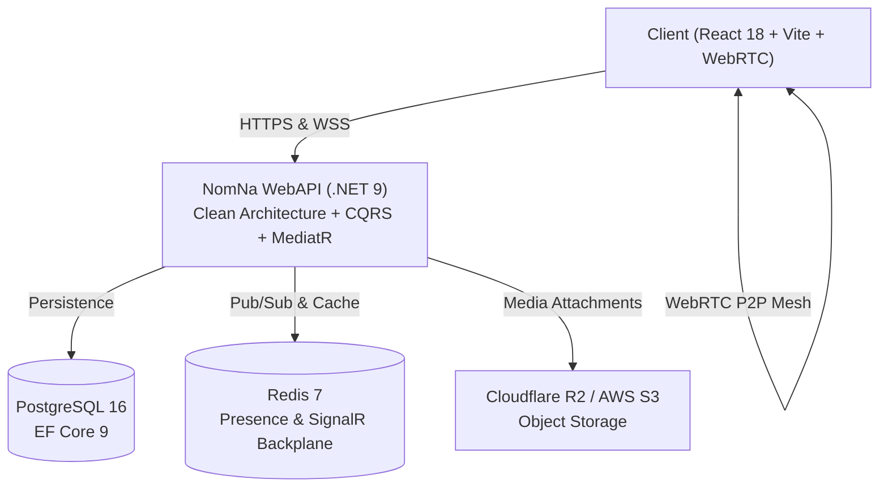

# ✉️ NomNa — Real-Time Chat & Voice Platform

<p align="center">
  
</p>

<p align="center">
  <strong>Nền tảng giao tiếp, nhắn tin và đàm thoại thời gian thực hiện đại.</strong><br />
  Xây dựng trên nền tảng <strong>.NET 9</strong> (Clean Architecture + CQRS) và <strong>React 18 + TypeScript</strong>, lấy cảm hứng từ Discord với trải nghiệm mượt mà, độ trễ thấp và thiết kế tinh gọn.
</p>

<p align="center">
  
  
  
  
  
  
  
</p>

---

## 🏗️ Kiến Trúc Hệ Thống



---

## ✨ Tính Năng Nổi Bật

- **💬 Nhắn tin thời gian thực (SignalR)**: Trò chuyện tức thì, chỉ báo đang gõ (Typing), thả cảm xúc (Reactions), trả lời tin nhắn (Reply), ghim tin nhắn và tìm kiếm.
- **🎙️ Tin nhắn thoại (Voice Note)**: Ghi âm trực tiếp, hiển thị biểu đồ sóng âm (Waveform), giải mã qua Web Audio API cho phép tua âm thanh mượt mà không lỗi.
- **🔊 Kênh thoại & Video đa người dùng (WebRTC Mesh)**:
  - Gọi nhóm không qua media server trung gian, độ trễ cực thấp.
  - Nhận diện giọng nói thời gian thực (VAD) với viền xanh phát sáng khi đang nói.
  - Chia sẻ màn hình & Camera với chế độ Spotlight linh hoạt, chuyển đổi luồng tức thì (`replaceTrack`).
  - Đường ống âm thanh độc lập (Web Audio Pipeline) cho phép kéo chỉnh âm lượng riêng của từng thành viên (0% – 200%).
  - Chế độ Toàn màn hình (Fullscreen) tự động ẩn thanh công cụ khi không tương tác.
  - Menu chuột phải thành viên hỗ trợ chuyển kênh, xem hồ sơ, tắt/bật tiếng nhanh.
- **📞 Cuộc gọi trực tiếp 1-1**: Đàm thoại âm thanh & video P2P riêng tư với chu trình đổ chuông, bắt máy và hủy gọi.
- **🛡️ Phân quyền Bitmask & Quản trị máy chủ**: Phân tầng Server $\to$ Danh mục $\to$ Kênh thoại/chat; phân quyền 64-bit theo Vai trò (Roles) với cơ chế thu hồi quyền tức thì.
- **🎨 Thiết kế Semantic Design System**: Giao diện tối giản, thanh lịch, chuẩn hóa semantic color tokens, đáp ứng tốt cả Desktop và Mobile.

---

## 📁 Cấu Trúc Dự Án

```
NomNaReal/
├── src/
│   ├── NomNa.Domain/          # Entities, Enums, Bitmask Permissions (0 dependency)
│   ├── NomNa.Application/     # Nghiệp vụ CQRS (MediatR), Behaviors, Validators
│   ├── NomNa.Infrastructure/  # EF Core, PostgreSQL, Redis, S3/R2 Storage, JWT
│   ├── NomNa.WebAPI/          # Controllers, ChatHub (Signaling/Voice), Middlewares
│   └── NomNa.Shared/          # DTOs, Contracts & Constants dùng chung
├── client/                    # React 18, TypeScript, Tailwind CSS, WebRTC Client
├── tests/                     # Unit Tests (.NET xUnit + FluentAssertions)
├── docs/                      # Tài liệu kỹ thuật chuyên sâu (WebRTC, Architecture, Benchmarks)
└── plans/                     # Kế hoạch phát triển & hướng dẫn deploy production
```

---

## 🚀 Khởi Chạy Nhanh (Local Development)

### Yêu Cầu
- [.NET 9 SDK](https://dotnet.microsoft.com/download/dotnet/9.0)
- [Node.js 20+](https://nodejs.org/)
- [Docker & Docker Compose](https://www.docker.com/)

### 1. Khởi động PostgreSQL & Redis
```bash
docker compose up -d
```

### 2. Khởi chạy Backend (.NET 9)
```bash
dotnet restore NomNa.sln
dotnet run --project src/NomNa.WebAPI/NomNa.WebAPI.csproj
```
> API & Swagger sẵn sàng tại: `http://localhost:5000`

### 3. Khởi chạy Frontend (React 18)
```bash
cd client
npm install
npm run dev
```
> Ứng dụng sẵn sàng tại: `http://localhost:5173`

---

## 🧪 Kiểm Thử Chất Lượng (Triple Gate)

Mọi thay đổi mã nguồn đều phải vượt qua 100% kiểm tra trước khi hợp nhất:

```bash
# Biên dịch Backend (.NET 9)
dotnet build NomNa.sln

# Biên dịch & Kiểm tra kiểu Frontend (TypeScript + Vite)
npm --prefix client run build

# Chạy toàn bộ Unit Tests
dotnet test NomNa.sln
```

---

## 📚 Tài Liệu Kỹ Thuật Tham Khảo

- [Kiến trúc WebRTC & Đàm thoại đa người dùng](docs/architecture/webrtc-multiuser-mesh-and-sfu-guide.md)
- [Cẩm nang triển khai Production 100% Miễn Phí](plans/production-free-deployment-guide.md)
- [Tổng quan kỹ thuật & Yêu cầu phi chức năng](docs/architecture/system-requirements-and-technical-overview.md)
