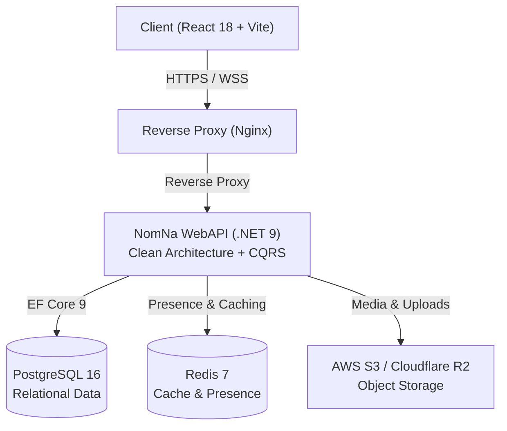

# 💬 NomNa — Real-Time Chat Platform

<p align="center">
  
</p>

<p align="center">
  <strong>Nền tảng giao tiếp & nhắn tin thời gian thực hiệu năng cao, xây dựng theo phong cách Discord.</strong><br />
  Được thiết kế trên nền tảng .NET 9 (Clean Architecture & CQRS) và React 18 (TypeScript & Vite), tập trung vào thiết kế hệ thống chuyên sâu, khả năng mở rộng chịu tải và chuẩn mực DevOps hiện đại.
</p>

<p align="center">
  
  
  
  
  
  
  
</p>

---

## 🎯 Tổng Quan Hệ Thống

NomNa là hệ thống chat thời gian thực quy mô máy chủ (Discord-style) với mô hình phân quyền đa cấp, luồng dữ liệu hai chiều độ trễ thấp và cấu trúc backend phân tầng chặt chẽ. Dự án đóng vai trò như một môi trường thực nghiệm chuyên sâu về **Backend Engineering**, **System Design** và **DevOps Automation**.



---

## ⚡ Điểm Nhấn Kỹ Thuật

- **Kiến trúc Clean Architecture & CQRS**: Phân tầng rành mạch (`Domain` → `Application` → `Infrastructure` → `WebAPI`). Nghiệp vụ tách biệt tuyệt đối theo nguyên tắc 3-file (Command, CommandHandler, CommandValidator) qua MediatR và FluentValidation.
- **Real-Time Engine (SignalR)**: Nhắn tin tức thì, trích dẫn phản hồi (Quote Reply), gõ phím (Typing Indicator), và theo dõi hiện diện (Presence tracking Online/Offline) với cơ chế Reconnection Catch-up.
- **Tối ưu Danh sách Tin nhắn**: Phân trang con trỏ hai chiều (Bi-directional Keyset Pagination) kết hợp ảo hóa giao diện (Message Virtualization), đảm bảo độ mượt khi xử lý hàng nghìn tin nhắn.
- **Hệ Thống Phân Quyền Bitmask (64-bit)**: Quản lý quyền theo vai trò (Roles) và ghi đè cấp kênh (Channel Overwrites), tích hợp cơ chế thu hồi quyền tức thì (Realtime Access Revocation) và hủy cache tự động.
- **Nhắn Tin Trực Tiếp Trì Hoãn (Deferred DM)**: Hội thoại cá nhân giữa hai người dùng chỉ được khởi tạo trong CSDL khi có tin nhắn đầu tiên, giảm thiểu rác dữ liệu.
- **Hạ Tầng Không Trạng Thái (Stateless Storage)**: Avatar và file đính kèm được lưu trữ trực tiếp trên AWS S3 / Cloudflare R2 qua Presigned URL.

---

## 📁 Cấu Trúc Mã Nguồn

```
NomNaReal/
├── src/
│   ├── NomNa.Domain/          # 0 Dependency: Entities, Enums (Permissions, Roles)
│   ├── NomNa.Application/     # Nghiệp vụ CQRS (MediatR), Behaviors, FluentValidation
│   ├── NomNa.Infrastructure/  # EF Core, PostgreSQL, Services (JWT, S3, Cache)
│   ├── NomNa.WebAPI/          # Thin Controllers, ChatHub, Middlewares, DI Setup
│   └── NomNa.Shared/          # Contracts, DTOs & Constants dùng chung
├── client/                    # React 18 SPA, Vite, Tailwind CSS, Atomic UI Primitives
├── tests/                     # Unit Tests (Domain, Application) & Test Suites
├── docs/                      # Tài liệu kỹ thuật chuyên sâu & System Design
└── scripts/                   # Script vận hành, sao lưu và kiểm tra mã nguồn
```

---

## 🚀 Khởi Chạy Nhanh (Local Development)

### Yêu Cầu Môi Trường
- [.NET 9 SDK](https://dotnet.microsoft.com/download/dotnet/9.0)
- [Node.js 20+](https://nodejs.org/)
- [Docker & Docker Compose](https://www.docker.com/)

### 1. Khởi động PostgreSQL & Redis
```bash
docker compose up -d
```

### 2. Cấu hình Biến Môi Trường
```bash
cp .env.example .env
```

### 3. Chạy Backend (.NET 9)
```bash
dotnet restore NomNa.sln
dotnet run --project src/NomNa.WebAPI/NomNa.WebAPI.csproj
```
> API sẵn sàng tại: `http://localhost:5000` (Swagger UI: `http://localhost:5000/swagger`)

### 4. Chạy Frontend (React 18)
```bash
cd client
npm install
npm run dev
```
> Giao diện sẵn sàng tại: `http://localhost:5173`

---

## 🧪 Kiểm Thử & Kiểm Soát Chất Lượng

Dự án áp dụng quy tắc **Triple Gate Verification** — mọi thay đổi đều phải vượt qua 100% kiểm tra trước khi tích hợp:

```bash
# 1. Kiểm tra biên dịch Backend
dotnet build NomNa.sln

# 2. Kiểm tra biên dịch & Type-check Frontend
cd client && npm run build && cd ..

# 3. Chạy toàn bộ Test Suites
dotnet test NomNa.sln
```

Tự động hóa qua GitHub Actions ([.github/workflows/ci.yml](.github/workflows/ci.yml)) chạy kiểm tra build, linting và unit tests trên mỗi Pull Request.

---

## 🗺️ Lộ Trình Nâng Cấp Hệ Thống (Engineering Roadmap)

| Giai Đoạn | Trọng Tâm | Tình Trạng |
|---|---|:---:|
| **Foundation** | Clean Architecture, CQRS, SignalR Hub, Bitmask RBAC, Virtualization | ✅ Hoàn thành |
| **Quality & Reliability** | Testcontainers (Postgres+Redis), Architecture Tests, Rate Limiting, Idempotency | 🚧 Đang triển khai |
| **Deep Backend & Scale** | Redis Backplane đa node, Transactional Outbox, Keyset & Partitioning, Full-Text Search | 📋 Lên kế hoạch |
| **DevOps & Observability** | OpenTelemetry, Prometheus + Grafana, Trivy security scan, Container packaging | 📋 Lên kế hoạch |
| **Performance Benchmarks** | Kịch bản k6 WebSocket C10K, đo lường P99 fanout latency, tài liệu ADR | 📋 Lên kế hoạch |

*Chi tiết kế hoạch kiến trúc và kịch bản chịu tải được lưu trữ tại [docs/deep-dive-infrastructure-and-performance-testing.md](docs/deep-dive-infrastructure-and-performance-testing.md).*
