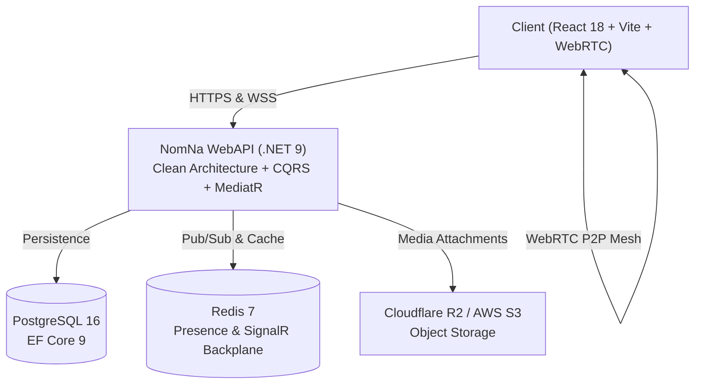

# ✉️ NomNa — Real-Time Chat & Voice Platform

<p align="center">
  
</p>

<p align="center">
  <strong>Nền tảng giao tiếp, nhắn tin và đàm thoại thời gian thực hiện đại.</strong><br />
  Xây dựng trên nền tảng <strong>.NET 9</strong> (Clean Architecture + CQRS) và <strong>React 18 + TypeScript</strong>, lấy cảm hứng từ Discord với trải nghiệm mượt mà, độ trễ thấp và thiết kế tinh gọn.
</p>

<p align="center">
  
  
  
  
  
  
  
</p>

---

## 🏗️ Kiến Trúc Hệ Thống



---

## ✨ Tính Năng Nổi Bật

### 1. 💬 Trải Nghiệm Nhắn Tin Đỉnh Cao (Real-Time Messaging)
- **Tương tác tức thì (SignalR WebSockets)**: Nhắn tin sub-50ms, hiển thị trạng thái gõ phím (*Typing Indicator*), đồng bộ tức thời đa thiết bị.
- **Biểu cảm & Đa phương tiện**: Thả cảm xúc (*Reactions*), bộ chọn Emoji & GIF Picker (Tenor/Giphy), đính kèm ảnh, video và tệp tin lên đến 100MB.
- **Soạn thảo thông minh**: Tự động hoàn thành `@mention`, khối mã tô màu cú pháp (*Syntax Highlighting CodeBlock*), tự động nhận diện và tạo thẻ xem trước liên kết (*Link OpenGraph Preview*).
- **Quản lý ngữ cảnh**: Trả lời trích dẫn (*Reply*), ghim tin nhắn quan trọng (*Sticky Pin Bar*), xem ảnh dạng Lightbox phóng to, tìm kiếm tin nhắn theo kênh.
- **Điều hướng mượt mà**: Thanh *Nhảy về hiện tại (Jump to Present)* khi đang cuộn xem lịch sử tin nhắn cũ.

### 2. 🎙️ Tin Nhắn Thoại Cao Cấp (Voice Note & Waveform)
- **Ghi âm trực tiếp**: Chuẩn nén nhẹ `audio/webm;codecs=opus` tối ưu băng thông.
- **Biểu đồ sóng âm (Waveform)**: Thuật toán trích xuất biên độ âm thanh trực quan theo thời gian thực trên bong bóng chat.
- **Giải mã Web Audio API độc quyền**: Khắc phục triệt để lỗi không tua được file WebM trên Chromium/WebKit bằng cách giải mã trực tiếp thành `AudioBuffer`, cho phép tua âm thanh mượt mà chính xác từng mili-giây.

### 3. 🔊 Kênh Thoại & Sân Khấu Video Nhóm (WebRTC P2P Mesh)
- **Đàm thoại độ trễ thấp (< 100ms)**: Kết nối trực tiếp giữa các trình duyệt không qua media server trung gian, tiết kiệm 100% chi phí máy chủ.
- **Nhận diện giọng nói (VAD)**: Tự động đo năng lượng sóng âm (RMS) ở 60 FPS để kích hoạt viền xanh phát sáng khi phát biểu.
- **Sân khấu trình chiếu (Spotlight & Grid)**: Hỗ trợ Chia sẻ màn hình & Camera; tráo luồng tức thì (`replaceTrack`) không cần đàm phán lại SDP.
- **Bộ điều âm độc lập (Per-Peer GainNode)**: Tùy chỉnh âm lượng riêng biệt cho từng người trong phòng (0% – 200%).
- **Toàn màn hình thông minh (Fullscreen)**: Tự động ẩn thanh công cụ sau 2.5 giây không tương tác để tối đa diện tích hiển thị video.
- **Menu chuột phải thành viên**: Chuyển kênh voice nhanh, xem hồ sơ cá nhân, tắt/bật mic và âm thanh tiện lợi.

### 4. 📞 Cuộc Gọi Trực Tiếp 1-1 (Direct Audio & Video Call)
- Đàm thoại âm thanh & video P2P riêng tư giữa 2 người bạn với đầy đủ chu trình đổ chuông, đếm ngược 35s, chấp nhận, từ chối hoặc hủy gọi.

### 5. 👥 Bạn Bè, DMs & Trạng Thái Hiện Diện (Presence Hub)
- **Trung tâm bạn bè**: Quản lý danh sách Online, Tất cả bạn bè, Yêu cầu kết bạn (Gửi/Nhận/Hủy) và Danh sách chặn.
- **Hiện diện thời gian thực (Redis Presence Lease)**: Theo dõi trạng thái Online, Vắng mặt (Idle), Đừng làm phiền (DND), Ẩn danh (Invisible) qua cơ chế nhịp tim (Heartbeat) và kịch bản Redis Lua.
- **Trạng thái tùy chỉnh (Custom Status)**: Đặt câu trạng thái kèm icon emoji cá nhân hiển thị trên thẻ hồ sơ.
- **Trung tâm thông báo (Notification Center)**: Nhận thông báo mời vào server, kết bạn, tag `@mention` kèm bộ đếm badge chưa đọc.

### 6. 🛡️ Quản Trị Máy Chủ & Phân Quyền Bitmask (Server Management & RBAC)
- **Cấu trúc không gian**: Máy chủ $\to$ Danh mục $\to$ Kênh văn bản & Kênh thoại (Kéo thả sắp xếp thứ tự).
- **Kênh riêng tư (Private Channels)**: Giới hạn quyền truy cập theo danh sách thành viên được chỉ định.
- **Liên kết lời mời**: Tạo mã mời tham gia Server có tùy chọn thời hạn và giới hạn lượt sử dụng.
- **Phân quyền nhị phân 64-bit (Bitmask RBAC)**: Tạo vai trò với màu sắc riêng, thiết lập quyền hạn chi tiết và thu hồi quyền tức thì (*Realtime Access Revocation*).

### 7. 🎨 Giao Diện Đa Chủ Đề & Tối Ưu Hiệu Năng
- **Multi-Theme Engine**: Chuyển đổi linh hoạt giữa giao diện Sáng (Light), Tối (Dark), và Midnight (OLED) dựa trên hệ thống Semantic Color Tokens.
- **Phân trang con trỏ hai chiều (Bi-directional Keyset Pagination)**: Đọc tin nhắn siêu nhanh, không bị chậm khi dữ liệu lớn như phương pháp OFFSET truyền thống.
- **Thiết kế thích ứng (Responsive)**: Tối ưu hoàn hảo cho cả máy tính để bàn, laptop và thiết bị di động.

---

## 📁 Cấu Trúc Dự Án

```
NomNaReal/
├── src/
│   ├── NomNa.Domain/          # Entities, Enums, Bitmask Permissions (0 dependency)
│   ├── NomNa.Application/     # Nghiệp vụ CQRS (MediatR), Behaviors, Validators
│   ├── NomNa.Infrastructure/  # EF Core, PostgreSQL, Redis, S3/R2 Storage, JWT
│   ├── NomNa.WebAPI/          # Controllers, ChatHub (Signaling/Voice), Middlewares
│   └── NomNa.Shared/          # DTOs, Contracts & Constants dùng chung
├── client/                    # React 18, TypeScript, Tailwind CSS, WebRTC Client
├── tests/                     # Unit Tests (.NET xUnit + FluentAssertions)
├── docs/                      # Tài liệu kỹ thuật chuyên sâu (WebRTC, Architecture, Benchmarks)
└── plans/                     # Kế hoạch phát triển & hướng dẫn deploy production
```

---

## 🚀 Khởi Chạy Nhanh (Local Development)

### Yêu Cầu
- [.NET 9 SDK](https://dotnet.microsoft.com/download/dotnet/9.0)
- [Node.js 20+](https://nodejs.org/)
- [Docker & Docker Compose](https://www.docker.com/)

### 1. Khởi động PostgreSQL & Redis
```bash
docker compose up -d
```

### 2. Khởi chạy Backend (.NET 9)
```bash
dotnet restore NomNa.sln
dotnet run --project src/NomNa.WebAPI/NomNa.WebAPI.csproj
```
> API & Swagger sẵn sàng tại: `http://localhost:5000`

### 3. Khởi chạy Frontend (React 18)
```bash
cd client
npm install
npm run dev
```
> Ứng dụng sẵn sàng tại: `http://localhost:5173`

---

## 🧪 Kiểm Thử Chất Lượng (Triple Gate)

Mọi thay đổi mã nguồn đều phải vượt qua 100% kiểm tra trước khi hợp nhất:

```bash
# Biên dịch Backend (.NET 9)
dotnet build NomNa.sln

# Biên dịch & Kiểm tra kiểu Frontend (TypeScript + Vite)
npm --prefix client run build

# Chạy toàn bộ Unit Tests
dotnet test NomNa.sln
```

---

## 📚 Tài Liệu Kỹ Thuật Tham Khảo

- [Kiến trúc WebRTC & Đàm thoại đa người dùng](docs/architecture/webrtc-multiuser-mesh-and-sfu-guide.md)
- [Cẩm nang triển khai Production 100% Miễn Phí](plans/production-free-deployment-guide.md)
- [Tổng quan kỹ thuật & Yêu cầu phi chức năng](docs/architecture/system-requirements-and-technical-overview.md)


---

## 📚 Tài Liệu Kỹ Thuật Tham Khảo

- [Kiến trúc WebRTC & Đàm thoại đa người dùng](docs/architecture/webrtc-multiuser-mesh-and-sfu-guide.md)
- [Cẩm nang triển khai Production 100% Miễn Phí](plans/production-free-deployment-guide.md)
- [Tổng quan kỹ thuật & Yêu cầu phi chức năng](docs/architecture/system-requirements-and-technical-overview.md)