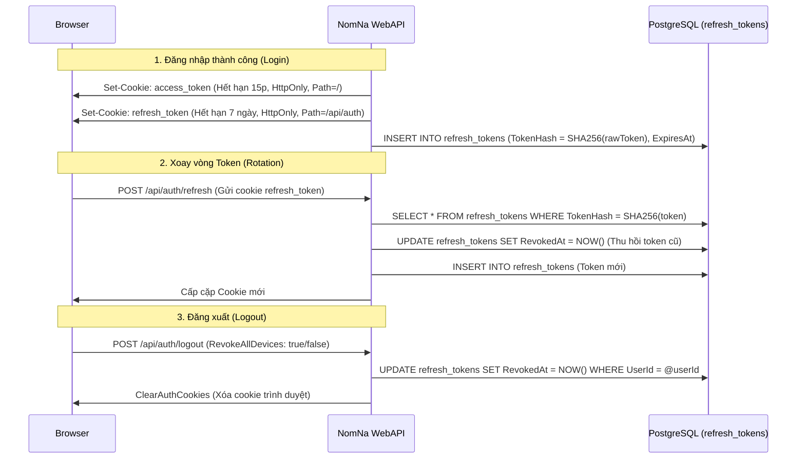

# 🔐 Chuyên Đề 01: Vòng Đời Xác Thực, Bảo Vệ Phiên & Chống Quét Bảng (Auth & Session Lifecycle)

> **Mục tiêu:** Hiểu rõ tại sao đăng nhập trong NomNa lại nhanh, cách bảo vệ mật khẩu, cơ chế lưu trữ token an toàn và quy trình hủy phiên làm việc từ xa.

---

## 💡 1. Tư Tưởng Cốt Lõi (The Mental Model)

Trong ứng dụng chat thời gian thực, lưu lượng truy cập xác thực (`/api/auth/*`) có 3 đặc thù sống còn:
1. **Người dùng có thể đăng nhập bằng Email HOẶC Username** (ví dụ: `alex@nomna.chat` hoặc `alex_dev`).
2. **Hàm băm mật khẩu PBKDF2 là tác vụ cực kỳ nặng về CPU** (mất ~20-30ms cho 1 phép băm). Nếu bị spam hoặc query DB chậm, toàn bộ tiến trình .NET (kể cả luồng WebSocket chat) sẽ bị nghẽn (ThreadPool Starvation).
3. **Token không được lưu ở `localStorage` của trình duyệt** để chống hoàn toàn tấn công XSS (Cross-Site Scripting). Thay vào đó, dùng `HttpOnly Cookie`.

---

## ⚡ 2. Vấn Đề Thực Tế & Cách Giải Quyết

### 💣 Cạm bẫy cũ: Sequential Scan khi đăng nhập
* **Trước đây:** Viết LINQ `u.Email == input || u.UserName == input`.
* **Bản chất vật lý:** Trong ASP.NET Core Identity, bảng `users` **chỉ tạo Index B-Tree trên 2 cột viết hoa**: `NormalizedEmail` và `NormalizedUserName`. Cột `Email` và `UserName` gốc **không hề có Index**.
* Khi có 100,000 người dùng, câu lệnh trên buộc PostgreSQL phải **quét tuần tự từng dòng trên đĩa (`Seq Scan`)**!
* **Cách khắc phục:** Chuyển đổi input người dùng sang chữ hoa (`input.ToUpperInvariant()`) và so sánh trên 2 cột có sẵn Index:

```csharp
// 🎯 Code then chốt: Tra cứu 1 dòng siêu tốc O(log N) bằng B-Tree Index
var input = request.EmailOrUsername.Trim();
var normalized = input.ToUpperInvariant();

var user = await _userManager.Users
    .FirstOrDefaultAsync(u => u.NormalizedEmail == normalized || u.NormalizedUserName == normalized, cancellationToken);
```

---

## 🔄 3. Vòng Đời Quản Lý Phiên (Tokens & Cookies)



### Điểm mấu chốt khi Logout và Đổi Mật Khẩu:
1. **Logout không chỉ xóa Cookie:** Trước đây Logout chỉ xóa cookie ở client, token cũ trong DB vẫn "sống" nếu kẻ xấu đã kịp copy trước đó. Bây giờ `LogoutCommandHandler` tìm hash của token trong DB và đánh dấu `RevokedAt = DateTime.UtcNow`.
2. **Đăng xuất khỏi mọi thiết bị (`RevokeAllDevices = true`):** Khi người dùng nghi ngờ lộ tài khoản, gọi cờ này sẽ đánh dấu thu hồi **toàn bộ các refresh token đang sống** của tài khoản đó.
3. **Đổi mật khẩu (`ChangePasswordCommand`):** Sau khi `UserManager.ChangePasswordAsync` thành công, hệ thống tự động quét và thu hồi toàn bộ refresh token cũ của user, ép tất cả thiết bị khác phải đăng nhập lại bằng mật khẩu mới.

---

## 🛡️ 4. Tóm Tắt Luật Bất Thành Văn
* **Luôn tra cứu bằng `NormalizedEmail`/`NormalizedUserName`**.
* **Chỉ gọi `ResetAccessFailedCountAsync` khi `AccessFailedCount > 0`** (tiết kiệm 1 lệnh UPDATE DB ở mỗi lần đăng nhập thành công).
* **Fail-Fast JWT Secret trên Production**: Nếu `environment.IsProduction()` mà `Jwt:Secret` thiếu hoặc dùng chuỗi mặc định, server sẽ tự dừng ngay khi khởi động để bảo vệ an toàn dữ liệu.
