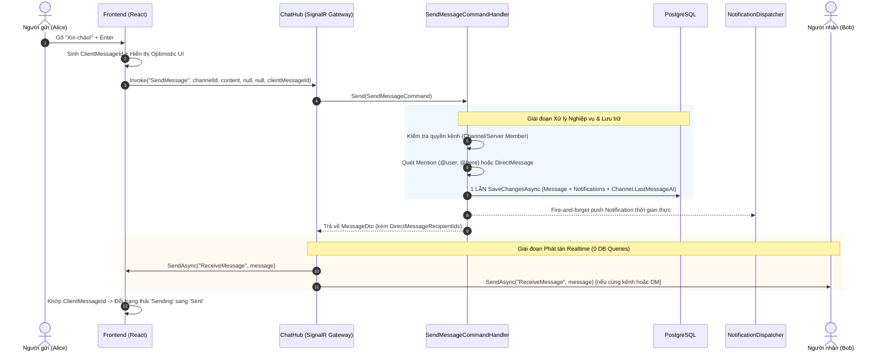

# 💬 Chuyên Đề 03: Đường Đi Của Tin Nhắn & Giải Phóng Điểm Nghẽn Ghi (Messaging Hot-Path)

> **Mục tiêu:** Nắm vững toàn bộ hành trình của tin nhắn từ lúc ấn Enter đến khi hiển thị trên màn hình người nhận, hiểu tại sao giảm DB Round-Trip tại Hub và gom `SaveChangesAsync` lại quyết định sự sống còn của hệ thống chat.

---

## 💡 1. Tư Tưởng Cốt Lõi (The Mental Model)

Đường gửi tin nhắn (`SendMessage`) là **Hot-Path** — đường bay có tần suất gọi cao nhất và khắt khe nhất về độ trễ (Latency Target: < 50ms).
Nếu kiến trúc bất cẩn để xảy ra:
1. **Double SaveChanges:** Lưu Message xong rồi mới tạo Notification và lưu tiếp lần 2 $\to$ Tốn 2 network round-trip tới PostgreSQL (lãng phí ~5-15ms và giữ DB connection lâu gấp đôi).
2. **Hub Query Database:** Sau khi Command chạy xong, ngoài Hub lại mở `IServiceScope` để query xem "Channel này là DM hay Server, gồm những ai" để bắn SignalR $\to$ Tốn thêm 1-2 câu SQL không cần thiết trên mỗi tin nhắn!

### Giải pháp tối ưu của NomNa:
* **Gom 1 giao dịch nguyên tử (Single Atomic Save):** Lưu tin nhắn, cập nhật `channel.LastMessageAt`, và lưu toàn bộ `Notification` trong **1 lần `SaveChangesAsync()` duy nhất**.
* **Zero DB Query tại Hub Layer:** Handler tính toán sẵn danh sách người nhận DM và gắn vào `MessageDto.DirectMessageRecipientIds`. Hub chỉ việc lấy ra và gọi `Clients.Users(...)` mà **tốn 0 round-trip Database**.
* **Khử trùng lặp (Idempotency) với `ClientMessageId`:** Cho phép Frontend sinh UUID tạm thời để render Optimistic UI ngay lập tức, sau đó khớp chính xác với tin nhắn thật từ Server trả về mà không bị nhân đôi tin nhắn (bubble duplicate).

---

## 🚀 2. Sơ Đồ Hành Trình Tin Nhắn (End-to-End Pipeline)



---

## ⚡ 3. Các Đoạn Code Then Chốt (Key Snippets)

### A. Gom Lưu Dữ Liệu Nguyên Tử trong `SendMessageCommandHandler.cs`
Thay vì gọi `SaveChangesAsync()` phân mảnh nhiều nơi:
```csharp
// 🎯 Gom Message, cập nhật Channel metadata và Notifications vào 1 Transaction
_context.Messages.Add(message);

channel.LastMessageAt = DateTime.UtcNow;
channel.LastMessageSenderId = userId.Value;
channel.LastMessageContent = snippet;

foreach (var notif in createdNotifications)
{
    _context.Notifications.Add(notif);
}

// DUY NHẤT 1 LẦN GỌI DATABASE CHO TOÀN BỘ NGHIỆP VỤ
await _context.SaveChangesAsync(cancellationToken);
```

### B. Giải Phóng Hub Khỏi Database trong `ChatHub.Messages.cs`
Trước đây ChatHub phải tự query DB để biết ai là người nhận DM. Nay thông tin đã được đóng gói sẵn trong DTO:
```csharp
// 🎯 1. Phát tán cho toàn bộ người đang xem Channel (Server Channel hoặc DM Channel)
var groupName = channelId.ToString();
await Clients.Group(groupName).SendAsync(SignalRConstants.Events.ReceiveMessage, message);

// 🎯 2. Nếu là Direct Message: Đẩy thẳng vào Connection cá nhân của người nhận (0 DB Round-trip)
if (message.DirectMessageRecipientIds != null && message.DirectMessageRecipientIds.Count > 0)
{
    var recipientStrings = message.DirectMessageRecipientIds.Select(id => id.ToString()).ToList();
    await Clients.Users(recipientStrings).SendAsync(SignalRConstants.Events.ReceiveMessage, message);
}
```

---

## 🛡️ 4. Tóm Tắt Luật Bất Thành Văn Khi Mở Rộng
1. **Không bao giờ mở `_context` trong SignalR Hub:** Mọi logic đọc/ghi dữ liệu bắt buộc phải đi qua MediatR Handler. Hub chỉ có 1 nhiệm vụ duy nhất: **Nhận lệnh và Phát tán (Route & Broadcast)**.
2. **Idempotency với `ClientMessageId`:** Bất kỳ thao tác gửi tin nhắn nào cũng nên kèm `ClientMessageId` để phía client dễ dàng quản lý state local mà không bị phụ thuộc vào độ trễ mạng.
3. **Async Fire-and-Forget cho Notifications:** Realtime SignalR notification được đẩy qua background task (`_ = _notificationDispatcher.DispatchAsync(...)`), không làm block thời gian phản hồi của lệnh gửi tin.

