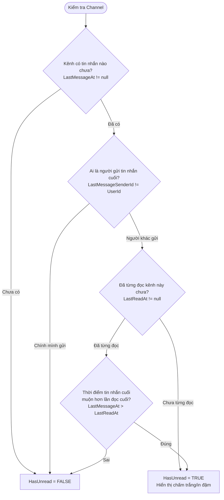
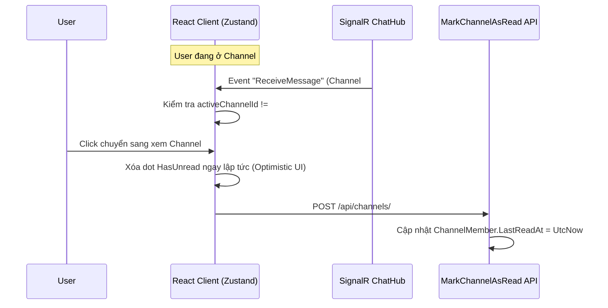

# 📬 Chuyên Đề 04: Mô Hình Tính Toán Kênh Chưa Đọc & Đồng Bộ Thời Gian Thực (Channel Unread & Sync)

> **Mục tiêu:** Hiểu rõ tại sao NomNa không dùng bảng liên kết n-n lưu từng tin nhắn chưa đọc (tránh bùng nổ hàng triệu dòng dữ liệu), mà áp dụng mô hình "Watermark Timestamp" để tính toán trạng thái chưa đọc (`HasUnread`) siêu nhẹ và chính xác.

---

## 💡 1. Tư Tưởng Cốt Lõi (The Mental Model)

Khi làm tính năng "Tin nhắn chưa đọc" (Unread Indicator):
* **Sai lầm kinh điển:** Tạo bảng `UserUnreadMessages(UserId, MessageId)`.  
  *Giả sử một server có 10,000 thành viên, mỗi tin nhắn gửi vào kênh chung sẽ tạo ra **10,000 dòng INSERT vào Database**! Hệ thống sẽ chết ngay lập tức vì nghẽn IO.*
* **Mô hình Con Dấu Thời Gian (Watermark Pattern) của NomNa:**  
  Mỗi người dùng trong một kênh chỉ cần ghi nhớ **DUY NHẤT 1 CON SỐ**: Thời điểm họ đọc kênh lần cuối (`ChannelMember.LastReadAt`).  
  Kênh chỉ cần ghi nhớ **DUY NHẤT 2 CON SỐ**: Thời điểm tin nhắn cuối cùng (`Channel.LastMessageAt`) và Ai là người gửi (`Channel.LastMessageSenderId`).

---

## 🧮 2. Công Thức Tính Toán Trạng Thái Chưa Đọc (`HasUnread`)

Trạng thái một kênh có tin nhắn chưa đọc đối với User $U$ được xác định theo công thức Boolean 3 điều kiện:

$$\text{HasUnread} = (\text{LastMessageAt} \ne \text{null}) \land (\text{LastMessageSenderId} \ne U) \land (\text{LastReadAt} == \text{null} \lor \text{LastMessageAt} > \text{LastReadAt})$$



### 🎯 3 Ý nghĩa thực tế:
1. **Chính mình gửi tin nhắn thì không bao giờ tính là chưa đọc:** Khi bạn gõ vào kênh, `c.LastMessageSenderId == userId`, do đó kênh của bạn sẽ không bao giờ tự nhảy chấm thông báo chưa đọc.
2. **Kênh mới chưa từng bấm vào:** `lastReadAt == null` $\implies$ Tự động tính là chưa đọc nếu đã có tin nhắn từ người khác.
3. **Batch Query 1 lần cho toàn bộ Server:** Khi tải danh sách kênh của một Server, hệ thống chỉ query DB đúng 1 lần duy nhất để lấy toàn bộ `LastReadAt` của user qua `ChannelMembers`, sau đó ráp vào danh sách kênh trong bộ nhớ RAM (độ phức tạp $O(K)$ với $K$ là số lượng kênh).

---

## ⚡ 3. Đoạn Code Then Chốt Trong [`GetChannelsQueryHandler.cs`](../../src/NomNa.Application/Features/Channels/Queries/GetChannels/GetChannelsQueryHandler.cs)

```csharp
// 🎯 1. Lấy tất cả mốc đọc (Read Markers) của user cho danh sách kênh chỉ bằng 1 câu SELECT
var readMarkers = await _context.ChannelMembers
    .AsNoTracking()
    .Where(cm => cm.UserId == userId.Value && channelIds.Contains(cm.ChannelId))
    .Select(cm => new { cm.ChannelId, cm.LastReadAt })
    .ToDictionaryAsync(cm => cm.ChannelId, cm => cm.LastReadAt, cancellationToken);

// 🎯 2. Tính toán HasUnread trên RAM
foreach (var c in channels)
{
    var lastReadAt = readMarkers.GetValueOrDefault(c.Id);

    var hasUnread = c.LastMessageAt.HasValue
        && c.LastMessageSenderId != userId.Value
        && (!lastReadAt.HasValue || c.LastMessageAt.Value > lastReadAt.Value);

    result.Add(new ChannelDto(..., hasUnread, ...));
}
```

---

## 🔄 4. Vòng Lặp Đồng Bộ Phía Client (Frontend Coordination)



### Điểm mấu chốt:
* **Trải nghiệm tức thời (Optimistic Update):** Khi người dùng nhấp vào kênh, Frontend xóa ngay chấm chưa đọc trong state Zustand, không cần đợi HTTP response của lệnh `MarkChannelAsRead`.
* **Tiết kiệm tài nguyên:** Kênh Public không cần ép tạo bản ghi `ChannelMember` giả lập cho mọi user. Thay vào đó, phía Client theo dõi thời gian thực qua SignalR và đồng bộ khi user tương tác trực tiếp.
