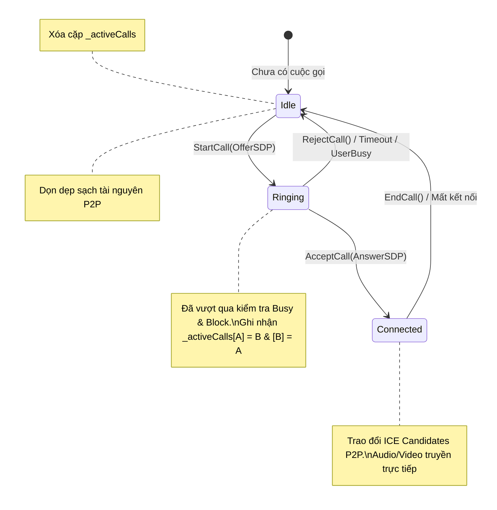
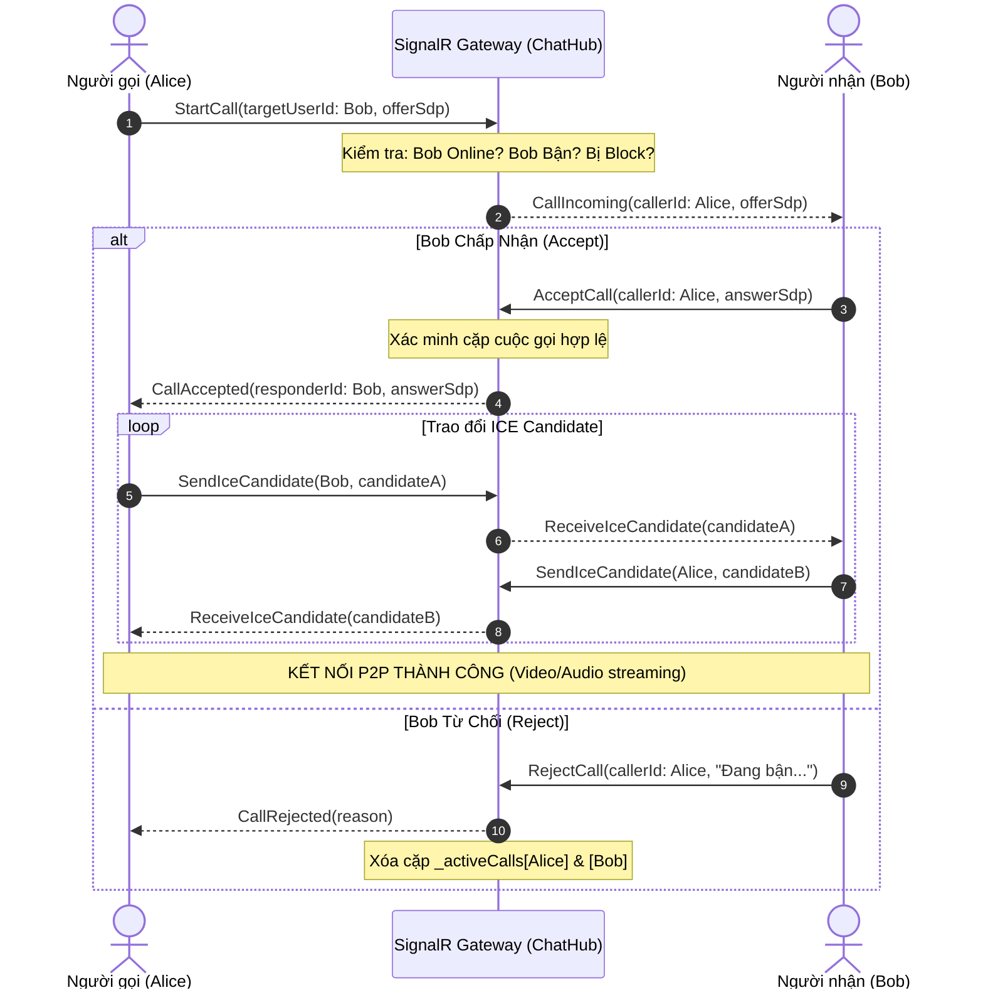

# 📞 Chuyên Đề 05: Cỗ Máy Trạng Thái Cuộc Gọi 1-1 WebRTC & Lớp Bảo Vệ An Ninh (Call Signaling)

> **Mục tiêu:** Hiểu rõ cách SignalR đóng vai trò làm kênh truyền tin hiệu (Signaling) để thiết lập kết nối WebRTC P2P (Peer-to-Peer), cỗ máy trạng thái cuộc gọi, và 3 lớp phòng vệ chống giả mạo hay quấy rối.

---

## 💡 1. Tư Tưởng Cốt Lõi (The Mental Model)

WebRTC cho phép 2 trình duyệt truyền trực tiếp âm thanh/hình ảnh (Audio/Video Streams) tới nhau mà **không cần đi qua máy chủ NomNa** (tiết kiệm 99% băng thông server).
Tuy nhiên, hai thiết bị nằm sau mạng NAT/Firewall không thể tự nhiên "nhìn thấy" nhau. Chúng cần một người trung gian để trao đổi danh thiếp:
* **SDP (Session Description Protocol):** Mô tả định dạng video/audio, độ phân giải, codec... (Bao gồm `Offer` từ người gọi và `Answer` từ người nghe).
* **ICE Candidates:** Danh sách các địa chỉ IP và Port khả dụng mà thiết bị thu thập được qua STUN/TURN server để tìm đường đi ngắn nhất giữa 2 máy.

> **Vai trò của ChatHub:** Là "người chuyển phát nhanh". SignalR chỉ chuyển tiếp (Relay) SDP và ICE Candidate trong vài giây đầu tiên, sau đó cuộc gọi chạy trực tiếp giữa 2 trình duyệt (P2P).

---

## 🔄 2. Cỗ Máy Trạng Thái Cuộc Gọi (Call State Machine)



---

## 🛡️ 3. 3 Lớp Bảo Vệ An Ninh Cốt Lõi

Trước khi cho phép cuộc gọi rung chuông phía người nhận, [`ChatHub.CallSignaling.cs`](../../src/NomNa.WebAPI/Hubs/ChatHub.CallSignaling.cs) thực thi 3 lớp kiểm tra nghiêm ngặt:

### Lớp 1: Chống Gọi Khi Đang Bận (`Busy Guard`)
* **Kiểm tra Caller:** Nếu người gọi đã có cuộc gọi đang dở dang $\to$ Báo lỗi `You are already in an active call`.
* **Kiểm tra Callee:** Nếu người nhận đang nghe máy của người khác $\to$ Gửi sự kiện `UserBusy` và `CallRejected` ngay lập tức, không làm gián đoạn cuộc gọi của người nhận.

### Lớp 2: Kiểm Tra Quan Hệ Bạn Bè / Chặn (`Blocked Guard`)
* Tra cứu bảng `Friendships` trong Database.
* Nếu $A$ đã Block $B$, hoặc $B$ đã Block $A$ (`FriendshipStatus.Blocked`) $\to$ Hủy cuộc gọi ngay tại server, trả về `CallRejected`. Kẻ quấy rối hoàn toàn không thể làm rung chuông nạn nhân.

### Lớp 3: Chống Chiếm Đoạt Phiên & Giả Mạo ICE (`Pairing Verification`)
* Trong bộ nhớ RAM của Server duy trì `ConcurrentDictionary<Guid, Guid> _activeCalls`.
* Mọi thao tác `AcceptCall`, `EndCall`, `SendIceCandidate` **đều phải đối chiếu tính đối xứng**:
  $$\_activeCalls[\text{senderId}] == \text{targetUserId}$$
* Nếu kẻ xấu cố tình gọi `SendIceCandidate` tới một người bất kỳ mà không có lời mời gọi hợp lệ từ trước, server lập tức drop packet và ghi log cảnh báo:

```csharp
// 🎯 Code then chốt: Chống giả mạo gói tin ICE Candidate
if (!_activeCalls.TryGetValue(senderId, out var partnerId) || partnerId != targetUserId)
{
    _logger.LogWarning("Rejected ICE candidate from {SenderId} to {TargetUserId}: not an active call pair", senderId, targetUserId);
    return;
}
```

---

## 📡 4. Sơ Đồ Bắt Tay Tín Hiệu (Signaling Sequence)



---

## 📌 5. Tóm Tắt Luật Bất Thành Văn
1. **Server không giữ luồng Video/Audio:** Mọi dữ liệu media chỉ trao đổi trực tiếp giữa 2 trình duyệt (P2P Mesh). Server SignalR chỉ là trạm trung chuyển SDP và ICE.
2. **Dọn dẹp cặp cuộc gọi đối xứng (`RemoveCallPair`):** Khi một bên ngắt máy hoặc từ chối, server bắt buộc phải xóa cả 2 chiều trong `_activeCalls` để cả 2 người dùng có thể thực hiện cuộc gọi mới.
3. **Presence gắn với Redis:** Kiểm tra `IsUserOnlineAsync(targetUserId)` dựa trên Redis ZSET Lease trước khi phát tín hiệu gọi, tránh gửi tín hiệu ảo cho người dùng đã tắt ứng dụng.
