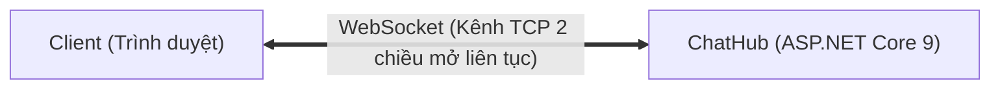
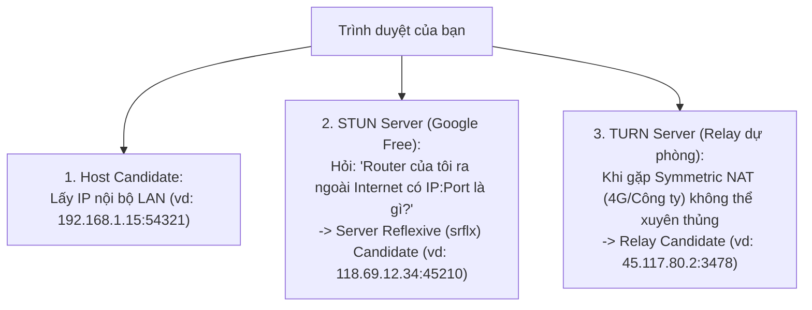
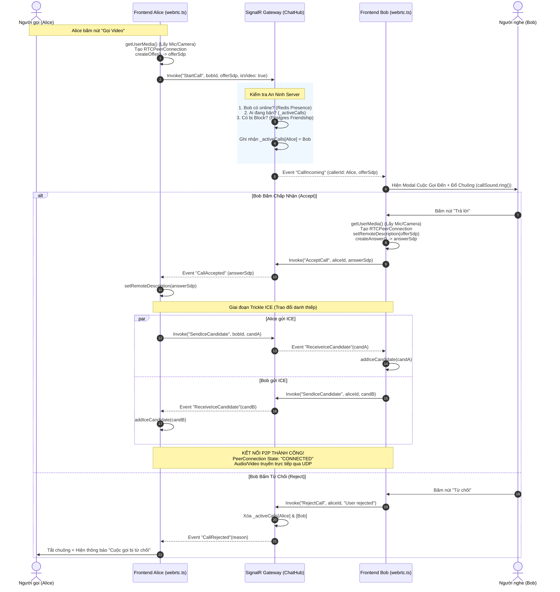
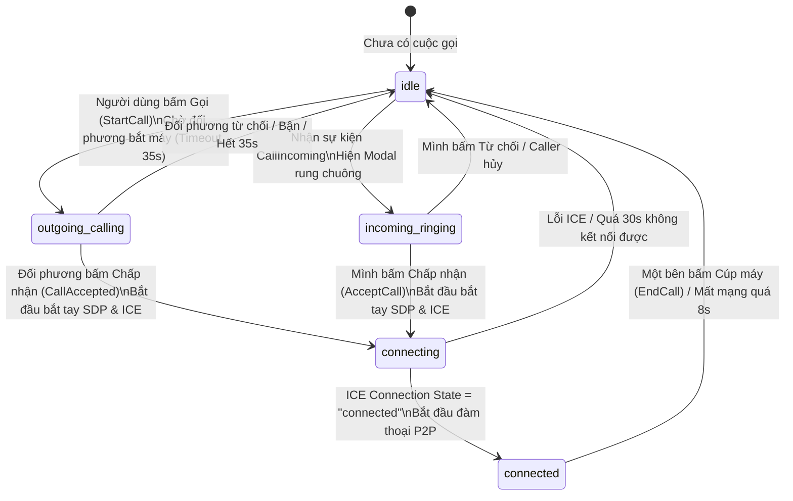

# 📡 Cẩm Nang Nghiên Cứu & Ôn Tập Toàn Diện: SignalR ChatHub & WebRTC P2P (The Master Handbook)

> **Mục đích tài liệu:**  
> Đóng vai trò là cẩm nang nghiên cứu và ôn tập kiến trúc toàn diện nhất của NomNa về **Tầng Giao Tiếp Thời Gian Thực (Realtime Gateway - SignalR ChatHub)** và **Hạ Tầng Cuộc Gọi P2P (WebRTC Audio/Video Streaming)**.  
> Tài liệu giải thích bản chất vật lý, cơ chế hoạt động, các khái niệm kỹ thuật cốt lõi, và luồng dữ liệu (End-to-End Workflow) xuyên suốt từ Frontend React đến Backend .NET 9.

---

## 🗺️ MỤC LỤC
1. [Phần 1: Bản Chất & Kiến Trúc Của SignalR ChatHub](#-phần-1-bản-chất--kiến-trúc-của-signalr-chathub)
   - [1.1. SignalR là gì và tại sao lại dùng WebSocket?](#11-signalr-là-gì-và-tại-sao-lại-dùng-websocket)
   - [1.2. Vòng đời của một Hub Instance (Transient Lifecycle)](#12-vòng-đời-của-một-hub-instance-transient-lifecycle)
   - [1.3. Cấu trúc 4 Phân Mảnh Partial Class của ChatHub](#13-cấu-trúc-4-phân-mảnh-partial-class-của-chathub)
   - [1.4. Mở rộng đa máy chủ với Redis Backplane](#14-mở-rộng-đa-máy-chủ-với-redis-backplane)
2. [Phần 2: Bản Chất & Khái Niệm Cốt Lõi Của WebRTC](#-phần-2-bản-chất--khái-niệm-cốt-lõi-của-webrtc)
   - [2.1. Tại sao cần WebRTC? (P2P vs Client-Server)](#21-tại-sao-cần-webrtc-p2p-vs-client-server)
   - [2.2. Khái niệm cốt lõi: SDP (Session Description Protocol)](#22-khái-niệm-cốt-lõi-sdp-session-description-protocol)
   - [2.3. Vấn đề Tường Lửa & NAT (Tại sao 2 máy không tự kết nối được?)](#23-vấn-đề-tường-lửa--nat-tại-sao-2-máy-không-tự-kết-nối-được)
   - [2.4. STUN, TURN và Các Loại ICE Candidates](#24-stun-turn-và-các-loại-ice-candidates)
3. [Phần 3: Mối Quan Hệ Giữa ChatHub và WebRTC](#-phần-3-mối-quan-hệ-giữa-chathub-và-webrtc)
   - [3.1. Ranh giới tuyệt đối: ChatHub chỉ là "Người Bưu Tá" (Signaling Channel)](#31-ranh-giới-tuyệt-đối-chathub-chỉ-là-người-bưu-tá-signaling-channel)
   - [3.2. 3 Lớp Khiên Bảo Vệ An Ninh Khi Bắt Tay Cuộc Gọi](#32-3-lớp-khiên-bảo-vệ-an-ninh-khi-bắt-tay-cuộc-gọi)
4. [Phần 4: Luồng Hoạt Động Chi Tiết (End-to-End Signaling & Media Workflow)](#-phần-4-luồng-hoạt-động-chi-tiết-end-to-end-signaling--media-workflow)
   - [4.1. Sơ đồ tuần tự bắt tay cuộc gọi](#41-sơ-đồ-tuần-tự-bắt-tay-cuộc-gọi)
   - [4.2. Cỗ máy trạng thái (Call State Machine)](#42-cỗ-máy-trạng-thái-call-state-machine)
5. [Phần 5: Bảng Tra Cứu Sự Kiện & File Triển Khai Thực Tế](#-phần-5-bảng-tra-cứu-sự-kiện--file-triển-khai-thực-tế)

---

# 🚀 PHẦN 1: BẢN CHẤT & KIẾN TRÚC CỦA SIGNALR CHATHUB

## 1.1. SignalR là gì và tại sao lại dùng WebSocket?

Trong lập trình web truyền thống (HTTP REST), Client luôn là bên chủ động gửi yêu cầu (Request), Server xử lý và trả về (Response) rồi ngắt kết nối. Server **không thể tự ý gửi dữ liệu về Client** khi có sự kiện mới.

**SignalR** là thư viện thời gian thực của ASP.NET Core, hoạt động dựa trên cơ chế kết nối 2 chiều liên tục (Full-Duplex):
* **Giao thức ưu tiên số 1: WebSocket.** Mở 1 kênh socket TCP duy nhất giữa Trình duyệt và Server. Cả hai bên có thể "bắn" tin nhắn qua lại với độ trễ cực thấp (< 5ms) mà không tốn overhead đóng/mở HTTP headers.
* **Cơ chế Fallback thông minh:** Nếu mạng hoặc firewall của người dùng chặn WebSocket, SignalR tự động lùi về Server-Sent Events (SSE) hoặc Long Polling để đảm bảo kết nối không bao giờ đứt.



---

## 1.2. Vòng đời của một Hub Instance (Transient Lifecycle)

> ⚠️ **BẪY KIẾN TRÚC SỐ 1:** Nhiều lập trình viên lầm tưởng một `ChatHub` là một đối tượng Singleton (sống mãi mãi trong suốt thời gian kết nối). **HOÀN TOÀN SAI!**

* Trong ASP.NET Core, **mỗi khi có một lệnh RPC từ Client gửi lên (ví dụ: `SendMessage`, `JoinChannel`), Server sẽ tạo mới một instance `ChatHub`**, chạy hàm đó xong là **hủy (Dispose) ngay lập tức**!
* **Dữ liệu bền vững nằm ở đâu?**
  1. `Context.UserIdentifier`: ID người dùng (lấy từ JWT Token claim `sub`).
  2. `Context.ConnectionId`: Mã socket duy nhất của từng tab trình duyệt.
  3. `Context.Items`: Bộ nhớ tạm đi theo kết nối socket cụ thể.
  4. Các biến tĩnh (`static readonly ConcurrentDictionary`) hoặc Services được đăng ký Singleton trong DI (`IUserPresenceTracker`, `IConnectionMultiplexer`).

---

## 1.3. Cấu trúc 4 Phân Mảnh Partial Class của ChatHub

Để chống lại hiện tượng "God Class" (một file phình to hàng nghìn dòng), `ChatHub` của NomNa được module hóa thành 4 partial class độc lập tại `src/NomNa.WebAPI/Hubs/`:

```text
src/NomNa.WebAPI/Hubs/
├── ChatHub.cs                # Quản lý vòng đời kết nối, Presence Scoping & Redis Backplane
├── ChatHub.Channels.cs       # Đăng ký nhóm kênh, phân quyền xem và gõ phím (Typing)
├── ChatHub.Messages.cs       # Gửi, sửa, xóa tin nhắn và cảm xúc (Reactions)
└── ChatHub.CallSignaling.cs  # Báo hiệu cuộc gọi WebRTC 1-1, kiểm tra bận và chặn (Blocked)
```

### 1. [`ChatHub.cs`](file:///home/vanmuzic/Projects/NomNaReal/src/NomNa.WebAPI/Hubs/ChatHub.cs) — Vòng Đời Kết Nối & Hiện Diện
* `OnConnectedAsync()`:
  - Khi client kết nối, tự động đăng ký connection vào các nhóm Server SignalR: `server_{serverId}`.
  - Gọi `_presenceTracker.UserConnectedAsync(userId, connectionId)`: Cập nhật Redis ZSET Lease.
  - **Presence Scoping (Chống bão $O(N^2)$):** Thay vì gọi `Clients.All`, hệ thống chỉ phát thông báo `UserStatusChanged` cho **Các Server chung** (`Clients.Groups`) và **Bạn bè trực tiếp** (`Clients.Users`).
  - **Tôn trọng Ẩn danh (Invisible Mode):** Nếu user cài đặt `UserStatusPreference.Invisible`, server tuyệt đối không phát thông báo online.
* `OnDisconnectedAsync()`:
  - Tự động ngắt cuộc gọi dở dang (bắn `CallEnded` cho đối phương).
  - Thu hồi lease trong Redis. Nếu không còn tab nào mở $\to$ phát `UserStatusChanged: offline` cho bạn bè/server chung.
* `PingPresence()`: Client gửi heartbeat mỗi 25 giây để gia hạn lease 60s trong Redis.
* `SetStatusPreference(preference)`: Cho phép user đổi trạng thái (`Online`, `Idle`, `DoNotDisturb`, `Invisible`) tức thì.

### 2. [`ChatHub.Channels.cs`](file:///home/vanmuzic/Projects/NomNaReal/src/NomNa.WebAPI/Hubs/ChatHub.Channels.cs) — Quản Lý Kênh & Sự Kiện Tức Thời
* `JoinChannel(channelId)` & `LeaveChannel(channelId)`:
  - Kiểm tra quyền `Permissions.ViewChannel` thông qua `IPermissionService`.
  - Nếu hợp lệ, gán `Context.ConnectionId` vào nhóm `channelId.ToString()`.
* `StartTyping(channelId)` & `StopTyping(channelId)`:
  - Thông báo "User đang gõ phím..." tới `Clients.OthersInGroup(groupName)`.
  - Có cơ chế **Throttle 1.5 giây** chống spam WebSocket.

### 3. [`ChatHub.Messages.cs`](file:///home/vanmuzic/Projects/NomNaReal/src/NomNa.WebAPI/Hubs/ChatHub.Messages.cs) — Hot-Path Gửi Tin Nhắn
* `SendMessage(channelId, content, replyToId, attachments, clientMessageId)`:
  - Bắn MediatR `SendMessageCommand`.
  - Nhận DTO đã tính toán sẵn $\to$ Multicast vào SignalR Group của Kênh.
  - Nếu là Direct Message (DM) $\to$ Bắn trực tiếp cho recipient user connections qua `DirectMessageRecipientIds` mà **tốn 0 câu truy vấn DB tại Hub**.
* `EditMessage`, `DeleteMessage`, `ToggleReaction`: Đồng bộ trạng thái chỉnh sửa và icon cảm xúc thời gian thực cho mọi người trong kênh.

### 4. [`ChatHub.CallSignaling.cs`](file:///home/vanmuzic/Projects/NomNaReal/src/NomNa.WebAPI/Hubs/ChatHub.CallSignaling.cs) — Báo Hiệu WebRTC
* Chuyển tiếp các gói tin bắt tay P2P (`StartCall`, `AcceptCall`, `RejectCall`, `EndCall`, `SendIceCandidate`).
* Thực thi 3 lớp bảo vệ: Chống gọi khi bận (`UserBusy`), Chống quấy rối khi bị chặn (`Blocked`), Chống giả mạo gói tin (`Pairing Guard`).

---

## 1.4. Mở rộng đa máy chủ với Redis Backplane

Khi hệ thống phát triển lên hàng chục nghìn người dùng, bạn phải bật **2 hoặc nhiều WebAPI nodes** đằng sau Load Balancer:
* Alice kết nối tới **Server 1**.
* Bob kết nối tới **Server 2**.
* **Vấn đề:** Nếu Alice gửi tin nhắn, Server 1 chỉ biết các kết nối nằm trong bộ nhớ RAM của nó, Server 2 không hề hay biết $\to$ Bob không nhận được tin nhắn!
* **Giải pháp:** Sử dụng gói `Microsoft.AspNetCore.SignalR.StackExchangeRedis`. Redis đóng vai trò là một **Message Bus (Pub/Sub Backplane)** kết nối tất cả các Server node lại với nhau. Khi Server 1 nhận lệnh, nó pub vào Redis channel `nomna_signalr`, Server 2 nghe được và đẩy thẳng xuống socket của Bob!

```mermaid
flowchart TD
    Alice["Alice (Tab Web)"] <-->|WebSocket| Node1["WebAPI Server Node 1"]
    Bob["Bob (Tab Web)"] <-->|WebSocket| Node2["WebAPI Server Node 2"]

    Node1 <==>|Redis Pub/Sub\n(nomna_signalr)| Redis[("Redis 7 Backplane")]
    Node2 <==>|Redis Pub/Sub\n(nomna_signalr)| Redis
```

---

# 📹 PHẦN 2: BẢN CHẤT & KHÁI NIỆM CỐT LÕI CỦA WEBRTC

## 2.1. Tại sao cần WebRTC? (P2P vs Client-Server)

* **Truyền thống (Client-Server Streaming):** Trình duyệt gửi video lên Server, Server giải mã rồi phát lại cho người nghe.  
  *Nhược điểm:* 1 cuộc gọi video 1080p tốn ~3-5 Mbps băng thông. Với 1,000 cuộc gọi đồng thời, server cần chịu tải **3 - 5 Gbps** băng thông mạng và hàng chục CPU! Chi phí cloud sẽ cực kỳ đắt đỏ.
* **WebRTC (Peer-to-Peer - P2P):**  
  Âm thanh và hình ảnh được mã hóa và truyền **TRỰC TIẾP giữa trình duyệt của Alice và trình duyệt của Bob**. Server của NomNa **hoàn toàn không tốn 1 byte băng thông video nào**!

---

## 2.2. Khái niệm cốt lõi: SDP (Session Description Protocol)

Trước khi 2 máy tính có thể truyền âm thanh/hình ảnh cho nhau, chúng phải "ký hợp đồng" thỏa thuận kỹ thuật. Bản hợp đồng dạng văn bản này gọi là **SDP**:
* **SDP chứa cái gì?**
  - Tôi hỗ trợ những codec nào? (Âm thanh: `Opus`; Video: `VP8`, `VP9`, `H.264`).
  - Độ phân giải mong muốn là bao nhiêu? (720p, 1080p, 30fps).
  - Khóa mã hóa bảo mật DTLS-SRTP (đảm bảo cuộc gọi được mã hóa đầu-cuối E2EE, không ai nghe lén được).
* **Quy trình Offer / Answer:**
  1. Người gọi (Alice) tạo một bản hợp đồng: **`Offer SDP`**.
  2. Người nghe (Bob) xem xét và tạo bản phản hồi: **`Answer SDP`**.

---

## 2.3. Vấn đề Tường Lửa & NAT (Tại sao 2 máy không tự kết nối được?)

Trong thực tế, máy tính của Alice và Bob **không có IP Public trực tiếp**.
* Máy của bạn ở nhà có IP nội bộ: `192.168.1.15`.
* Máy của bạn bè bạn ở công ty có IP nội bộ: `10.0.0.42`.
* Cả hai đều nằm sau cục Router WiFi (**NAT - Network Address Translation**) và Tường lửa (Firewall). Router che giấu IP thật của máy và chỉ cho phép kết nối từ trong đi ra, chặn mọi kết nối lạ từ ngoài đi vào!
* Do đó, Alice không thể gõ `connect(10.0.0.42)` để gọi cho Bob được!

---

## 2.4. STUN, TURN và Các Loại ICE Candidates

Để vượt qua NAT, công nghệ **ICE (Interactive Connectivity Establishment)** ra đời. ICE sẽ thu thập các "địa chỉ danh thiếp" khả dĩ (gọi là **ICE Candidates**) để thử từng cặp xem đường nào thông mạng:



| Loại ICE Candidate | Tên gọi chuẩn | Ý nghĩa thực tế | Xác suất thành công |
| :--- | :--- | :--- | :---: |
| **1. Host** | `typ host` | IP mạng nội bộ trực tiếp. (Dùng khi 2 máy cùng chung 1 mạng WiFi). | Siêu nhanh, trễ 1ms. |
| **2. Server Reflexive** | `typ srflx` | IP Public và Port mà STUN server nhìn thấy ở mặt ngoài Router của bạn. | Thành công > 85% các mạng gia đình. |
| **3. Relay** | `typ relay` | Địa chỉ một máy chủ trung gian TURN. Khi cả 2 bên bị tường lửa chặn đứng (Symmetric NAT), mọi gói tin P2P sẽ được relay qua TURN. | Thành công 100% trong mọi tình huống mạng. |

* **Cơ chế Trickle ICE:** Thay vì phải chờ thu thập đủ tất cả ICE candidate (mất 2-4 giây), trình duyệt phát hiện ra candidate nào là lập tức gửi ngay candidate đó qua SignalR cho đối phương thử kết nối song song $\implies$ **Cuộc gọi thông mạng chỉ sau < 500ms!**

---

# 🤝 PHẦN 3: MỐI QUAN HỆ GIỮA CHATHUB VÀ WEBRTC

## 3.1. Ranh giới tuyệt đối: ChatHub chỉ là "Người Bưu Tá" (Signaling Channel)

> 💡 **NGUYÊN TẮC VÀNG CẦN KHẮC CỐT GHI TÂM:**  
> **ChatHub KHÔNG BAO GIỜ chạm vào âm thanh hoặc hình ảnh video!**

* Trình duyệt A và Trình duyệt B muốn gọi nhau nhưng chưa biết IP/Port và Codec của nhau.
* Chúng nhờ **ChatHub** chuyển phát nhanh các lá thư văn bản:
  1. Lá thư 1: Offer SDP (chuỗi text).
  2. Lá thư 2: Answer SDP (chuỗi text).
  3. Các bưu thiếp: ICE Candidates (chuỗi text ngắn chứa IP/Port).
* **Sau khi 2 trình duyệt nhận được thư của nhau:** Chúng tự thiết lập đường hầm UDP trực tiếp (P2P). Từ giây phút này, ChatHub hoàn toàn "rảnh tay", âm thanh và video truyền thẳng giữa 2 máy!

```text
[Trình duyệt Alice]  <======== Trao đổi SDP & ICE qua SignalR (Văn bản) ========>  [Trình duyệt Bob]
                                           |
                                      (ChatHub)
                                           |
[Trình duyệt Alice]  <========== LUỒNG VIDEO & AUDIO TRỰC TIẾP P2P (UDP) ========>  [Trình duyệt Bob]
```

---

## 3.2. 3 Lớp Khiên Bảo Vệ An Ninh Khi Bắt Tay Cuộc Gọi

Trong [`ChatHub.CallSignaling.cs`](file:///home/vanmuzic/Projects/NomNaReal/src/NomNa.WebAPI/Hubs/ChatHub.CallSignaling.cs), trước khi cho phép một cuộc gọi rung chuông, hệ thống kiểm duyệt qua 3 lớp phòng vệ nghiêm ngặt:

1. **Busy Guard (Chống gọi khi đang bận):**
   - Nếu Người gọi đang có cuộc gọi dở $\to$ Báo lỗi `You are already in an active call`.
   - Nếu Người nghe đang trong một cuộc gọi khác $\to$ Gửi sự kiện `UserBusy` và `CallRejected` ngay cho người gọi, không làm phiền người nghe.
2. **Blocked Guard (Chống quấy rối khi bị chặn):**
   - Kiểm tra bảng `Friendships` trong PostgreSQL. Nếu 1 trong 2 người đã Block người kia $\to$ Chặn cuộc gọi ngay tại cửa, không làm rung chuông.
3. **Pairing Verification (Chống chiếm đoạt phiên & giả mạo ICE):**
   - Lưu trữ cặp cuộc gọi `_activeCalls[callerId] = targetUserId` trong RAM.
   - Khi nhận `AcceptCall`, `EndCall`, hay `SendIceCandidate`, server bắt buộc đối chiếu tính đối xứng. Kẻ tấn công không thể tự tiện gửi gói tin can thiệp vào cuộc gọi của người khác!

---

# 🔄 PHẦN 4: LUỒNG HOẠT ĐỘNG CHI TIẾT (END-TO-END WORKFLOW)

## 4.1. Sơ đồ tuần tự bắt tay cuộc gọi



---

## 4.2. Cỗ Máy Trạng Thái Cuộc Gọi (Frontend & Backend State Machine)

Tại Frontend, trạng thái cuộc gọi được quản lý tập trung trong [`useCallStore.ts`](file:///home/vanmuzic/Projects/NomNaReal/client/src/stores/useCallStore.ts):



---

# 📚 PHẦN 5: BẢNG TRA CỨU SỰ KIỆN & FILE TRIỂN KHAI THỰC TẾ

## 5.1. Bảng Sự Kiện SignalR Realtime (Contract Matrix)

| Tên Sự Kiện / Method | Chiều | Payload Dữ Liệu | Mục Đích Kỹ Thuật |
| :--- | :---: | :--- | :--- |
| **`SendMessage`** | Client $\to$ Hub | `(channelId, content, replyTo, attachments, clientMsgId)` | Gửi tin nhắn mới vào kênh / DM. |
| **`ReceiveMessage`** | Hub $\to$ Client | `MessageDto` | Phát tán tin nhắn tới nhóm kênh hoặc connection người nhận DM. |
| **`UserStatusChanged`** | Hub $\to$ Client | `{ userId, status: "online"\|"offline"\|"away"\|"dnd" }` | Báo trạng thái hiện diện (đã được phân vùng cho Server chung & Bạn bè). |
| **`SetStatusPreference`** | Client $\to$ Hub | `UserStatusPreference` (0..3) | Đổi nguyện vọng trạng thái hiển thị (Online, Idle, DND, Invisible). |
| **`StartTyping` / `StopTyping`** | Client $\to$ Hub | `channelId` | Phát tín hiệu đang soạn tin nhắn (throttle 1.5s). |
| **`StartCall`** | Client $\to$ Hub | `(targetUserId, offerSdp, isVideoCall)` | Khởi tạo cuộc gọi 1-1, gửi hợp đồng Offer SDP. |
| **`CallIncoming`** | Hub $\to$ Client | `CallOfferPayload(callerId, callerName, avatar, offerSdp)` | Báo chuông cuộc gọi đến cho callee. |
| **`AcceptCall`** | Client $\to$ Hub | `(callerId, answerSdp)` | Chấp nhận cuộc gọi, gửi lại hợp đồng Answer SDP. |
| **`CallAccepted`** | Hub $\to$ Client | `CallAnswerPayload(responderId, callerId, answerSdp)` | Báo cho caller biết cuộc gọi đã được nhận. |
| **`SendIceCandidate`** | Client $\to$ Hub | `(targetUserId, candidateString)` | Chuyển tiếp gói tin IP/Port ứng viên P2P. |
| **`ReceiveIceCandidate`** | Hub $\to$ Client | `IceCandidatePayload(candidateString)` | Nạp ứng viên vào `RTCPeerConnection.addIceCandidate()`. |
| **`UserBusy`** | Hub $\to$ Client | `CallRejectedPayload(reason: "User is busy")` | Báo máy bận khi callee đang trong cuộc gọi khác. |
| **`CallEnded`** | Hub $\to$ Client | `CallEndedPayload(userId)` | Dọn dẹp tài nguyên và tắt màn hình cuộc gọi khi một bên gác máy. |

---

## 5.2. Bản Đồ File Triển Khai Trong Mã Nguồn

```text
/home/vanmuzic/Projects/NomNaReal/
├── src/NomNa.WebAPI/
│   ├── Hubs/
│   │   ├── ChatHub.cs                # Core hub, scoped presence & Redis Backplane
│   │   ├── ChatHub.Channels.cs       # Group management, view permissions & typing
│   │   ├── ChatHub.Messages.cs       # Hotpath messaging, 0-DB Hub RTT & reactions
│   │   └── ChatHub.CallSignaling.cs  # WebRTC 1v1 signaling with 3 security shields
│   └── DependencyInjection.cs        # AddSignalR + AddStackExchangeRedis Backplane
│
├── src/NomNa.Infrastructure/
│   ├── Services/
│   │   ├── RedisUserPresenceTracker.cs # Redis ZSET Lease + 3 precompiled Lua scripts
│   │   └── PermissionService.cs        # 64-bit Bitmask RBAC + Static Token Invalidation
│
├── client/src/
│   ├── services/
│   │   ├── signalr.ts                # Wrapper quản lý kết nối WebSocket SignalR
│   │   ├── webrtc.ts                 # RTCPeerConnection engine (1,045 dòng mã chuẩn chỉnh)
│   │   └── callSound.ts              # Web Audio API phát nhạc chuông ringtone/dialing
│   ├── stores/
│   │   └── useCallStore.ts           # Cỗ máy trạng thái cuộc gọi toàn cục (Zustand)
│   └── components/call/
│       ├── CallOverlay.tsx           # Giao diện gọi điện (Spotlight/Grid, Screen Share)
│       └── IncomingCallModal.tsx     # Popup thông báo có cuộc gọi đến kèm nút nghe/từ chối
```

---

## 💡 Tóm Tắt 3 Bài Học Cốt Lõi Để Ghi Nhớ
1. **ChatHub là WebSocket RPC Gateway:** Hub instances là *Transient*, được tạo và hủy theo từng request; dữ liệu kết nối dài hạn thuộc về ConnectionId, Redis Backplane và Presence Tracker.
2. **WebRTC giải phóng hoàn toàn băng thông Server:** Video và Audio đi trực tiếp P2P giữa hai trình duyệt; ChatHub chỉ đóng vai trò chuyển phát thư SDP/ICE trong vài giây bắt tay ban đầu.
3. **An ninh và Hiệu năng luôn đi đôi:** 
   - Presence Scoping triệt tiêu bão broadcast $O(N^2)$ và bảo vệ riêng tư.
   - Busy Guard và Pairing Verification ngăn chặn hoàn toàn tấn công giả mạo phiên hay quấy rối cuộc gọi.

