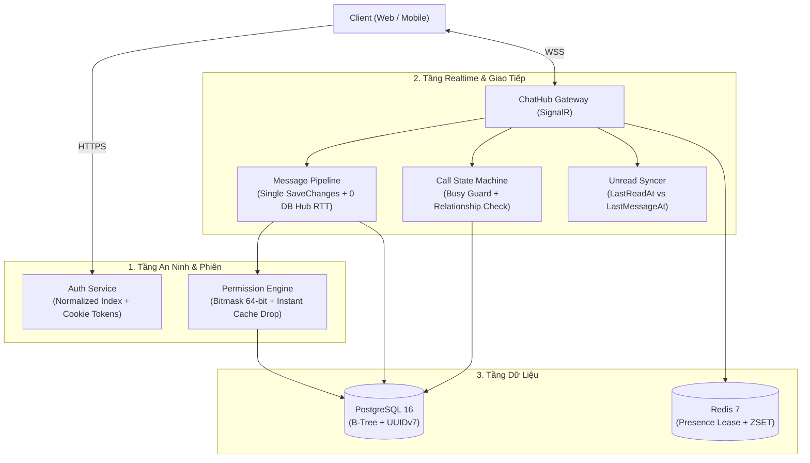

# 🧠 NomNa — Cẩm Nang Tư Duy & Logic Nghiệp Vụ Cốt Lõi (Application Intent & Mental Models)

> **Mục đích tài liệu:**  
> Đọc lại code của một dự án lớn qua thời gian là một cực hình ("đọc rồi cũng quên"). Bộ tài liệu này được thiết kế để **ghi nhớ tư tưởng kiến trúc bằng ngôn ngữ tự nhiên**, giải thích tường tận **Ý ĐỊNH NGHIỆP VỤ (The "WHY")**, **CÁCH THỨC VẬN HÀNH (The "HOW")**, cùng **các đoạn code then chốt (Key Snippets)** thay vì phải lội qua hàng nghìn dòng code C# và TypeScript.

---

## 📚 5 Chuyên Đề Nghiệp Vụ Trọng Tâm

1. **[`01-auth-and-session-lifecycle.md`](./01-auth-and-session-lifecycle.md)**  
   *Vòng Đời Xác Thực, Bảo Vệ Phiên & Chống Quét Bảng:*  
   Tư tưởng tối ưu hóa tìm kiếm người dùng qua `NormalizedEmail`/`NormalizedUserName` (tránh Sequential Scan), cơ chế xoay vòng Refresh Token an toàn, quy trình thu hồi phiên đăng nhập (`Logout`) và đổi mật khẩu (`ChangePassword`).

2. **[`02-permission-engine-and-cache-invalidation.md`](./02-permission-engine-and-cache-invalidation.md)**  
   *Động Cơ Phân Quyền Bitmask 64-bit & Xóa Cache Tức Thì:*  
   Quy tắc phân giải thứ tự quyền phân cấp chuẩn Discord (`Owner` $\to$ `Administrator` $\to$ `Base Roles` $\to$ `Channel Overwrites`), kết hợp chiến lược Cache-Aside (`IMemoryCache`) và cơ chế `CancellationChangeToken` toàn cục để xóa cache ngay lập tức khi quyền thay đổi.

3. **[`03-messaging-pipeline-and-hotpath.md`](./03-messaging-pipeline-and-hotpath.md)**  
   *Đường Đi Của Tin Nhắn & Giải Phóng Điểm Nghẽn Ghi (Hot-Path):*  
   Hành trình từ lúc người dùng ấn Enter $\to$ WebSocket RPC $\to$ CQRS Command $\to$ Gom lưu Database trong 1 lần `SaveChangesAsync` $\to$ Multicast SignalR cho nhóm kênh và gửi trực tiếp DM mà tốn **0 DB round-trip** tại Hub.

4. **[`04-channel-unread-and-sync-model.md`](./04-channel-unread-and-sync-model.md)**  
   *Mô Hình Tính Toán Kênh Chưa Đọc & Đồng Bộ Thời Gian Thực:*  
   Cách hệ thống xác định một kênh có tin nhắn chưa đọc (`HasUnread`) thông qua cặp mốc thời gian `Channel.LastMessageAt` và `ChannelMember.LastReadAt`, cùng cơ chế đánh dấu đã đọc khi chuyển kênh.

5. **[`05-webrtc-call-signaling-state-machine.md`](./05-webrtc-call-signaling-state-machine.md)**  
   *Cỗ Máy Trạng Thái Cuộc Gọi 1-1 WebRTC & Lớp Bảo Vệ An Ninh:*  
   Bản chất bắt tay P2P qua SignalR Signaling, State Machine cuộc gọi (`Idle` $\to$ `Ringing` $\to$ `Connected` $\to$ `Ended`), cơ chế xử lý máy bận (`UserBusy`), chặn cuộc gọi từ người bị Block và bảo vệ ICE Candidate chống giả mạo.

---

## 🧭 Sơ Đồ Khái Niệm Tổng Thể (Big Picture)

