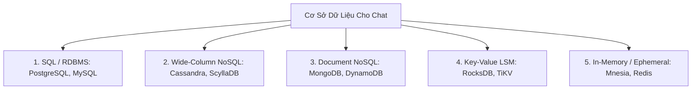

# 🏛️ Khảo Sát Kiến Trúc: Cơ Sở Dữ Liệu & Chiến Lược Caching Cho Hệ Thống Realtime Chat Ở Quy Mô Lớn

> **Mục tiêu tài liệu:** Cung cấp góc nhìn kiến trúc chuyên sâu cấp Senior/Principal/Staff Engineer về bài toán lưu trữ và tăng tốc dữ liệu trong các hệ sinh thái Chat Realtime quy mô lớn (Discord, Slack, WhatsApp, Meta Messenger, Telegram). Phân tích toàn diện các cuộc chuyển dịch cơ sở dữ liệu lịch sử (từ NoSQL sang SQL và ngược lại), mổ xẻ trade-offs, và đúc kết cẩm nang chiến lược Caching thực chiến cho dự án **NomNa**.

---

## Mục Lục
1. [Bản Chất Của Dữ Liệu Tin Nhắn Realtime (The Anatomy of Chat Data)](#1-bản-chất-của-dữ-liệu-tin-nhắn-realtime-the-anatomy-of-chat-data)
2. [Bản Đồ Cơ Sở Dữ Liệu: SQL vs NoSQL vs NewSQL](#2-bản-đồ-cơ-sở-dữ-liệu-sql-vs-nosql-vs-newsql)
3. [Case Studies Thực Chiến: Lịch Sử Chuyển Đổi DB Của Các Ông Lớn](#3-case-studies-thực-chiến-lịch-sử-chuyển-đổi-db-của-các-ông-lớn)
   - [3.1. Discord: MongoDB ➔ Apache Cassandra ➔ ScyllaDB](#31-discord-mongodb--apache-cassandra--scylladb)
   - [3.2. Meta / Facebook Messenger: HBase (NoSQL) ➔ MyRocks (LSM trên MySQL)](#32-meta--facebook-messenger-hbase-nosql--myrocks-lsm-trên-mysql)
   - [3.3. Slack: Trung thành với MySQL (Vitess Horizontal Sharding)](#33-slack-trung-thành-với-mysql-vitess-horizontal-sharding)
   - [3.4. WhatsApp: Erlang Mnesia & Triết Lý "Store-and-Forward" (Zero Persistence)](#34-whatsapp-erlang-mnesia--triết-lý-store-and-forward-zero-persistence)
   - [3.5. Telegram: MTProto & Phân Tán Địa Lý (Geographical Datacenter Sharding)](#35-telegram-mtproto--phân-tán-địa-lý-geographical-datacenter-sharding)
4. [Bảng Tổng Hợp So Sánh Kiến Trúc DB Của Các Nền Tảng](#4-bảng-tổng-hợp-so-sánh-kiến-trúc-db-của-các-nền-tảng)
5. [Toàn Thư Về Chiến Lược Caching Cho Ứng Dụng Chat Realtime](#5-toàn-thư-về-chiến-lược-caching-cho-ứng-dụng-chat-realtime)
   - [5.1. Bốn mô hình Caching kinh điển & Trade-offs](#51-bốn-mô-hình-caching-kinh-điển--trade-offs)
   - [5.2. Kiến trúc Cache đa tầng (Multi-Tier Caching) trong Chat](#52-kiến-trúc-cache-đa-tầng-multi-tier-caching-trong-chat)
   - [5.3. Sử dụng Redis Data Structures tối ưu cho Chat](#53-sử-dụng-redis-data-structures-tối-ưu-cho-chat)
   - [5.4. Bốn bài toán "Ác Mộng" của Cache & Giải pháp thực chiến](#54-bốn-bài-toán-ác-mộng-của-cache--giải-pháp-thực-chiến)
6. [Tư Duy Kiến Trúc Dành Cho Dự Án NomNa (.NET 9 + PostgreSQL + Redis)](#6-tư-duy-kiến-trúc-dành-cho-dự-án-nomna-net-9--postgresql--redis)

---

## 1. Bản Chất Của Dữ Liệu Tin Nhắn Realtime (The Anatomy of Chat Data)

Trước khi lựa chọn cơ sở dữ liệu hay dựng cache, một kỹ sư hệ thống phải giải phẫu đặc tính I/O (Input/Output characteristics) của dữ liệu chat. Dữ liệu tin nhắn trong một ứng dụng như NomNa hay Discord có những hành vi rất đặc thù:

```
                           ĐẶC TÍNH I/O CỦA HỆ THỐNG CHAT
 ┌──────────────────────────────────────────────────────────────────────────────────┐
 │                                                                                  │
 │  1. Write-Heavy (99% Append-Only): Tin nhắn chỉ chèn mới, hiếm khi sửa/xóa.     │
 │                                                                                  │
 │  2. High Temporal Locality: 95% lượt đọc tập trung vào 50 tin nhắn mới nhất.   │
 │                                                                                  │
 │  3. Strict Chronological Ordering: Cần sắp xếp tuyệt đối theo thời gian.        │
 │                                                                                  │
 │  4. Asymmetrical Fanout: 1 người gửi tin ──> Hàng nghìn người nhận realtime.     │
 │                                                                                  │
 └──────────────────────────────────────────────────────────────────────────────────┘
```

1. **Write-Heavy & Append-Only (Ghi áp đảo, chỉ chèn thêm):**
   - Người dùng liên tục gõ và gửi tin nhắn. Thao tác `INSERT` chiếm tới 99% tổng số thao tác ghi.
   - Thao tác `UPDATE` (sửa nội dung tin nhắn) hoặc `DELETE` (xóa tin nhắn) chiếm tỷ lệ cực nhỏ (< 1%).
2. **Tính cục bộ thời gian cực cao (High Temporal Locality):**
   - 95% đến 99% lượt truy vấn đọc tin nhắn chỉ tập trung vào **vài chục tin nhắn gần nhất** của các kênh đang hoạt động (Active Channels).
   - Tin nhắn gửi từ 6 tháng hay 2 năm trước gần như rơi vào trạng thái "ngủ đông" (Cold Data), rất hiếm khi được truy cập trừ khi người dùng dùng tính năng tìm kiếm lịch sử.
3. **Thứ tự thời gian nghiêm ngặt (Strict Chronological Ordering):**
   - Tin nhắn bắt buộc phải hiển thị đúng theo trình tự được gửi. Điều này đòi hỏi khóa chính (Primary Key) phải có tính chất tăng dần theo thời gian (Time-sortable ID như Twitter Snowflake, ULID, hoặc UUIDv7) để phục vụ phân trang Keyset Cursor.
4. **Tỷ lệ Fanout bất đối xứng:**
   - Trong một Server có 10.000 thành viên (như kênh thông báo chung của NomNa), 1 thao tác ghi (Write) từ người gửi sẽ tạo ra **10.000 thông báo nhận (Reads/Pushes)** qua WebSocket tới 10.000 client khác nhau.

---

## 2. Bản Đồ Cơ Sở Dữ Liệu: SQL vs NoSQL vs NewSQL

Không có cơ sở dữ liệu "tốt nhất trên đời", chỉ có sự đánh đổi (Trade-offs) theo định lý **CAP (Consistency - Availability - Partition Tolerance)** và **PACELC**:



### 2.1. Relational Databases (PostgreSQL / MySQL)
- **Cơ chế lưu trữ:** Thường sử dụng **B-Tree / B+Tree Index**. Các trang dữ liệu (Pages) được ghi đè tại chỗ (In-place updates) kết hợp với Write-Ahead Logging (WAL).
- **Điểm mạnh:**
  - Hỗ trợ ACID Transactions hoàn hảo.
  - Quan hệ phức tạp phong phú (Foreign Keys, JOIN giữa `Users`, `Servers`, `Channels`, `Roles`, `Permissions`).
  - Hệ sinh thái công cụ quản trị, backup, migration cực kỳ trưởng thành.
- **Điểm yếu ở quy mô lớn:**
  - Khi bảng `Messages` vượt ngưỡng **vài trăm triệu dòng**, B-Tree Index phình to vượt quá dung lượng RAM (`shared_buffers`), dẫn đến việc đọc/ghi index phải swap liên tục xuống ổ đĩa.
  - Scale ngang (Horizontal Scaling) khó khăn: Cần giải pháp sharding phức tạp (như Citus cho Postgres hoặc Vitess cho MySQL).

### 2.2. Wide-Column Stores dựa trên LSM-Tree (Cassandra / ScyllaDB)
- **Cơ chế lưu trữ:** **LSM-Tree (Log-Structured Merge-tree)**. Toàn bộ thao tác ghi được ghi tuần tự vào CommitLog và lưu vào bộ nhớ RAM (**MemTable**). Khi MemTable đầy, nó được xả tuần tự (Flush) xuống đĩa thành các file bất biến (**SSTables**).
- **Điểm mạnh:**
  - **Tốc độ ghi kinh hoàng (Astronomical Write Throughput):** Vì ghi tuần tự (Sequential I/O), không cần tìm kiếm và ghi đè ngẫu nhiên như B-Tree.
  - Scale ngang tuyến tính (Linear Scalability): Thêm node mới vào cluster là thông lượng tăng theo cấp số cộng.
  - Thiết kế cấu trúc bảng hoàn hảo cho Chat:
    - `Partition Key`: `(channel_id, bucket)` ➔ Giúp gom toàn bộ tin nhắn của 1 kênh vào cùng 1 node hoặc partition.
    - `Clustering Key`: `message_id` (Snowflake) ➔ Tự động sắp xếp vật lý theo thứ tự thời gian trên đĩa!
- **Điểm yếu:**
  - Không có JOIN, không có Foreign Keys. Phải chấp nhận trùng lặp dữ liệu (Denormalization).
  - Vấn đề **Tombstones**: Khi xóa dữ liệu, Cassandra không xóa thật mà chỉ ghi một marker "tombstone". Nếu xóa nhiều tin nhắn, các câu truy vấn đọc phải quét qua hàng nghìn tombstones, gây nghẽn CPU và độ trễ P99 tăng vọt.

---

## 3. Case Studies Thực Chiến: Lịch Sử Chuyển Đổi DB Của Các Ông Lớn

Việc tìm hiểu tại sao các tập đoàn công nghệ hàng đầu chuyển đổi cơ sở dữ liệu là "kho báu tri thức" lớn nhất để hiểu sâu về giới hạn kỹ thuật.

---

### 3.1. Discord: MongoDB ➔ Apache Cassandra ➔ ScyllaDB

Câu chuyện của Discord là ví dụ kinh điển nhất trong lịch sử kỹ nghệ phần mềm về sự phát triển vượt bậc của dữ liệu.

```
                  LỊCH SỬ CHUYỂN DỊCH CƠ SỞ DỮ LIỆU CỦA DISCORD

    2015                      2017                               2022 - 2023
 ┌─────────┐              ┌───────────┐                        ┌───────────┐
 │ MongoDB │ ───────────> │ Cassandra │ ─────────────────────> │  ScyllaDB │
 └─────────┘              └───────────┘                        └───────────┘
 (Startup phase)          (Scale to billions)                  (Trillion messages,
  Nghẽn RAM,               Khổ sở vì JVM GC pauses,             C++, No GC pauses,
  dữ liệu không vừa đĩa    Tombstone scans, CPU spikes          P99 < 15ms)
```

#### Giai đoạn 1 (2015): Bắt đầu với MongoDB
- **Bối cảnh:** Khi mới ra mắt, mục tiêu của Discord là xây dựng sản phẩm nhanh nhất có thể. MongoDB (Document NoSQL) là lựa chọn hoàn hảo: schema linh hoạt, dễ dev.
- **Điểm gãy (The Breaking Point):**
  - Dữ liệu tin nhắn tăng trưởng theo cấp số nhân.
  - MongoDB sử dụng mmap và B-Tree. Khi dữ liệu và index vượt quá dung lượng RAM, MongoDB bắt buộc phải liên tục đọc ghi trang đĩa (Paging to disk).
  - Kết quả: Độ trễ tăng vọt, API chat bắt đầu bị đơ, database thường xuyên sập trong giờ cao điểm. Discord nhận ra: MongoDB không thể scale cho bài toán chat hàng tỷ tin nhắn.

#### Giai đoạn 2 (2017): Di chuyển sang Apache Cassandra
- **Lý do chọn Cassandra:** Cassandra là database dạng Wide-Column dựa trên LSM-Tree, có khả năng scale ngang xuất sắc và tốc độ ghi cực nhanh.
- **Thiết kế Data Model của Discord:**
  ```sql
  CREATE TABLE messages (
      channel_id bigint,
      bucket int,             -- Chia nhỏ kênh lớn thành các xô (ví dụ: mỗi xô chứa 10 ngày)
      message_id bigint,      -- Snowflake ID (chứa timestamp)
      author_id bigint,
      content text,
      PRIMARY KEY ((channel_id, bucket), message_id)
  ) WITH CLUSTERING ORDER BY (message_id DESC);
  ```
- **Vấn đề phát sinh khi dữ liệu chạm ngưỡng hàng nghìn tỷ tin nhắn:**
  1. **JVM Garbage Collection Pauses (Stop-The-World):** Cassandra viết bằng Java. Khi lượng dữ liệu trong RAM quá lớn, JVM kích hoạt Full GC, dừng toàn bộ tiến trình trong hàng giây, khiến các client Discord bị giật lag không rõ lý do.
  2. **Tombstone Spikes:** Người dùng Discord liên tục xóa tin nhắn hoặc bot dọn dẹp kênh. Cassandra ghi lại hàng triệu "tombstones". Khi người dùng cuộn xem lịch sử, Cassandra phải đọc qua hàng nghìn tombstones này khiến CPU của cluster nhảy lên 100%!
  3. **Hot Partitions:** Các kênh chat khổng lồ (kênh thông báo của server game lớn) dồn hàng triệu tin nhắn vào 1 partition duy nhất, làm một vài node trong cluster bị quá tải nhiệt (hotspot).

#### Giai đoạn 3 (2022 - Nay): Cuộc đại di chuyển sang ScyllaDB
- **ScyllaDB là gì?** ScyllaDB là bản thiết kế lại hoàn toàn của Apache Cassandra nhưng được viết bằng **C++** (thay vì Java).
- **Kiến trúc đột phá của ScyllaDB:**
  - **Shared-Nothing & Thread-Per-Core Architecture:** Mỗi CPU core xử lý độc lập dữ liệu của riêng nó, không có tranh chấp khóa (Lock-free), không chia sẻ bộ nhớ.
  - **Hoàn toàn KHÔNG CÓ Garbage Collection:** Viết bằng C++, quản trị bộ nhớ thủ công, loại bỏ 100% hiện tượng Stop-The-World GC pause!
  - **Tự động quản lý I/O Scheduler:** Tự động điều tiết ưu tiên giữa luồng đọc của user và luồng ghi compaction ngầm.
- **Kết quả thu được:**
  - Discord giảm quy mô từ **177 nodes Cassandra** cồng kềnh xuống chỉ còn **72 nodes ScyllaDB**!
  - Độ trễ P99 giảm từ **hàng giây xuống còn < 15ms** ổn định tuyệt đối!

---

### 3.2. Meta / Facebook Messenger: HBase (NoSQL) ➔ MyRocks (LSM trên MySQL)

Đây là ví dụ điển hình nhất cho thấy: **Không phải lúc nào NoSQL cũng tốt hơn SQL!**

```
                       SỰ CHUYỂN DỊCH CỦA FACEBOOK MESSENGER
 ┌──────────────────────────────────┐            ┌──────────────────────────────────┐
 │           Apache HBase           │            │             MyRocks              │
 │          (Hadoop NoSQL)          │ ─────────> │   (RocksDB Engine trên MySQL)    │
 └──────────────────────────────────┘            └──────────────────────────────────┘
  - Quá cồng kềnh (HDFS, ZooKeeper)               - Tận dụng ecosystem MySQL quen thuộc
  - Chi phí hạ tầng khổng lồ                      - Tỷ lệ nén dữ liệu cực cao của RocksDB
  - Garbage collection & IO spikes                - Giảm 75% dung lượng đĩa lưu trữ!
```

- **Giai đoạn trước:** Facebook dùng **HBase** (NoSQL chạy trên nền tảng Apache Hadoop & HDFS) để lưu trữ hàng chục tỷ tin nhắn mỗi ngày của Messenger.
- **Nỗi đau của HBase:**
  - Hệ thống phụ thuộc quá nhiều thành phần: Java JVM, Hadoop HDFS NameNode, DataNode, ZooKeeper. Việc vận hành bảo trì cụm này tốn hàng trăm kỹ sư SRE.
  - Dung lượng lưu trữ phình to mất kiểm soát. Chi phí mua ổ cứng SSD cho các trung tâm dữ liệu của Meta tăng vọt.
- **Quyết định táo bạo:** Chuyển sang **MyRocks** (Sử dụng storage engine **RocksDB** viết bằng C++ nhúng vào trong **MySQL**).
- **Tại sao lại quay về MySQL?**
  - Meta có đội ngũ chuyên gia về MySQL mạnh nhất thế giới. Toàn bộ hạ tầng replication, backup, sharding tooling của MySQL đã được xây dựng hoàn hảo trong suốt 15 năm.
  - RocksDB là một LSM-Tree engine tối ưu nén dữ liệu (Data Compression) cực tốt.
- **Kết quả:**
  - **Giảm 75% dung lượng lưu trữ trên đĩa** so với HBase (tiết kiệm hàng chục triệu USD tiền phần cứng).
  - Giảm 50% số lượng máy chủ cần thiết.
  - P99 latency được kiểm soát chặt chẽ, không còn bị ảnh hưởng bởi JVM GC.

---

### 3.3. Slack: Trung thành với MySQL (Vitess Horizontal Sharding)

Trái ngược hoàn toàn với Discord, **Slack** là ứng dụng chat phục vụ doanh nghiệp (B2B). Họ đưa ra quyết định kiến trúc hoàn toàn khác: **Không dùng NoSQL, trung thành 100% với MySQL!**

#### Tại sao Slack không dùng Cassandra hay MongoDB?
1. **Đặc thù dữ liệu B2B:**
   - Khách hàng doanh nghiệp yêu cầu tính toàn vẹn dữ liệu tuyệt đối (ACID).
   - Yêu cầu tuân thủ pháp lý (Compliance, e-Discovery, GDPR, HIPAA): Doanh nghiệp cần truy vết kiểm toán (Audit Trail), xuất lịch sử chat của nhân viên theo ngày giờ chính xác.
   - Phân quyền (Permissions) cực kỳ phức tạp: Guest accounts, kênh nội bộ, kênh riêng tư, kênh kết nối giữa 2 công ty khác nhau (Slack Connect). RDBMS thực hiện các bài toán phân quyền này tốt hơn NoSQL rất nhiều.
2. **Chiến lược mở rộng của Slack: Vitess Sharding**
   - Slack sử dụng **Vitess** (Hệ thống database clustering mã nguồn mở do YouTube phát triển để mở rộng MySQL).
   - **Mô hình Sharding theo Workspace/Organization:** Toàn bộ tin nhắn của một công ty (ví dụ: Google hay Spotify) được gom vào cùng một Shard MySQL.
   - Nhờ phân tách ranh giới rõ ràng theo từng doanh nghiệp (Multi-tenant Sharding), Slack không gặp phải bài toán nghẽn một bảng Messages khổng lồ dùng chung cho toàn nhân loại.

---

### 3.4. WhatsApp: Erlang Mnesia & Triết Lý "Store-and-Forward" (Zero Persistence)

WhatsApp phục vụ hơn **2 tỷ người dùng** và xử lý hơn **100 tỷ tin nhắn mỗi ngày**, nhưng số lượng kỹ sư hạ tầng của họ chỉ vỏn vẹn vài chục người! Bí quyết nằm ở triết lý kiến trúc tối giản:

```
                      TRIẾT LÝ STORE-AND-FORWARD CỦA WHATSAPP

[User A Gửi Tin] ──> [WhatsApp Server] ──> [Hàng đợi Erlang Mnesia]
                                                  │
                             (Gửi ngay cho User B đang online)
                                                  ▼
                                          [User B Nhận Tin]
                                                  │
                                       (Client B gửi ACK về Server)
                                                  ▼
                                      🔥 SERVER XÓA NGAY TIN NHẮN! 🔥
                                      (Không lưu trữ vĩnh viễn trên server!)
```

1. **Zero Server Persistence (Không lưu tin nhắn trên Server):**
   - WhatsApp coi server là một **hàng đợi tạm thời (Transient Queue)**, không phải là kho lưu trữ vĩnh viễn.
   - Khi User A gửi tin cho User B: Tin nhắn được đưa vào hàng đợi in-memory trong **Erlang Mnesia DB**.
   - Ngay khi User B nhận được tin nhắn và gửi tín hiệu xác nhận (Delivery ACK) về server ➔ **Server lập tức xóa vĩnh viễn tin nhắn đó khỏi đĩa và RAM!**
   - Toàn bộ lịch sử trò chuyện được lưu trữ **cục bộ trên điện thoại của người dùng (bằng SQLite)** và được backup lên iCloud hoặc Google Drive của chính họ.
2. **Hệ quả kiến trúc:**
   - Server WhatsApp không bao giờ phải đối mặt với bài toán bảng Messages 10.000 tỷ dòng!
   - Tiết kiệm 99% chi phí lưu trữ phần cứng.

---

### 3.5. Telegram: MTProto & Phân Tán Địa Lý (Geographical Datacenter Sharding)

Telegram xử lý bài toán bằng mô hình tập trung phân tán:
- **Cloud Chats (Kênh công khai, nhóm chat, chat thường):** Dữ liệu được mã hóa và lưu trữ trên server của Telegram.
- **Geographically Distributed Architecture:** Telegram chia thế giới thành **5 Trung tâm dữ liệu chính (DC1 đến DC5)** (ví dụ: DC1 ở Miami - Mỹ, DC2 ở Amsterdam - Hà Lan, DC4 ở Singapore...).
- **Cơ chế định tuyến:** Tài khoản người dùng được gán cố định vào một DC dựa trên mã vùng số điện thoại đăng ký. Khi bạn chat trong một nhóm, dữ liệu nhóm sẽ nằm ở DC gần nhất với đa số thành viên.
- **Secret Chats:** Hoạt động theo mô hình **End-to-End Encryption (E2EE)** giống WhatsApp — tin nhắn chỉ giải mã được trên thiết bị của hai người và không lưu trữ trên cloud.

---

## 4. Bảng Tổng Hợp So Sánh Kiến Trúc DB Của Các Nền Tảng

| Ứng Dụng | Cơ Sở Dữ Liệu Chính | Mô Hình Lưu Trữ | Lý Do Lựa Chọn | Điểm Đánh Đổi (Trade-offs) |
| :--- | :--- | :--- | :--- | :--- |
| **Discord** | **ScyllaDB** (Trước đó: Cassandra, MongoDB) | Wide-Column NoSQL (LSM-Tree) | Ghi cực nhanh, scale hàng nghìn tỷ tin nhắn, C++ không có GC pause | Không có ACID/JOIN, cấu trúc query bị giới hạn theo Partition Key |
| **Meta Messenger** | **MyRocks** (Trước đó: HBase) | LSM-Tree Engine trên nền tảng MySQL | Tiết kiệm 75% dung lượng đĩa, tận dụng tooling MySQL, latency ổn định | Phải tự xây dựng hệ thống Sharding và Cluster quản trị |
| **Slack** | **MySQL** (qua Vitess Sharding) | RDBMS Sharded theo Organization | Hỗ trợ phân quyền phức tạp, audit trail, compliance cho doanh nghiệp B2B | Khó truy vấn dữ liệu chéo giữa các Shards; chi phí server cao hơn |
| **WhatsApp** | **Erlang Mnesia** (In-memory transient) | Store-and-Forward (Ephemeral Queue) | Server chỉ trung chuyển, không lưu trữ dài hạn; chi phí cực thấp | Tin nhắn chỉ nằm ở điện thoại client; mất máy mất luôn dữ liệu nếu ko backup |
| **NomNa** *(Hiện tại)* | **PostgreSQL 16** | RDBMS (B-Tree + Relational) | Đơn giản, nhanh cho giai đoạn xây dựng, hỗ trợ bitmask permissions hoàn hảo | Cần tối ưu Keyset Cursor và Caching để không bị nghẽn đĩa khi tăng trưởng |

---

## 5. Toàn Thư Về Chiến Lược Caching Cho Ứng Dụng Chat Realtime

Nếu Database là "kho chứa thóc", thì Cache chính là "bát cơm trên bàn". Trong ứng dụng Chat Realtime, 95% lượng truy cập phải được xử lý ngay trên Cache mà không được phép chạm vào Database.

```
                               MÔ HÌNH PHÂN TẦNG CACHE CHO CHAT

                       ┌──────────────────────────────────────────────┐
                       │           CLIENT (React 19 SPA)             │
                       │   - TanStack Query (L0 Memory Cache)         │
                       │   - Zustand Store (Active Channel Messages)  │
                       └──────────────────────┬───────────────────────┘
                                              │ HTTP / WebSocket
                                              ▼
                       ┌──────────────────────────────────────────────┐
                       │       L1 CACHE: In-Memory (.NET WebAPI)      │
                       │   - IMemoryCache / MemoryCache               │
                       │   - Permissions, Channel Metadata (TTL: 30s) │
                       │   - Độ trễ: ~0.001 ms (Vài micro-seconds)    │
                       └──────────────────────┬───────────────────────┘
                                              │ Cache Miss
                                              ▼
                       ┌──────────────────────────────────────────────┐
                       │       L2 CACHE: Distributed Cache (Redis)     │
                       │   - Sorted Set (ZSET): 50 tin nhắn hot       │
                       │   - Redis Hash: Unread counters, Presence    │
                       │   - Độ trễ: ~0.5 - 2 ms                      │
                       └──────────────────────┬───────────────────────┘
                                              │ Cache Miss
                                              ▼
                       ┌──────────────────────────────────────────────┐
                       │          DATABASE (PostgreSQL 16)            │
                       │   - Bảng Messages (Lưu trữ vĩnh viễn)        │
                       │   - Độ trễ: ~5 - 50 ms                       │
                       └──────────────────────────────────────────────┘
```

---

### 5.1. Bốn mô hình Caching kinh điển & Trade-offs

#### 1. Cache-Aside (Lazy Loading):
- **Cơ chế:** Khi có request đọc: App kiểm tra Cache. Nếu có (Hit) ➔ Trả về. Nếu không (Miss) ➔ Đọc Database ➔ Ghi kết quả vào Cache ➔ Trả về.
- **Ưu điểm:** Chỉ cache những gì thực sự được đọc; nếu Redis chết, app vẫn có thể fallback về Database.
- **Nhược điểm:** Lần đọc đầu tiên luôn bị chậm (Cache Miss); dễ gặp race condition khi cập nhật dữ liệu.

#### 2. Write-Through:
- **Cơ chế:** Ứng dụng ghi dữ liệu vào Cache. Cache tự động ghi đồng bộ xuống Database trước khi báo thành công cho client.
- **Ưu điểm:** Dữ liệu trong Cache luôn mới nhất, không bao giờ đọc phải dữ liệu cũ.
- **Nhược điểm:** Độ trễ thao tác ghi tăng lên vì phải hoàn thành cả 2 bước ghi.

#### 3. Write-Behind (Write-Back):
- **Cơ chế:** Ứng dụng ghi dữ liệu vào Cache và **trả về thành công ngay lập tức cho client (Latency ~1ms)**! Sau đó, một tiến trình ngầm (Background Worker) gom các bản ghi trong Cache lại và ghi theo lô (Batching) xuống Database.
- **Ưu điểm:** Tốc độ ghi nhanh như chớp, giảm tải tối đa cho Database.
- **Nhược điểm:** **Nguy cơ mất dữ liệu (Data Loss)** nếu cụm Redis bị sập đột ngột trước khi worker kịp ghi xuống Database.

#### 4. Refresh-Ahead:
- **Cơ chế:** Cache tự động thăm dò các key sắp hết hạn và nạp lại dữ liệu từ DB trước khi TTL chạm số 0 nếu key đó vẫn đang có lượng truy cập cao.

---

### 5.2. Kiến trúc Cache đa tầng (Multi-Tier Caching) trong Chat

Trong NomNa, để đạt độ trễ sub-millisecond, ta kết hợp mô hình **L1 (In-Process) + L2 (Distributed)**:

1. **Tầng L1: In-Process Cache (`IMemoryCache` trong .NET 9)**
   - Nằm ngay trong không gian bộ nhớ của tiến trình WebAPI.
   - Thao tác đọc tốn **vài nano-giây**, không tốn chi phí serialized/deserialized mạng.
   - **Thích hợp cho:** Bảng phân quyền Bitmask của Channel (`ChannelPermissionService`), cấu hình Server, Profile người dùng.
   - **TTL:** Cực ngắn (5 giây đến 30 giây) để tránh dữ liệu bị lệch khi scale nhiều node.
2. **Tầng L2: Distributed Cache (Redis 7 / Dragonfly)**
   - Dùng chung cho toàn bộ cụm WebAPI nodes.
   - **Thích hợp cho:** Lịch sử tin nhắn gần nhất, Trạng thái online (Presence), Bộ đếm tin chưa đọc.

---

### 5.3. Sử dụng Redis Data Structures tối ưu cho Chat

Rất nhiều lập trình viên chỉ dùng Redis như một chiếc "Key-Value Store" đơn giản (`SET key json_string`). Đây là cách dùng lãng phí sức mạnh của Redis! Dưới đây là cách các Senior Architect khai thác các cấu trúc dữ liệu chuyên biệt của Redis cho Chat:

#### A. Hot Messages Caching bằng Redis `Sorted Set (ZSET)`
Thay vì cache một mảng JSON nguyên khối:
- **Cấu trúc:**
  - Key: `channel:{channelId}:messages`
  - **Score:** Dùng chính **Timestamp** hoặc **SnowflakeId** của tin nhắn!
  - **Member:** Chuỗi JSON của tin nhắn (hoặc chỉ `messageId`).
- **Thao tác lấy 50 tin nhắn mới nhất:**
  ```redis
  ZREVRANGEBYSCORE channel:01a16f00:messages +inf -inf LIMIT 0 50
  ```
  *(Độ phức tạp $O(\log(N) + M)$, Redis trả về 50 tin mới nhất trong **0.3 ms**!)*
- **Thao tác lấy tin nhắn cũ hơn con trỏ (Pagination):**
  ```redis
  ZREVRANGEBYSCORE channel:01a16f00:messages (cursorTimestamp -inf LIMIT 0 50
  ```
- **Giới hạn bộ nhớ:** Giữ cho mỗi kênh chỉ lưu tối đa 200 tin mới nhất trong RAM:
  ```redis
  -- Sau khi thêm tin mới, cắt tỉa bỏ các tin cũ hơn vị trí 200:
  ZREMRANGEBYRANK channel:01a16f00:messages 0 -201
  ```

#### B. Bộ đếm tin chưa đọc bằng Redis `Hash`
- Mỗi người dùng có một Hash lưu số lượng tin chưa đọc theo từng kênh:
  - Key: `user:{userId}:unreads`
  - Field: `{channelId}`
  - Value: Số tin chưa đọc.
- Khi có tin mới vào kênh:
  ```redis
  HINCRBY user:alex:unreads channel:general 1
  ```
- Khi người dùng bấm vào xem kênh:
  ```redis
  HDEL user:alex:unreads channel:general
  ```

#### C. Quản lý trạng thái Online (Presence) bằng Redis `String` với Heartbeat TTL
- Client gửi heartbeat mỗi 15 giây lên server:
  ```redis
  SET user:presence:alex "online" EX 30
  ```
- Nếu client rớt mạng đột ngột và không gửi heartbeat, sau 30 giây key tự động biến mất (Expire). Hệ thống tự hiểu người dùng đã Offline mà không cần xử lý ngắt kết nối phức tạp!

---

### 5.4. Bốn bài toán "Ác Mộng" của Cache & Giải pháp thực chiến

Bất kỳ hệ thống phân tán nào chạy ở quy mô lớn cũng sẽ đối mặt với 4 thảm họa Cache sau đây:

```
                            4 THẢM HỌA CACHE KINH ĐIỂN
 ┌──────────────────────────┬──────────────────────────┬──────────────────────────┐
 │  1. Cache Stampede       │  2. Cache Penetration    │  3. Cache Avalanche      │
 │  (Key nóng hết hạn,      │  (Truy vấn ID rác        │  (Hàng loạt key hết hạn  │
 │   nghìn request đâm DB)  │   xuyên thủng cache)     │   cùng một giây)         │
 └──────────────────────────┴──────────────────────────┴──────────────────────────┘
```

#### 1. Cache Stampede / Thundering Herd Problem
- **Kịch bản:** Key cache chứa 50 tin nhắn của kênh chat "General" (có 50.000 user online) hết hạn TTL.
- Đúng vào tích tắc đó, 1.000 requests cùng lúc kiểm tra cache và thấy Miss. Cả 1.000 requests cùng lúc lao xuống PostgreSQL chạy câu query nặng ➔ PostgreSQL chết nghẽn ngay tức khắc!
- **Giải pháp: Cơ chế SingleFlight (Mutex / Distributed Lock)**
  Chỉ cho phép **1 request duy nhất** được quyền gọi xuống DB để tính toán và ghi lại vào Cache. 999 requests còn lại bị chặn bởi Mutex (`SemaphoreSlim` trong code hoặc RedLock trên Redis), kiên nhẫn chờ request đầu tiên xong rồi đọc kết quả mới từ Cache:
  ```csharp
  // Khóa cục bộ bằng SemaphoreSlim trong .NET
  private static readonly ConcurrentDictionary<string, SemaphoreSlim> _locks = new();
  ```
- **Giải pháp nâng cao: XFetch (Probabilistic Early Expiration)**
  Thuật toán xác suất tự động tính toán thời gian chạy query của DB. Nếu một request đến khi key sắp hết hạn (ví dụ còn 5 giây) và có xác suất cao là key nóng, nó sẽ âm thầm nạp lại cache ở background trước khi key kịp biến mất!

#### 2. Cache Penetration (Thủng Cache)
- **Kịch bản:** Kẻ tấn công cố tình spam hàng triệu request đọc tin nhắn với các ID ngẫu nhiên không hề tồn tại trong hệ thống (`GET /channels/non-existent-id/messages`).
- Vì ID không tồn tại, Cache luôn luôn Miss ➔ 100% request xuyên thủng qua Cache và dội thẳng vào PostgreSQL để quét bảng!
- **Giải pháp:**
  1. **Cache Null Objects:** Khi DB trả về không tìm thấy, lưu ngay giá trị rác vào Redis với TTL ngắn:
     `SET channel:fake-id:null "1" EX 60`
  2. **Bloom Filter:** Đặt một **Bloom Filter** ở tầng trước khi truy cập Cache/DB. Bloom Filter là một cấu trúc dữ liệu xác suất siêu nhẹ trong RAM giúp trả lời câu hỏi: *"ID này chắc chắn không tồn tại"* với độ chính xác 100%. Nếu Bloom Filter bảo không có, từ chối request ngay từ cửa ngõ!

#### 3. Cache Avalanche (Tuyết Lở)
- **Kịch bản:** Một kỹ sư lập trình đặt toàn bộ cache tin nhắn của tất cả các kênh có cùng một thời gian hết hạn cố định: `TTL = 3600s (1 giờ)`.
- Đúng 1 giờ sau, **toàn bộ hàng triệu keys trong Redis đồng loạt bốc hơi trong cùng 1 giây**!
- Toàn bộ lưu lượng truy cập của toàn hệ thống đồng thời dồn thẳng xuống Database ➔ Database sập toàn diện.
- **Giải pháp: Thêm độ lệch ngẫu nhiên (TTL Jitter):**
  Tuyệt đối không bao giờ dùng TTL cố định. Luôn cộng thêm một khoảng thời gian ngẫu nhiên:
  $$\text{Actual TTL} = \text{Base TTL} + \text{Random}(1, 300) \text{ seconds}$$
  Các key sẽ hết hạn rải rác trong vòng 5 phút, triệt tiêu hoàn toàn hiệu ứng tuyết lở.

#### 4. Cache Invalidation & Race Conditions (Bẫy Ghi Chéo)
- **Vấn đề:** Khi người dùng sửa nội dung tin nhắn (`UPDATE message`):
  1. Thread 1 ghi Database.
  2. Thread 1 chuẩn bị xóa Cache thì bị gián đoạn mạng.
  3. Kết quả: Cache chứa dữ liệu cũ mãi mãi!
  Hoặc:
  1. Thread A xóa Cache.
  2. Thread B đọc Cache (Miss) ➔ Đọc Database cũ ➔ Chuẩn bị ghi Cache.
  3. Thread A ghi Database mới.
  4. Thread B ghi dữ liệu cũ vào Cache ➔ Cache bị ô nhiễm dữ liệu sai lệch (Stale Data)!
- **Giải pháp chuẩn Enterprise: Transactional Outbox + CDC (Change Data Capture)**
  - Ứng dụng **không bao giờ xóa cache thủ công trong code API**.
  - Ứng dụng chỉ ghi vào Database (Single Source of Truth).
  - Sử dụng công cụ CDC (như **Debezium**) đọc trực tiếp file nhật ký giao dịch **WAL (Write-Ahead Log)** của PostgreSQL. Khi có sự kiện `UPDATE` hoặc `DELETE` xảy ra chắc chắn trong DB, Debezium bắn event sang Kafka, một worker chuyên trách sẽ nhận event và gửi lệnh xóa cache tương ứng trên Redis một cách bất đồng bộ và đảm bảo tin cậy 100%!

---

## 6. Tư Duy Kiến Trúc Dành Cho Dự Án NomNa (.NET 9 + PostgreSQL + Redis)

Là một Senior/Staff Engineer, bạn phải biết hệ thống của mình **đang đứng ở đâu** trên bản đồ tiến hóa và đưa ra quyết định phù hợp nhất với nguồn lực thực tế:

```
                            LỘ TRÌNH TIẾN HÓA DỮ LIỆU CỦA NOMNA

 Giai đoạn 1 (Hiện tại: 0 - 100K Users)     Giai đoạn 2 (Scale: 100K - 5M Users)      Giai đoạn 3 (Hyper: 10M+ Users)
 ┌────────────────────────────────────┐    ┌───────────────────────────────────┐    ┌───────────────────────────────┐
 │ - PostgreSQL 16 Đơn Node           │    │ - PostgreSQL Primary (Ghi)        │    │ - ScyllaDB / Cassandra        │
 │ - Keyset Cursor Pagination O(1)    │ ─> │ - PostgreSQL Read Replicas (Đọc)  │ ─> │   lưu trữ tin nhắn (LSM-Tree) │
 │ - Redis ZSET Hot Messages Cache    │    │ - Redis Cluster Caching đa tầng   │    │ - PostgreSQL lưu Users,       │
 │ - IMemoryCache cho Permissions     │    │ - Table Partitioning bảng Messages│    │   Servers, Roles (Metadata)   │
 └────────────────────────────────────┘    └───────────────────────────────────┘    └───────────────────────────────┘
```

### Lời khuyên vàng cho NomNa:
1. **Đừng vội vã chuyển sang NoSQL (Tránh Premature Migration):**
   - Rất nhiều startup chết yểu vì cố gắng dùng Cassandra hoặc MongoDB quá sớm khi chưa có hàng tỷ tin nhắn.
   - Chi phí vận hành, bảo trì cluster NoSQL và cái giá phải trả vì mất tính năng quan hệ/ACID của PostgreSQL là cực lớn!
   - **PostgreSQL 16 hoàn toàn có thể phục vụ 10.000.000 tin nhắn một cách êm ái** nếu được cấu hình đúng:
     - Dùng Keyset Cursor Pagination `(ChannelId, CreatedAt DESC)`.
     - Bật `AddDbContextPool` trong .NET 9.
     - Tích hợp Redis ZSET lưu 100 tin nhắn hot nhất của mỗi kênh.
2. **Kích hoạt Redis ngay trong Phase Scale:**
   - Container Redis đã được khai báo trong `docker-compose.yml`. Hãy cài đặt thư viện `StackExchange.Redis`, xây dựng tầng `RedisMessageCache` bằng cấu trúc dữ liệu `Sorted Set (ZSET)`.
3. **Phân vùng bảng (Partitioning) khi bảng Messages vượt 10 triệu dòng:**
   - Phân vùng Declarative Partitioning theo tháng trong PostgreSQL để giữ cho các Index của tháng hiện tại luôn nằm trọn vẹn trong RAM.
