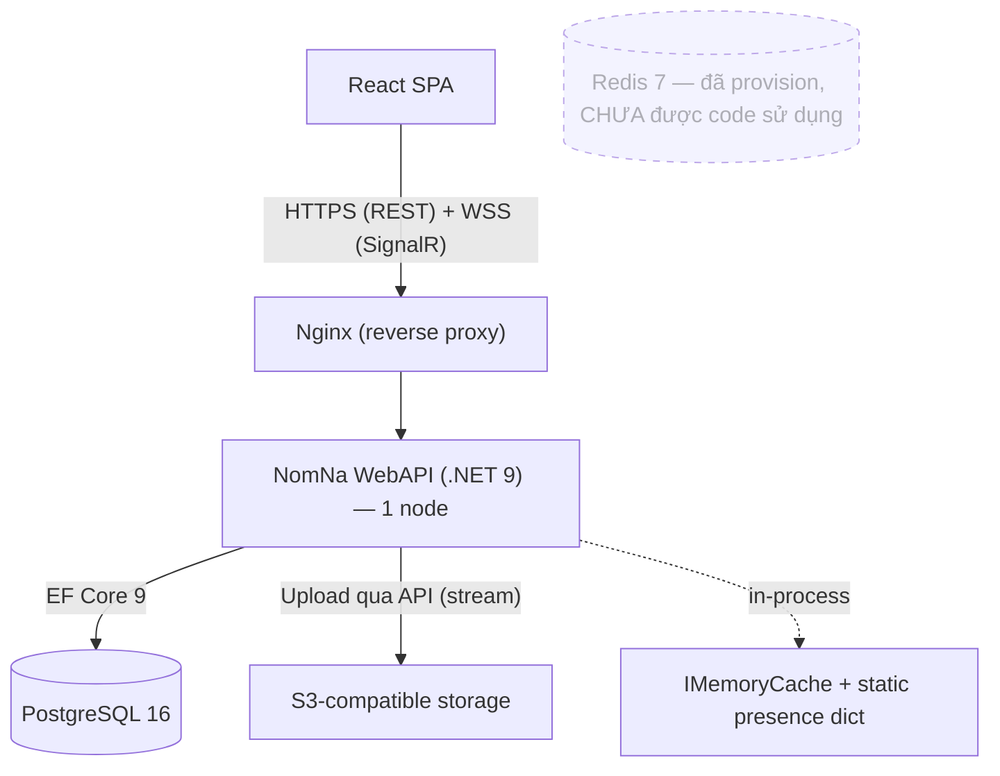

# 📘 NomNa — Tài Liệu Yêu Cầu & Tổng Quan Kỹ Thuật

> **Mục đích:** mô tả những gì hệ thống **đã làm được** (và làm bằng cách nào), những gì **dự định làm**, và các **yêu cầu phi chức năng (NFR)** cần đạt khi tối ưu dần.
> **Nguồn sự thật:** tài liệu được viết sau khi khảo sát trực tiếp mã nguồn (không dựa vào README). Khi code thay đổi, cập nhật lại các bảng trạng thái bên dưới.
> **Cập nhật:** 2026-10-25 · Nhánh tham chiếu: `perf/k6-load-testing`

**Chú giải trạng thái**

| Ký hiệu | Ý nghĩa |
| :---: | :--- |
| ✅ | Đã hoàn thành, đang chạy trong code |
| 🚧 | Làm một phần / có hạn chế đã biết |
| 📋 | Đã lên kế hoạch, chưa làm |
| ⚠️ | Khác với mô tả cũ (README) hoặc là rủi ro cần xử lý |

## Mục lục
1. [Tổng quan kiến trúc](#1-tổng-quan-kiến-trúc)
2. [Yêu cầu chức năng đã có (Functional Requirements)](#2-yêu-cầu-chức-năng-đã-có)
3. [Chức năng dự định](#3-chức-năng-dự-định)
4. [Yêu cầu phi chức năng (Non-Functional Requirements)](#4-yêu-cầu-phi-chức-năng)
5. [Giới hạn đã biết & nợ kỹ thuật](#5-giới-hạn-đã-biết--nợ-kỹ-thuật)
6. [Kết quả đo hiệu năng hiện có](#6-kết-quả-đo-hiệu-năng-hiện-có)
7. [Lộ trình tối ưu & cách kiểm chứng](#7-lộ-trình-tối-ưu--cách-kiểm-chứng)

---

## 1. Tổng quan kiến trúc

NomNa là hệ thống chat thời gian thực theo mô hình **Server → Channel → Message** (tương tự Discord), có phân quyền bitmask, DM, bạn bè và thông báo.

### 1.1. Trạng thái hiện tại (as-built)



> ⚠️ **README ghi "Redis: Cache & Presence" nhưng thực tế chưa có dòng code nào dùng Redis** (không có package `StackExchange.Redis`, presence là `static ConcurrentDictionary`, cache là `IMemoryCache`, SignalR chưa có backplane). Redis container chỉ được khai báo trong `docker-compose*.yml`. Đây là mục tiêu của giai đoạn *Scale*, không phải thứ đã có.

### 1.2. Công nghệ thực tế

| Tầng | Công nghệ (theo `csproj` / `package.json`) |
| :--- | :--- |
| Backend | .NET 9, ASP.NET Core, **MediatR 14**, **FluentValidation 12**, EF Core 9 + Npgsql, ASP.NET Core Identity (Core), SignalR, `System.IdentityModel.Tokens.Jwt`, `AWSSDK.S3`, `Google.Apis.Auth` |
| Frontend | **React 19** ⚠️ (README ghi 18), Vite 8, TypeScript 6, Tailwind CSS 4, TanStack Query 5, Zustand 5, `react-virtuoso`, React Hook Form + Zod, `@microsoft/signalr` |
| Hạ tầng | Docker multi-stage, Nginx, Certbot, GitHub Actions (CI + Deploy qua GHCR → SSH VPS), k6 (đo tải) |
| Test | xUnit — 41 test (34 Domain, 7 Application) |

### 1.3. Phân tầng (Clean Architecture)

```
Domain  ←  Application  ←  Infrastructure  ←  WebAPI
(Entities,   (CQRS handlers,   (EF Core, JWT, S3,    (Controllers mỏng, ChatHub,
 Enums,       Behaviors,        Cache, Permission     Middleware, DI)
 PermissionCalculator)  Validators)  Service)
```

- **Domain** không phụ thuộc thư viện ngoài. Logic tính quyền thuần túy nằm ở `Domain/Services/PermissionCalculator` → test được mà không cần DB.
- **Application** dùng quy tắc 3 file/command (`Command`, `CommandHandler`, `CommandValidator`); 8 module: Auth, Servers, Channels, Messages, Roles, ChannelOverwrites, Friends, Notifications (**~60 command/query**).
- **MediatR pipeline:** `ValidationBehavior` → `AuthorizationBehavior`. Quyền được khai báo **bằng interface đánh dấu** (`IRequireChannelPermission`, `IRequireServerPermission`) ngay trên request, behavior tự kiểm tra trước khi vào handler.
- **WebAPI:** 9 controller (~65 endpoint) chỉ gọi `Mediator.Send`; `ExceptionHandlingMiddleware` ánh xạ exception → HTTP status/ProblemDetails.

---

## 2. Yêu cầu chức năng đã có

### 2.1. Xác thực & tài khoản (Auth)

| ID | Chức năng | TT | Cách triển khai |
| :--- | :--- | :---: | :--- |
| FR-AUTH-01 | Đăng ký, đăng nhập bằng **email hoặc username** | ✅ | `RegisterCommand`, `LoginCommand` (trường `emailOrUsername`); ASP.NET Identity quản lý user/password hash |
| FR-AUTH-02 | Đăng nhập Google | ✅ | `GoogleLoginCommand` + `GoogleAuthService` (verify ID token qua `Google.Apis.Auth`) |
| FR-AUTH-03 | Access token ngắn hạn + **Refresh token có xoay vòng (rotation)** | ✅ | JWT ký HS256; refresh token sinh ngẫu nhiên, **chỉ lưu hash** (`TokenHash`, index) trong bảng `RefreshToken`; khi refresh: thu hồi token cũ (`RevokedAt`) và cấp token mới |
| FR-AUTH-04 | Token lưu trong **HttpOnly cookie** (không lộ ra JSON) | ✅ | Controller set cookie `access_token` / `refresh_token` (refresh giới hạn path `/api/auth`); SignalR đọc cookie, fallback `?access_token=` cho riêng `/hubs` |
| FR-AUTH-05 | Quên/đặt lại mật khẩu, xác minh email, gửi lại mail | ✅ | `ForgotPassword`, `ResetPassword`, `VerifyEmail`, `ResendVerification` + `EmailService` (SMTP cấu hình qua `Email:*`) |
| FR-AUTH-06 | Khóa tài khoản khi nhập sai nhiều lần | ✅ | Identity `Lockout`: 5 lần sai → khóa 15 phút |
| FR-AUTH-07 | Cập nhật hồ sơ (tên hiển thị, bio, avatar) | ✅ | `UpdateProfileCommand` |
| FR-AUTH-08 | Bắt buộc xác minh email mới đăng nhập được | 🚧 | Hiện `RequireConfirmedEmail = false` (cố ý, để dễ dev) |

### 2.2. Server, thành viên & lời mời

| ID | Chức năng | TT | Cách triển khai |
| :--- | :--- | :---: | :--- |
| FR-SRV-01 | Tạo / sửa / xóa server, icon | ✅ | `CreateServer`, `UpdateServer`, `DeleteServer`; người tạo là Owner |
| FR-SRV-02 | Tham gia bằng **mã mời**, trang `/join/:inviteCode` | ✅ | `InviteCode` unique index; `GetServerByInviteCode` (xem trước) → `JoinServer` |
| FR-SRV-03 | Mời qua thông báo, rời server, **kick** thành viên | ✅ | `SendServerInvites`, `LeaveServer`, `KickServerMember`; kick xong gọi `IRealtimeAccessRevoker` để rút connection khỏi group |
| FR-SRV-04 | Danh sách thành viên + trạng thái online | ✅ | `GetServerMembers` + trạng thái từ presence |
| FR-SRV-05 | Avatar fallback chữ cái đầu khi chưa có icon | ✅ | `ServerAvatar` / `UserAvatar` (client) |

### 2.3. Vai trò & phân quyền (RBAC bitmask)

| ID | Chức năng | TT | Cách triển khai |
| :--- | :--- | :---: | :--- |
| FR-RBAC-01 | **Quyền 64-bit bitmask** (27 cờ: quản trị, kênh, tin nhắn, voice…) | ✅ | `enum Permissions : long` với `[Flags]`; gộp `\|`, kiểm tra `&`; `Administrator` bypass |
| FR-RBAC-02 | Role: tạo/sửa/xóa, gán/gỡ cho thành viên, role mặc định `@everyone` | ✅ | `CreateRole`/`UpdateRole`/`DeleteRole`/`AssignRole`/`UnassignRole`; `Role.IsDefault`, `Position`, `ColorHex`; gán/gỡ **idempotent** |
| FR-RBAC-03 | **Ghi đè quyền theo kênh** (channel overwrite) cho role hoặc member | ✅ | `ChannelPermissionOverwrite` (unique `ChannelId+TargetId+TargetType`); `SetChannelOverwrite`/`DeleteChannelOverwrite` |
| FR-RBAC-04 | Tính quyền hiệu lực theo thứ tự: owner → admin → role gộp → overwrite | ✅ | `PermissionCalculator.CalculateServerPermissions/ChannelPermissions` (pure function, có unit test) |
| FR-RBAC-05 | Cache quyền + **hủy cache tức thì** khi đổi role/overwrite | ✅ | `PermissionService`: cache-aside `IMemoryCache` TTL 2 phút; mỗi entry gắn `CancellationChangeToken` theo **server / channel / (server,user)** → `InvalidateServer/Channel/User` làm hết hạn ngay |
| FR-RBAC-06 | Tính quyền hàng loạt cho nhiều kênh trong **1 lượt query** | ✅ | `GetChannelsPermissionsAsync` (gom overwrite bằng 1 query, tránh N+1) — dùng trong `SearchMessages` |
| FR-RBAC-07 | **Thu hồi quyền realtime**: bị kick/mất quyền → bị rút khỏi SignalR group + nhận sự kiện | ✅ | `RealtimeAccessRevoker` → `Groups.RemoveFromGroupAsync` + event `RemovedFromServer` |

### 2.4. Kênh (Channel)

| ID | Chức năng | TT | Cách triển khai |
| :--- | :--- | :---: | :--- |
| FR-CH-01 | 4 loại kênh: **Text, Voice, DirectMessage, Category** | ✅ | `ChannelType` enum; `Category` không cho gửi tin |
| FR-CH-02 | Tạo/sửa/xóa kênh, topic, vị trí, danh mục | ✅ | `CreateChannel`/`UpdateChannel`/`DeleteChannel`; index `(ServerId, Position)` |
| FR-CH-03 | **Kênh riêng tư** + thêm thành viên vào kênh | ✅ | `IsPrivate` + `ChannelMember`; `AddChannelMember` bắn `AddedToChannel` để kênh hiện ngay ở sidebar người được thêm, kèm tin nhắn hệ thống |
| FR-CH-04 | **DM**: tạo hoặc lấy lại DM với 1 người | ✅ | `CreateOrGetDmChannel` (idempotent); `GetDirectMessages` |
| FR-CH-05 | Đánh dấu đã đọc + preview tin cuối | ✅ | `MarkChannelAsRead` (`ChannelMember.LastReadAt`); `Channel.LastMessageContent/At/SenderId` được cập nhật khi gửi tin (denormalize để sidebar không phải join) |

### 2.5. Tin nhắn (Message)

| ID | Chức năng | TT | Cách triển khai |
| :--- | :--- | :---: | :--- |
| FR-MSG-01 | Gửi tin qua **REST** hoặc **SignalR** | ✅ | Cùng đi qua `SendMessageCommand` (đã có validator + `RequiredPermission = SendMessages`) |
| FR-MSG-02 | Sửa tin, **xóa mềm** | ✅ | `EditMessage` (`IsEdited`, `EditedAt`); `DeleteMessage` đặt `DeletedAt`, mọi query lọc `DeletedAt == null` |
| FR-MSG-03 | **Reply/quote** tin nhắn | ✅ | `ReplyToMessageId` (self-FK, có index); DTO trả kèm bản trích; tin gốc bị xóa hiển thị "Tin nhắn đã bị xóa". *(Mô hình thread cũ đã được thay bằng quote-reply — migration `ReplaceThreadWithQuoteReply`.)* |
| FR-MSG-04 | **Reaction emoji** (bật/tắt) | ✅ | `ToggleReaction`; unique `(MessageId, UserId, Emoji)`; khi đọc, reaction của cả trang tin được lấy **1 query** rồi group trong bộ nhớ |
| FR-MSG-05 | **Đính kèm file/ảnh** | ✅ | `POST /api/files/upload`: giới hạn dung lượng + **allow-list phần mở rộng**; lưu qua `IFileStorageService` (S3/R2); metadata lưu cột **jsonb** (`List<MessageAttachmentItem>`) |
| FR-MSG-06 | **Ghim / bỏ ghim** + danh sách ghim | ✅ | `PinMessage`/`UnpinMessage`/`GetPinnedMessages`; unique `(ChannelId, MessageId)`; `PinnedMessageCache` |
| FR-MSG-07 | **Mention** `@username`, `@all/@channel/@here` → tạo thông báo | ✅ | Regex trong `SendMessageCommandHandler` → tạo `Notification(Mention)`; trả lời tin người khác → `ThreadReply` |
| FR-MSG-08 | **Link preview** (OpenGraph) | ✅ | `GetLinkPreview` — có chặn SSRF cơ bản (`IsPrivateOrLoopbackHost`) |
| FR-MSG-09 | **Tìm kiếm** theo từ khóa/người gửi/khoảng ngày, trong server hoặc kênh | ✅ | `SearchMessages`: trước hết lọc các kênh user **thực sự xem được** (`ViewChannel`+`ReadMessageHistory`) rồi mới tìm → không rò rỉ tin kênh ẩn. 🚧 Từ khóa dùng `LIKE '%kw%'` (xem mục 5) |
| FR-MSG-10 | **Phân trang con trỏ hai chiều** (keyset) | ✅ | `GetMessages(before/after, limit 1–100)` dùng `CreatedAt` làm cursor, lấy `limit+1` để biết còn trang; index `(ChannelId, CreatedAt)` |
| FR-MSG-11 | **Nhảy tới tin nhắn** (từ search/ghim/reply) | ✅ | `GetMessagesAround(messageId)` trả cửa sổ tin quanh đích |
| FR-MSG-12 | ID tin nhắn tăng theo thời gian | ✅ | `BaseEntity.Id = Guid.CreateVersion7()` (UUIDv7: thân thiện index B-tree, sắp xếp được theo thời gian) |

### 2.6. Realtime (SignalR `ChatHub`)

| ID | Chức năng | TT | Cách triển khai |
| :--- | :--- | :---: | :--- |
| FR-RT-01 | Hub yêu cầu xác thực | ✅ | `[Authorize]`; `UserIdentifier` lấy từ JWT |
| FR-RT-02 | **Tham gia nhóm kênh có kiểm tra quyền** | ✅ | `JoinChannel`: kênh thường cần `ViewChannel`; DM cần là thành viên; ngược lại ném `HubException`. Group name = `channelId` |
| FR-RT-03 | Phát sự kiện tin nhắn cho cả nhóm | ✅ | `SendMessage/EditMessage/DeleteMessage/ToggleReaction` → `Clients.Group(channelId)` với các event `ReceiveMessage`, `MessageEdited`, `MessageDeleted`, `ReceiveReactionUpdated` |
| FR-RT-04 | DM: đẩy thẳng tới người nhận dù chưa mở tab | ✅ | Thêm `Clients.Users(recipientIds)` khi `ChannelType.DirectMessage` |
| FR-RT-05 | **Typing indicator** | ✅ | Xem 2.6.1 bên dưới |
| FR-RT-06 | **Presence online/offline đa thiết bị** | ✅ | Xem 2.6.2 bên dưới |
| FR-RT-07 | **Bù tin khi mất kết nối (reconnect catch-up)** | ✅ | Client `withAutomaticReconnect()`; `onReconnected` → nếu đang ở cuối kênh, gọi `getMessages(after = tin cuối cùng đang có, limit 50)` rồi `appendNewerMessages`; tự `JoinChannel` lại kênh đang xem |
| FR-RT-08 | Banner trạng thái kết nối | ✅ | `SignalRService` phát `connected/reconnecting/disconnected` → `useConnectionStatus` |
| FR-RT-09 | Đẩy thông báo & đếm chưa đọc realtime | ✅ | `SignalRNotificationDispatcher` → `ReceiveNotification`, `NotificationCountUpdated`; ngoài ra `FriendRequestReceived/Accepted`, `FriendshipRemoved`, `MessagePinned/Unpinned`, `ChannelMemberAdded`, `ServerMemberJoined` |
| FR-RT-10 | Transport dự phòng | ✅ | Client cho phép `WebSockets | LongPolling` |

#### 2.6.1. Typing indicator — làm như thế nào

```
Client gõ phím ─► StartTyping(channelId) ─► Hub:
   1. bỏ qua nếu là kênh DM tạm "pending-dm-*" hoặc id không hợp lệ
   2. kiểm tra connection này ĐÃ JoinChannel kênh đó (Context.Items["JoinedChannels"])
   3. THROTTLE: tối đa 1 broadcast / 1,5 giây / connection / kênh (Context.Items)
   4. Clients.OthersInGroup(channelId).SendAsync("UserTyping", {channelId,userId,username})
Client ngừng gõ ─► StopTyping ─► "UserStoppedTyping"
```
- Dữ liệu **ephemeral**: không ghi DB.
- Chống spam và chống giả mạo: phải đã tham gia group; throttle phía server.
- 🚧 Hạn chế: store client giữ **một** `typingUser` (chỉ hiển thị 1 người gõ cùng lúc, không phải danh sách "A, B đang gõ…").

#### 2.6.2. Presence — làm như thế nào

- `UserPresenceTracker` (singleton) giữ `ConcurrentDictionary<UserId, HashSet<ConnectionId>>`.
- `UserConnectedAsync` trả `true` **chỉ khi là connection đầu tiên** của user; `UserDisconnectedAsync` trả `true` **chỉ khi là connection cuối cùng** → mở nhiều tab/thiết bị không làm "nhấp nháy" online/offline.
- Khi chuyển trạng thái thật sự: cập nhật `User.Status` trong DB rồi `Clients.All.UserStatusChanged`.
- 🚧 Hạn chế: bộ nhớ tiến trình (mất khi restart, **không dùng được khi chạy ≥ 2 node**) và broadcast `Clients.All` (xem mục 5).

### 2.7. Bạn bè & Thông báo

| ID | Chức năng | TT | Cách triển khai |
| :--- | :--- | :---: | :--- |
| FR-FR-01 | Gửi/chấp nhận/từ chối lời mời, hủy kết bạn, chặn/bỏ chặn, tổng quan bạn bè | ✅ | 6 command + `GetFriendsSummary`; `Friendship` unique `(RequesterId, AddresseeId)` + index theo `Status` |
| FR-NT-01 | 7 loại thông báo: Mention, Reply, ChannelInvite, ServerInvite, FriendRequest, FriendAccepted, DirectMessage | ✅ | Entity `Notification`; index `(UserId, IsRead)`, `(UserId, CreatedAt)`, `(UserId, Type)` |
| FR-NT-02 | Danh sách, số chưa đọc, đánh dấu đọc từng cái/tất cả | ✅ | `GetNotifications`, `GetUnreadNotificationCount`, `MarkNotificationAsRead`, `MarkAllNotificationsAsRead` |

### 2.8. Trải nghiệm phía Client

| ID | Chức năng | TT | Cách triển khai |
| :--- | :--- | :---: | :--- |
| FR-UX-01 | **Ảo hóa danh sách tin nhắn** (hàng nghìn tin vẫn mượt) | ✅ | `react-virtuoso`; kỹ thuật `firstItemIndex` giảm dần để **prepend tin cũ không giật viewport** |
| FR-UX-02 | **Nhớ vị trí cuộn từng kênh** | ✅ | `channelScrollMemory` (Map cấp module) lưu `isAtBottom` + `topMessageId`; quay lại kênh sẽ cuộn về đúng tin đang đọc |
| FR-UX-03 | **Vạch "tin chưa đọc"** + nút nhảy tới | ✅ | `utils/readMarkers.ts` lưu mốc đã đọc trong `localStorage`, **chỉ tiến, không lùi**. 🚧 Chỉ theo từng trình duyệt (xem mục 5) |
| FR-UX-04 | Nhảy về tin mới nhất (`JumpToPresentBar`) | ✅ | Theo dõi `atBottomStateChange` |
| FR-UX-05 | Kéo-thả / dán ảnh từ clipboard để upload | ✅ | `useFileUpload`, `MessageComposer` |
| FR-UX-06 | Emoji picker, GIF picker, code block, mention autocomplete | ✅ | Component trong `components/chat` |
| FR-UX-07 | **Hệ thống theme bằng design token** | ✅ | Chỉ dùng biến CSS ngữ nghĩa (`--bg-surface`, `--accent-primary`…); đổi theme không sửa component |
| FR-UX-08 | Cài đặt: hồ sơ, giao diện, thông báo, bảo mật, phím tắt | ✅ | `components/settings/*` |
| FR-UX-09 | Panel thành viên/tìm kiếm/ghim có thể kéo đổi kích thước | ✅ | `usePanelResizers` |
| FR-UX-10 | Quản lý state đúng vai trò | ✅ | TanStack Query = dữ liệu server; Zustand = trạng thái UI toàn cục (`useChatStore`, `useServerStore`, `useUiStore`…); Context chỉ cho auth/theme |

### 2.9. Voice

| ID | Chức năng | TT | Ghi chú |
| :--- | :--- | :---: | :--- |
| FR-VC-01 | Kênh voice: vào/ra, mute/deafen, màn hình stage | 🚧 | **Chỉ là giao diện + state cục bộ** (`useVoiceStore` có "NomNa AudioBot" mô phỏng). **Chưa có âm thanh thật / WebRTC / signaling**. Đã có sẵn cờ quyền `Connect`, `Speak`, `Mute/Deafen/MoveMembers` |

---

## 3. Chức năng dự định

Sắp theo mức ưu tiên đóng góp cho mục tiêu **học BE / System Design / DevOps**.

### 3.1. Độ tin cậy dữ liệu & đúng đắn (ưu tiên cao)

| ID | Chức năng | TT | Hướng triển khai dự kiến |
| :--- | :--- | :---: | :--- |
| PL-REL-01 | **Gửi tin idempotent** (không trùng khi retry / mạng chập chờn) | 📋 | Client sinh `clientMessageId` (đã có `uuidv7.ts`) → server unique `(SenderId, ClientMessageId)`; trả lại bản ghi cũ nếu trùng |
| PL-REL-02 | **Cursor ổn định** `(CreatedAt, Id)` thay vì chỉ `CreatedAt` | 📋 | Tránh mất/lặp tin khi 2 tin cùng timestamp; dùng luôn UUIDv7 `Id` làm cursor |
| PL-REL-03 | **Transactional Outbox** cho sự kiện (thông báo, broadcast) | 📋 | Ghi event cùng transaction với message; worker đọc outbox → phát; thay cho `_ = DispatchAsync(...)` fire-and-forget hiện tại |
| PL-REL-04 | **Số tin chưa đọc phía server** | 📋 | Dùng `ChannelMember.LastReadAt` (đã có) thay cho `localStorage`, đồng bộ đa thiết bị |

### 3.2. Mở rộng ngang (Scale)

| ID | Chức năng | TT | Hướng triển khai dự kiến |
| :--- | :--- | :---: | :--- |
| PL-SC-01 | **SignalR Redis backplane** để chạy ≥ 2 node | 📋 | `AddStackExchangeRedis`; chứng minh bằng k6: trước = tin không qua node (0%), sau = 100% |
| PL-SC-02 | **Presence trên Redis** (TTL + heartbeat) | 📋 | Thay `static ConcurrentDictionary`; hết hạn tự động khi node chết |
| PL-SC-03 | **Cache phân tán + invalidation liên node** | 📋 | Redis cache cho profile/permission; invalidate qua Pub/Sub |
| PL-SC-04 | Bỏ `Clients.All` — chỉ phát presence cho người liên quan | 📋 | Group theo server / danh sách bạn bè |
| PL-SC-05 | Giao thức **MessagePack** cho SignalR | 📋 | `AddMessagePackProtocol()`; đo giảm kích thước & CPU |

### 3.3. Tìm kiếm, nội dung

| ID | Chức năng | TT | Hướng triển khai dự kiến |
| :--- | :--- | :---: | :--- |
| PL-SE-01 | **Full-text search** thay `LIKE '%kw%'` | 📋 | PostgreSQL `tsvector` + GIN (hoặc `pg_trgm`); so sánh EXPLAIN trước/sau |
| PL-SE-02 | **Partition** bảng `Messages` theo thời gian | 📋 | Declarative partitioning theo tháng + đo ảnh hưởng truy vấn |
| PL-SE-03 | Thumbnail/resize ảnh, quét file đính kèm | 📋 | Background worker |

### 3.4. Tính năng sản phẩm

| ID | Chức năng | TT | Ghi chú |
| :--- | :--- | :---: | :--- |
| PL-PR-01 | **Voice thật** (WebRTC) | 📋 | Cân nhắc SFU (LiveKit/mediasoup) thay vì tự viết |
| PL-PR-02 | Ban thành viên | 📋 | Cờ `BanMembers` đã có, **chưa có command** |
| PL-PR-03 | Nhắc `@role`, danh sách nhiều người đang gõ | 📋 | |
| PL-PR-04 | Quản lý phiên đăng nhập (xem/thu hồi thiết bị), 2FA | 📋 | Tận dụng bảng `RefreshToken` |
| PL-PR-05 | Web Push / email khi offline | 📋 | |
| PL-PR-06 | Audit log hành động quản trị | 📋 | |
| PL-AI-01 | **AI (tùy chọn):** tóm tắt kênh, tìm kiếm ngữ nghĩa (`pgvector`), gợi ý kiểm duyệt | 📋 | Chỉ làm sau khi hạ tầng ổn định |

---

## 4. Yêu cầu phi chức năng

> **Cách đọc:** *Mục tiêu* là con số đề xuất cần đạt (chưa được kiểm chứng trừ khi ghi rõ). Cột *Hiện trạng* nói thật về code hôm nay. *Kiểm chứng* là cách đo để chứng minh.
> **Môi trường chuẩn để đo:** 1 node WebAPI giới hạn **1 vCPU / 512 MB** (Docker `deploy.resources.limits`), Postgres 1 vCPU / 512 MB, k6 chạy ở container riêng. Mọi con số phải kèm cấu hình này.

### 4.1. Hiệu năng (Performance)

| ID | Yêu cầu | Mục tiêu | Hiện trạng | Kiểm chứng |
| :--- | :--- | :--- | :--- | :--- |
| NFR-PERF-01 | Độ trễ đọc tin (`GET messages`, limit 25) | P95 < 100 ms, P99 < 250 ms @ ≥ 200 RPS | ⚠️ Chưa đo riêng (xem mục 6) | k6 `01_http_message_load.js` (bỏ login khỏi vòng lặp) |
| NFR-PERF-02 | Độ trễ gửi tin (`POST`) | P95 < 150 ms @ 100 RPS ghi | Chưa đo | k6 |
| NFR-PERF-03 | **Độ trễ fanout realtime** (gửi → client nhận) | P95 < 100 ms, P99 < 250 ms với 1.000 client trong 1 kênh | Chưa đo | k6 `02_signalr_realtime.js` |
| NFR-PERF-04 | Kiểm tra quyền khi cache hit | **0 query DB** | ✅ đạt (cache-aside, TTL 2′) | Bật EF logging, đếm query |
| NFR-PERF-05 | Không có N+1 trên các endpoint nóng | Số query/request cố định, không tăng theo số tin | ✅ phần lớn (reaction gộp 1 query, quyền kênh gộp 1 query). Cần audit lại | Log query / test đếm query |
| NFR-PERF-06 | Giữ DB connection ngắn | Không giữ `DbContext` khi gọi mạng ngoài (S3, link preview) | 🚧 chưa kiểm tra toàn bộ | Review + soak test |
| NFR-PERF-07 | Giao diện mượt với danh sách lớn | Cuộn 10.000 tin ≥ 55 FPS; DOM node ≈ hằng số | ✅ có ảo hóa; chưa đo FPS | Chrome Performance/Lighthouse |

### 4.2. Khả năng mở rộng (Scalability)

| ID | Yêu cầu | Mục tiêu | Hiện trạng | Kiểm chứng |
| :--- | :--- | :--- | :--- | :--- |
| NFR-SCAL-01 | Số kết nối WebSocket đồng thời / node (1 vCPU, 512 MB) | ≥ 1.000 ổn định; mở rộng 5.000 sau tuning | Chưa đo | k6 ws, theo dõi `docker stats` |
| NFR-SCAL-02 | **Scale ngang** | 2 node → thông lượng ≥ 1,7× và **giao tin xuyên node 100%** | ❌ **Chưa đạt**: không backplane, presence & cache in-memory | k6 qua Nginx 2 upstream, trước/sau Redis |
| NFR-SCAL-03 | Không có trạng thái cục bộ ngoài nguồn có thể chia sẻ | Mọi state dùng chung nằm ở Postgres/Redis | ❌ presence, permission cache, profile cache, pinned cache đều cục bộ | Review kiến trúc |
| NFR-SCAL-04 | Kích thước dữ liệu | Truy vấn lịch sử không suy giảm khi `Messages` ≥ 10 triệu dòng | Chưa kiểm | Seed dữ liệu lớn (đã có `scripts/seed_messages.py`, `seed_channel_messages.sql`) + `EXPLAIN ANALYZE` |
| NFR-SCAL-05 | Phát sinh fanout hợp lý | Số frame gửi ra tỉ lệ với **người liên quan**, không phải toàn hệ thống | ❌ `UserStatusChanged` & `ServerMemberJoined` đang `Clients.All` | Đếm frame trong k6 |

### 4.3. Tính sẵn sàng & chịu lỗi (Availability / Reliability)

| ID | Yêu cầu | Mục tiêu | Hiện trạng | Kiểm chứng |
| :--- | :--- | :--- | :--- | :--- |
| NFR-REL-01 | Probe sức khỏe | `/health` (liveness), `/health/ready` (kiểm DB) | ✅ có | `curl` / Docker healthcheck |
| NFR-REL-02 | Tự phục hồi phía client | Reconnect ≤ 10 s sau khi node khởi động lại; **không mất tin** | 🚧 có reconnect + catch-up theo `CreatedAt` | Chaos: restart container khi k6 chạy |
| NFR-REL-03 | **Không mất / không trùng tin** khi retry | Tin lưu 1 lần duy nhất (at-least-once + idempotent) | ❌ chưa có idempotency key | Test ngắt mạng giữa chừng |
| NFR-REL-04 | Suy giảm có kiểm soát khi Redis chết | Chat vẫn dùng được (mất presence/cache, không sập) | N/A (chưa dùng Redis) | Chaos: `docker stop redis` |
| NFR-REL-05 | Migration an toàn | Tự `Migrate` khi khởi động; không mất dữ liệu | ✅ `ApplicationDbContextInitializer.InitializeAsync` | CI chạy migrate trên DB trống |
| NFR-REL-06 | Không rò rỉ tài nguyên theo thời gian | RAM tăng < 5% sau 12 h ở 70% tải; số socket ổn định | Chưa đo | Soak test 12 h + `dotnet-counters`/`gcdump` |

### 4.4. Bảo mật (Security)

| ID | Yêu cầu | Mục tiêu | Hiện trạng |
| :--- | :--- | :--- | :--- |
| NFR-SEC-01 | Token an toàn | HttpOnly + `Secure` + `SameSite`; refresh rotation | ✅ HttpOnly, `SameSite=Lax`, rotation. 🚧 Chưa có phát hiện **reuse** refresh token cũ |
| NFR-SEC-02 | **Rate limiting** cho login/register/gửi tin | Có, theo IP + user | ❌ **Chưa có** (rủi ro brute-force/spam) |
| NFR-SEC-03 | Bí mật không nằm trong code | Secret JWT/DB lấy từ biến môi trường; **fail-fast** nếu thiếu ở Production | ⚠️ `Jwt:Secret` có **giá trị mặc định cứng** trong `DependencyInjection.cs` & `appsettings.json` → phải loại bỏ trước khi public |
| NFR-SEC-04 | CORS whitelist chặt | Chỉ origin cấu hình; không wildcard | ✅ whitelist + chỉ cho `localhost` khi Development |
| NFR-SEC-05 | HTTPS/HSTS & header bảo mật | `RequireHttpsMetadata = true` ở Production, HSTS, CSP | 🚧 `RequireHttpsMetadata = false`, `AllowedHosts = *`; Nginx + Certbot đã có trong compose prod |
| NFR-SEC-06 | Phân quyền theo nguyên tắc **deny-by-default** & kiểm ở mọi đường vào (REST **và** Hub) | Mọi command nhạy cảm có kiểm quyền | 🚧 `SendMessage`, các query tin nhắn, role, overwrite đã gắn marker; cần **audit** Pin/Delete/React/Kick có đủ kiểm quyền không |
| NFR-SEC-07 | Upload an toàn | Allow-list đuôi, giới hạn dung lượng, kiểm tra MIME | ✅ allow-list + giới hạn; 📋 kiểm MIME thật, quét mã độc |
| NFR-SEC-08 | Chống SSRF ở link preview | Chặn IP nội bộ/loopback, giới hạn redirect/timeout | 🚧 đã chặn host private/loopback; cần chặn DNS-rebinding & redirect |
| NFR-SEC-09 | Lộ thông tin qua broadcast | Không gửi dữ liệu người dùng cho người không liên quan | ⚠️ `Clients.All` phát presence/`ServerMemberJoined` cho mọi kết nối |
| NFR-SEC-10 | Quét lỗ hổng phụ thuộc/ảnh Docker | Trivy/`dotnet list package --vulnerable` trong CI | 📋 |
| NFR-SEC-11 | Không đưa PII vào JWT claim | Claim tối thiểu (chỉ id/username) | 🚧 JWT hiện chứa **email** → nên bỏ (vi phạm quy tắc dự án) |

### 4.5. Quan sát được (Observability)

| ID | Yêu cầu | Mục tiêu | Hiện trạng |
| :--- | :--- | :--- | :--- |
| NFR-OBS-01 | Log có cấu trúc + correlation id | JSON log, `traceId` xuyên suốt | 🚧 `ILogger` mặc định; ProblemDetails có `traceId` |
| NFR-OBS-02 | Metric hệ thống & nghiệp vụ | Prometheus: RPS, P95, GC pause, ThreadPool queue, số kết nối SignalR, DB pool | 📋 |
| NFR-OBS-03 | Distributed tracing | OpenTelemetry: HTTP → MediatR → EF → Redis | 📋 |
| NFR-OBS-04 | Dashboard + cảnh báo | Grafana: SLO vi phạm → alert | 📋 |

### 4.6. Chất lượng mã & khả năng bảo trì

| ID | Yêu cầu | Mục tiêu | Hiện trạng |
| :--- | :--- | :--- | :--- |
| NFR-QA-01 | Ranh giới kiến trúc được **tự động kiểm** | NetArchTest: Domain không tham chiếu EF/Infrastructure | 📋 (đang giữ bằng quy ước + review) |
| NFR-QA-02 | Unit test cho logic lõi | Mọi nhánh `PermissionCalculator`; ≥ 70% coverage Application | 🚧 41 test (Domain 34, Application 7) |
| NFR-QA-03 | **Integration test với DB thật** | Testcontainers (Postgres 16 + Redis 7) + `WebApplicationFactory` + Respawn | 📋 |
| NFR-QA-04 | Triple Gate trước mỗi commit | `dotnet build` + `npm run build` + `dotnet test` = 100% xanh | ✅ thực hiện thủ công & trong CI |
| NFR-QA-05 | Strict TypeScript, không `any` tùy tiện | Build không lỗi `tsc` | ✅ `tsc -b` trong `npm run build` |
| NFR-QA-06 | Quy tắc "design system là luật" | Không dùng màu thô; chỉ token | ✅ có script `scripts/audit-colors.sh` |
| NFR-QA-07 | Không có thuật ngữ cũ lẫn lộn | Thống nhất "Server", bỏ "Workspace" | 🚧 Còn dấu vết: route `/workspace/:workspaceId`, prop `workspaces` trong `ServerRail`, bảng `database_schema.md` mô tả mô hình Classroom cũ |

### 4.7. Triển khai & vận hành (DevOps)

| ID | Yêu cầu | Mục tiêu | Hiện trạng |
| :--- | :--- | :--- | :--- |
| NFR-OPS-01 | Build lặp lại được | Dockerfile multi-stage (SDK → runtime Alpine, user không phải root) | ✅ |
| NFR-OPS-02 | CI trên mỗi PR | Build + test + lint + type-check + build image | ✅ `.github/workflows/ci.yml` |
| NFR-OPS-03 | CD tự động | Push `main` → build image → GHCR → SSH VPS → verify | 🚧 `.github/workflows/deploy.yml` đã viết; **chưa xác nhận đã chạy thật** trên VPS |
| NFR-OPS-04 | Môi trường đo tải tái lập | 1 lệnh dựng cụm có giới hạn tài nguyên | ✅ `scripts/k6/run-bench.sh` + `docker-compose.bench.yml` |
| NFR-OPS-05 | Cấu hình theo môi trường | Không hard-code; có `.env.example` | 🚧 có `.env.example`; còn mặc định cứng trong code (NFR-SEC-03) |
| NFR-OPS-06 | Chi phí | Chạy trọn bộ trên 1 VPS ≤ 2 vCPU / 2 GB | Mục tiêu thiết kế của cụm benchmark |

---

## 5. Giới hạn đã biết & nợ kỹ thuật

Danh sách này rút ra từ việc đọc code, xếp theo mức ảnh hưởng. Đây cũng là **backlog tối ưu** cho Phase sau.

| # | Vấn đề | Vị trí | Hậu quả | Hướng xử lý |
| :-: | :--- | :--- | :--- | :--- |
| 1 | Presence là `static ConcurrentDictionary` | `Infrastructure/Services/UserPresenceTracker.cs` | Chạy 2 node → mỗi node thấy một nửa người online; restart là mất | PL-SC-02 (Redis) |
| 2 | **Không có SignalR backplane** | `WebAPI/DependencyInjection.cs` (`AddSignalR()` trần) | Tin gửi ở node A không tới client ở node B | PL-SC-01 |
| 3 | Cache quyền/profile/ghim là `IMemoryCache` mỗi node | `PermissionService`, `UserProfileCache`, `PinnedMessageCache` | Đổi role ở node A, node B vẫn dùng quyền cũ tới 2 phút → **lỗ hổng phân quyền** khi scale | PL-SC-03 |
| 4 | `Clients.All` cho `UserStatusChanged` và `ServerMemberJoined` | `ChatHub`, `ServersController` | Mỗi lần ai đó online/offline = 1 broadcast tới **toàn bộ** kết nối (O(N)); lộ thông tin | PL-SC-04 |
| 5 | Tìm kiếm `LIKE '%kw%'` + `ToLower()` | `SearchMessagesQueryHandler` | Không dùng được index → quét tuần tự khi bảng lớn | PL-SE-01 |
| 6 | Cursor chỉ theo `CreatedAt` | `GetMessagesQueryHandler`, reconnect catch-up | Hai tin cùng timestamp có thể bị bỏ sót/lặp | PL-REL-02 |
| 7 | Gửi tin không idempotent; thông báo gửi **fire-and-forget** (`_ = DispatchAsync`) | `SendMessageCommandHandler` | Retry tạo tin trùng; lỗi dispatch bị nuốt | PL-REL-01, PL-REL-03 |
| 8 | Gửi tin làm nhiều round-trip DB tuần tự (channel → membership → reply → save → recipients → save) và Hub còn query thêm người nhận DM | `SendMessageCommandHandler`, `ChatHub.SendMessage` | Độ trễ ghi cao hơn cần thiết; giữ connection pool lâu | Gộp query, bỏ query thừa ở Hub, cân nhắc `AddDbContextPool` |
| 9 | `AddDbContext` (chưa `AddDbContextPool`) | `Infrastructure/DependencyInjection.cs` | Cấp phát `DbContext` mỗi request | `AddDbContextPool` + đo |
| 10 | Số chưa đọc/vạch chưa đọc lưu `localStorage` | `client/src/utils/readMarkers.ts` | Không đồng bộ giữa thiết bị | PL-REL-04 |
| 11 | Secret JWT mặc định cứng; `RequireHttpsMetadata=false` | `WebAPI/DependencyInjection.cs`, `appsettings.json` | Rủi ro nếu quên cấu hình khi deploy | NFR-SEC-03/05 |
| 12 | Chưa có rate limiting | — | Brute-force login, spam tin | NFR-SEC-02 |
| 13 | Tài liệu cũ lệch thực tế: README (Redis, React 18, "Presigned URL" — thực tế upload đi qua API), `database_schema.*` (mô hình Classroom/E-Learning) | `README.md`, `docs/database_schema.*` | Người đọc hiểu sai hệ thống | Cập nhật khi xong Phase hiện tại |
| 14 | Thư mục `docs/` đang bị `.gitignore` | `.gitignore` | Tài liệu **không lên GitHub**, link trong README bị hỏng | Quyết định có bỏ ignore `docs/` không |

---

## 6. Kết quả đo hiệu năng hiện có

Chỉ có **một** lần đo, nên coi là *điểm xuất phát (baseline #0)*, **chưa phải** số liệu đại diện.

**Cấu hình:** 1 node WebAPI (1 vCPU / 512 MB) → Nginx → Postgres (1 vCPU / 512 MB); k6 ở container riêng; kịch bản `01_http_message_load.js`, tăng 0 → 300 VU trong ~75 s.

| Chỉ số | Kết quả |
| :--- | :--- |
| Tổng request | 1.108 (~12,7 req/s) |
| Tỷ lệ lỗi | 17,29% (login 77% OK, GET 94%, POST 95%) |
| Độ trễ tối thiểu / trung vị | 4,2 ms / 7,3 s |
| P95 / P99 | 35,9 s / 45,6 s |
| WebAPI CPU / RAM | **~102% (chạm trần 1 vCPU)** / 113 MiB |
| Postgres CPU / RAM | 2,8% / 80 MiB |

**Cách đọc đúng:**
- Hệ thống **nghẽn ở CPU của node API, không phải DB hay RAM**.
- ⚠️ Kịch bản này **gọi `POST /auth/login` ở mỗi vòng lặp** — hành vi không thực tế (người dùng đăng nhập 1 lần). Băm mật khẩu của Identity vốn tốn CPU nên **rất có thể** là thủ phạm chính, nhưng đây mới là **giả thuyết chưa được xác minh bằng profiling**.
- **Việc cần làm kế tiếp:** đăng nhập 1 lần ở `setup()` (hoặc mỗi VU 1 lần), đo lại thuần đọc/ghi tin nhắn, rồi mới kết luận. Đồng thời sửa lỗi lưu kết quả (`results/` cần quyền ghi cho container).

---

## 7. Lộ trình tối ưu & cách kiểm chứng

Nguyên tắc: **đo → tối ưu một thứ → đo lại → ghi số "trước/sau"**. Mỗi bước phải để lại bằng chứng (số k6, `EXPLAIN`, ảnh dashboard) trong `docs/benchmarks/`.

| Giai đoạn | Việc làm | Bằng chứng cần có | NFR liên quan |
| :--- | :--- | :--- | :--- |
| **0. Baseline** | Sửa kịch bản (login 1 lần), đo REST + WS ở 1 node, ghi `docker stats` | Bảng RPS/P95/CPU/RAM | PERF-01..03 |
| **1. Quick wins** | `AddDbContextPool`, gộp query gửi tin, bỏ query thừa ở Hub, kiểm tra sync-over-async | So sánh P95 trước/sau | PERF-02, 05, 06 |
| **2. Đúng đắn** | Idempotency key, cursor `(CreatedAt, Id)`, test tích hợp Testcontainers | Test xanh; test ngắt mạng không trùng/mất tin | REL-03, QA-03 |
| **3. Bảo mật nền** | Rate limiting, bỏ secret mặc định + fail-fast, audit quyền Pin/Delete/React | Test 429; cấu hình prod không khởi động nếu thiếu secret | SEC-02, 03, 06 |
| **4. Scale ngang** | Redis backplane + presence + cache invalidation; bỏ `Clients.All` | **Demo 2 node**: trước = giao tin xuyên node 0%, sau = 100% | SCAL-02, 03, 05 |
| **5. Search & dữ liệu lớn** | FTS/trigram, seed ≥ 10 triệu tin, (tuỳ chọn) partition | `EXPLAIN ANALYZE` trước/sau; thời gian truy vấn | SCAL-04 |
| **6. Quan sát được** | OpenTelemetry + Prometheus + Grafana, dashboard SLO | Ảnh dashboard khi chạy k6 | OBS-01..04 |
| **7. Bền bỉ** | Soak 12 h, chaos (restart node, dừng Redis), tuning kernel (`ulimit`, `somaxconn`) | Đồ thị RAM phẳng; reconnect ≤ 10 s | REL-02, 04, 06, SCAL-01 |

> **Tài liệu liên quan:** [`deep-dive-infrastructure-and-performance-testing.md`](./deep-dive-infrastructure-and-performance-testing.md) (lý thuyết kiểm thử tải, tuning Linux, bẫy hạ tầng) · [`database_schema.md`](./database_schema.md) ⚠️ (đang lỗi thời, mô tả mô hình Classroom cũ).
