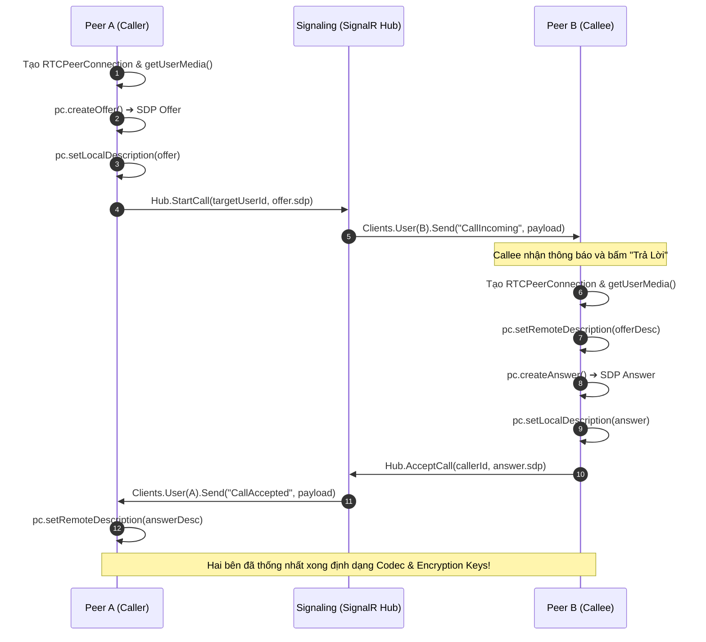
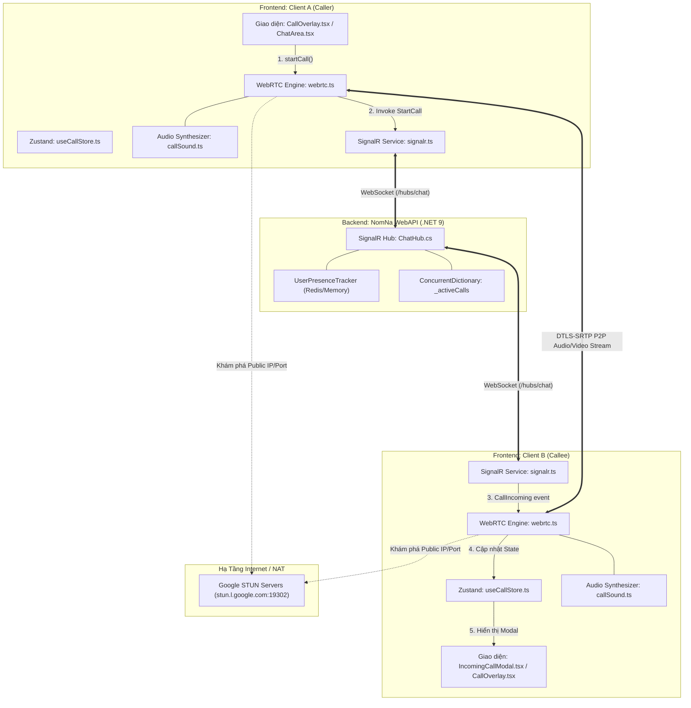

# 🌐 Toàn Thư Kiến Trúc WebRTC 1-1: Từ Nền Tảng Lý Thuyết, Thực Chiến Dự Án NomNa Đến Hướng Mở Rộng Quy Mô (SFU/Mesh)

> **Mục tiêu tài liệu:** Cung cấp tài liệu kỹ thuật toàn diện, chuyên sâu từ nền tảng đến thực chiến về công nghệ **WebRTC (Web Real-Time Communication)** áp dụng cho tính năng gọi thoại / video call 1-1 trong dự án **NomNa** (.NET 9 + SignalR + React 18 + Zustand + Tailwind CSS). Tài liệu này được biên soạn như một cẩm nang kỹ thuật cho các kỹ sư phát triển, bảo trì và mở rộng hệ thống đa phương tiện thời gian thực.

---

## Mục Lục
1. [Bản Chất Cốt Lõi Của WebRTC (WebRTC Fundamentals)](#1-bản-chất-cốt-lõi-của-webrtc-webrtc-fundamentals)
   - [1.1. WebRTC là gì? Tại sao lại dùng WebRTC thay vì WebSocket hay HTTP Streaming?](#11-webrtc-là-gì-tại-sao-lại-dùng-webrtc-thay-vì-websocket-hay-http-streaming)
   - [1.2. Mô hình P2P (Peer-to-Peer) vs Client-Server: Độ trễ, băng thông và chi phí](#12-mô-hình-p2p-peer-to-peer-vs-client-server-độ-trễ-băng-thông-và-chi-phí)
   - [1.3. Chồng giao thức WebRTC (WebRTC Protocol Stack)](#13-chồng-giao-thức-webrtc-webrtc-protocol-stack)
2. [Các Khái Niệm & Cơ Chế Trọng Yếu Trong WebRTC](#2-các-khái-niệm--cơ-chế-trọng-yếu-trong-webrtc)
   - [2.1. SDP (Session Description Protocol) & Mô hình Offer - Answer](#21-sdp-session-description-protocol--mô-hình-offer---answer)
   - [2.2. Vấn đề NAT & Tường Lửa (NAT & Firewall Traversal)](#22-vấn-đề-nat--tường-lửa-nat--firewall-traversal)
   - [2.3. Bộ ba giải pháp: ICE, STUN và TURN](#23-bộ-ba-giải-pháp-ice-stun-và-turn)
   - [2.4. Kênh Báo Hiệu (Signaling Channel) & Vai trò của SignalR](#24-kênh-báo-hiệu-signaling-channel--vai-trò-của-signalr)
   - [2.5. Luồng truyền thông: MediaStream, MediaStreamTrack và Transceivers](#25-luồng-truyền-thông-mediastream-mediastreamtrack-và-transceivers)
   - [2.6. Mã hóa & Codecs: Opus (Audio) và VP8/VP9/H.264/AV1 (Video)](#26-mã-hóa--codecs-opus-audio-và-vp8vp9h264av1-video)
3. [Kiến Trúc Triển Khai Thực Tế Trong NomNa](#3-kiến-trúc-triển-khai-thực-tế-trong-nomna)
   - [3.1. Sơ đồ kiến trúc tổng thể (System Architecture Diagram)](#31-sơ-đồ-kiến-trúc-tổng-thể-system-architecture-diagram)
   - [3.2. Bản đồ mã nguồn (Source Code Map)](#32-bản-đồ-mã-nguồn-source-code-map)
   - [3.3. Luồng hoạt động chi tiết từng bước (Step-by-Step Lifecycle Flow)](#33-luồng-hoạt-động-chi-tiết-từng-bước-step-by-step-lifecycle-flow)
     - [Pha 1: Khởi tạo cuộc gọi & Báo hiệu SDP Offer](#pha-1-khởi-tạo-cuộc-gọi--báo-hiệu-sdp-offer)
     - [Pha 2: Đổ chuông & Tiếp nhận / Từ chối](#pha-2-đổ-chuông--tiếp-nhận--từ-chối)
     - [Pha 3: Đàm phán P2P & Trao đổi ICE Candidates](#pha-3-đàm-phán-p2p--trao-đổi-ice-candidates)
     - [Pha 4: Thiết lập kết nối thành công & Phát Media Stream](#pha-4-thiết-lập-kết-nối-thành-công--phát-media-stream)
     - [Pha 5: Tương tác thời gian thực (Mute Mic, Tắt Camera, Chia sẻ màn hình)](#pha-5-tương-tác-thời-gian-thực-mute-mic-tắt-camera-chia-sẻ-màn-hình)
     - [Pha 6: Cúp máy & Giải phóng tài nguyên (Teardown & Cleanup)](#pha-6-cúp-máy--giải-phóng-tài-nguyên-teardown--cleanup)
4. [Các "Hố Đen" Kỹ Thuật Thực Chiến & Giải Pháp Trong NomNa (Pitfalls & Battle-tested Solutions)](#4-các-hố-đen-kỹ-thuật-thực-chiến--giải-pháp-trong-nomna-pitfalls--battle-tested-solutions)
   - [4.1. "Nói không ai nghe": Trình duyệt chặn Autoplay Audio & Giải pháp Isolated Pipeline](#41-nói-không-ai-nghe-trình-duyệt-chặn-autoplay-audio--giải-pháp-isolated-pipeline)
   - [4.2. "Track tới nhưng UI không đổi": Zustand Reference Equality Bug với MediaStream](#42-track-tới-nhưng-ui-không-đổi-zustand-reference-equality-bug-với-mediastream)
   - [4.3. "Đang Voice Call không share màn hình được": Kỹ thuật Pre-negotiated Dual Transceivers](#43-đang-voice-call-không-share-màn-hình-được-kỹ-thuật-pre-negotiated-dual-transceivers)
   - [4.4. "Báo kết nối ảo (Fake Connected)": Phân biệt ConnectionState vs IceConnectionState](#44-báo-kết-nối-ảo-fake-connected-phân-biệt-connectionstate-vs-iceconnectionstate)
   - [4.5. "Mất ICE Candidate đến sớm": Hàng đợi đệm pendingCandidates](#45-mất-ice-candidate-đến-sớm-hàng-đợi-đệm-pendingcandidates)
   - [4.6. "Cuộc gọi Zombie & Rớt mạng đột ngột": Quản lý Active Calls ở Backend ChatHub](#46-cuộc-gọi-zombie--rớt-mạng-đột-ngột-quản-lý-active-calls-ở-backend-chathub)
   - [4.7. "Môi trường Insecure Context trên Mobile LAN": Rào cản HTTPS của getUserMedia](#47-môi-trường-insecure-context-trên-mobile-lan-rào-cản-https-của-getusermedia)
5. [Cẩm Nang Debug & Công Cụ Khảo Sát WebRTC Thực Chiến](#5-cẩm-nang-debug--công-cụ-khảo-sát-webrtc-thực-chiến)
   - [5.1. Công cụ vàng chrome://webrtc-internals](#51-công-cụ-vàng-chromewebrtc-internals)
   - [5.2. Các chỉ số quan trọng cần giám sát (KPIs & Metrics)](#52-các-chỉ-số-quan-trọng-cần-giám-sát-kpis--metrics)
6. [Định Hướng Phát Triển Tương Lai (Future Architecture & Scalability)](#6-định-hướng-phát-triển-tương-lai-future-architecture--scalability)
   - [6.1. Từ Cuộc Gọi 1-1 đến Cuộc Gọi Nhóm: Mesh vs SFU vs MCU](#61-từ-cuộc-gọi-1-1-đến-cuộc-gọi-nhóm-mesh-vs-sfu-vs-mcu)
   - [6.2. Lựa chọn SFU cho tương lai NomNa (LiveKit vs mediasoup vs Pion)](#62-lựa-chọn-sfu-cho-tương-lai-nomna-livekit-vs-mediasoup-vs-pion)
   - [6.3. Triển khai hạ tầng TURN Server Production với Coturn & Dynamic Credentials](#63-triển-khai-hạ-tầng-turn-server-production-với-coturn--dynamic-credentials)
   - [6.4. Công nghệ nâng cao: AI Noise Suppression, Virtual Background, Simulcast](#64-công-nghệ-nâng-cao-ai-noise-suppression-virtual-background-simulcast)
7. [Bảng Tra Cứu Nhanh (Cheat Sheet) & Glossary Cho Developer](#7-bảng-tra-cứu-nhanh-cheat-sheet--glossary-cho-developer)

---

## 1. Bản Chất Cốt Lõi Của WebRTC (WebRTC Fundamentals)

### 1.1. WebRTC là gì? Tại sao lại dùng WebRTC thay vì WebSocket hay HTTP Streaming?

**WebRTC (Web Real-Time Communication)** là một bộ công nghệ mã nguồn mở (được Google khởi xướng và W3C/IETF chuẩn hóa) cho phép các trình duyệt và ứng dụng di động truyền thông âm thanh (voice), hình ảnh (video) và dữ liệu nhị phân (arbitrary data) trực tiếp giữa các thiết bị theo thời gian thực mà **không cần cài đặt plugin hoặc phần mềm bổ sung**.

#### Bảng so sánh WebRTC với WebSocket và HTTP Streaming (HLS/DASH)

| Tiêu chí | WebRTC | WebSocket | HTTP Streaming (HLS/DASH) |
| :--- | :--- | :--- | :--- |
| **Giao thức nền tảng** | **UDP** (qua SRTP/SCTP) | **TCP** | **TCP** (HTTP/1.1, HTTP/2, HTTP/3) |
| **Độ trễ trung bình** | **Sub-second (50ms – 200ms)** | 200ms – 800ms | 2 giây – 30 giây |
| **Mô hình kết nối** | **Peer-to-Peer (P2P)** hoặc qua SFU | Client - Server | Client - Server / CDN |
| **Cơ chế truyền gói** | Chấp nhận rớt gói (Drop packet) để giữ trễ thấp | Đảm bảo 100% không rớt gói (Head-of-Line Blocking) | Đảm bảo 100% không rớt gói, chia chunk buffer |
| **Chi phí băng thông Server** | **Gần như 0** (ở chế độ 1-1 P2P) | Cao (Server phải chuyển tiếp mọi byte) | Cực cao (hoặc tốn chi phí CDN) |
| **Khả năng điều chỉnh chất lượng (Congestion Control)** | Tự động thích ứng mạng linh hoạt (GCC, REMB, TWCC) | Không có sẵn (phải tự code tầng ứng dụng) | ABR qua manifest file |
| **Mục đích sử dụng chính** | Thoại tương tác, Video Call, Cloud Gaming | Tin nhắn văn bản, Notify, Realtime cursor | Livestream truyền hình, Xem bóng đá, VOD |

> **Tại sao không truyền Voice/Video qua WebSocket?**
> WebSocket chạy trên **TCP**. Đặc tính của TCP là *Reliable & Ordered Delivery*. Nếu một gói tin âm thanh bị thất lạc do nhiễu sóng Wi-Fi, TCP sẽ dừng mọi gói tin tiếp theo lại để chờ retransmit gói cũ (hiện tượng **Head-of-Line Blocking**). Trong cuộc gọi tương tác, một từ bị trễ 2 giây không còn giá trị — người nghe cần âm thanh hiện tại ngay lập tức kể cả khi chất lượng bị suy giảm đôi chút. WebRTC sử dụng **UDP**, sẵn sàng bỏ qua gói tin bị mất để duy trì độ trễ thời gian thực tuyệt đối (< 200ms).

---

### 1.2. Mô hình P2P (Peer-to-Peer) vs Client-Server: Độ trễ, băng thông và chi phí

```
   MÔ HÌNH CLIENT-SERVER TRUYỀN THỐNG                   MÔ HÌNH PEER-TO-PEER (WebRTC 1-1)
       (Mọi media đều đi qua Server)                          (Media đi trực tiếp giữa 2 máy)

     Client A ──── Media Stream ───►                      Client A ◄────────────────────────► Client B
                                    │                                  Direct P2P Media Path
                                 Server (Băng thông lớn)                 (Audio / Video / Data)
                                    │                                            ▲
     Client B ◄─── Media Stream ────┘                                            │
                                                          Client A ──► [Signaling] ◄── Client B
                                                                      (SignalR Server)
                                                                (Chỉ gửi text SDP/ICE ban đầu)
```

1. **Độ trễ (Latency):**
   - Trong mô hình P2P, gói tin đi theo đường cáp vật lý ngắn nhất giữa 2 nhà mạng (ISP). Khoảng cách địa lý gần đồng nghĩa với Ping thấp (10ms - 50ms).
   - Trong mô hình qua Server, nếu Client A và B ở Việt Nam nhưng Server đặt ở Singapore hoặc Mỹ, media phải đi vòng nửa vòng trái đất rồi quay lại, làm tăng độ trễ thêm 100ms - 300ms.
2. **Chi phí hạ tầng băng thông (Bandwidth Cost):**
   - 1 luồng video 720p 30fps tiêu tốn khoảng **1.5 Mbps**.
   - Nếu có 1.000 cuộc gọi đồng thời qua Server, Server phải gánh:
     $$1.000 \times 1.5\text{ Mbps} \times 2 = 3.000\text{ Mbps} = 3\text{ Gbps Outbound Bandwidth}$$
   - Với WebRTC P2P 1-1, Server chỉ làm nhiệm vụ báo hiệu (Signaling qua SignalR) với vài KB tin nhắn JSON. Băng thông truyền video hoàn toàn do mạng của 2 người dùng tự gánh. Chi phí server gần như bằng 0!
3. **Quyền riêng tư (End-to-End Privacy):**
   - Media truyền trực tiếp giữa 2 máy và được mã hóa bằng **DTLS-SRTP**. Server không thể nhìn thấy, giải mã hay nghe trộm nội dung cuộc gọi.

---

### 1.3. Chồng giao thức WebRTC (WebRTC Protocol Stack)

Để đảm bảo vừa nhanh, vừa bảo mật và hoạt động được trên Web, WebRTC xây dựng trên một ngăn xếp giao thức phức tạp:

```
┌─────────────────────────────────────────────────────────────┐
│                      ỨNG DỤNG WEB (JS / React / DOM)        │
├──────────────────────────────┬──────────────────────────────┤
│      MediaStream (Audio/Video)│     RTCDataChannel (Data)    │
├──────────────────────────────┼──────────────────────────────┤
│       SRTP (Secure RTP)      │       SCTP (Encrypted)       │
├──────────────────────────────┴──────────────────────────────┤
│                            DTLS                             │
├─────────────────────────────────────────────────────────────┤
│                          ICE / STUN / TURN                  │
├─────────────────────────────────────────────────────────────┤
│                             UDP                             │
├─────────────────────────────────────────────────────────────┤
│                              IP                             │
└─────────────────────────────────────────────────────────────┘
```

- **IP (Internet Protocol):** Tầng mạng định tuyến gói tin theo địa chỉ IPv4/IPv6.
- **UDP (User Datagram Protocol):** Giao thức truyền dữ liệu không kết nối, không bắt tay 3 bước, không retransmit, tối đa hóa tốc độ.
- **ICE / STUN / TURN:** Cơ chế xuyên qua tường lửa và bộ định tuyến NAT.
- **DTLS (Datagram Transport Layer Security):** Phiên bản bảo mật TLS dành cho UDP. Dùng để trao đổi khóa mã hóa giữa 2 Peer.
- **SRTP (Secure Real-time Transport Protocol):** Tầng mã hóa đối xứng (AES) truyền các gói tin Audio/Video với tiêu đề RTP.
- **SCTP (Stream Control Transmission Protocol):** Cung cấp kênh truyền dữ liệu dạng tin nhắn (DataChannel) có thể cấu hình linh hoạt (tin cậy hoặc không tin cậy).

---

## 2. Các Khái Niệm & Cơ Chế Trọng Yếu Trong WebRTC

### 2.1. SDP (Session Description Protocol) & Mô hình Offer - Answer

Để hai thiết bị bất kỳ có thể giao tiếp, chúng phải hiểu được khả năng phần cứng và định dạng truyền thông của nhau. **SDP** đóng vai trò là bản "sơ yếu lý lịch kỹ thuật" định dạng văn bản thuần túy (Plain Text).

```
SDP Chứa Những Gì?
├── Thông tin phiên: IP, Version, Thời gian hiệu lực
├── Thông tin Media: Audio (port, codec Opus), Video (port, codec VP8/H.264)
├── Thông tin mã hóa: DTLS Fingerprint, Cryptographic Setup (actpass / active)
└── Thuộc tính mạng: ICE Ufrag (username), ICE Pwd (password), candidate list
```

#### Quy trình Bắt Tay Offer - Answer:


---

### 2.2. Vấn đề NAT & Tường Lửa (NAT & Firewall Traversal)

Hầu hết các máy tính và điện thoại thông minh ngày nay **không có địa chỉ IP công khai (Public IP)** trực tiếp. Chúng nằm sau bộ định tuyến gia đình, mạng 4G/5G hoặc tường lửa công ty qua cơ chế **NAT (Network Address Translation)**.

Ví dụ: Máy bạn có IP LAN `192.168.1.15`, nhưng cả nhà bạn cùng dùng chung 1 địa chỉ IP Public do nhà mạng cung cấp (ví dụ `14.232.18.99`).

#### Bốn Loại NAT Kinh Điển:

```
┌─────────────────────────────────────────────────────────────────────────────┐
│ 1. Full Cone NAT (Dễ nhất):                                                 │
│    Mọi gói tin từ ngoài gửi vào đúng Port Public đều được map vào máy local.│
├─────────────────────────────────────────────────────────────────────────────┤
│ 2. Restricted Cone NAT:                                                     │
│    Chỉ cho phép IP ngoài gửi vào nếu máy local đã từng gửi tin tới IP đó.   │
├─────────────────────────────────────────────────────────────────────────────┤
│ 3. Port Restricted Cone NAT:                                                │
│    Chỉ cho phép gửi vào nếu máy local đã gửi tin tới đúng IP và PORT đó.    │
├─────────────────────────────────────────────────────────────────────────────┤
│ 4. Symmetric NAT (Khó nhất - Thường gặp ở 4G/5G và mạng Doanh nghiệp):     │
│    Mỗi khi máy local kết nối tới 1 IP khác nhau, router gán một Port Public │
│    hoàn toàn mới. STUN hoàn toàn vô tác dụng! Bắt buộc phải có TURN Server.  │
└─────────────────────────────────────────────────────────────────────────────┘
```

---

### 2.3. Bộ ba giải pháp: ICE, STUN và TURN

Để vượt qua mê cung NAT, WebRTC chuẩn hóa bộ ba công cụ:

```
                    ┌────────────────────────┐
                    │      STUN SERVER       │
                    │ (Hỏi: IP Public là gì?)│
                    └───────────▲────────────┘
                                │
        1. Hỏi IP Public        │
        ┌───────────────────────┘
        │
   ┌────┴─────┐                                          ┌──────────┐
   │ CLIENT A │ ════════ 2. Thử nối P2P Trực tiếp ═══════╡ CLIENT B │
   └────┬─────┘          (Thành công ~80-85% trường hợp) └────┬─────┘
        │                                                     │
        │ 3. Nếu gặp Symmetric NAT / Tường lửa chặn UDP       │
        └───────────────────────┐   ┌─────────────────────────┘
                                ▼   ▼
                    ┌────────────────────────┐
                    │      TURN SERVER       │
                    │   (Relay chuyển tiếp)   │
                    │   (Bảo đảm thông 100%)  │
                    └────────────────────────┘
```

1. **STUN (Session Traversal Utilities for NAT):**
   - Client gửi gói tin "Binding Request" tới STUN Server (ví dụ `stun.l.google.com:19302`).
   - STUN Server nhìn vào gói tin UDP và trả lời: *"Này Client, tao thấy gói tin của mày đến từ IP `14.232.18.99`, Port `45231`!"*.
   - Nhờ đó, Client biết được địa chỉ Public phản chiếu (Server Reflexive Candidate) của chính mình để đem đi cho đối phương.
   - **STUN cực kỳ nhẹ, không tốn băng thông vì chỉ trả lời vài byte IP/Port.**
2. **TURN (Traversal Using Relays around NAT):**
   - Khi cả 2 máy đều nằm sau **Symmetric NAT** (ví dụ 1 máy dùng 4G Viettel, 1 máy dùng mạng Wi-Fi công ty có tường lửa chặn P2P), việc đục lỗ NAT (UDP Hole Punching) thất bại hoàn toàn.
   - Lúc này, cả hai máy kết nối vào một máy chủ trung gian gọi là **TURN Server**.
   - Mọi luồng âm thanh/hình ảnh từ A gửi lên TURN, rồi TURN chuyển tiếp sang B.
   - **TURN bảo đảm kết nối thông 100%, nhưng tốn rất nhiều băng thông máy chủ.**
3. **ICE (Interactive Connectivity Establishment):**
   - Là một thuật toán tìm đường thông minh. Nó thu thập tất cả các địa chỉ tiềm năng của một máy (gọi là **ICE Candidates**), gồm 3 loại:
     - `host`: Địa chỉ IP nội bộ (LAN / Wi-Fi, ví dụ `192.168.1.5`).
     - `srflx` (Server Reflexive): Địa chỉ IP Public do STUN Server phát hiện.
     - `relay`: Địa chỉ trung gian qua TURN Server.
   - Sau đó hai bên trao đổi danh sách ứng viên này qua kênh Signaling, tự động thực hiện phép bắt cặp (Candidate Pairing) và đo kiểm (Connectivity Checks). Cặp nào có độ trễ thấp nhất và kết nối thành công trước sẽ được chọn làm kênh truyền chính thức.

---

### 2.4. Kênh Báo Hiệu (Signaling Channel) & Vai trò của SignalR

WebRTC cố tình **không định nghĩa giao thức Signaling trong đặc tả của mình**. Các kỹ sư có thể tự do dùng bất cứ phương tiện nào: HTTP Polling, SIP, XMPP, WebSocket... miễn là hai bên chuyển được văn bản SDP và ICE Candidates cho nhau.

Trong dự án **NomNa**, chúng tôi lựa chọn **ASP.NET Core SignalR**:
- **Tốc độ cực cao qua WebSocket nhị phân**: Độ trễ gửi tin báo hiệu chỉ vài mili-giây.
- **Tích hợp sâu với Identity & Auth**: Xác thực bằng JWT Bearer Token, lấy trực tiếp `Context.UserIdentifier` chuẩn xác.
- **Quản lý ConnectionId linh hoạt**: Hỗ trợ gọi chính xác theo `Clients.User(targetUserId)` dù người dùng mở 1 tab hay nhiều thiết bị.
- **Xử lý sự kiện ngắt kết nối (`OnDisconnectedAsync`)**: Dễ dàng phát hiện khi một bên tắt tab để dọn dẹp phòng gọi.

---

### 2.5. Luồng truyền thông: MediaStream, MediaStreamTrack và Transceivers

```
MediaStream (Ví dụ: localStream)
├── MediaStreamTrack (Audio: Micro) ──► enabled = true/false (Mute/Unmute)
└── MediaStreamTrack (Video: Camera) ──► enabled = true/false (Bật/Tắt)
```

- **`MediaStream`:** Đối tượng đại diện cho một luồng truyền thông được gom nhóm (đồng bộ thời gian giữa tiếng và hình).
- **`MediaStreamTrack`:** Từng kênh truyền riêng biệt (Audio hoặc Video).
- **`RTCRtpTransceiver`:** Đại diện cho một cặp **Sender (kênh gửi)** và **Receiver (kênh nhận)** gắn liền với một luồng SDP (`m=audio` hoặc `m=video`).
  - Hướng truyền (`direction`):
    - `sendrecv`: Vừa gửi vừa nhận (Mặc định cho cuộc gọi video hai chiều).
    - `sendonly`: Chỉ gửi (như giáo viên giảng bài trong lớp học).
    - `recvonly`: Chỉ nhận (học sinh nghe giảng).
    - `inactive`: Tạm dừng.

---

### 2.6. Mã hóa & Codecs: Opus (Audio) và VP8/VP9/H.264/AV1 (Video)

1. **Opus (Âm thanh chuẩn mực):**
   - Là codec âm thanh bắt buộc và duy nhất được ưu tiên hàng đầu trong WebRTC.
   - Hỗ trợ dải tần số lấy mẫu từ 8 kHz (thoại điện thoại hẹp) đến 48 kHz (Fullband chất lượng phòng thu).
   - Tự động thay đổi bitrate linh hoạt từ 6 kbps đến 510 kbps tùy theo tình trạng nghẽn mạng.
   - Tích hợp sẵn cơ chế chống mất gói âm thanh (In-band Forward Error Correction - FEC).
2. **Video Codecs:**
   - **VP8:** Codec tương thích tốt nhất trên 100% các trình duyệt (Chrome, Firefox, Safari, Edge), ngốn ít CPU khi decode.
   - **H.264:** Codec có hỗ trợ phần cứng (Hardware Acceleration) rất mạnh trên thiết bị di động (iPhone/iPad, Android), giúp máy không bị nóng và tiết kiệm pin.
   - **VP9 / AV1:** Nén dữ liệu tốt hơn 30-50% so với VP8 nhưng đòi hỏi năng lực xử lý CPU cao hơn.

---

## 3. Kiến Trúc Triển Khai Thực Tế Trong NomNa

### 3.1. Sơ đồ kiến trúc tổng thể (System Architecture Diagram)



---

### 3.2. Bản đồ mã nguồn (Source Code Map)

Dưới đây là bảng tra cứu đầy đủ các tập tin phụ trách tính năng WebRTC trong dự án NomNa:

| Tầng | Đường dẫn file | Vai trò chính |
| :--- | :--- | :--- |
| **Backend DTOs** | [CallModels.cs](file:///home/vanmuzic/Projects/NomNaReal/src/NomNa.Shared/Models/CallModels.cs) | Chứa các Record C# đại diện cho payload mạng: `CallOfferPayload`, `CallAnswerPayload`, `IceCandidatePayload`, `CallRejectedPayload`, `CallEndedPayload`. |
| **Backend Constants** | [SignalRConstants.cs](file:///home/vanmuzic/Projects/NomNaReal/src/NomNa.Shared/Constants/SignalRConstants.cs#L80-L98) | Khai báo hằng số chuỗi cho RPC Methods (`StartCall`, `AcceptCall`...) và Events (`CallIncoming`, `CallAccepted`...). |
| **Backend Hub** | [ChatHub.cs](file:///home/vanmuzic/Projects/NomNaReal/src/NomNa.WebAPI/Hubs/ChatHub.cs#L336-L443) | Cổng Signaling điều phối cuộc gọi, xác thực người dùng, kiểm tra `IsUserOnlineAsync`, theo dõi cặp gọi `_activeCalls` và xử lý ngắt kết nối `OnDisconnectedAsync`. |
| **Frontend Types** | [call.ts](file:///home/vanmuzic/Projects/NomNaReal/client/src/types/call.ts) | Định nghĩa TypeScript Interface cho Payloads và Union Type `CallStatus = 'idle' \| 'outgoing' \| 'incoming' \| 'connecting' \| 'connected'`. |
| **Frontend SignalR** | [signalr.ts](file:///home/vanmuzic/Projects/NomNaReal/client/src/services/signalr.ts#L405-L505) | Wrapper quản lý kết nối SignalR Client, bọc các hàm `invoke()` và `on()` cho WebRTC. |
| **Frontend Engine** | [webrtc.ts](file:///home/vanmuzic/Projects/NomNaReal/client/src/services/webrtc.ts) | Trái tim WebRTC: Khởi tạo `RTCPeerConnection`, Dual Transceivers, quản lý Local/Remote Streams, đệm ICE Candidates, hoán đổi track chia sẻ màn hình. |
| **Frontend State** | [useCallStore.ts](file:///home/vanmuzic/Projects/NomNaReal/client/src/stores/useCallStore.ts) | Zustand Store lưu trữ tập trung trạng thái cuộc gọi, luồng media, cờ bật/tắt mic/webcam/share screen và bộ đếm thời gian gọi. |
| **Frontend Sound** | [callSound.ts](file:///home/vanmuzic/Projects/NomNaReal/client/src/services/callSound.ts) | Trình tổng hợp âm thanh bằng **Web Audio API** (tạo sóng dao động Sine/Triangle), không phụ thuộc file mp3 tĩnh, cam kết không độ trễ. |
| **Frontend UI Stage** | [CallOverlay.tsx](file:///home/vanmuzic/Projects/NomNaReal/client/src/components/call/CallOverlay.tsx) | Giao diện cuộc gọi: Sân khấu toàn màn hình (Discord-style), cửa sổ thu nhỏ (PiP), tách luồng thẻ `<audio>`, thanh điều khiển và banner mở khóa tiếng. |
| **Frontend Incoming** | [IncomingCallModal.tsx](file:///home/vanmuzic/Projects/NomNaReal/client/src/components/call/IncomingCallModal.tsx) | Modal thông báo cuộc gọi đến kèm hiệu ứng Avatar xung kích và 2 nút Trả lời / Từ chối. |
| **Unit Tests** | [CallSignalingPayloadTests.cs](file:///home/vanmuzic/Projects/NomNaReal/tests/NomNa.Application.UnitTests/CallSignalingPayloadTests.cs) | Bộ kiểm thử tự động xUnit + FluentAssertions kiểm chứng tính toàn vẹn của các payload signaling. |

---

### 3.3. Luồng hoạt động chi tiết từng bước (Step-by-Step Lifecycle Flow)

#### Pha 1: Khởi tạo cuộc gọi & Báo hiệu SDP Offer
1. Người dùng A mở khung chat Direct Message với người dùng B trong [ChatArea.tsx](file:///home/vanmuzic/Projects/NomNaReal/client/src/components/chat/ChatArea.tsx) và nhấn nút **Gọi thoại** hoặc **Gọi video**.
2. Hàm `webrtcService.startCall(peer, isVideo)` được kích hoạt:
   - Dọn dẹp phiên gọi cũ nếu còn sót qua `cleanup()`.
   - Cập nhật Zustand: `setOutgoingCall(peer, isVideo)`.
   - Phát âm thanh tút tút chờ máy qua `callSound.playOutgoingRing()`.
   - Gọi `navigator.mediaDevices.getUserMedia()` lấy quyền truy cập Micro (và Camera nếu `isVideo = true`).
   - Khởi tạo đối tượng `pc = new RTCPeerConnection(RTC_CONFIG)`.
   - **Thêm Dual Transceivers:**
     - Audio: `pc.addTrack(audioTrack, stream)` hoặc `pc.addTransceiver('audio', { direction: 'sendrecv' })`.
     - Video: `pc.addTrack(cameraTrack, stream)` hoặc `pc.addTransceiver('video', { direction: 'sendrecv' })`.
   - Gọi `pc.createOffer({ offerToReceiveAudio: true, offerToReceiveVideo: true })`.
   - Lưu vào cấu hình cục bộ: `pc.setLocalDescription(offer)`.
   - Bắn RPC qua SignalR: `signalRService.startCall(targetUserId, offer.sdp, isVideo)`.
3. Server nhận `StartCall` trong [ChatHub.cs](file:///home/vanmuzic/Projects/NomNaReal/src/NomNa.WebAPI/Hubs/ChatHub.cs):
   - Kiểm tra `_presenceTracker.IsUserOnlineAsync(targetUserId)`. Nếu Callee đang Offline, server gửi ngay event `CallRejected` về cho Caller với lý do *"Người dùng hiện không trực tuyến"*, dừng đổ chuông vô ích.
   - Nếu Online, lưu cặp gọi vào `_activeCalls[callerId] = targetUserId` và `_activeCalls[targetUserId] = callerId`.
   - Chuyển tiếp payload `CallOfferPayload` tới kết nối của Callee qua `Clients.User(targetUserId).SendAsync("CallIncoming", payload)`.

#### Pha 2: Đổ chuông & Tiếp nhận / Từ chối
1. Phía Client B nhận sự kiện `CallIncoming` qua SignalR:
   - Kiểm tra trạng thái hiện tại trong `useCallStore`: Nếu `callStatus !== 'idle'`, tự động phản hồi `rejectCall(callerId, "Người nhận đang bận trong cuộc gọi khác")`.
   - Nếu đang rảnh rỗi: Kích hoạt `useCallStore.setIncomingCall(payload)` và phát chuông giai điệu tươi vui qua `callSound.playIncomingRing()`.
   - [IncomingCallModal.tsx](file:///home/vanmuzic/Projects/NomNaReal/client/src/components/call/IncomingCallModal.tsx) hiển thị lên màn hình đè lên mọi trang chat.
2. Nếu B nhấn **Từ chối (Decline)**:
   - Dừng chuông `callSound.stop()`.
   - Gửi RPC `RejectCall` lên Hub. Server báo về cho A qua `CallRejected`. Phía A phát âm báo ngắt máy `callSound.playCallEnd()` và đóng overlay sau 1.5 giây.
3. Nếu B nhấn **Trả lời (Accept)**:
   - Dừng chuông `callSound.stop()`.
   - Chuyển trạng thái store sang `setConnecting()` ("Đang kết nối...").
   - Lấy thiết bị media của B qua `getUserMedia`.
   - Khởi tạo `pc = new RTCPeerConnection(RTC_CONFIG)`.
   - Đăng ký các track của B vào PeerConnection.
   - Nạp SDP Offer của A: `pc.setRemoteDescription(new RTCSessionDescription({ type: 'offer', sdp: incomingOffer.sdp }))`.
   - Giải phóng các ứng viên ICE đã đến sớm (xem mục 4.5): `await flushPendingCandidates()`.
   - Tạo SDP Answer: `answer = await pc.createAnswer()`.
   - Nạp cấu hình cục bộ: `pc.setLocalDescription(answer)`.
   - Bắn RPC lên Server: `signalRService.acceptCall(callerId, answer.sdp)`.

#### Pha 3: Đàm phán P2P & Trao đổi ICE Candidates
1. Client A nhận được sự kiện `CallAccepted` từ SignalR:
   - Dừng âm chuông chờ máy `callSound.stop()`.
   - Chuyển trạng thái store sang `setConnecting()`.
   - Nạp Answer của B: `pc.setRemoteDescription(new RTCSessionDescription({ type: 'answer', sdp: payload.sdp }))`.
   - Giải phóng các ứng viên ICE đang đệm trong `pendingCandidates`.
2. Song song trong suốt quá trình trên, ngay khi `setLocalDescription` được gọi ở cả 2 máy, trình duyệt bắt đầu liên hệ với Google STUN Servers:
   - Mỗi khi tìm thấy một địa chỉ khả thi, trình duyệt kích hoạt event `pc.onicecandidate`.
   - Client lập tức gửi ứng viên này lên Server qua `signalRService.sendIceCandidate(targetUserId, JSON.stringify(event.candidate))`.
   - Server chuyển tiếp qua `ReceiveIceCandidate` tới máy đối diện.
   - Máy đối diện nhận được sẽ nạp vào mạng lưới tìm đường qua `pc.addIceCandidate(candidateInit)`.

#### Pha 4: Thiết lập kết nối thành công & Phát Media Stream
1. Ngay khi thuật toán ICE tìm thấy cặp IP thông suốt và bắt tay mã hóa DTLS-SRTP hoàn tất:
   - Sự kiện `pc.oniceconnectionstatechange` chuyển sang `connected` hoặc `completed`.
   - Sự kiện `pc.onconnectionstatechange` chuyển sang `connected`.
   - Store gọi `setConnected()`: Đồng hồ thời lượng bắt đầu đếm `00:00, 00:01...`.
2. Khi các luồng dữ liệu bắt đầu đổ về, sự kiện `pc.ontrack` kích hoạt:
   - Nhận track Audio và Video từ đối phương.
   - Thẻ `<audio ref={remoteAudioRef}>` cố định trong [CallOverlay.tsx](file:///home/vanmuzic/Projects/NomNaReal/client/src/components/call/CallOverlay.tsx) nhận luồng và tự động phát tiếng ra loa.
   - Thẻ `<video ref={remoteVideoRef} muted>` hiển thị khung hình camera của đối phương.

#### Pha 5: Tương tác thời gian thực (Mute Mic, Tắt Camera, Chia sẻ màn hình)
- **Mute / Unmute Microphone:**
  - Không cần gửi tín hiệu mạng. Thao tác cục bộ trực tiếp trên track:
    ```typescript
    localStream.getAudioTracks().forEach(track => { track.enabled = !isMicMuted; });
    ```
  - Khi `track.enabled = false`, WebRTC tự động gửi gói tin câm (Silence Packets), giảm mạnh băng thông và bảo đảm không phát ra tiếng.
- **Tắt / Bật Camera:**
  - Thao tác tương tự:
    ```typescript
    localStream.getVideoTracks().forEach(track => { track.enabled = !isCameraOff; });
    ```
  - Khi tắt, đối phương sẽ nhận khung hình đen hoặc sự kiện mute track, UI hiển thị Avatar thay thế.
- **Chia sẻ màn hình (Screen Sharing):**
  - Gọi API `navigator.mediaDevices.getDisplayMedia({ video: true, audio: true })`.
  - Lấy `screenTrack = screenStream.getVideoTracks()[0]`.
  - Thay thế track camera đang gửi đi bằng track màn hình qua phương thức:
    ```typescript
    const videoTransceiver = pc.getTransceivers().find(t => t.receiver.track.kind === 'video');
    await videoTransceiver.sender.replaceTrack(screenTrack);
    ```
  - Lắng nghe sự kiện người dùng bấm nút "Dừng chia sẻ" nổi trên trình duyệt (`screenTrack.onended`) để tự động hoàn trả lại webcam.

#### Pha 6: Cúp máy & Giải phóng tài nguyên (Teardown & Cleanup)
1. Khi một trong hai bên bấm nút màu đỏ **Kết thúc cuộc gọi**:
   - Gửi RPC `EndCall(peerUserId)` lên SignalR Hub.
   - Phát âm cụp máy `callSound.playCallEnd()`.
   - Hàm `cleanup()` dừng tất cả các track phần cứng (`track.stop()`) để tắt đèn tín hiệu webcam/micro trên máy tính.
   - Đóng PeerConnection (`pc.close()`).
   - Xóa dữ liệu tạm trong Zustand (`resetCall()`).
2. Phía đối diện nhận event `CallEnded`:
   - Kích hoạt tiến trình dọn dẹp tương tự và tự động đóng Overlay.
3. Server loại bỏ cặp gọi khỏi bộ nhớ:
   ```csharp
   _activeCalls.TryRemove(senderId, out _);
   _activeCalls.TryRemove(peerUserId, out _);
   ```

---

## 4. Các "Hố Đen" Kỹ Thuật Thực Chiến & Giải Pháp Trong NomNa (Pitfalls & Battle-tested Solutions)

Trong quá trình xây dựng tính năng WebRTC cho NomNa, hệ thống đã gặp phải hàng loạt bài toán hóc búa. Dưới đây là phân tích chi tiết từng vấn đề và giải pháp triệt để đã áp dụng:

---

### 4.1. "Nói không ai nghe": Trình duyệt chặn Autoplay Audio & Giải pháp Isolated Pipeline

#### ❌ Hiện tượng lỗi:
Cuộc gọi báo kết nối thành công, micro cả hai bên đều mở, nhưng hai bên **hoàn toàn không nghe thấy tiếng nhau**. Mở Console thấy xuất hiện dòng cảnh báo đỏ:
```
DOMException: play() failed because the user didn't interact with the document first.
```

#### 🔍 Nguyên nhân gốc rễ:
1. **Chính sách Autoplay của các trình duyệt hiện đại (Chrome, Safari, Edge):** Trình duyệt cấm các thẻ `<video>` hoặc `<audio>` có âm thanh tự động phát (`play()`) nếu chưa có cử chỉ người dùng (user gesture: click, tap) tương tác trực tiếp lên tài liệu gần thời điểm đó.
2. **Lỗi thẻ `<video>` không có thuộc tính `muted`:** Trước đây, remote stream (chứa cả audio và video) được gán vào thẻ `<video ref={remoteVideoRef} autoPlay playsInline />` nhưng **thiếu cờ `muted`**. Trình duyệt coi thẻ video này là một nguồn phát âm thanh và tự động đình chỉ (pause) toàn bộ quá trình render của thẻ!
3. **Lỗi Unmount thẻ `<audio>` khi thu nhỏ cửa sổ (PiP):** Thẻ audio trước đây nằm bên trong khối render có điều kiện của cửa sổ lớn. Khi người dùng bấm nút thu nhỏ để vừa gọi vừa chat, React hủy (unmount) thẻ audio cũ, dẫn đến mất tiếng hoàn toàn.

####  Giải pháp thực chiến trong NomNa:
1. **Cô lập kênh Audio riêng biệt:**
   - Trong [CallOverlay.tsx](file:///home/vanmuzic/Projects/NomNaReal/client/src/components/call/CallOverlay.tsx), đưa thẻ `<audio>` ra vị trí gốc ngoài cùng, độc lập với trạng thái `isMinimized`:
     ```tsx
     <audio ref={remoteAudioRef} autoPlay playsInline className="hidden" />
     ```
   - Đảm bảo các thẻ `<video>` (cả local và remote) **luôn luôn có `muted={true}`** để trình duyệt không bao giờ kích hoạt cơ chế chặn autoplay video.
2. **Cơ chế Bắt lỗi & Banner mở khóa âm thanh tương tác:**
   - Lắng nghe `playPromise` của thẻ audio:
     ```typescript
     const playPromise = remoteAudioRef.current.play();
     if (playPromise !== undefined) {
       playPromise
         .then(() => setIsAudioAutoplayBlocked(false))
         .catch((err) => {
           console.warn('Audio auto-play prevented by browser:', err);
           setIsAudioAutoplayBlocked(true);
         });
     }
     ```
   - Nếu bị chặn, hiển thị một Banner nổi bật trên đỉnh màn hình: *"🔊 Âm thanh bị chặn bởi trình duyệt. Bấm vào đây để bật tiếng!"*. Khi người dùng nhấn vào banner, hàm `remoteAudioRef.current.play()` được kích hoạt trong ngữ cảnh một User Gesture hợp lệ, âm thanh được mở khóa tức thì 100%.

---

### 4.2. "Track tới nhưng UI không đổi": Zustand Reference Equality Bug với MediaStream

#### ❌ Hiện tượng lỗi:
Người bên kia bật webcam, log Console hiển thị `ontrack` đã nhận được video track, nhưng màn hình bên này vẫn trơ trơ hiển thị Avatar, biến `hasRemoteVideo` trong component luôn tính ra `false`.

#### 🔍 Nguyên nhân gốc rễ:
WebRTC kích hoạt sự kiện `pc.ontrack` lần lượt cho từng track (Audio track đến trước, Video track đến sau vài chục mili-giây). Trình duyệt gắn cả 2 track này vào **cùng một thực thể đối tượng `MediaStream`** duy nhất (`event.streams[0]`).
Khi video track đến, code gọi:
```typescript
useCallStore.getState().setRemoteStream(event.streams[0]);
```
Zustand bên dưới sử dụng phép so sánh tham chiếu **`Object.is(oldState.remoteStream, newState.remoteStream)`**. Vì con trỏ bộ nhớ của `event.streams[0]` không hề thay đổi, Zustand kết luận state không thay đổi và **bỏ qua hoàn toàn việc kích hoạt React re-render**! Kết quả là React không biết có video mới để vẽ thẻ `<video>`.

####  Giải pháp thực chiến trong NomNa:
Trong [webrtc.ts](file:///home/vanmuzic/Projects/NomNaReal/client/src/services/webrtc.ts), chúng tôi áp dụng kỹ thuật **Immutability Stream Wrapper**:
```typescript
pc.ontrack = (event) => {
  if (!this.remoteStream) {
    this.remoteStream = new MediaStream();
  }

  // Tích lũy track vào instance nội bộ
  if (!this.remoteStream.getTracks().some((t) => t.id === event.track.id)) {
    this.remoteStream.addTrack(event.track);
  }

  // Luôn bọc bằng một MediaStream wrapper MỚI để tạo tham chiếu object mới cho Zustand
  useCallStore.getState().setRemoteStream(new MediaStream(this.remoteStream.getTracks()));

  // Lắng nghe thêm sự kiện un-mute khi track bắt đầu có tín hiệu
  event.track.onunmute = () => {
    if (this.remoteStream) {
      useCallStore.getState().setRemoteStream(new MediaStream(this.remoteStream.getTracks()));
    }
  };
};
```
Nhờ tạo `new MediaStream(...)`, tham chiếu bộ nhớ thay đổi, Zustand lập tức kích hoạt React re-render và video hiển thị mượt mà.

---

### 4.3. "Đang Voice Call không share màn hình được": Kỹ thuật Pre-negotiated Dual Transceivers

#### ❌ Hiện tượng lỗi:
Hai người đang gọi thoại bình thường (`isVideoCall = false`), một người bấm **Chia sẻ màn hình**. Mặc dù trình duyệt có hỏi quyền chọn cửa sổ màn hình, nhưng bên kia không thể xem được gì, màn hình vẫn là cuộc gọi thoại.

#### 🔍 Nguyên nhân gốc rễ:
Trong cuộc gọi thoại thuần túy, SDP Offer ban đầu chỉ khai báo phần mô tả âm thanh (`m=audio`), không hề có phần video (`m=video`).
Khi bạn gọi `pc.addTrack(screenTrack)`, WebRTC yêu cầu bắt buộc phải thực hiện **Đàm phán lại SDP (SDP Renegotiation: tạo Offer mới, gửi qua SignalR, nhận Answer mới)**. Nếu không renegotiate, đối phương không hề biết có video transceiver mới xuất hiện để nhận stream.

####  Giải pháp thực chiến trong NomNa:
Thay vì phải xây dựng một cỗ máy đàm phán lại SDP cực kỳ phức tạp và dễ phát sinh xung đột Race Condition (Glare condition trong đàm phán WebRTC), chúng tôi áp dụng chiến lược **Pre-negotiated Dual Transceivers (Luôn mở sẵn kênh âm thanh và hình ảnh ngay từ đầu)**:

Trong [webrtc.ts](file:///home/vanmuzic/Projects/NomNaReal/client/src/services/webrtc.ts):
```typescript
// 1. Luôn thêm transceiver Audio
if (audioTrack) {
  pc.addTrack(audioTrack, stream);
} else {
  pc.addTransceiver('audio', { direction: 'sendrecv' });
}

// 2. Luôn thêm transceiver Video (Dù cuộc gọi là Voice-only)
if (this.cameraTrack) {
  pc.addTrack(this.cameraTrack, stream);
} else {
  pc.addTransceiver('video', { direction: 'sendrecv' });
}
```
Nhờ bản đàm phán ban đầu đã có sẵn dòng `m=video`, khi người dùng bấm **Chia sẻ màn hình** hoặc **Bật Webcam**, chúng tôi chỉ cần thực hiện thay thế track:
```typescript
const videoTransceiver = pc.getTransceivers().find(t => t.receiver.track.kind === 'video');
await videoTransceiver.sender.replaceTrack(screenTrack);
```
Phương thức `replaceTrack()` hoán đổi nguồn cấp dữ liệu ở tầng RTP Sender **ngay lập tức trong 0 mili-giây, không cần đàm phán lại SDP, không tốn thêm roundtrip SignalR**!

---

### 4.4. "Báo kết nối ảo (Fake Connected)": Phân biệt ConnectionState vs IceConnectionState

#### ❌ Hiện tượng lỗi:
Người gọi vừa bấm máy và người nhận bấm "Trả lời", đồng hồ cuộc gọi lập tức nhảy `00:01, 00:02`, trạng thái hiện *"Đã kết nối"*. Nhưng thực tế 2 máy chưa nghe thấy gì, và sau 5 giây thì báo lỗi ngắt kết nối do mạng không thông được.

#### 🔍 Nguyên nhân gốc rễ:
Code trước đây gọi `setConnected()` ngay khi nhận được bản tin `CallAccepted` từ SignalR. Nhưng bản tin này chỉ có nghĩa là hai bên đã trao đổi xong SDP! Lúc này tiến trình thăm dò mạng ICE (ICE gathering & checks) mới chỉ bắt đầu. Hai máy có thể không bao giờ chạm được tới nhau nếu gặp tường lửa chặn UDP.

####  Giải pháp thực chiến trong NomNa:
1. Bổ sung trạng thái trung gian `connecting` vào `CallStatus` trong [call.ts](file:///home/vanmuzic/Projects/NomNaReal/client/src/types/call.ts):
   - Khi nhận Answer: Chuyển sang `connecting` (Hiển thị: *"Đang thiết lập kết nối P2P..."*).
2. Chỉ chuyển sang `connected` khi **trạng thái mạng vật lý thực sự thành công**:
   ```typescript
   pc.oniceconnectionstatechange = () => {
     if (pc.iceConnectionState === 'connected' || pc.iceConnectionState === 'completed') {
       useCallStore.getState().setConnected();
     } else if (pc.iceConnectionState === 'failed') {
       useCallStore.getState().setError('Không thể thiết lập kết nối mạng trực tiếp P2P.');
       setTimeout(() => this.endCall(), 2500);
     }
   };
   ```

---

### 4.5. "Mất ICE Candidate đến sớm": Hàng đợi đệm pendingCandidates

#### ❌ Hiện tượng lỗi:
Đôi khi cuộc gọi kết nối rất chậm hoặc thất bại bất thường, Console báo lỗi:
```
OperationError: Failed to execute 'addIceCandidate' on 'RTCPeerConnection': 
The remote description was null.
```

#### 🔍 Nguyên nhân gốc rễ (Race Condition):
Tốc độ mạng truyền gói tin SignalR mang ICE Candidate của người gọi có thể tới máy người nhận **trước khi** người nhận kịp hoàn tất xử lý hàm bất đồng bộ `pc.setRemoteDescription(offerDesc)`.
Theo chuẩn WebRTC, bạn không thể nạp `addIceCandidate` khi máy chưa biết Remote Description là gì. Nếu nạp ngay lúc này, trình duyệt sẽ quăng ngoại lệ và vứt bỏ ứng viên đó, dẫn đến thiếu địa chỉ IP để thông mạng.

####  Giải pháp thực chiến trong NomNa:
Áp dụng cơ chế **Hàng đợi đệm (Candidate Buffering Queue)** trong [webrtc.ts](file:///home/vanmuzic/Projects/NomNaReal/client/src/services/webrtc.ts):
```typescript
private pendingCandidates: RTCIceCandidateInit[] = [];

// Khi nhận được candidate từ SignalR:
signalRService.onReceiveIceCandidate(async (payload) => {
  const candidateInit = typeof payload.candidate === 'string' 
    ? JSON.parse(payload.candidate) 
    : payload.candidate;

  if (this.peerConnection && this.peerConnection.remoteDescription) {
    // Nếu remoteDescription đã sẵn sàng -> Nạp ngay
    await this.peerConnection.addIceCandidate(candidateInit);
  } else {
    // Nếu chưa xong -> Đẩy vào hàng đợi đệm
    this.pendingCandidates.push(candidateInit);
  }
});

// Ngay sau khi setRemoteDescription() hoàn tất:
private async flushPendingCandidates(): Promise<void> {
  while (this.pendingCandidates.length > 0) {
    const candidateInit = this.pendingCandidates.shift();
    if (candidateInit && this.peerConnection) {
      await this.peerConnection.addIceCandidate(candidateInit);
    }
  }
}
```

---

### 4.6. "Cuộc gọi Zombie & Rớt mạng đột ngột": Quản lý Active Calls ở Backend ChatHub

#### ❌ Hiện tượng lỗi:
Hai người đang gọi nhau, máy A hết pin sập nguồn hoặc người dùng A tắt luôn tab trình duyệt. Phía máy B vẫn tiếp tục đếm giây `03:45, 03:46`, bị kẹt trong phòng gọi vô thời hạn.

####  Giải pháp thực chiến trong NomNa:
Trong [ChatHub.cs](file:///home/vanmuzic/Projects/NomNaReal/src/NomNa.WebAPI/Hubs/ChatHub.cs), chúng tôi duy trì một bảng tra cứu luồng gọi đồng thời:
```csharp
private static readonly ConcurrentDictionary<Guid, Guid> _activeCalls = new();
```
- Khi cuộc gọi bắt đầu (`StartCall` / `AcceptCall`):
  ```csharp
  _activeCalls[callerId] = targetUserId;
  _activeCalls[targetUserId] = callerId;
  ```
- Khi cúp máy bình thường (`RejectCall` / `EndCall`):
  ```csharp
  _activeCalls.TryRemove(callerId, out _);
  _activeCalls.TryRemove(targetUserId, out _);
  ```
- **Khi một kết nối WebSocket bị đứt (`OnDisconnectedAsync`):**
  ```csharp
  if (Guid.TryParse(userIdStr, out var userId))
  {
      if (_activeCalls.TryRemove(userId, out var partnerId))
      {
          _activeCalls.TryRemove(partnerId, out _);
          await Clients.User(partnerId.ToString()).SendAsync(
              SignalRConstants.Events.CallEnded,
              new CallEndedPayload(userId));
      }
  }
  ```
Bất kể người dùng tắt tab, rớt mạng hay crash trình duyệt, server SignalR sẽ tự động dọn dẹp và gửi lệnh `CallEnded` tới đối tác ngay tức khắc.

---

### 4.7. "Môi trường Insecure Context trên Mobile LAN": Rào cản HTTPS của getUserMedia

#### ❌ Hiện tượng lỗi:
Test giữa 2 tab trên máy tính (`http://localhost:5173`) thì gọi được. Nhưng khi dùng điện thoại truy cập qua mạng Wi-Fi nội bộ bằng địa chỉ IP máy tính (`http://192.168.1.15:5173` hoặc `http://10.177.216.130:5173`) thì bấm gọi bị báo lỗi ngay:
```
TypeError: Cannot read properties of undefined (reading 'getUserMedia')
```

#### 🔍 Nguyên nhân gốc rễ:
Đặc tả bảo mật của W3C quy định: Các API phần cứng nhạy cảm liên quan đến quyền riêng tư như Micro, Webcam (`navigator.mediaDevices.getUserMedia`) và Chia sẻ màn hình (`getDisplayMedia`) **chỉ hoạt động trong môi trường bảo mật (Secure Contexts)**.
- Secure Contexts bao gồm: `https://...` và `http://localhost`.
- Mọi địa chỉ IP thông thường qua HTTP (như `http://192.168.x.x` hay `http://10.x.x.x`) bị trình duyệt coi là **Insecure Context**. Trình duyệt tự động ẩn hoặc xóa luôn đối tượng `navigator.mediaDevices`!

####  Giải pháp thực chiến:
1. **Đối với môi trường Development khi cần test điện thoại:**
   - Sử dụng giải pháp tạo đường hầm HTTPS an toàn như **ngrok**:
     ```bash
     ngrok http 5173
     ```
   - Dùng đường dẫn HTTPS do ngrok cấp (ví dụ `https://xxxx.ngrok-free.app`) để mở trên điện thoại.
   - Trong [vite.config.ts](file:///home/vanmuzic/Projects/NomNaReal/client/vite.config.ts), cấu hình `allowedHosts: true` và `host: true` để chấp nhận Host header từ ngrok.
2. **Đối với môi trường Production:**
   - Bắt buộc cấu hình chứng chỉ SSL/TLS (Let's Encrypt) qua Nginx Reverse Proxy. Mọi truy cập HTTP đều tự động chuyển hướng (301 Redirect) sang HTTPS.

---

## 5. Cẩm Nang Debug & Công Cụ Khảo Sát WebRTC Thực Chiến

### 5.1. Công cụ vàng chrome://webrtc-internals

Khi gặp bất kỳ sự cố nào liên quan đến WebRTC, công cụ quan trọng nhất của mọi kỹ sư là mở một tab mới trên Chrome và gõ:
```
chrome://webrtc-internals
```

Tab này cung cấp toàn bộ bức tranh X-quang của kết nối WebRTC:
1. **Lịch sử gọi API (API Trace):** Xem chi tiết từng hàm `createOffer`, `setLocalDescription`, `addIceCandidate` kèm thời gian chính xác từng mili-giây.
2. **Bản tin SDP thô:** Xem chi tiết SDP Offer và Answer để biết hai bên đang đàm phán những Codec nào, bitrate ra sao.
3. **Danh sách ICE Candidates:** Xem toàn bộ ứng viên của máy mình và đối phương (IP nội bộ, IP Public, Port, giao thức UDP hay TCP).
4. **Cặp kết nối được chọn (Selected Candidate Pair):** Cho biết cuộc gọi đang chạy P2P trực tiếp hay qua Relay, Round Trip Time (RTT) hiện tại là bao nhiêu mili-giây.

---

### 5.2. Các chỉ số quan trọng cần giám sát (KPIs & Metrics)

Trong tab `webrtc-internals` hoặc qua API `pc.getStats()`, các chỉ số sau quyết định chất lượng cuộc gọi:

| Chỉ số (Metric) | Ý nghĩa kỹ thuật | Ngưỡng tiêu chuẩn cho trải nghiệm tốt |
| :--- | :--- | :--- |
| **`roundTripTime` (RTT)** | Thời gian gói tin đi từ máy mình sang đối phương rồi quay lại. | **< 150ms** (Rất tốt), 150-300ms (Chấp nhận được), > 350ms (Bắt đầu bị hiện tượng nói đè lên nhau). |
| **`packetsLost`** | Số lượng gói tin âm thanh/hình ảnh bị rơi trên đường truyền. | **< 2%** (Không nhận ra), 2% - 5% (Ngắt quãng nhẹ), > 8% (Robot voice). |
| **`jitter`** | Sự biến thiên về độ trễ giữa các gói tin liên tiếp. | **< 30ms**. Jitter cao chứng tỏ mạng chập chờn, bộ đệm (Jitter Buffer) phải làm việc vất vả. |
| **`audioInputLevel` / `audioOutputLevel`** | Mức âm lượng thu từ micro và phát ra loa. | Dùng để debug xem micro có thu được tiếng không hay người dùng nói nhưng mic bị hỏng. |
| **`bytesReceived` / `bytesSent`** | Tổng dung lượng đã truyền. | Tăng đều theo thời gian. Nếu dừng tăng chứng tỏ luồng media bị nghẽn hoặc đứt kết nối. |

---

## 6. Định Hướng Phát Triển Tương Lai (Future Architecture & Scalability)

Tính năng hiện tại của NomNa là **P2P 1-1 Call**, tối ưu hoàn hảo cho các cuộc trò chuyện riêng tư giữa 2 người dùng qua Direct Message. Tuy nhiên, khi mở rộng hệ thống phục vụ Voice Channel trong Server (tương tự phòng voice của Discord), kiến trúc P2P sẽ bộc lộ giới hạn vật lý.

---

### 6.1. Từ Cuộc Gọi 1-1 đến Cuộc Gọi Nhóm: Mesh vs SFU vs MCU

Khi số lượng người tham gia trong một kênh âm thanh/hình ảnh tăng lên $N$ người, có 3 mô hình kiến trúc xử lý:

```
    MÔ HÌNH MESH (P2P)                   MÔ HÌNH SFU (Selective Forwarding)           MÔ HÌNH MCU (Multipoint Mixing)
(Mỗi người gửi cho tất cả)               (Gửi 1 luồng lên, Server chia tiếp)           (Server giải mã & Mix lại 1 luồng)

      A ◄─────────► B                                    A                                           A
      ▲ \         / ▲                                    ▲                                           ▲
      │  \       /  │                                    │ (Gửi 1, Nhận N-1)                         │ (Gửi 1, Nhận 1)
      │   \     /   │                                    ▼                                           ▼
      │    \   /    │                             ┌─────────────┐                             ┌─────────────┐
      │     \ /     │                     B ◄────►│  SFU SERVER │◄────► C             B ◄────►│  MCU SERVER │◄────► C
      │      X      │                             └─────────────┘                             │ (Mix Video) │
      │     / \     │                                    ▲                                    └─────────────┘
      │    /   \    │                                    │                                           ▲
      ▼   /     \   ▼                                    ▼                                           ▼
      C ◄─────────► D                                    D                                           D
```

#### Bảng so sánh 3 mô hình cuộc gọi đa điểm:

| Tiêu chí | Mesh (Full-Mesh P2P) | SFU (Selective Forwarding Unit) | MCU (Multipoint Control Unit) |
| :--- | :--- | :--- | :--- |
| **Bản chất hoạt động** | Mỗi client mở $N-1$ kết nối P2P tới tất cả mọi người. | Client gửi **1 luồng duy nhất** lên Server. Server forward luồng đó cho các client khác. | Server nhận $N$ luồng, giải mã, ghép (composite) thành 1 luồng hình duy nhất gửi về. |
| **Số luồng Client gửi (Up)** | $N - 1$ luồng (Rất nặng upload) | **1 luồng** (Tối ưu upload) | **1 luồng** |
| **Băng thông mạng Client** | $O(N^2)$ — Quá tải khi $N \ge 4$ | $O(N)$ — Mượt mà tới $50 - 100$ người | $O(1)$ — Rất nhẹ cho client |
| **Tải CPU trên Server** | **Gần như 0%** (Chỉ signaling) | **Rất thấp** (Chỉ copy packet ở tầng định tuyến RTP, không decode) | **Cực cao** (Phải giải mã và render video liên tục, tốn GPU/CPU) |
| **Độ trễ (Latency)** | Nhỏ nhất (< 100ms) | Rất nhỏ (100ms - 200ms) | Cao (300ms - 600ms do phải encode lại) |
| **Chi phí vận hành** | Rẻ nhất | Trung bình | Đắt đỏ nhất |
| **Phù hợp cho** | **Gọi 1-1 (NomNa hiện tại)** | **Phòng họp, Voice Channel (Discord/Zoom)** | Thiết bị phần cứng cũ, viễn thông truyền thống |

---

### 6.2. Lựa chọn SFU cho tương lai NomNa (LiveKit vs mediasoup vs Pion)

Khi NomNa phát triển tính năng **Kênh thoại Server (Voice Channels)** cho phép 10 - 50 người cùng vào đàm thoại và livestream game, chúng tôi khuyến nghị tích hợp **SFU (Selective Forwarding Unit)**:

```
┌────────────────────────────────────────────────────────────────────────────────────────┐
│ KHUYẾN NGHỊ: LIVEKIT (https://livekit.io)                                             │
├────────────────────────────────────────────────────────────────────────────────────────┤
│ • Viết bằng ngôn ngữ Go, hiệu năng định tuyến hàng triệu packet/giây.                  │
│ • Cung cấp sẵn Client SDK chất lượng cao cho React / TypeScript.                      │
│ • Cung cấp Server SDK cho C# / .NET giúp tạo Room Token và quản lý quyền người dùng.  │
│ • Hỗ trợ sẵn tính năng Simulcast, Adaptive Bitrate, và E2EE.                          │
│ • Mã nguồn mở hoàn toàn, có thể tự host qua Docker Compose cực kỳ tiện lợi.           │
└────────────────────────────────────────────────────────────────────────────────────────┘
```

---

### 6.3. Triển khai hạ tầng TURN Server Production với Coturn & Dynamic Credentials

Hiện tại dự án đang sử dụng danh sách máy chủ STUN công cộng miễn phí của Google (`stun.l.google.com:19302`). Các máy chủ này chỉ giúp vượt qua các loại NAT thông thường. Trong môi trường doanh nghiệp hoặc mạng di động 4G/5G với Symmetric NAT, khoảng **10% - 15% cuộc gọi sẽ không thể kết nối được nếu thiếu TURN Server**.

#### Kế hoạch triển khai:
1. Triển khai máy chủ mã nguồn mở **Coturn** trên một VPS Ubuntu độc lập có IP Public tĩnh.
2. Cấu hình sinh thông tin đăng nhập tạm thời (Time-limited Ephemeral Credentials) theo chuẩn HMAC-SHA1 trong backend .NET:
   ```csharp
   // Sinh username có hạn sử dụng (timestamp) và password mã hóa HMAC
   var timestamp = DateTimeOffset.UtcNow.AddHours(2).ToUnixTimeSeconds();
   var username = $"{timestamp}:{userId}";
   var password = ComputeHmacSha1(username, turnSecretKey);
   ```
3. Khi client bắt đầu cuộc gọi, gọi API lấy danh sách ICE Servers động để nạp vào `RTCConfiguration`.

---

### 6.4. Công nghệ nâng cao: AI Noise Suppression, Virtual Background, Simulcast

1. **AI Noise Suppression (Lọc ồn thông minh):**
   - Tích hợp thư viện **RNNoise** được biên dịch sang **WebAssembly (WASM)**.
   - Chèn một bộ xử lý âm thanh `AudioWorkletNode` vào giữa micro và PeerConnection. Các tiếng ồn như tiếng gõ bàn phím cơ, tiếng còi xe, tiếng quạt gió sẽ bị triệt tiêu hoàn toàn trước khi gửi đi.
2. **Virtual Background (Làm mờ / Đổi hình nền Webcam):**
   - Sử dụng mô hình AI nhẹ chạy trên trình duyệt (như Google MediaPipe Selfie Segmentation hoặc TensorFlow.js).
   - Tách nền người gọi theo thời gian thực và vẽ lên một thẻ `<canvas>`, sau đó dùng `canvas.captureStream()` để truyền đi.
3. **Simulcast (Phát nhiều luồng phân giải đồng thời):**
   - Khi chia sẻ màn hình hoặc video trong cuộc gọi nhóm, người gửi phát đồng thời 3 độ phân giải: Cao (720p), Trung bình (360p), Thấp (180p).
   - Server SFU sẽ tự động phân phát luồng 180p cho những người dùng có mạng yếu hoặc đang xem màn hình thu nhỏ, và gửi luồng 720p cho người dùng xem toàn màn hình.

---

## 7. Bảng Tra Cứu Nhanh (Cheat Sheet) & Glossary Cho Developer

```
┌─────────────────┬────────────────────────────────────────────────────────────────────┐
│ Thuật ngữ       │ Định nghĩa ngắn gọn                                                │
├─────────────────┼────────────────────────────────────────────────────────────────────┤
│ P2P             │ Peer-to-Peer: Kết nối ngang hàng trực tiếp giữa 2 máy.            │
│ Signaling       │ Kênh báo hiệu trung gian (SignalR) để trao đổi thông tin ban đầu.  │
│ SDP             │ Bản mô tả khả năng truyền thông (Codecs, Encryption, Network).     │
│ Offer           │ Bản tin SDP khởi tạo từ phía người gọi (Caller).                   │
│ Answer          │ Bản tin SDP phản hồi từ phía người nhận (Callee).                  │
│ ICE             │ Thuật toán tìm đường và đục lỗ tường lửa kết nối 2 máy.           │
│ ICE Candidate   │ Một địa chỉ IP:Port tiềm năng để thử kết nối (Host, Srflx, Relay). │
│ STUN            │ Máy chủ giúp Client biết được địa chỉ IP Public của chính mình.    │
│ TURN            │ Máy chủ Relay chuyển tiếp toàn bộ gói tin khi P2P thất bại.        │
│ DTLS-SRTP       │ Cơ chế bắt tay và mã hóa bảo mật toàn bộ âm thanh/hình ảnh.       │
│ Transceiver     │ Bộ ghép cặp 1 Sender và 1 Receiver đại diện cho 1 loại media.      │
│ replaceTrack    │ Thay thế nguồn cấp dữ liệu video/audio mà không cần đàm phán lại. │
│ Web Audio API   │ API JavaScript tạo âm thanh chuông gọi trực tiếp bằng sóng số.     │
└─────────────────┴────────────────────────────────────────────────────────────────────┘
```

---

> **Tài liệu tham khảo chính thức:**
> - W3C WebRTC 1.0 Specification: https://www.w3.org/TR/webrtc/
> - IETF RFC 5245 (ICE), RFC 5389 (STUN), RFC 5766 (TURN), RFC 8866 (SDP)
> - WebRTC Architecture & Guides: https://webrtc.org/getting-started/overview
> - Mozilla Developer Network (MDN) WebRTC API: https://developer.mozilla.org/en-US/docs/Web/API/WebRTC_API
