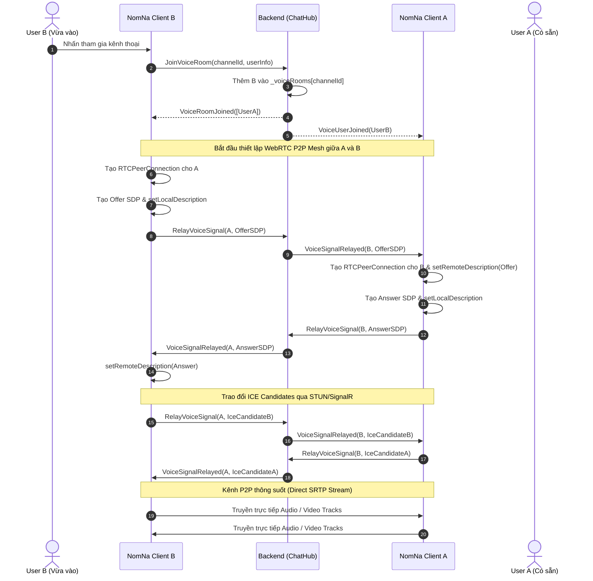
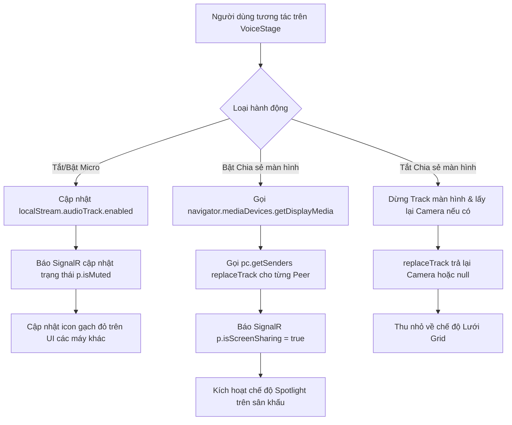

# 🌐 Cẩm Nang Toàn Diện Về WebRTC: Cơ Chế STUN/TURN/ICE, Hiện Trạng Triển Khai NomNa & Lộ Trình Mở Rộng

---

## 📑 Mục Lục
1. [Bản Chất Cốt Lõi Của WebRTC](#1-bản-chất-cốt-lõi-của-webrtc)
   - [1.1. WebRTC là gì & Tại sao lại dùng WebRTC?](#11-webrtc-là-gì--tại-sao-lại-dùng-webrtc)
   - [1.2. Chồng giao thức WebRTC (UDP, SRTP, DTLS, SCTP)](#12-chồng-giao-thức-webrtc-udp-srtp-dtls-sctp)
   - [1.3. Cơ chế đàm phán SDP (Session Description Protocol)](#13-cơ-chế-đàm-phán-sdp-session-description-protocol)
2. [Tất Tần Tật Về NAT, STUN, TURN & ICE](#2-tất-tần-tật-về-nat-stun-turn--ice)
   - [2.1. Vấn đề NAT & Phân loại NAT (Full Cone vs Symmetric NAT)](#21-vấn-đề-nat--phân-loại-nat-full-cone-vs-symmetric-nat)
   - [2.2. STUN Server (RFC 5389): Khám phá IP công khai](#22-stun-server-rfc-5389-khám-phá-ip-công-khai)
   - [2.3. TURN Server (RFC 5766): Chuyển tiếp luồng khi bế tắc](#23-turn-server-rfc-5766-chuyển-tiếp-luồng-khi-bế-tắc)
   - [2.4. ICE Framework (RFC 8445): Thu thập và bắt cặp Candidate](#24-ice-framework-rfc-8445-thu-thập-và-bắt-cặp-candidate)
3. [Hiện Trạng Áp Dụng Trong Dự Án NomNa](#3-hiện-trạng-áp-dụng-trong-dự-án-nomna)
   - [3.1. Cuộc gọi 1-1 (Direct P2P Call)](#31-cuộc-gọi-1-1-direct-p2p-call)
   - [3.2. Phòng thoại & Sân khấu nhóm (Voice Channel & Stage - Multi-Peer Mesh)](#32-phòng-thoại--sân-khấu-nhóm-voice-channel--stage---multi-peer-mesh)
   - [3.3. Tín hiệu Signaling qua .NET 9 SignalR Hub](#33-tín-hiệu-signaling-qua-net-9-signalr-hub)
   - [3.4. Quản lý Transceivers & Tráo luồng Media (`replaceTrack`)](#34-quản-lý-transceivers--tráo-luồng-media-replacetrack)
   - [3.5. Hệ thống Web Audio Pipeline độc lập (Per-Peer GainNode & Volume)](#35-hệ-thống-web-audio-pipeline-độc-lập-per-peer-gainnode--volume)
   - [3.6. Voice Activity Detection (VAD) & Đo năng lượng sóng âm](#36-voice-activity-detection-vad--đo-năng-lượng-sóng-âm)
   - [3.7. Tin nhắn thoại (Voice Note): Waveform & Bộ giải mã Web Audio](#37-tin-nhắn-thoại-voice-note-waveform--bộ-giải-mã-web-audio)
4. [Luồng Hoạt Động Chi Tiết (Detailed Activity Flows)](#4-luồng-hoạt-động-chi-tiết-detailed-activity-flows)
   - [4.1. Sơ đồ tuần tự tham gia phòng thoại đa người dùng](#41-sơ-đồ-tuần-tự-tham-gia-phòng-thoại-đa-người-dùng)
   - [4.2. Luồng xử lý Bật/Tắt Micro, Camera, Chia sẻ màn hình](#42-luồng-xử-lý-bậttắt-micro-camera-chia-sẻ-màn-hình)
   - [4.3. Luồng ngắt kết nối & Giải phóng tài nguyên](#43-luồng-ngắt-kết-nối--giải-phóng-tài-nguyên)
5. [Đánh Giá Kiến Trúc: Mesh vs SFU vs MCU](#5-đánh-giá-kiến-trúc-mesh-vs-sfu-vs-mcu)
6. [Kế Hoạch & Lộ Trình Nâng Cấp Tương Lai (Future Plan & Roadmap)](#6-kế-hoạch--lộ-trình-nâng-cấp-tương-lai-future-plan--roadmap)
   - [Pha 1: Triển khai Coturn Server Production (STUN/TURN)](#pha-1-triển-khai-coturn-server-production-stunturn)
   - [Pha 2: Chuyển dịch từ Full Mesh sang SFU (LiveKit / mediasoup)](#pha-2-chuyển-dịch-từ-full-mesh-sang-sfu-livekit--mediasoup)
   - [Pha 3: Công nghệ nâng cao (Simulcast, SVC, AI Noise Suppression)](#pha-3-công-nghệ-nâng-cao-simulcast-svc-ai-noise-suppression)

---

## 1. Bản Chất Cốt Lõi Của WebRTC

### 1.1. WebRTC là gì & Tại sao lại dùng WebRTC?
**WebRTC (Web Real-Time Communication)** là bộ tiêu chuẩn mở do Google khởi xướng và được W3C / IETF chuẩn hóa, cho phép các trình duyệt và thiết bị di động truyền thông âm thanh (Audio), hình ảnh (Video) và dữ liệu nhị phân (Data) theo thời gian thực trực tiếp giữa các máy khách (*Peer-to-Peer*) mà không cần cài thêm plugin hay phần mềm trung gian.

#### Bảng so sánh WebRTC với WebSocket và HTTP Streaming (HLS/DASH):
| Tiêu chí | WebRTC | WebSocket | HTTP Streaming (HLS/DASH) |
| :--- | :--- | :--- | :--- |
| **Giao thức mạng** | **UDP** (qua SRTP / SCTP) | **TCP** | **TCP** (HTTP/1.1, HTTP/2) |
| **Độ trễ trung bình** | **Sub-second (50ms – 200ms)** | 200ms – 800ms | 2 giây – 30 giây |
| **Đặc tính truyền** | Chấp nhận rớt gói (Drop packet) để giữ độ trễ thấp | Đảm bảo 100% không rớt gói (*Head-of-Line Blocking*) | Buffer từng đoạn file (Chunks) |
| **Bảo mật** | Mã hóa bắt buộc: DTLS & SRTP | Tùy chọn (WSS) | Tùy chọn (HTTPS) |
| **Mục đích phù hợp** | Voice/Video call tương tác tức thời | Tin nhắn chat, thông báo, realtime cursor | Livestream truyền hình, bóng đá, VOD |

> [!NOTE]
> **Tại sao không thể truyền Video/Voice qua WebSocket?**  
> WebSocket dựa trên nền TCP. TCP có cơ chế *Reliable Delivery* (giao hàng tin cậy): khi một gói tin âm thanh bị mất do sóng Wi-Fi chập chờn, TCP sẽ **dừng toàn bộ các gói tin tiếp theo lại** để chờ truyền lại gói cũ (*Head-of-Line Blocking*). Trong một cuộc hội thoại, từ ngữ phát ra 2 giây trước đã trở thành vô nghĩa. WebRTC dùng UDP, sẵn sàng bỏ qua gói tin bị mất và áp dụng thuật toán che giấu lỗi âm thanh (Packet Loss Concealment) để giữ độ trễ luôn dưới 200ms.

---

### 1.2. Chồng giao thức WebRTC (UDP, SRTP, DTLS, SCTP)

WebRTC không phải là một giao thức đơn lẻ mà là sự kết hợp của nhiều giao thức chuẩn hóa:

```
┌────────────────────────────────────────────────────────┐
│               Ứng Dụng (Application / UI)              │
├──────────────────────────┬─────────────────────────────┤
│   Audio / Video Streams  │       DataChannel           │
├──────────────────────────┼─────────────────────────────┤
│           SRTP           │           SCTP              │
├──────────────────────────┴─────────────────────────────┤
│                          DTLS                          │
├────────────────────────────────────────────────────────┤
│                          ICE                           │
├────────────────────────────────────────────────────────┤
│                      STUN / TURN                       │
├────────────────────────────────────────────────────────┤
│                          UDP                           │
└────────────────────────────────────────────────────────┘
```

1. **UDP (User Datagram Protocol)**: Tầng vận chuyển nền tảng mang lại tốc độ truyền tải nhanh nhất, không overhead bắt tay 3 bước của TCP.
2. **DTLS (Datagram Transport Layer Security)**: Cung cấp xác thực và bảo mật ngang hàng (tương đương TLS trên TCP). Dùng để trao đổi khóa mã hóa giữa hai máy khách.
3. **SRTP (Secure Real-time Transport Protocol)**: Giao thức truyền tải luồng media âm thanh và hình ảnh đã được mã hóa bằng khóa sinh ra từ DTLS.
4. **SCTP (Stream Control Transmission Protocol)**: Chạy trên DTLS để phục vụ cho `RTCDataChannel` (truyền file, dữ liệu dạng bản tin).

---

### 1.3. Cơ chế đàm phán SDP (Session Description Protocol)

Trước khi hai máy khách có thể truyền luồng media cho nhau, chúng phải thống nhất về khả năng giải mã đa phương tiện (Codecs), độ phân giải, băng thông và địa chỉ mạng. Bản mô tả này được gọi là **SDP**.

Quá trình này diễn ra theo mô hình **Offer / Answer**:
1. **Peer A tạo Offer SDP**: Thống kê danh sách Codecs máy A hỗ trợ (Opus 48kHz, VP8, H.264), số lượng track (1 audio, 1 video).
2. **Peer A gán LocalDescription** (`pc.setLocalDescription(offer)`).
3. **Peer A gửi Offer sang Peer B** qua kênh Signaling (SignalR).
4. **Peer B nhận Offer** và gán RemoteDescription (`pc.setRemoteDescription(offer)`).
5. **Peer B tạo Answer SDP**: Chọn codec tương thích chung (ví dụ cả 2 đều hỗ trợ Opus và VP8).
6. **Peer B gán LocalDescription** (`pc.setLocalDescription(answer)`).
7. **Peer B gửi Answer về cho Peer A** qua Signaling.
8. **Peer A nhận Answer** và gán RemoteDescription (`pc.setRemoteDescription(answer)`).

---

## 2. Tất Tần Tật Về NAT, STUN, TURN & ICE

Trong mạng Internet hiện đại, hầu hết các thiết bị máy tính và điện thoại đều **không có địa chỉ IP công khai (Public IP)** mà nằm sau Router gia đình, mạng 4G/5G của nhà mạng, hoặc Firewall của công ty. Thiết bị này nằm trong mạng cục bộ (Private IP như `192.168.1.x` hoặc `10.x.x.x`).

```
[Peer A: 192.168.1.15] ──► [ Router NAT A: 115.78.2.14 ] ───► INTERNET ◄─── [ Router NAT B: 14.161.4.22 ] ◄── [Peer B: 192.168.0.8]
```

### 2.1. Vấn đề NAT & Phân loại NAT
**NAT (Network Address Translation)** là kỹ thuật mà Router thay thế địa chỉ IP/Port nội bộ bằng IP/Port công khai của Router khi gửi gói tin ra Internet.

Có 4 loại NAT cơ bản:
1. **Full Cone NAT (1-to-1 NAT)**: Dễ kết nối nhất. Khi cổng nội bộ được ánh xạ ra cổng công khai, bất kỳ ai từ Internet cũng có thể gửi dữ liệu về cổng này.
2. **Address-Restricted Cone NAT**: Chỉ máy chủ ngoài Internet mà client từng gửi dữ liệu tới mới có quyền gửi dữ liệu ngược lại.
3. **Port-Restricted Cone NAT**: Chỉ máy chủ có đúng cả IP và Port mà client từng gửi tới mới có quyền gửi dữ liệu ngược lại.
4. **Symmetric NAT (NAT Đối xứng)**: Khó khăn nhất! Mỗi khi client gửi tới một địa chỉ đích khác nhau (kể cả cùng IP nhưng khác Port), Router sẽ mở một cổng công khai **HOÀN TOÀN MỚI**.
   - Hầu hết mạng di động **4G/5G, mạng Wi-Fi công ty, trường học** đều dùng Symmetric NAT.
   - P2P trực tiếp giữa hai máy Symmetric NAT **không thể kết nối qua STUN**, bắt buộc phải có **TURN Server**!

---

### 2.2. STUN Server (RFC 5389): Khám phá IP công khai
**STUN (Session Traversal Utilities for NAT)** là một máy chủ nằm ngoài Internet với IP công khai.

- **Nhiệm vụ của STUN**:
  - Peer A gửi một gói tin UDP tới STUN Server: *"Tôi là ai?"*
  - STUN Server nhìn vào gói tin và trả lời: *"Gói tin của bạn đến từ IP công khai `115.78.2.14` và Port `54321`"*.
  - Nhờ đó, Peer A biết được địa chỉ công khai của mình (được gọi là **Server Reflexive Candidate - `srflx`**) để gửi cho Peer B.
- **Chi phí**: Rất nhẹ, STUN chỉ trả lời 1-2 gói tin lúc bắt tay, không trung chuyển media. Do đó Google cung cấp STUN server miễn phí (`stun.l.google.com:19302`).

---

### 2.3. TURN Server (RFC 5766): Chuyển tiếp luồng khi bế tắc
Khi hai máy khách đều nằm sau **Symmetric NAT** hoặc tường lửa chặn UDP P2P:
- Hai máy không thể nào tự đục lỗ NAT (NAT Hole Punching) tới cổng của nhau.
- **Giải pháp TURN (Traversal Using Relays around NAT)**:
  - Máy chủ TURN đóng vai trò như một Proxy trung gian có băng thông cao.
  - Peer A gửi dữ liệu Audio/Video lên TURN Server.
  - TURN Server chuyển tiếp (Relay) dữ liệu đó sang cho Peer B.
  - Địa chỉ ứng với trường hợp này gọi là **Relay Candidate (`relay`)**.
- **Nhược điểm**: Tiêu tốn băng thông và CPU của máy chủ (vì phải trung chuyển toàn bộ megabytes dữ liệu cuộc gọi).

---

### 2.4. ICE Framework (RFC 8445): Thu thập và bắt cặp Candidate
**ICE (Interactive Connectivity Establishment)** là bộ khung chịu trách nhiệm thu thập tất cả các phương án kết nối khả dĩ (**ICE Candidates**) và thử nghiệm để tìm ra con đường ngắn nhất, nhanh nhất.

Mỗi ICE Candidate bao gồm các loại:
1. **host**: Địa chỉ IP nội bộ của card mạng (LAN/Wi-Fi: ví dụ `192.168.1.15:52431`). Dùng khi 2 máy ở cùng mạng Wi-Fi.
2. **srflx (Server Reflexive)**: Địa chỉ công khai được máy chủ STUN phản xạ lại (ví dụ `115.78.2.14:48210`).
3. **relay**: Địa chỉ máy chủ TURN được cấp phát để trung chuyển gói tin.

#### Quá trình chọn đường của ICE:
```
Thử kết nối host - host (Trực tiếp mạng LAN)
      │ (Thất bại)
      ▼
Thử kết nối srflx - srflx (P2P xuyên NAT qua STUN)
      │ (Thất bại do Symmetric NAT)
      ▼
Kết nối qua TURN Server (Relay trung gian - Đảm bảo kết nối thành công 100%)
```

---

## 3. Hiện Trạng Áp Dụng Trong Dự Án NomNa

Trong mã nguồn NomNa, toàn bộ hệ thống WebRTC và Real-time Media được chia thành hai nhánh độc lập tối ưu:

### 3.1. Cuộc gọi 1-1 (Direct P2P Call)
- **Tập tin quản lý**:
  - Quản lý logic WebRTC: [client/src/services/webrtc.ts](file:///home/vanmuzic/Projects/NomNaReal/client/src/services/webrtc.ts)
  - Quản lý trạng thái cuộc gọi: `client/src/stores/useCallStore.ts`
  - Giao diện cuộc gọi: `client/src/components/call/CallModal.tsx`
- **Đặc điểm**:
  - Dành cho cuộc gọi trực tiếp giữa 2 người (Direct Message).
  - Có đầy đủ chu trình: Đổ chuông (`playIncomingRing`, timeout 35s), Chấp nhận (`acceptCall`), Từ chối (`rejectCall`), Kết thúc cuộc gọi (`endCall`).

---

### 3.2. Phòng thoại & Sân khấu nhóm (Voice Channel & Stage - Multi-Peer Mesh)
- **Tập tin quản lý**:
  - Quản lý WebRTC Mesh & Web Audio: [client/src/stores/useVoiceStore.ts](file:///home/vanmuzic/Projects/NomNaReal/client/src/stores/useVoiceStore.ts)
  - Giao diện Sân khấu phòng thoại: [client/src/components/chat/VoiceStage.tsx](file:///home/vanmuzic/Projects/NomNaReal/client/src/components/chat/VoiceStage.tsx)
  - Hiển thị danh sách kênh & presence: [client/src/components/channel/ChannelSidebar.tsx](file:///home/vanmuzic/Projects/NomNaReal/client/src/components/channel/ChannelSidebar.tsx)
- **Mô hình kết nối**: **Full Mesh P2P**:
  - Mỗi máy tham gia phòng thoại sở hữu một bảng băm:
    ```ts
    const peerConnections = new Map<string, RTCPeerConnection>();
    const pendingCandidates = new Map<string, RTCIceCandidateInit[]>();
    ```
  - Khi phòng có các thành viên $\{A, B, C\}$, nếu $D$ bước vào:
    $D$ sẽ tạo 3 kết nối `RTCPeerConnection` độc lập tương ứng với $A, B$ và $C$.
    Mỗi kết nối này tự động trao đổi Offer, Answer và ICE Candidate qua SignalR.

---

### 3.3. Tín hiệu Signaling qua .NET 9 SignalR Hub
Backend .NET 9 tại [ChatHub.VoiceChannel.cs](file:///home/vanmuzic/Projects/NomNaReal/src/NomNa.WebAPI/Hubs/ChatHub.VoiceChannel.cs) giữ vai trò trung tâm điều phối Signaling cho toàn bộ các kênh thoại:

1. **Quản lý danh sách thành viên trong phòng (In-Memory Room State)**:
   - `_voiceRooms`: Lưu danh sách các user đang có mặt trong từng `channelId`.
   - `_userVoiceChannels`: Tra cứu ngược xem user hiện đang kết nối ở kênh thoại nào để tự động dọn dẹp khi user chuyển kênh hoặc mất mạng đột ngột.
2. **Các phương thức RPC cốt lõi**:
   - `JoinVoiceRoom(channelId, channelName, serverId, userInfo)`: Tham gia phòng, trả về danh sách những người đã có sẵn trong phòng cho người mới vào.
   - `LeaveVoiceRoom(channelId)`: Rời phòng thoại, báo cho các thành viên còn lại gỡ bỏ kết nối của người này.
   - `RelayVoiceSignal(channelId, targetUserId, signalData)`: Chuyển tiếp tín hiệu SDP (Offer/Answer) hoặc ICE Candidate giữa hai người dùng cụ thể mà không cần giải mã dữ liệu.

---

### 3.4. Quản lý Transceivers & Tráo luồng Media (`replaceTrack`)

Một trong những tối ưu quan trọng nhất trong [useVoiceStore.ts](file:///home/vanmuzic/Projects/NomNaReal/client/src/stores/useVoiceStore.ts#L358-L379) là kỹ thuật **Pre-negotiated Dual Transceivers**:
```ts
// Đàm phán sẵn cả Transceiver Audio và Video ngay từ đầu
pc.addTransceiver(audioTrack || 'audio', { direction: 'sendrecv', streams: [localStream] });
pc.addTransceiver(videoTrack || 'video', { direction: 'sendrecv', streams: [videoStream] });
```

> [!TIP]
> **Lợi ích**: Khi người dùng chuyển đổi giữa Camera và Chia sẻ màn hình (hoặc bật/tắt camera), ta chỉ cần gọi:
> ```ts
> sender.replaceTrack(newVideoTrack);
> ```
> Việc này diễn ra **ngay lập tức** (< 50ms) ở tầng phần cứng trình duyệt mà **không cần tạo lại Offer/Answer**, tránh gây chớp đen màn hình hoặc ngắt quãng cuộc gọi của các thành viên khác!

---

### 3.5. Hệ thống Web Audio Pipeline độc lập (Per-Peer GainNode & Volume)
Khi nhận luồng âm thanh từ các máy khách khác trong phòng, NomNa không gắn trực tiếp vào thẻ `<audio>` thông thường mà đưa qua pipeline của **Web Audio API**:

```
[Remote MediaStreamTrack (Audio)]
              │
              ▼
    [MediaStreamAudioSourceNode]
              │
              ▼
          [GainNode]  ◄── Điều khiển âm lượng (0% -> 200%) & Deafen
              │
              ▼
   [audioCtx.destination (Loa)]
```

- Mỗi thành viên có một `PeerAudioPipeline` riêng được lưu trong `peerAudioPipelines`.
- Người dùng có thể kéo thanh trượt từ `0%` đến `200%` cho riêng từng thành viên trên giao diện sân khấu hoặc qua menu chuột phải tại sidebar.

---

### 3.6. Voice Activity Detection (VAD) & Đo năng lượng sóng âm
Để tạo hiệu ứng viền xanh nổi bật khi đang nói trên [VoiceStage.tsx](file:///home/vanmuzic/Projects/NomNaReal/client/src/components/chat/VoiceStage.tsx) và [ChannelSidebar.tsx](file:///home/vanmuzic/Projects/NomNaReal/client/src/components/channel/ChannelSidebar.tsx), hệ thống sử dụng VAD tích hợp:
1. `createAnalyser()` lấy mẫu dữ liệu miền thời gian (Time-domain Data) từ micro cục bộ.
2. Tính giá trị năng lượng **RMS (Root Mean Square)**:
   $$\text{RMS} = \sqrt{\frac{1}{N} \sum_{i=0}^{N-1} x_i^2}$$
3. Khi $\text{RMS} > 0.05$: Đánh dấu `isSpeaking = true` và phát thông báo qua SignalR để các thành viên khác hiển thị viền xanh và icon sóng âm chuyển động.
4. Tích hợp độ trễ trễ (Hysteresis / Silence Timer 400ms) để viền xanh không bị chớp giật liên tục giữa các khoảng ngắt câu khi người dùng nói chuyện.

---

### 3.7. Tin nhắn thoại (Voice Note): Waveform & Bộ giải mã Web Audio
Trong tính năng ghi âm gửi tin nhắn thoại qua chat:
- Ghi âm bằng `MediaRecorder` với định dạng nén tối ưu `audio/webm;codecs=opus`.
- Trích xuất dữ liệu mảng biên độ sóng âm (Waveform downsampling) để hiển thị biểu đồ sóng âm trực quan trên bong bóng tin nhắn.
- **Xử lý triệt để bug tua âm thanh Chromium**: Trình duyệt Chromium không thể tua (`seek`) các file WebM ghi âm thô do thiếu bảng chỉ mục Cues. NomNa khắc phục bằng cách giải mã trực tiếp luồng nhị phân thành `AudioBuffer` thông qua Web Audio API `decodeAudioData()` trong [AudioMessagePlayer.tsx](file:///home/vanmuzic/Projects/NomNaReal/client/src/components/chat/AudioMessagePlayer.tsx), cho phép tua chính xác đến từng mili-giây.

---

## 4. Luồng Hoạt Động Chi Tiết (Detailed Activity Flows)

### 4.1. Sơ đồ tuần tự tham gia phòng thoại đa người dùng

Khi User B tham gia vào kênh thoại đã có sẵn User A:



---

### 4.2. Luồng xử lý Bật/Tắt Micro, Camera, Chia sẻ màn hình



---

### 4.3. Luồng ngắt kết nối & Giải phóng tài nguyên
Khi người dùng bấm nút **Ngắt kết nối** màu đỏ hoặc chuyển sang phòng thoại khác:
1. Client gọi `leaveVoice()` trong `useVoiceStore`.
2. Dừng toàn bộ các track micro, camera, màn hình cục bộ (`track.stop()`).
3. Lặp qua tất cả kết nối `peerConnections.forEach(pc => pc.close())` và xóa bộ nhớ bảng băm.
4. Đóng toàn bộ các `GainNode` trong `peerAudioPipelines`.
5. Gửi thông điệp SignalR `LeaveVoiceRoom(channelId)`.
6. Backend xóa user khỏi danh sách `_voiceRooms` và thông báo sự kiện `VoiceUserLeft` cho các máy còn lại để hủy bỏ khung hình hiển thị của user đó.

---

## 5. Đánh Giá Kiến Trúc: Mesh vs SFU vs MCU

| Tiêu chí so sánh | Mesh (NomNa hiện tại) | SFU (Mô hình Discord / Google Meet) | MCU (Hội nghị truyền hình cũ) |
| :--- | :--- | :--- | :--- |
| **Mô hình kết nối** | Peer-to-Peer hoàn toàn | Client-to-Server-to-Client | Client-to-Server-to-Client |
| **Tải trên Server** | **Cực nhẹ** (Chỉ làm Signaling) | Trung bình (Định tuyến gói tin RTP) | **Cực nặng** (Decode & Re-encode toàn bộ video) |
| **Băng thông Upload Client** | **Rất cao**: $N - 1$ luồng | **Rất thấp**: Duy nhất 1 luồng | **Rất thấp**: Duy nhất 1 luồng |
| **Băng thông Download Client** | Cao: $N - 1$ luồng | Linh hoạt (Chọn lọc theo Simulcast) | Cực thấp: 1 luồng video duy nhất |
| **Quy mô người dùng (Scale)** | **2 - 5 người** | **10 - 100+ người** | 5 - 20 người |
| **Chi phí máy chủ** | **0 đồng** | Trung bình (tùy băng thông) | Rất đắt tiền CPU |

---

## 6. Kế Hoạch & Lộ Trình Nâng Cấp Tương Lai (Future Plan & Roadmap)

Để nâng tầm hệ thống Realtime Media của NomNa từ quy mô thử nghiệm lên cấp độ sản phẩm sản xuất (Production-grade), lộ trình được chia làm 3 giai đoạn:

### Pha 1: Triển khai Coturn Server Production (STUN/TURN)
- **Mục tiêu**: Đảm bảo 100% cuộc gọi kết nối thành công, không bị gián đoạn khi người dùng dùng 4G Viettel/Vinaphone hoặc Wi-Fi văn phòng bảo mật cao.
- **Hành động kỹ thuật**:
  - Triển khai **Coturn** qua Docker trên máy chủ Linux công khai.
  - Cấu hình mở dải cổng UDP cho Media: `49152:65535`.
  - Tích hợp cơ chế sinh **Temporary TURN Credentials (HMAC-SHA1)** tại backend .NET qua `TurnSecretKey` (thời hạn 24h) để bảo vệ server khỏi bị bên ngoài dùng chùa băng thông.

### Pha 2: Chuyển dịch từ Full Mesh sang SFU (Selective Forwarding Unit)
- **Mục tiêu**: Hỗ trợ phòng video từ 10 đến 50+ người cùng bật camera mà điện thoại di động không bị nóng máy, không bị bóp nghẽn upload.
- **Giải pháp đề xuất**: Tích hợp **LiveKit** hoặc **mediasoup**:
  - LiveKit cung cấp SDK TypeScript/React và Go backend server tối ưu hóa sẵn.
  - Cho phép mỗi thành viên chỉ upload duy nhất 1 luồng video lên SFU.
  - Backend .NET đóng vai trò cấp Access Token (JWT) cho các phiên phòng thoại.

### Pha 3: Công nghệ Media nâng cao
1. **Simulcast & Dynamic Layer Switching**:
   - Trình duyệt tự động mã hóa đồng thời 3 tầng phân giải: 720p (Cao), 360p (Trung bình), 180p (Thấp).
   - Server SFU tự động gửi luồng 720p cho người đang được ghim to trên Spotlight, và chỉ gửi 180p cho các ô thumbnail nhỏ bên dưới $\to$ Giảm **75% - 85% băng thông mạng**.
2. **Khử tiếng ồn bằng AI (AI Noise Suppression)**:
   - Tích hợp thư viện xử lý số tín hiệu **RNNoise (WebAssembly)** trực tiếp trên trình duyệt để loại bỏ tiếng gõ phím, tiếng quạt gió và tạp âm môi trường mà không tốn tài nguyên máy chủ.
3. **Mã hóa hiện đại AV1 & VP9**:
   - Tận dụng codec thế hệ mới AV1 trên các trình duyệt hiện đại giúp tăng 30% độ sắc nét ở cùng mức băng thông so với H.264.

