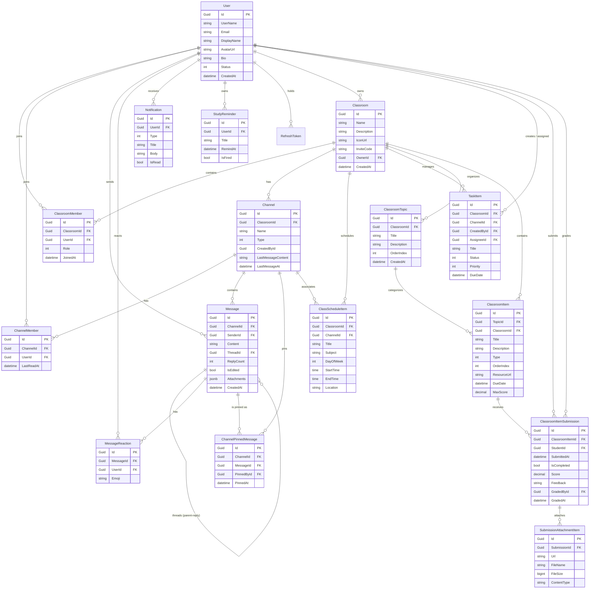

# NomNa Database Architecture & Domain Entity Design

Visual documentation and Entity-Relationship diagram for the NomNa Chat & E-Learning/Classroom application.

## 1. Quick Ways to View the Database

- **Online Interactive Diagram (Recommended)**: Copy the contents of [`docs/database_schema.dbml`](file:///home/vanmuzic/Projects/ChatApp/docs/database_schema.dbml) and paste it into **[dbdiagram.io](https://dbdiagram.io)** or **[drawSQL.app](https://drawsql.app)** to immediately get an interactive, draggable visual ERD.
- **XML Schema Definition**: View [`docs/database_schema.xml`](file:///home/vanmuzic/Projects/ChatApp/docs/database_schema.xml) for standard XML table/column/relationship metadata.
- **Markdown / Mermaid Diagram**: Rendered right below in any Markdown previewer or on GitHub.

---

## 2. Mermaid Entity-Relationship Diagram

