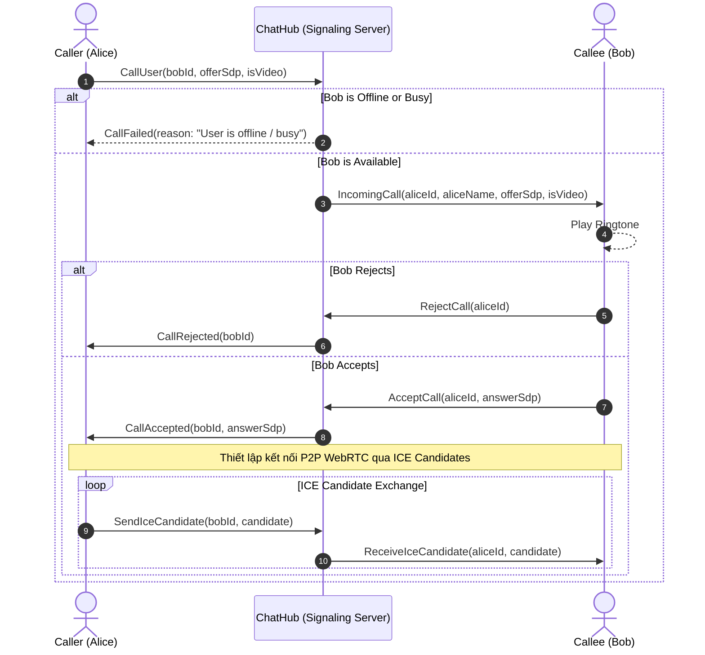

# 📞 NomNa — WebRTC 1-1 Voice & Video Call: Feature Guide & Signaling Architecture
> **Phiên bản:** v1.0 (Production Merged)  
> **Vị trí tài liệu:** `docs/features/webrtc-call/webrtc-1v1-call-and-signaling-guide.md`  
> **Tài liệu chuyên sâu chi tiết:** [`docs/architecture/webrtc-architecture-and-engineering-deep-dive.md`](../../architecture/webrtc-architecture-and-engineering-deep-dive.md)

---

## 1. Giới Thiệu Tính Năng

Hệ thống cuộc gọi 1-1 (Voice & Video Call) trong NomNa cho phép hai người dùng đàm thoại thời gian thực trực tiếp (Peer-to-Peer - P2P) với độ trễ siêu thấp (< 100ms), hỗ trợ:
- Gọi thoại âm thanh độ trung thực cao (Opus codec, Stereo).
- Gọi video độ phân giải thích ứng (VP8/VP9/H.264).
- Chia sẻ màn hình (Screen Sharing) với chuyển đổi mượt mà.
- Chuông chờ tùy biến (Custom Ringtone audio pipeline) và quản lý trạng thái bận (Busy State).
- Tự phục hồi luồng video (`VideoPlayer` tự phục hồi khi có thay đổi thiết bị hoặc autoplay policy).

---

## 2. Luồng Báo Hiệu (Signaling Flow qua SignalR)

Signaling server được hiện thực trong `NomNa.WebAPI/Hubs/ChatHub.CallSignaling.cs`:

---

## 3. Các File Cốt Lõi Tham Chiếu

| Thành Phần | Đường Dẫn File | Trách Nhiệm |
|---|---|---|
| **Backend Signaling Hub** | `src/NomNa.WebAPI/Hubs/ChatHub.CallSignaling.cs` | Quản lý vòng đời cuộc gọi, khóa thiết bị, kiểm tra bận và chuyển tiếp SDP/ICE. |
| **Frontend WebRTC Hook** | `client/src/hooks/useWebRTCCall.ts` | Khởi tạo `RTCPeerConnection`, quản lý media stream, transceiver và ICE candidates. |
| **UI Call Overlay** | `client/src/components/call/CallOverlay.tsx` | Giao diện cuộc gọi nổi (Spotlight / Grid mode, swap màn hình, điều khiển mic/cam). |
| **Video Player Cô Lập** | `client/src/components/call/VideoPlayer.tsx` | Trình phát video độc lập, chống lỗi đen màn hình và cưỡng chế autoplay policy. |
| **Tài liệu chuyên sâu** | `docs/architecture/webrtc-architecture-and-engineering-deep-dive.md` | Bản thiết kế kỹ thuật 67KB phân tích chi tiết toàn bộ cơ chế âm thanh và ICE. |

