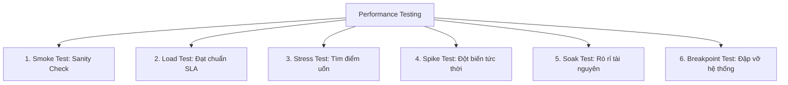

# 🚀 Toàn Thư Về Performance Testing: Các Loại Kiểm Thử, Chỉ Số Cốt Lõi & Tư Duy Đánh Giá Hiệu Năng

> **Mục tiêu tài liệu:** Cung cấp nền tảng lý thuyết vững chắc, chuẩn kỹ nghệ cao cấp (Senior/Principal Engineer) về kiểm thử hiệu năng phần mềm. Mọi khái niệm đều được mổ xẻ qua ví dụ thực tế trong hệ thống Chat Realtime **NomNa** (.NET 9, PostgreSQL, SignalR, React).
> **Đối tượng:** Kỹ sư muốn làm chủ nghệ thuật tối ưu hóa hệ thống, vượt qua các bài toán chịu tải cao (High Concurrency, C10K/C100K).

---

## Mục Lục
1. [Bản Chất Của Performance Testing: Tại Sao Phải Đo?](#1-bản-chất-của-performance-testing-tại-sao-phải-đo)
2. [Phân Loại Chi Tiết 6 Loại Performance Testing Kinh Điển](#2-phân-loại-chi-tiết-6-loại-performance-testing-kinh-điển)
   - [2.1. Smoke Testing (Kiểm Thử Khói / Sanity Check)](#21-smoke-testing-kiểm-thử-khói--sanity-check)
   - [2.2. Load Testing (Kiểm Thử Tải Tiêu Chuẩn)](#22-load-testing-kiểm-thử-tải-tiêu-chuẩn)
   - [2.3. Stress Testing (Kiểm Thử Vượt Ngưỡng Chịu Đựng)](#23-stress-testing-kiểm-thử-vượt-ngưỡng-chịu-đựng)
   - [2.4. Spike Testing (Kiểm Thử Đột Biến Tải Tức Thời)](#24-spike-testing-kiểm-thử-đột-biến-tải-tức-thời)
   - [2.5. Soak / Endurance Testing (Kiểm Thử Độ Bền & Rò Rỉ Tài Nguyên)](#25-soak--endurance-testing-kiểm-thử-độ-bền--rò-rỉ-tài-nguyên)
   - [2.6. Breakpoint / Capacity Testing (Kiểm Thử Tìm Điểm Gãy Hệ Thống)](#26-breakpoint--capacity-testing-kiểm-thử-tìm-điểm-gãy-hệ-thống)
3. [Bảng So Sánh Toàn Diện Các Loại Test](#3-bảng-so-sánh-toàn-diện-các-loại-test)
4. [Bộ Tứ Chỉ Số Vàng (The Golden Signals) & Thuật Ngữ Cốt Lõi](#4-bộ-tứ-chỉ-số-vàng-the-golden-signals--thuật-ngữ-cốt-lõi)
   - [4.1. Throughput (RPS / TPS) vs Concurrency (VUs)](#41-throughput-rps--tps-vs-concurrency-vus)
   - [4.2. Latency, Response Time & TTFB (Time To First Byte)](#42-latency-response-time--ttfb-time-to-first-byte)
   - [4.3. Phân Vị (Percentiles): Vì Sao P95/P99 Đè Bẹp Average?](#43-phân-vị-percentiles-vì-sao-p95p99-đè-bẹp-average)
   - [4.4. Error Rate & Saturation (Độ Bão Hòa Tài Nguyên)](#44-error-rate--saturation-độ-bão-hòa-tài-nguyên)
5. [Định Luật Little (Little's Law) & Công Thức Tính Tải](#5-định-luật-little-littles-law--công-thức-tính-tải)

---

## 1. Bản Chất Của Performance Testing: Tại Sao Phải Đo?

Hầu hết lập trình viên bắt đầu phát triển ứng dụng bằng cách kiểm thử chức năng (Functional Testing):
- Đăng nhập có thành công không? -> **Có.**
- Bấm gửi tin nhắn, người bên kia có nhận được không? -> **Có.**
- Chạy 41 unit tests trong xUnit -> **100% Xanh.**

Tuy nhiên, **"Chạy đúng với 1 người dùng KHÔNG CÓ NGHĨA LÀ sẽ chạy đúng với 1.000 hay 100.000 người dùng đồng thời."**

```
 1 Người dùng:      Request ──[ 15ms ]──> Trả về kết quả (Hoàn hảo!)
 
 1.000 Người dùng:  Request ──> [ Hàng đợi Kestrel (Queue Full) ]
                                    └──> [ Postgres Connection Pool Cạn ]
                                             └──> [ CPU 100% PBKDF2 ]
                                                      └──> Timeout 30.000ms / 504 Gateway Timeout!
```

### Những ảo tưởng nguy hiểm thường gặp:
1. **"Cứ code xong, khi nào lên Production nhiều người dùng rồi tính":** Khi phát hiện nghẽn kiến trúc (Architectural Bottleneck) trên Production, cái giá phải trả là downtime, người dùng tẩy chay, và việc refactor lúc đó tốn gấp 10-50 lần chi phí so với việc kiểm thử tải từ sớm.
2. **"Chỉ cần nâng cấp Server mạnh hơn (Vertical Scaling) là xong":** Nếu bạn gặp lỗi **Thread Lock**, **Database Deadlock**, hoặc **N+1 Query**, thì dù server có 128 vCPU và 512 GB RAM, hệ thống vẫn sẽ nghẽn y nguyên vì tài nguyên bị khóa tuần tự.
3. **"Average Response Time = 100ms nghĩa là hệ thống chạy nhanh":** Đây là "cú lừa kinh điển" (Flaw of Averages). 90% người dùng có thể phản hồi trong 10ms, nhưng 10% người dùng còn lại phải đợi 15 giây. 10% khách hàng chịu đựng 15 giây đó chính là những người sẽ rời bỏ nền tảng của bạn.

Performance Testing là phương pháp **chủ động khám phá giới hạn**, **xác minh các chỉ số cam kết chất lượng dịch vụ (SLA/SLO)** và **đảm bảo tính ổn định của hệ thống dưới áp lực thực tế**.

---

## 2. Phân Loại Chi Tiết 6 Loại Performance Testing Kinh Điển

Để làm chủ kỹ nghệ kiểm thử tải, bạn phải hiểu rõ từng loại test: sinh ra để trả lời câu hỏi gì, hình dạng đồ thị tải (Load Profile) ra sao, và áp dụng vào dự án chat NomNa như thế nào.



---

### 2.1. Smoke Testing (Kiểm Thử Khói / Sanity Check)

#### Câu hỏi cốt lõi:
> *"Kịch bản test có chạy thông suốt không? Các API cơ bản có bị lỗi cú pháp, sai token, hoặc chết container ngay từ tải tối thiểu không?"*

#### Đặc điểm kỹ thuật:
- **Tải:** Cực kỳ nhỏ (1 đến 5 Virtual Users - VUs).
- **Thời gian:** 1 đến 2 phút.
- **Mục đích:** Xác minh tính toàn vẹn của kịch bản kiểm thử (Test Script Integrity) và môi trường kiểm thử (Infrastructure Sanity). Không dùng để đo lường hiệu năng.

#### Biểu đồ tải (Load Profile):
```
VUs
 5 |  ┌──────────────────────────────────┐
   |  │                                  │
 0 └──┴──────────────────────────────────┴── Time (1 - 2 mins)
```

#### Ví dụ thực tế trong NomNa:
Trước khi dồn 300 VUs vào kịch bản `01_http_message_load.js`, bạn chạy Smoke Test với **2 VUs**:
- VU 1 đăng nhập bằng `alex@nomna.local`, lấy server đầu tiên, lấy channel đầu tiên, đọc 25 tin nhắn.
- VU 2 gửi 1 tin nhắn vào channel đó.
- Nếu status code trả về là 200 OK và không có exception nào ném ra trong console của container `.NET WebAPI` -> **Smoke Test Pass!** Bạn sẵn sàng cho các bài test tải nặng hơn.
- Nếu ngay từ 1 VU đã trả về `401 Unauthorized` (do cấu hình JWT sai) hoặc `500 Internal Server Error` (do DB chưa chạy migration), Smoke Test sẽ phát hiện ngay trong 10 giây mà không cần lãng phí thời gian chạy một bài test tải 30 phút.

---

### 2.2. Load Testing (Kiểm Thử Tải Tiêu Chuẩn)

#### Câu hỏi cốt lõi:
> *"Khi hệ thống phục vụ đúng lượng người dùng theo thiết kế trong giờ cao điểm bình thường, các chỉ số độ trễ và tỷ lệ lỗi có đạt SLA/SLO không?"*

#### Đặc điểm kỹ thuật:
- **Tải:** Tương đương mức tải kỳ vọng tối đa trong ngày thường (ví dụ: 150 - 300 VUs).
- **Thời gian:** 15 đến 60 phút. Có 3 giai đoạn rõ rệt:
  1. **Ramp-up:** Tăng dần tải từ 0 lên mục tiêu để hệ thống làm ấm (warm-up JIT compiler, database connection pool, cache).
  2. **Steady State:** Duy trì tải ổn định trong một khoảng thời gian đủ dài để đo đạc các chỉ số P50, P95, P99.
  3. **Ramp-down:** Giảm dần tải về 0 để kiểm tra hệ thống giải phóng tài nguyên.

#### Biểu đồ tải (Load Profile):
```
VUs
300 |             ┌────────────────────────┐
    |            /                          \
150 |           /                            \
    |  ┌───────┘                              └───────┐
 0  └──┴───────┴──┴────────────────────────┴──┴───────┴── Time (30 - 45 mins)
      Ramp-up           Steady State          Ramp-down
```

#### Ví dụ thực tế trong NomNa:
Trong mục tiêu `NFR-PERF-01` và `NFR-PERF-02`:
- Mục tiêu: Đọc tin nhắn P95 < 100ms, Gửi tin nhắn P95 < 150ms khi có **150 người dùng đồng thời**.
- Thiết lập k6:
  - 0 -> 2 phút: Tăng từ 0 lên 150 VUs (Ramp-up).
  - 2 -> 15 phút: Giữ đều đặn 150 VUs liên tục cuộn xem tin nhắn và gửi tin (Steady state).
  - Kết quả kỳ vọng: CPU của node API dao động ở mức 40-60%, PostgreSQL CPU < 30%, P95 duy trì dưới 100ms, Error Rate = 0%.

---

### 2.3. Stress Testing (Kiểm Thử Vượt Ngưỡng Chịu Đựng)

#### Câu hỏi cốt lõi:
> *"Khi lượng người dùng vượt quá 150% - 200% so với thiết kế, hệ thống sẽ ứng xử thế nào? Nó có chết ngắc (Crash/OOM Killer) không, hay suy thoái có kiểm soát (Graceful Degradation)? Khi hạ tải về bình thường, nó có tự hồi phục được không?"*

#### Đặc điểm kỹ thuật:
- **Tải:** Vượt xa mức thiết kế chuẩn (ví dụ: từ 300 VUs đẩy lên 600, 900, 1.200 VUs).
- **Thời gian:** 20 đến 45 phút.
- **Quan sát trọng tâm:**
  - Điểm uốn (Inflection Point / Knee of the Curve): Điểm mà throughput (RPS) không thể tăng thêm được nữa, nhưng độ trễ (latency) bắt đầu tăng vọt theo phương thẳng đứng.
  - Phản ứng của hệ thống: Có trả về HTTP `429 Too Many Requests` hoặc `503 Service Unavailable` một cách văn minh không?
  - Cơ chế tự hồi phục (Self-healing): Khi giảm tải từ 1.200 VUs về lại 150 VUs, latency có trở về mức < 100ms ngay không, hay server bị "treo vĩnh viễn" do deadlock/thread starvation?

#### Biểu đồ tải (Load Profile):
```
VUs
1200|                               ┌───────┐
 900|                       ┌───────┘       └───────┐
 600|               ┌───────┘                       └───────┐
 300|       ┌───────┘                                       └───────┐
  0 └──┴────┴───────┴───────┴───────┴───────┴───────┴───────┴───────┴── Time
      Norm   Overload   Extreme Stress        Recovery Phase
```

#### Ví dụ thực tế trong NomNa:
Node WebAPI của NomNa được giới hạn tài nguyên ở mức **1 vCPU / 512 MB RAM**.
- Ở 300 VUs: Hệ thống xử lý được 150 RPS, P95 = 120ms.
- Đẩy lên 600 VUs: CPU chạm 98%. Nginx bắt đầu buffer request.
- Đẩy lên 1.000 VUs: PostgreSQL hết connection (vượt quá `Max Pool Size=100`), MediatR handler phải chờ connection rảnh. Latency vọt lên 8.000ms.
- Bài test kiểm tra: Liệu WebAPI container có bị Linux Kernel gọi `OOM Killer` (Out Of Memory) giết chết do RAM vượt 512MB không? Khi hạ tải về 200 VUs, DbContext connection pool có tự giải phóng để latency hạ về 100ms không?

---

### 2.4. Spike Testing (Kiểm Thử Đột Biến Tải Tức Thời)

#### Câu hỏi cốt lõi:
> *"Nếu lượng truy cập tăng dựng đứng từ số 0 lên mức cực đại chỉ trong vài giây, hệ thống có trụ được không hay Kestrel queue và Socket backlog sẽ vỡ trận ngay lập tức?"*

#### Đặc điểm kỹ thuật:
- **Tải:** Tăng đột ngột gấp 10x - 50x trong vòng 5 đến 15 giây, duy trì trong 1-2 phút, sau đó rớt thẳng đứng về mức thấp.
- **Thời gian:** 5 đến 10 phút.
- **Bản chất vật lý:** Trong Spike Test, các cơ chế tự động mở rộng (Auto-scaling của Kubernetes hay Cloud) thường **hoàn toàn vô dụng** vì việc khởi tạo Pod mới / VM mới thường mất từ 45 giây đến 3 phút. Toàn bộ đợt sóng tải ban đầu phải do **hạ tầng hiện hữu và các hàng đợi (queues/buffers)** gánh chịu.

#### Biểu đồ tải (Load Profile):
```
VUs
1000|            ┌───────┐
    |            │       │
    |            │       │
 50 |  ──────────┘       └──────────
  0 └──┴─────────┴───────┴─────────┴── Time (Chỉ vài phút)
       Bình thường  SỐC TẢI   Hạ nhiệt
```

#### Ví dụ thực tế trong NomNa:
Tình huống điển hình của ứng dụng Chat:
- Một Streamer nổi tiếng trên kênh Discord/NomNa thông báo: *"Mọi người bấm vào link phòng chat này ngay để nhận quà giveaway!"*
- Trong vòng 5 giây, **1.000 người dùng** đồng thời mở app, kết nối WebSocket SignalR, và gửi tin nhắn `!claim`.
- Điều gì xảy ra?
  - TCP Listen Backlog (`net.core.somaxconn`) có đủ sâu để chứa 1.000 SYN packets không? Nếu backlog chỉ để mặc định 128, 872 kết nối còn lại sẽ bị `Connection Refused` ngay tại tầng kernel của Linux!
  - ThreadPool của .NET Runtime có spawn kịp luồng mới không? (.NET ThreadPool mặc định chỉ tăng 1-2 worker threads mỗi 500ms nếu bị nghẽn).
  - Nginx có bị tràn `worker_connections` không?

---

### 2.5. Soak / Endurance Testing (Kiểm Thử Độ Bền & Rò Rỉ Tài Nguyên)

#### Câu hỏi cốt lõi:
> *"Hệ thống chạy 10 phút rất mượt, nhưng nếu chạy liên tục 24 giờ, 48 giờ hoặc 7 ngày dưới mức tải 70%, liệu có xảy ra rò rỉ bộ nhớ (Memory Leak), cạn kiệt File Descriptors, hay phình to Database Lock không?"*

#### Đặc điểm kỹ thuật:
- **Tải:** Mức trung bình khá (60% - 75% công suất tối đa).
- **Thời gian:** Rất dài (12 giờ, 24 giờ, hoặc nhiều ngày).
- **Quan sát trọng tâm:**
  - **Memory Leak (Rò rỉ RAM):** Đường biểu diễn RAM tiêu thụ có dốc dần đều lên theo thời gian không? (.NET Garbage Collection có dọn được Gen 2 và Large Object Heap - LOH không?).
  - **Socket / File Descriptor Leak:** Sau khi người dùng ngắt kết nối WebSocket SignalR, socket có bị kẹt ở trạng thái `CLOSE_WAIT` hoặc `TIME_WAIT` không?
  - **Connection Pool Leak:** Có câu query nào quên giải phóng `DbContext` (ví dụ do async void, hoặc unhandled exception giữa chừng) làm cạn dần connection của Npgsql không?
  - **Disk Space / Log Bloat:** Ổ đĩa có bị lấp đầy bởi file log JSON không kiểm soát không?

#### Biểu đồ tải (Load Profile):
```
VUs
200 |  ┌────────────────────────────────────────────────────────────────┐
    |  │                                                                │
  0 └──┴────────────────────────────────────────────────────────────────┴── Time (12h - 48h)
```

#### Ví dụ thực tế trong NomNa (Mục NFR-REL-06):
Trong NomNa, `UserPresenceTracker` hiện đang dùng `static ConcurrentDictionary` để lưu người dùng online:
```csharp
// Infrastructure/Services/UserPresenceTracker.cs
private static readonly ConcurrentDictionary<string, UserOnlineSession> _onlineUsers = new();
```
- Khi user kết nối, thêm vào Dictionary.
- Nếu logic `OnDisconnectedAsync` của SignalR gặp lỗi hoặc client bị mất mạng đột ngột (network timeout) mà không clean key tương ứng, Dictionary này sẽ phình to mãi mãi.
- Chạy Soak Test trong **12 giờ**: Cho hàng nghìn lượt user kết nối rồi disconnect liên tục.
- Sử dụng công cụ `dotnet-dump` hoặc `dotnet-gcdump` lấy snapshot bộ nhớ ở giờ thứ 1 và giờ thứ 12 để so sánh (diff). Nếu số lượng đối tượng `UserOnlineSession` hoặc `SignalR ConnectionContext` tăng đều đặn không giảm -> **Phát hiện Memory Leak thành công trước khi nó giết chết Production!**

---

### 2.6. Breakpoint / Capacity Testing (Kiểm Thử Tìm Điểm Gãy Hệ Thống)

#### Câu hỏi cốt lõi:
> *"Trần công suất tối đa (Maximum Capacity Ceiling) tuyệt đối của 1 node WebAPI với 1 vCPU / 512MB RAM là bao nhiêu RPS và bao nhiêu kết nối WebSocket trước khi nó chết hoàn toàn?"*

#### Đặc điểm kỹ thuật:
- **Tải:** Tăng liên tục không ngừng (Ramp-up bậc thang - Stepping ramp) cho đến khi hệ thống gãy đổ hoàn toàn (Error rate chạm 100% hoặc server sập).
- **Thời gian:** Cho đến khi chết (thường 20 - 40 phút).

#### Biểu đồ tải (Load Profile):
```
VUs
     |                                                      X (SẬP HOÀN TOÀN)
1500 |                                              ┌───────┘
1200 |                                      ┌───────┘
 900 |                              ┌───────┘
 600 |                      ┌───────┘  <- Điểm suy giảm hiệu năng (Knee)
 300 |              ┌───────┘
   0 └──┴───────────┴────────────────────────────────────────── Time
```

#### Ví dụ thực tế trong NomNa:
Bạn muốn biết chính xác: Một VPS giá rẻ 2 vCPU / 2GB RAM có thể chịu được tối đa bao nhiêu người dùng chat cùng lúc?
- Tăng tải: Cứ mỗi 2 phút tăng thêm 50 VUs.
- Ở 50 VUs: RPS = 30, P95 = 15ms.
- Ở 200 VUs: RPS = 120, P95 = 45ms.
- Ở 350 VUs: RPS = 180, P95 = 250ms (Chớm quá tải).
- Ở 420 VUs: RPS chững lại ở mức 195 RPS không tăng thêm được nữa, P95 vọt lên 3.500ms (Knee of the curve).
- Ở 500 VUs: Nginx bắt đầu trả về lỗi `502 Bad Gateway`, WebAPI bị `Kestrel connection reset` (Breakpoint đạt được!).
- **Kết luận kỹ nghệ:** Sức chứa tối đa (Capacity Ceiling) an toàn của 1 node là **350 VUs (~180 RPS)**. Từ con số này, bạn tính ra được: Muốn phục vụ 3.500 VUs thì bắt buộc phải scale ngang ra tối thiểu **10 nodes WebAPI** chạy sau Load Balancer.

---

## 3. Bảng So Sánh Toàn Diện Các Loại Test

| Loại Test | Mục Tiêu Chính | Mức Tải (VUs) | Thời Gian Chạy | Chỉ Số Quan Sát Trọng Tâm |
| :--- | :--- | :--- | :--- | :--- |
| **Smoke Test** | Kiểm tra kịch bản & môi trường sẵn sàng | Tối thiểu (1 - 5) | Rất ngắn (1 - 2 phút) | Tỷ lệ thành công 100%, không có lỗi cú pháp/mạng |
| **Load Test** | Đo lường độ trễ & throughput theo SLA | Tải thiết kế (150 - 300) | Vừa (15 - 45 phút) | P95, P99 Latency, RPS, CPU/RAM ổn định |
| **Stress Test** | Tìm điểm uốn & khả năng chịu đựng khi quá tải | Vượt thiết kế (150% - 300%) | Vừa (20 - 45 phút) | Mã lỗi trả về (429/503), khả năng tự phục hồi |
| **Spike Test** | Đo khả năng hấp thụ sốc tải đột biến tức thời | Đột biến cực lớn (10x - 50x) | Rất ngắn (3 - 8 phút) | TCP backlog, ThreadPool starvation, Connection queue |
| **Soak Test** | Tìm lỗi rò rỉ RAM, Socket, DB connection | Tải trung bình (60% - 75%) | Rất dài (12h - 48h) | Biểu đồ RAM tăng dần, File Descriptors, GC Gen 2 |
| **Breakpoint** | Xác định trần công suất tối đa của 1 node | Tăng đều đến khi sập | Đến khi chết (20 - 45 phút) | Điểm RPS bão hòa, ngưỡng sập nguồn tài nguyên |

---

## 4. Bộ Tứ Chỉ Số Vàng (The Golden Signals) & Thuật Ngữ Cốt Lõi

Google SRE (Site Reliability Engineering) đúc kết 4 tín hiệu vàng để giám sát và đánh giá bất kỳ hệ thống phân tán nào: **Latency**, **Traffic (Throughput)**, **Errors**, và **Saturation**.

```
                  ┌─────────────────────────────────────────┐
                  │      4 TÍN HIỆU VÀNG CỦA GOOGLE SRE     │
                  └─────────────────────────────────────────┘
                     │            │            │            │
             ┌───────┴──────┐ ┌───┴───┐ ┌──────┴──────┐ ┌───┴───┐
             │   Latency    │ │Traffic│ │    Errors   │ │Saturat│
             │  (P95, P99)  │ │ (RPS) │ │  (Tỷ lệ %)  │ │(CPU/IO│
             └──────────────┘ └───────┘ └─────────────┘ └───────┘
```

---

### 4.1. Throughput (RPS / TPS) vs Concurrency (VUs)

Rất nhiều kỹ sư nhầm lẫn giữa **Số người dùng đồng thời (Concurrent Users / VUs)** và **Thông lượng (Throughput / RPS)**.

- **VUs (Virtual Users):** Là số lượng "luồng giả lập người dùng" đang hoạt động song song.
- **RPS (Requests Per Second):** Là số lượng yêu cầu mà máy chủ thực sự tiếp nhận và xử lý xong trong mỗi giây.

#### Mối quan hệ:
Nếu 100 VUs liên tục gửi request mà **không nghỉ (sleep = 0)** và server phản hồi cực nhanh trong 10ms:
$$\text{RPS} = \frac{100 \text{ VUs}}{0.010 \text{ giây}} = 10.000 \text{ RPS}$$

Nhưng nếu server bị nghẽn DB, phản hồi mất 2.000ms (2 giây):
$$\text{RPS} = \frac{100 \text{ VUs}}{2 \text{ giây}} = 50 \text{ RPS}$$

> **Bài học:** VUs cao không đồng nghĩa với RPS cao! Khi hệ thống bị nghẽn, số VUs có thể vẫn là 300 nhưng RPS sẽ tụt dốc thảm hại vì các VUs đang phải "ngâm hàng đợi" chờ server phản hồi.

---

### 4.2. Latency, Response Time & TTFB (Time To First Byte)

Khi một client gửi request tới NomNa qua Nginx, tổng thời gian không đơn thuần là thời gian code C# chạy. Nó bao gồm nhiều chặng:

```
[Client] ──(1. DNS + Connect + TLS)──> [Nginx] ──(2. Queue + Proxy)──> [Kestrel WebAPI]
                                                                             │
                                                                       (3. MediatR)
                                                                             │
                                                                    (4. Query Postgres)
                                                                             │
[Client] <──(6. Response Body Stream)── [Nginx] <──(5. TTFB Byte 1)──────────┘
```

1. **`http_req_blocked`:** Thời gian client phải chờ socket rảnh hoặc chờ DNS lookup.
2. **`http_req_connecting`:** Thời gian bắt tay TCP (TCP 3-way handshake SYN -> SYN-ACK -> ACK).
3. **`http_req_tls_handshaking`:** Bắt tay TLS/SSL (trao đổi chứng chỉ, mã hóa khóa phiên).
4. **`http_req_sending`:** Thời gian đẩy payload từ client lên đường truyền mạng.
5. **`http_req_waiting` (TTFB - Time To First Byte):** Thời gian máy chủ nhận trọn request, suy nghĩ, xử lý logic, query DB và nhả ra **byte dữ liệu đầu tiên**.
   - *Nếu TTFB cao:* Lỗi 100% nằm ở code backend, ORM EF Core, hoặc Database Query!
6. **`http_req_receiving`:** Thời gian truyền tải toàn bộ body response về client.
   - *Nếu `http_req_receiving` cao:* Payload quá nặng (ví dụ: trả về JSON 50MB do quên phân trang limit 25).
7. **`http_req_duration` (Total Response Time):** Tổng thời gian từ khi bắt đầu gửi byte đầu tiên đến khi nhận xong byte cuối cùng:
   $$\text{Duration} = \text{Sending} + \text{Waiting (TTFB)} + \text{Receiving}$$

---

### 4.3. Phân Vị (Percentiles): Vì Sao P95/P99 Đè Bẹp Average?

Hãy tưởng tượng bạn có 100 request gửi đến API `POST /api/channels/{id}/messages`:
- **99 requests** phản hồi thần tốc trong **10 ms**.
- **1 request** bị khóa DB lock, phản hồi mất **10.000 ms (10 giây)**.

Hãy tính con số trung bình cộng (Average / Mean):
$$\text{Average} = \frac{99 \times 10 + 1 \times 10000}{100} = \frac{990 + 10000}{100} = 109.9 \text{ ms}$$

Báo cáo ghi: *"Thời gian phản hồi trung bình là ~110 ms"*. Ban giám đốc nghĩ rằng hệ thống chạy rất tốt!
**Nhưng sự thật là gì?** Có 1 khách hàng đã phải nhìn màn hình quay tít thò lò suốt **10 giây** và tức giận đóng ứng dụng. Con số Average đã **che giấu hoàn toàn nỗi đau của khách hàng**.

Đó là lý do ngành kỹ nghệ hiệu năng sử dụng **Phân Vị (Percentiles)**:
- **P50 (Median - Trung vị):** 50% số request có thời gian xử lý nhanh hơn hoặc bằng giá trị này. Đại diện cho trải nghiệm của một người dùng thông thường.
- **P90:** 90% số request nhanh hơn giá trị này.
- **P95:** 95% số request nhanh hơn giá trị này. Đây là **chuẩn mực vàng** trong hầu hết các SLA của các công ty công nghệ lớn.
- **P99:** 99% số request nhanh hơn giá trị này. Đại diện cho 1% người dùng chịu trải nghiệm tồi tệ nhất (Worst-case scenario / Long Tail Latency).
- **P99.9:** 1 trong 1.000 request xui xẻo nhất.

```
Số lượng Request
  ^
  |        P50 (15ms)
  |         |
  |      ┌──┴──┐              P90 (45ms)
  |     │       │                |        P95 (80ms)
  |    │         │               |           |          P99 (450ms)
  |   │           │              |           |             |
  |───┴───────────┴──────────────┴───────────┴─────────────┴──────────> Latency (ms)
      [ Vùng An Toàn ]                         [ Vùng Đuôi Dài (Long Tail) ]
```

> **Nguyên tắc vàng:** Khi viết SLA cho NomNa, **luôn luôn** cam kết theo P95 và P99, ví dụ:
> `http_req_duration: ['p(95)<200', 'p(99)<500']`. Tuyệt đối không dùng Average làm thước đo nghiệm thu!

---

### 4.4. Error Rate & Saturation (Độ Bão Hòa Tài Nguyên)

- **Error Rate (Tỷ lệ lỗi):**
  $$\text{Error Rate} = \frac{\text{Số request lỗi (HTTP 5xx, Timeout, Connection Reset)}}{\text{Tổng số request gửi đi}} \times 100\%$$
  Trong điều kiện tải bình thường, Error Rate phải đạt chuẩn **0.00%**. Khi stress test, Error Rate tối đa chấp nhận được thường là `< 1%` hoặc `< 5%`.
- **Saturation (Độ bão hòa):** Đo lường mức độ khai thác tài nguyên phần cứng:
  - **CPU Saturation:** CPU sử dụng bao nhiêu %? Có bị nghẽn 1 core đơn lẻ (Single-thread bottleneck) không?
  - **Memory Saturation:** RAM sử dụng, tần suất chạy Major GC (Garbage Collection dừng cả thế giới - Stop-The-World).
  - **Disk I/O Wait (%iowait):** CPU có đang phải ngồi rảnh rỗi chờ ổ cứng đọc ghi dữ liệu từ đĩa từ/SSD không?
  - **Network / Socket Saturation:** Số lượng socket ở trạng thái `ESTABLISHED`, `TIME_WAIT`, `CLOSE_WAIT`.

---

## 5. Định Luật Little (Little's Law) & Công Thức Tính Tải

Được nhà toán học John Little chứng minh năm 1961, đây là định luật nền tảng chi phối mọi hệ thống hàng đợi và kiến trúc phần mềm phân tán trên thế giới:

$$L = \lambda \times W$$

Trong đó:
- **$L$ (Concurrency - Số người dùng / request đang nằm trong hệ thống):** Số VUs đồng thời.
- **$\lambda$ (Throughput - Tốc độ đến/xử lý của request):** Số RPS (Requests Per Second).
- **$W$ (Latency / Residence Time - Thời gian trung bình 1 request ở trong hệ thống):** Thời gian phản hồi tính bằng giây.

### Ứng dụng thực chiến tính toán tải cho NomNa:
Giả sử hệ thống NomNa đặt mục tiêu phục vụ **500 RPS** với thời gian phản hồi trung bình là **100 ms (0.1 giây)**:
$$L = 500 \text{ req/s} \times 0.1 \text{ s} = 50 \text{ concurrent requests}$$
Điều này có nghĩa là tại bất kỳ thời điểm nào, bên trong Kestrel WebAPI và PostgreSQL chỉ cần duy trì xử lý song song **50 requests** là đã đạt được thông lượng 500 RPS!

**Nhưng điều gì xảy ra nếu code bị chậm, thời gian xử lý tăng từ 100ms lên 2.000ms (2 giây)?**
Để đạt được cùng thông lượng 500 RPS:
$$L = 500 \text{ req/s} \times 2.0 \text{ s} = 1.000 \text{ concurrent requests}$$
Hệ thống lúc này phải gánh đồng thời **1.000 requests** nằm kẹt trong RAM và DB Connection Pool. Kết quả là cạn kiệt tài nguyên, đứt hàng đợi và sập hệ thống!

> **Chân lý kỹ nghệ:** Giảm Latency ($W$) chính là cách hiệu quả nhất để giảm số lượng kết nối đồng thời kẹt trong hệ thống ($L$), từ đó giải phóng bộ nhớ và tăng thông lượng tối đa ($\lambda$).
