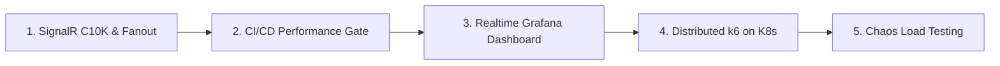

# ⚠️ Cạm Bẫy Trong Performance Testing & Lộ Trình Tiến Hóa k6

> **Mục tiêu tài liệu:** Giúp kỹ sư nhận diện và tránh xa các cạm bẫy kinh điển (Anti-patterns) khiến kết quả đo tải bị sai lệch nghiêm trọng; đồng thời vạch ra lộ trình nâng cấp bộ công cụ k6 của NomNa lên chuẩn Enterprise (SignalR C10K, CI/CD Performance Gate, Grafana Realtime Dashboard, Distributed k6 trên Kubernetes và Chaos Testing).

---

## Mục Lục
1. [7 Cạm Bẫy Kinh Điển Khi Kiểm Thử Tải Bằng k6](#1-7-cạm-bẫy-kinh-điển-khi-kiểm-thử-tải-bằng-k6)
   - [Bẫy 1: Coordinated Omission (Sai Số Bỏ Sót Khi Bị Nghẽn)](#bẫy-1-coordinated-omission-sai-số-bỏ-sót-khi-bị-nghẽn)
   - [Bẫy 2: Tự Bắn Vào Chân - Benchmark Client Bị Cạn Kiệt Tài Nguyên](#bẫy-2-tự-bắn-vào-chân---benchmark-client-bị-cạn-kiệt-tài-nguyên)
   - [Bẫy 3: Đăng Nhập Trong Vòng Lặp Chính (`default function`)](#bẫy-3-đăng-nhập-trong-vòng-lặp-chính-default-function)
   - [Bẫy 4: Đo WebSocket Ảo (Chỉ Bắt Handshake, Bỏ Qua Frame Latency)](#bẫy-4-đo-websocket-ảo-chỉ-bắt-handshake-bỏ-qua-frame-latency)
   - [Bẫy 5: Cache Hit Giả Tạo (Synthetic Cache Warmth)](#bẫy-5-cache-hit-giả-tạo-synthetic-cache-warmth)
   - [Bẫy 6: Thiếu Think Time Hoặc Dùng Sleep Phi Thực Tế](#bẫy-6-thiếu-think-time-hoặc-dùng-sleep-phi-thực-tế)
   - [Bẫy 7: Cạn Kiệt Cổng Tạm Thời (Ephemeral Port Exhaustion)](#bẫy-7-cạn-kiệt-cổng-tạm-thời-ephemeral-port-exhaustion)
2. [Lộ Trình Tiến Hóa & Mở Rộng k6 Cho Hệ Thống NomNa](#2-lộ-trình-tiến-hóa--mở-rộng-k6-cho-hệ-thống-nomna)
   - [2.1. Đo Lường SignalR Fanout Latency P99 Với C10K](#21-đo-lường-signalr-fanout-latency-p99-với-c10k)
   - [2.2. Đưa k6 Vào GitHub Actions CI/CD (Performance Regression Gate)](#22-đưa-k6-vào-github-actions-cicd-performance-regression-gate)
   - [2.3. Trực Quan Hóa Thời Gian Thực: k6 + InfluxDB / Prometheus + Grafana](#23-trực-quan-hóa-thời-gian-thực-k6--influxdb--prometheus--grafana)
   - [2.4. Kiểm Thử Phân Tán (Distributed Load Testing) Với k6-operator](#24-kiểm-thử-phân-tán-distributed-load-testing-với-k6-operator)
   - [2.5. Chaos Engineering Kết Hợp Load Testing (Kiểm Thử Tính Tự Phục Hồi)](#25-chaos-engineering-kết-hợp-load-testing-kiểm-thử-tính-tự-phục-hồi)

---

## 1. 7 Cạm Bẫy Kinh Điển Khi Kiểm Thử Tải Bằng k6

Kiểm thử hiệu năng là một con dao hai lưỡi. Nếu viết kịch bản sai, bạn sẽ thu về những con số đẹp đẽ nhưng hoàn toàn giả tạo, dẫn đến sự tự tin mù quáng trước khi hệ thống sụp đổ trên Production.

---

### Bẫy 1: Coordinated Omission (Sai Số Bỏ Sót Khi Bị Nghẽn)

Được phát hiện và đặt tên bởi chuyên gia hiệu năng Gil Tene (CTO của Azul Systems), **Coordinated Omission** là cạm bẫy tai hại và phổ biến nhất trong thế giới kiểm thử tải.

#### Hiện tượng xảy ra như thế nào?
Giả sử bạn cấu hình k6 với mô hình Virtual Users lặp (Looping VUs):
- Mỗi VU gửi 1 request, đợi kết quả, sau đó gửi request tiếp theo.
- Bình thường server phản hồi trong **10 ms**. Trong 1 giây, mỗi VU gửi được 100 requests.
- Đột nhiên, server bị Garbage Collection pause (Stop-The-World) hoặc database lock kéo dài **10 giây**.
- Trong suốt 10 giây đó, VU bị **kẹt cứng (blocked)** chờ đợi.
- Kết quả là: Trong suốt 10 giây hệ thống "chết lâm sàng", VU đó **chỉ gửi đúng 1 request duy nhất** (với thời gian đo được là 10 giây).
- Hàng nghìn request lẽ ra phải được gửi đến trong 10 giây đó **đã không bao giờ được gửi đi!**

```
KỊCH BẢN THỰC TẾ (Người dùng đến đều đặn):
Giây 1  Giây 2  Giây 3  Giây 4  Giây 5  Giây 6  Giây 7  Giây 8  Giây 9  Giây 10
  ▼       ▼       ▼       ▼       ▼       ▼       ▼       ▼       ▼       ▼
[REQ]   [REQ]   [REQ]   [REQ]   [REQ]   [REQ]   [REQ]   [REQ]   [REQ]   [REQ]
(Mỗi người dùng đều phải chịu đựng sự chậm trễ từ 1s đến 10s!)

KỊCH BẢN k6 BỊ COORDINATED OMISSION (VU lặp):
Giây 1 ─────────────────── (VU BỊ KẸT CHỜ ĐỢI) ───────────────────> Giây 10
  ▼                                                                      ▼
[REQ 1: 10s] ──────────────── (9 REQ KHÁC BỊ BỎ RƠI!) ─────────────> [REQ 2]
```

#### Hậu quả:
Trong bảng thống kê phân vị, bạn chỉ ghi nhận **1 request** bị chậm 10 giây, trong khi 999 request trước đó chạy mất 10ms. k6 sẽ tính toán rằng P99 của bạn vẫn... cực kỳ tốt! Toàn bộ thảm họa trong 10 giây chết nghẽn đã bị che giấu vì số lượng request gửi vào tự động sụt giảm.

#### Cách khắc phục trong k6:
Thay vì dùng mô hình VUs lặp (`stages` với target VUs), hãy sử dụng executor kiểu **Tần suất đến cố định (Arrival-rate Executor)** của k6:

```javascript
export const options = {
  scenarios: {
    constant_rate_test: {
      executor: 'constant-arrival-rate',
      rate: 200,             // Luôn luôn bắn đều đặn 200 requests MỖI GIÂY
      timeUnit: '1s',
      duration: '5m',
      preAllocatedVUs: 100,  // k6 sẽ tự sinh thêm VU nếu server phản hồi chậm
      maxVUs: 1000,          // Không để VU bị nghẽn làm giảm nhịp bắn
    },
  },
};
```
Với `constant-arrival-rate`, bất kể server chạy chậm thế nào, k6 vẫn spawn thêm VU để ép đúng 200 RPS vào hệ thống. Nếu server nghẽn, các request mới sẽ chất đống và P99 sẽ phản ánh chính xác sự khủng hoảng!

---

### Bẫy 2: Tự Bắn Vào Chân - Benchmark Client Bị Cạn Kiệt Tài Nguyên

Nhiều kỹ sư thấy latency tăng vọt từ 20ms lên 5.000ms liền vội vàng kết luận: *"WebAPI .NET 9 của chúng ta quá chậm!"*. Nhưng khi kiểm tra kỹ:
- WebAPI server: CPU 15%, RAM 200MB.
- Máy chạy k6: **CPU 100%, RAM cạn kiệt, quạt tản nhiệt rú hết công suất!**

#### Nguyên nhân:
Bản thân máy chạy k6 cũng là một phần mềm. Nếu bạn:
- Thực hiện parse JSON khổng lồ (`res.json()`) trong từng iteration.
- Chạy quá nhiều hàm tính toán phức tạp, regex, hoặc console.log liên tục.
- Cấp tài nguyên Docker cho container `bench_k6` quá bèo bọt (ví dụ trong `docker-compose.bench.yml` giới hạn k6 chỉ 1 vCPU và 512MB RAM trong khi cố sinh 1.000 VUs).

#### Dấu hiệu nhận biết:
- Nhìn vào chỉ số **`http_req_blocked`** trong báo cáo k6. Nếu `http_req_blocked` tăng lên hàng trăm miligiây, điều đó chứng tỏ request bị nghẽn **ngay trên máy client k6** trước khi kịp chạm vào dây mạng!
- CPU container `bench_k6` chạm ngưỡng 100% khi gõ lệnh `docker stats`.

---

### Bẫy 3: Đăng Nhập Trong Vòng Lặp Chính (`default function`)

Đây chính là cạm bẫy đã diễn ra trực tiếp trong kịch bản `01_http_message_load.js` của NomNa (đã được mổ xẻ ở tài liệu trước).

- **Sai lầm:** Đặt `http.post('/api/auth/login')` bên trong `export default function()`.
- **Cơ chế:** Kestrel và ASP.NET Identity phải chạy thuật toán băm HMAC-SHA256 10.000 vòng liên tục cho mỗi lượt gửi/nhận tin nhắn.
- **Hậu quả:** 1 vCPU bị bóp nghẹt bởi Password Hashing. Kết quả đo được là *"Hiệu năng thuật toán băm mật khẩu của CPU"* chứ không phải *"Hiệu năng đọc ghi tin nhắn của hệ thống Chat"*.
- **Quy tắc vàng:** **Tách biệt pha Setup và pha Execute.** Đăng nhập lấy JWT Token ở `setup()` hoặc chuẩn bị sẵn database với danh sách token cấp trước.

---

### Bẫy 4: Đo WebSocket Ảo (Chỉ Bắt Handshake, Bỏ Qua Frame Latency)

WebSocket hoạt động qua 2 giai đoạn:
1. **HTTP Upgrade Handshake:** Client gửi request HTTP với header `Upgrade: websocket`. Server trả về `101 Switching Protocols`.
2. **Bi-directional Streaming:** Duy trì kết nối TCP mở, gửi nhận các khung tin (Frames) liên tục mà không cần tạo lại kết nối.

#### Cạm bẫy phổ biến:
Nhiều script test WebSocket chỉ mở kết nối, kiểm tra `status === 101`, rồi `socket.close()` ngay lập tức.
- Kết quả báo cáo: *"Hệ thống chịu được 5.000 kết nối WebSocket, latency 15ms!"*.
- Nhưng khi lên Production: 5.000 người kết nối và bắt đầu **chat đồng thời**, server sập ngay lập tức vì không chịu nổi áp lực **Fanout Broadcasting** (1 người gửi tin -> Server phải copy và gửi frame tới 4.999 người còn lại).

#### Cách làm đúng (như file `02_signalr_realtime.js` của NomNa):
- Bắt tay SignalR protocol thành công (`{"protocol":"json","version":1}\x1e`).
- Gửi lệnh tham gia phòng (`JoinChannel`).
- Lắng nghe sự kiện `ReceiveMessage`, lấy timestamp `msg.createdAt`, so sánh với `Date.now()` trên client để đo **End-to-End Fanout Latency**.
- Xử lý bản tin Ping/Pong (SignalR Type 6) để giữ kết nối sống thực sự trong 30-60 giây.

---

### Bẫy 5: Cache Hit Giả Tạo (Synthetic Cache Warmth)

Trong NomNa, các dịch vụ như `PermissionService`, `UserProfileCache`, và `PinnedMessageCache` đều sử dụng bộ nhớ đệm `IMemoryCache`:
```csharp
// Khi kiểm tra quyền, nếu cache hit -> 0 truy vấn DB!
_cache.GetOrCreateAsync($"perm_{userId}_{channelId}", ...);
```

#### Cạm bẫy:
Nếu kịch bản k6 của bạn hardcode:
- 300 VUs đều truy cập vào cùng **1 Channel ID** (`channelId = "01a16f00-d847..."`).
- Sau request đầu tiên của VU 1, toàn bộ thông tin Channel, Server, Role, và Permission đã nằm sẵn trong L1 RAM của WebAPI.
- 299 VUs còn lại sẽ luôn luôn **Cache Hit 100%**. Không có một câu lệnh SQL nào chạm vào PostgreSQL!
- Báo cáo kết quả: *"Hệ thống cực nhanh, 1.000 RPS, P95 = 5ms!"*.

#### Thực tế phũ phàng:
Trên Production, 10.000 người dùng thuộc về **500 Server khác nhau** và **2.000 Channel khác nhau**. Bộ nhớ đệm không thể chứa hết toàn bộ, dẫn đến Cache Miss liên tục, dồn áp lực xuống PostgreSQL và làm sập connection pool!

#### Cách khắc phục:
- Chuẩn bị dữ liệu seed lớn (Data Seeding): Sinh ít nhất 50 Servers và 200 Channels trong DB.
- Trong k6, mỗi VU lựa chọn ngẫu nhiên các Server ID và Channel ID khác nhau từ danh sách seed để mô phỏng chính xác tỷ lệ Cache Hit/Miss trong thực tế.

---

### Bẫy 6: Thiếu Think Time Hoặc Dùng Sleep Phi Thực Tế

Người dùng thật không phải là robot. Khi một người dùng đọc tin nhắn:
1. Mở kênh chat (gọi `GET /messages`).
2. Mắt người đọc tin nhắn, suy nghĩ câu trả lời: mất **3 đến 10 giây** (**Think Time**).
3. Gõ phím và bấm gửi: gọi `POST /messages`.

Nếu bạn viết kịch bản k6:
```javascript
export default function () {
  http.get('/api/messages');
  http.post('/api/messages');
  // Không có sleep() hoặc sleep(0.01)
}
```
Mỗi VU sẽ dội bom server liên tục 100 requests/giây mà không hề nghỉ. Đây là hành vi của một đợt tấn công từ chối dịch vụ (DDoS), không phản ánh tải người dùng tự nhiên.

#### Cách viết chuẩn: Dùng khoảng thời gian nghỉ ngẫu nhiên (Gaussian / Random Think Time):
```javascript
import { sleep } from 'k6';
import { randomIntBetween } from 'https://jslib.k6.io/k6-utils/1.2.0/index.js';

export default function () {
  http.get('/api/messages');
  
  // Người dùng đọc tin nhắn trong khoảng 2 đến 5 giây ngẫu nhiên
  sleep(randomIntBetween(2, 5));
  
  http.post('/api/messages');
  
  // Nghỉ trước khi làm thao tác tiếp theo
  sleep(randomIntBetween(1, 3));
}
```

---

### Bẫy 7: Cạn Kiệt Cổng Tạm Thời (Ephemeral Port Exhaustion)

Mỗi kết nối TCP ra ngoài từ máy chạy k6 tới server cần một cổng cục bộ tạm thời (Ephemeral Port). Trên Linux, dải cổng này mặc định nằm trong khoảng 32768 - 60999 (~28.000 cổng).

Khi một kết nối đóng lại, socket chuyển sang trạng thái `TIME_WAIT` trong **60 giây** trước khi cổng đó được tái sử dụng.
Nếu k6 sinh tải với tốc độ 1.000 kết nối mới mỗi giây mà **không tái sử dụng kết nối (No Keep-Alive)**:
$$1.000 \text{ conn/s} \times 60 \text{ s} = 60.000 \text{ sockets kẹt ở TIME\_WAIT}$$
Máy chạy k6 sẽ cạn kiệt hoàn toàn cổng tạm thời! Lỗi ném ra: `dial tcp: lookup: connect: cannot assign requested address`.

#### Khắc phục:
1. k6 mặc định bật HTTP Keep-Alive để tái sử dụng kết nối. Không tắt cờ này trừ khi bạn cố tình muốn test TCP Handshake.
2. Tối ưu Linux Kernel (sẽ trình bày chi tiết ở Tài liệu 4): Bật `net.ipv4.tcp_tw_reuse = 1` và mở rộng `ip_local_port_range`.

---

## 2. Lộ Trình Tiến Hóa & Mở Rộng k6 Cho Hệ Thống NomNa

Để đưa NomNa từ một dự án đang phát triển trở thành một nền tảng chat realtime chịu tải hàng chục nghìn kết nối đồng thời, dưới đây là lộ trình tiến hóa 5 giai đoạn cho bộ công cụ k6:



---

### 2.1. Đo Lường SignalR Fanout Latency P99 Với C10K

Hiện tại, file `02_signalr_realtime.js` mới chỉ đo 500 WebSocket connections trên 1 kênh đơn lẻ. Bước tiến hóa tiếp theo là giải bài toán **C10K (10.000 Concurrent Connections)**:

```
KỊCH BẢN FANOUT BENCHMARK C10K:

[1 VU Sender] ──(POST /messages)──> [WebAPI]
                                       │
                        (Broadcast Fanout SignalR)
                                       ▼
  ┌────────────────────────────────────────────────────────┐
  ▼              ▼              ▼              ▼           ▼
[VU 1]        [VU 2]         [VU 3]        [VU 4] ... [VU 10.000]
(Đo delta: t_receive - t_sent trên từng client trong 10.000 client)
```

#### Các cải tiến kỹ thuật cần đưa vào:
1. **Chuyển giao thức sang MessagePack:**
   - SignalR mặc định dùng JSON text format. Khi fanout cho 10.000 client, CPU phải serialize JSON 10.000 lần.
   - Chuyển sang MessagePack (nhị phân) giúp giảm kích thước frame từ **350 bytes xuống 85 bytes** và giảm 65% CPU tiêu thụ trên WebAPI.
2. **Kịch bản k6 đa nhóm (Multi-channel distribution):**
   - Không nhốt 10.000 clients vào 1 channel duy nhất. Chia thành 50 channels khác nhau để mô phỏng tải thực tế.

---

### 2.2. Đưa k6 Vào GitHub Actions CI/CD (Performance Regression Gate)

Hiện tại, CI của NomNa (`.github/workflows/ci.yml`) chỉ chạy unit test và build frontend/backend. Một lập trình viên có thể vô tình commit một câu truy vấn **N+1 Query** vào `GetMessagesQueryHandler` mà CI vẫn báo xanh!

#### Giải pháp: Thêm Performance Gate vào CI
Tự động kích hoạt k6 Smoke & Light Load Test trên môi trường PR. Nếu độ trễ P95 tăng quá 15% so với baseline hoặc xuất hiện bất kỳ mã lỗi 5xx nào -> **Tự động chặn Merge Pull Request!**

```yaml
# Ví dụ cấu hình bổ sung vào .github/workflows/perf-gate.yml
name: Performance Regression Gate

on:
  pull_request:
    branches: [main]

jobs:
  k6-benchmark:
    runs-on: ubuntu-latest
    steps:
      - uses: actions/checkout@v4

      - name: Spin up Benchmark Cluster
        run: |
          docker compose -f scripts/k6/docker-compose.bench.yml up -d postgres webapi-1 nginx
          # Chờ healthcheck
          until curl -s http://localhost:5050/health > /dev/null; do sleep 2; done

      - name: Run k6 Smoke & Baseline Test
        uses: grafana/k6-action@v0.3.1
        with:
          filename: scripts/k6/scenarios/01_http_message_load.js
          flags: --thresholds http_req_duration=p(95)<200 --summary-export=result.json

      - name: Compare against Baseline Thresholds
        run: |
          echo "Kiểm tra SLA hoàn tất. Build pass nếu mọi ngưỡng thresholds thỏa mãn."
```

---

### 2.3. Trực Quan Hóa Thời Gian Thực: k6 + InfluxDB / Prometheus + Grafana

Thay vì phải đợi k6 chạy xong mới đọc file JSON tĩnh, bạn có thể xuất trực tiếp luồng metrics theo thời gian thực (Realtime Streaming) vào **Prometheus** hoặc **InfluxDB**, và quan sát trên bảng điều khiển **Grafana**.

```
[k6 Engine] ──(Push Metrics mỗi 1s)──> [InfluxDB / Prometheus]
                                              │
                                              ▼
                                     [Grafana Dashboard]
                                     - Biểu đồ RPS trực tiếp
                                     - Biểu đồ P50, P90, P95, P99
                                     - Số lượng VUs hoạt động
```

#### Cách kích hoạt:
Khi chạy k6, chỉ cần thêm cờ `--out`:
```bash
k6 run --out influxdb=http://localhost:8086/k6 scenarios/01_http_message_load.js
```
Kỹ sư có thể nhìn thấy ngay lập tức đồ thị độ trễ vọt lên đúng vào giây thứ 45 khi số lượng VUs đạt đỉnh, giúp phát hiện chính xác thời điểm xảy ra điểm gãy (Inflection Point).

---

### 2.4. Kiểm Thử Phân Tán (Distributed Load Testing) Với k6-operator

Khi hệ thống NomNa phát triển và cần kiểm thử **50.000 đến 100.000 người dùng đồng thời**, một máy đơn lẻ (dù là máy chủ 64 vCPU) sẽ chạm trần Network I/O hoặc CPU của chính k6.

Giải pháp chuẩn Enterprise là triển khai **k6-operator trên cụm Kubernetes**:
- Định nghĩa tài nguyên tùy biến (CRD) `K6`.
- k6-operator sẽ tự động phân phối kịch bản kiểm thử ra **20 Pods k6 độc lập**.
- Mỗi Pod sinh 5.000 VUs từ nhiều địa chỉ IP khác nhau, hội tụ tải vào hệ thống NomNa.
- Tự động thu thập và tổng hợp kết quả phân vị P95/P99 về một báo cáo duy nhất.

---

### 2.5. Chaos Engineering Kết Hợp Load Testing (Kiểm Thử Tính Tự Phục Hồi)

Trong mục tiêu `NFR-REL-02` và `NFR-REL-04`:
> *"Hệ thống phải tự phục hồi: Reconnect <= 10s sau khi node khởi động lại; không mất tin; suy giảm có kiểm soát khi Redis gặp sự cố."*

Để kiểm chứng điều này, ta kết hợp k6 với **Chaos Engineering (Gieo rắc sự cố chủ động)**:
1. k6 đang duy trì tải 300 VUs chat liên tục qua SignalR.
2. Dùng script gieo sự cố:
   ```bash
   # Đột ngột khởi động lại WebAPI node
   docker restart bench_webapi_1
   ```
3. Quan sát hành vi:
   - Các client WebSocket trên k6 có tự động kích hoạt logic Reconnect với Exponential Backoff không?
   - Khi WebAPI sống lại sau 5 giây, các tin nhắn gửi bù (catch-up) có bị trùng lặp (duplicate) trong PostgreSQL không?
   - Tỷ lệ lỗi trên k6 có nhanh chóng trở về 0% sau khi node hồi phục không?

> **Tư duy kỹ nghệ đỉnh cao:** Một hệ thống tốt không phải là hệ thống không bao giờ gặp lỗi, mà là hệ thống **biết cách tự hồi phục một cách duyên dáng (Graceful Recovery)** khi lỗi xảy ra dưới áp lực tải nặng.
