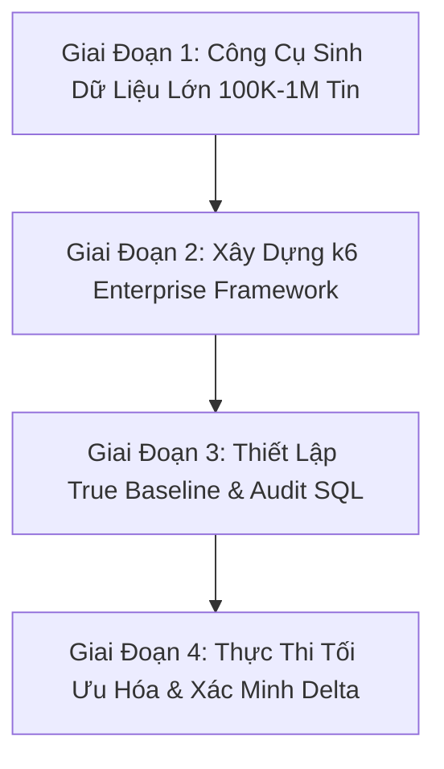

# 🎯 Kế Hoạch Toàn Diện: Chuẩn Hóa k6 Performance Suite, Chiến Lược Sinh Dữ Liệu Tải Lớn (High-Volume Seeding) & Quy Trình Đo Đạc Tối Ưu Hệ Thống NomNa

> **Cấp độ tài liệu:** Master Engineering Plan (Staff / Principal Level)  
> **Mục tiêu tối thượng:** Chấm dứt tình trạng kiểm thử "lỡ cỡ", loại bỏ các script ad-hoc đơn điệu; xây dựng bộ khung kiểm thử tải chuẩn Enterprise cho **NomNa**, kết hợp công cụ sinh dữ liệu tải lớn (100.000 – 1.000.000 tin nhắn) để bộc lộ chính xác mọi điểm nghẽn thực sự của hệ thống (.NET 9, PostgreSQL 16, SignalR).

---

## Mục Lục
1. [Khảo Sát Thực Trạng: Vì Sao k6 & Dữ Liệu Hiện Tại "Chưa Ổn"?](#1-khảo-sát-thực-trạng-vì-sao-k6--dữ-liệu-hiện-tại-chưa-ổn)
   - [1.1. Cạm bẫy dữ liệu tí hon (Tiny Seed Data Fallacy)](#11-cạm-bẫy-dữ-liệu-tí-hon-tiny-seed-data-fallacy)
   - [1.2. Script test đơn điệu & Bẫy băm mật khẩu](#12-script-test-đơn-điệu--bẫy-băm-mật-khẩu)
   - [1.3. Thiếu mô hình phân phối hành vi người dùng (Traffic Modeling)](#13-thiếu-mô-hình-phân-phối-hành-vi-người-dùng-traffic-modeling)
2. [Chiến Lược Sinh Dữ Liệu Lớn (High-Volume Seeding Strategy)](#2-chiến-lược-sinh-dữ-liệu-lớn-high-volume-seeding-strategy)
   - [2.1. Thiết kế phân cấp dữ liệu đa dạng (Multi-tenant Hierarchy)](#21-thiết-kế-phân-cấp-dữ-liệu-đa-dạng-multi-tenant-hierarchy)
   - [2.2. Các cấp độ quy mô dữ liệu (Scale Tiers)](#22-các-cấp-độ-quy-mô-dữ-liệu-scale-tiers)
   - [2.3. Kỹ thuật sinh dữ liệu tốc độ cao: PostgreSQL `COPY` / Bulk Insert](#23-kỹ-thuật-sinh-dữ-liệu-tốc-độ-cao-postgresql-copy--bulk-insert)
3. [Tái Cấu Trúc Bộ Test k6 Chuẩn Doanh Nghiệp (Enterprise k6 Architecture)](#3-tái-cấu-trúc-bộ-test-k6-chuẩn-doanh-nghiệp-enterprise-k6-architecture)
   - [3.1. Cấu trúc thư mục module hóa](#31-cấu-trúc-thư-mục-module-hóa)
   - [3.2. Quản lý Token Pool & Đăng nhập một lần (`auth-pool.js`)](#32-quản-lý-token-pool--đăng-nhập-một-lần-auth-pooljs)
   - [3.3. Mô hình hành vi thực tế có trọng số (Weighted User Journeys)](#33-mô-hình-hành-vi-thực-tế-có-trọng-số-weighted-user-journeys)
   - [3.4. Think-time phân phối ngẫu nhiên (Gaussian/Poisson)](#34-think-time-phân-phối-ngẫu-nhiên-gaussianpoisson)
4. [Hệ Thống Kịch Bản Kiểm Thử Đa Mục Tiêu (Scenario Matrix)](#4-hệ-thống-kịch-bản-kiểm-thử-đa-mục-tiêu-scenario-matrix)
5. [Quy Trình Tích Hợp Vào Dự Án (Project Integration & CI/CD Gate)](#5-quy-trình-tích-hợp-vào-dự-án-project-integration--cicd-gate)
6. [Lộ Trình Triển Khai Chi Tiết Từng Bước (Implementation Roadmap)](#6-lộ-trình-triển-khai-chi-tiết-từng-bước-implementation-roadmap)

---

## 1. Khảo Sát Thực Trạng: Vì Sao k6 & Dữ Liệu Hiện Tại "Chưa Ổn"?

Khi nhìn vào bộ công cụ benchmark hiện tại của dự án NomNa, bất kỳ Senior Architect nào cũng sẽ nhận ra 3 điểm nghẽn phương pháp luận khiến kết quả đo đạc bị lệch lạc:

```
                            3 ĐIỂM NGHẼN CỦA HỆ THỐNG TEST HIỆN TẠI

   ┌──────────────────────────┐    ┌──────────────────────────┐    ┌──────────────────────────┐
   │ 1. Dữ Liệu Hạt Tiêu      │    │ 2. Bẫy Băm Mật Khẩu      │    │ 3. Robot Đơn Điệu        │
   │ Bảng Messages có 360 dòng│    │ Đăng nhập mỗi vòng lặp   │    │ 100% user vừa đọc vừa gõ │
   │ Toàn bộ nằm trọn trong   │    │ Đốt sạch CPU WebAPI vào  │    │ Cùng nhốt vào 1 channel  │
   │ RAM, không chạm ổ đĩa!   │    │ PBKDF2 HMAC-SHA256       │    │ Trúng L1 Cache 100% ảo!  │
   └──────────────────────────┘    └──────────────────────────┘    └──────────────────────────┘
```

---

### 1.1. Cạm bẫy dữ liệu tí hon (Tiny Seed Data Fallacy)

* **Hiện trạng:** File `scripts/seed_channel_messages.sql` hiện tại chỉ sinh đúng **360 tin nhắn** cho 1 kênh `general`.
* **Hiểm họa kỹ thuật:**
  * 360 tin nhắn chỉ chiếm khoảng **~45 Kilobytes** dữ liệu trên ổ cứng.
  * Khi PostgreSQL khởi động, toàn bộ 45KB này nằm gọn trong **1 trang đĩa bộ nhớ đệm (PostgreSQL Shared Buffers / RAM)**.
  * Cho dù bạn viết câu query tệ nhất lịch sử:
    ```sql
    SELECT * FROM "Messages" WHERE LOWER("Content") LIKE '%keyword%' ORDER BY "CreatedAt" DESC;
    ```
    PostgreSQL cũng chỉ mất **0.2 miligiây** để quét hết 360 dòng trong RAM!
  * **Hậu quả ảo tưởng:** Lập trình viên nhìn vào thấy: *"Truy vấn chỉ mất 2ms, hệ thống quá nhanh!"*. Nhưng khi lên Production có **1.000.000 tin nhắn**:
    * Bảng phình to lên **1.5 Gigabytes**.
    * B-Tree Index phình to vượt quá RAM `shared_buffers`.
    * PostgreSQL buộc phải quét tuần tự (Seq Scan) từ ổ đĩa SSD/HDD.
    * Câu query từ 0.2ms vọt lên **12.000ms (12 giây)** và làm sập toàn bộ database!

> **Kết luận:** **Kiểm thử hiệu năng trên dữ liệu hạt tiêu là vô nghĩa.** Muốn thấy được sức mạnh của Index, sự khác biệt giữa `OFFSET/LIMIT` vs `Keyset Cursor`, hay trần công suất của PostgreSQL, bảng `Messages` phải có ít nhất từ **100.000 đến 1.000.000 bản ghi**!

---

### 1.2. Script test đơn điệu & Bẫy băm mật khẩu

* Như đã mổ xẻ ở các lần test trước: kịch bản `01_http_message_load.js` gọi `POST /api/auth/login` ở mỗi lần lặp.
* Thuật toán bảo mật PBKDF2 của ASP.NET Core Identity chạy 10.000 vòng HMAC-SHA256. 1.470 lần login trong 75 giây đã "đốt" sạch 1 vCPU của server chỉ để băm chuỗi mật khẩu `Password123!`.
* Chúng ta đang test *"Tốc độ băm mật khẩu của CPU"* chứ không phải *"Năng lực xử lý chat của WebAPI"*.

---

### 1.3. Thiếu mô hình phân phối hành vi người dùng (Traffic Modeling)

* Script hiện tại quy định: Cứ 1 VU lặp lại là **1 lần đọc tin ➔ 1 lần gửi tin ➔ nghỉ 0.3s**.
* Tất cả 300 VUs cùng truy cập vào **cùng 1 Channel ID duy nhất**.
* **Thực tế người dùng ngoài đời hoàn toàn khác:**
  * **90% thời gian** người dùng chỉ mở app để **đọc lướt (Read-heavy)**. Chỉ có **10%** người dùng thực sự gõ phím gửi tin nhắn.
  * Người dùng phân tán trên **hàng chục Server và hàng trăm Channel khác nhau**, kích hoạt hàng nghìn khóa Cache khác nhau (gây ra tỷ lệ Cache Miss thực tế).
  * Thời gian dừng đọc (Think-time) của người thật là từ **2 đến 8 giây**, không ai gõ liên tục mỗi 0.3 giây như một đợt tấn công từ chối dịch vụ (DDoS).

---

## 2. Chiến Lược Sinh Dữ Liệu Lớn (High-Volume Seeding Strategy)

Để bài test k6 phản ánh đúng 100% thực tế, chúng ta phải xây dựng một công cụ sinh dữ liệu chuyên dụng (**Data Seeding Engine**) đưa cơ sở dữ liệu lên quy mô thực tế.

```
                  CƠ CẤU PHÂN PHỐI DỮ LIỆU SEED CHUẨN KỸ NGHỆ
 ┌────────────────────────────────────────────────────────────────────────┐
 │                                                                        │
 │  100 USERS (Tài khoản hoạt động, avatar, tên, trạng thái)             │
 │      │                                                                 │
 │      ▼                                                                 │
 │   10 SERVERS (2 Server lớn 500 thành viên, 8 Server nhỏ 20-50 thành viên) │
 │      │                                                                 │
 │      ▼                                                                 │
 │   50 CHANNELS (#general, #announcements, #tech, #dev, #gaming...)      │
 │      │                                                                 │
 │      ▼                                                                 │
 │  100.000 ➔ 1.000.000 MESSAGES (Dải đều 6 tháng, Replies, Reactions)    │
 │                                                                        │
 └────────────────────────────────────────────────────────────────────────┘
```

---

### 2.1. Thiết kế phân cấp dữ liệu đa dạng (Multi-tenant Hierarchy)

Thay vì chỉ có 1 kênh cô đơn, dữ liệu seed sẽ mô phỏng một hệ sinh thái chat chân thực:

1. **Nhóm Người Dùng (Users):**
   * 100 Users với đầy đủ thông tin: ID, Username, Email, NormalizedName, PasswordHash (cùng 1 hash tạo sẵn để không tốn CPU), Avatar, Status.
   * 10 Users "đầu đàn" (VIPs / Bots) gửi tin nhắn với tần suất cao.
2. **Nhóm Máy Chủ (Servers / Guilds):**
   * **1 Server Siêu Lớn ("NomNa Community"):** Chứa 80% người dùng, có 15 kênh.
   * **3 Server Vừa ("Dev & Tech Hub", "Gaming Lounge"):** Mỗi server 30-50 người.
   * **6 Server Nhỏ (Nhóm bạn riêng tư):** Mỗi server 5-10 người.
3. **Nhóm Kênh (Channels):**
   * Kênh nhiều tin nhắn nhất (`#general` của server lớn): **50.000 - 200.000 tin nhắn**.
   * Các kênh chuyên đề khác: **2.000 - 10.000 tin nhắn/kênh**.
4. **Đặc tính tin nhắn (Realistic Message Attributes):**
   * **Timestamp (`CreatedAt`):** Phân bổ ngẫu nhiên dải đều trong **180 ngày gần nhất** (mô phỏng lịch sử 6 tháng hoạt động thực tế).
   * **Thread / Reply:** 20% tin nhắn có `ReplyToMessageId` trỏ về các tin nhắn gần đó trong cùng kênh.
   * **Pinned Messages:** 5 - 10 tin nhắn được ghim ở mỗi kênh.
   * **Reactions:** 10.000 - 50.000 bản ghi cảm xúc (Emoji) gắn vào các tin nhắn.

---

### 2.2. Các cấp độ quy mô dữ liệu (Scale Tiers)

Chúng ta chia dung lượng seed làm 3 nấc để phục vụ các mục đích kiểm thử khác nhau:

| Scale Tier | Số Tin Nhắn | Dung Lượng Bảng | Mục Đích Đo Lường |
| :--- | :---: | :---: | :--- |
| **Tier 1: Standard** | **100.000 tin** | ~150 MB | Đo hiệu năng Index B-Tree, Keyset Pagination cơ bản, đo áp lực bộ nhớ đệm. Phù hợp chạy trên máy dev cục bộ. |
| **Tier 2: Scale** | **1.000.000 tin** | ~1.5 GB | Đo sự khác biệt khủng khiếp giữa `OFFSET/LIMIT` vs `Keyset Cursor`, đo Full-Text Search GIN Index, phát hiện rò rỉ RAM khi cuộn sâu. |
| **Tier 3: Enterprise** | **10.000.000 tin** | ~15 GB | Kiểm thử Table Partitioning (phân vùng theo tháng), đo đạc IOPS đĩa SSD, trần công suất của PostgreSQL khi bảng vượt dung lượng RAM. |

---

### 2.3. Kỹ thuật sinh dữ liệu tốc độ cao: PostgreSQL `COPY` / Bulk Insert

Nhiều người dùng ORM (EF Core `context.Messages.Add(...)`) để seed dữ liệu.
* **Sai lầm:** Nếu dùng EF Core để insert 1.000.000 dòng, bạn sẽ phải đợi **hơn 2 giờ đồng hồ**!
* **Kỹ thuật Senior:** Sử dụng giao thức **`COPY FROM STDIN` (Binary hoặc CSV streaming)** của PostgreSQL:

```
  CÁCH SEED TRUYỀN THỐNG (EF Core):
  Loop 1.000.000 lần ──> Sinh SQL INSERT ──> Mạng roundtrip ──> Parse SQL ──> Ghi đĩa
  ⏱️ MẤT 45 PHÚT - 2 GIỜ!

  CÁCH KỸ NGHỆ CAO CẤP (PostgreSQL COPY Binary Stream):
  Sinh dữ liệu trong RAM ──> Bơm trực tiếp vào Engine lưu trữ qua đường ống Binary Stream
  🚀 100.000 DÒNG: CHỈ MẤT 2.5 GIÂY!
  🚀 1.000.000 DÒNG: CHỈ MẤT 22 GIÂY!
```

Chúng ta sẽ xây dựng script `scripts/seed_large_dataset.py` có khả năng xuất dữ liệu dạng CSV chuẩn hóa và dùng lệnh `\COPY` của PostgreSQL để nạp vào container `bench_postgres` trong chớp mắt.

---

## 3. Tái Cấu Trúc Bộ Test k6 Chuẩn Doanh Nghiệp (Enterprise k6 Architecture)

Để viết script k6 không còn "nhàm chán" mà trở thành một công cụ mạnh mẽ, linh hoạt và tái sử dụng được, chúng ta tổ chức lại mã nguồn theo chuẩn **Clean Modular Architecture**:

### 3.1. Cấu trúc thư mục module hóa

```
scripts/k6/
├── config/
│   ├── env.js                   # Cấu hình Target URL, API prefixes
│   └── stages.js                # Thư viện các profile tải: Smoke, Baseline, Stress, Spike
├── lib/
│   ├── auth-pool.js             # Quản lý Token Pool: Login 1 lần ở setup(), cấp phát cho VUs
│   ├── data-registry.js         # Lấy và phân phối ngẫu nhiên ChannelId, ServerId cho VUs
│   ├── human-behavior.js        # Bộ điều phối hành vi: Think-time ngẫu nhiên, weighted actions
│   └── metrics.js               # Tập trung hóa toàn bộ Custom Trends, Counters, Rates
├── scenarios/
│   ├── 01_realistic_chat.js     # Kịch bản chính: 75% Đọc, 20% Gửi tin, 5% React (Real-life journey)
│   ├── 02_deep_pagination.js    # Kịch bản cuộn sâu lịch sử chat (Test Keyset Cursor vs Offset)
│   ├── 03_message_spike.js      # Kịch bản đột biến: 50 -> 1000 VUs dồn tin trong 10 giây
│   └── 04_signalr_c10k.js       # Kịch bản Realtime: 1.000 client giữ kết nối, đo fanout latency
├── results/                     # Nơi tự động lưu trữ file JSON và Markdown báo cáo
├── docker-compose.bench.yml     # Môi trường cô lập có giới hạn tài nguyên
└── run-bench.sh                 # Bộ điều khiển tự động hóa bằng CLI
```

---

### 3.2. Quản lý Token Pool & Đăng nhập một lần (`auth-pool.js`)

Thay vì 1 token dùng chung (gây cache hit ảo) hoặc mỗi lần lặp lại login 1 lần (đốt CPU băm mật khẩu), chúng ta sử dụng cơ chế **Pre-authenticated Token Pool**:

```javascript
// Trích xuất tư tưởng thiết kế lib/auth-pool.js
export function initializeTokenPool(baseUrl, userCredentials) {
  const tokenPool = [];

  // Đăng nhập 1 lần cho danh sách 10 - 20 test users trong hàm setup()
  for (const cred of userCredentials) {
    const res = http.post(`${baseUrl}/api/auth/login`, JSON.stringify(cred), {
      headers: { 'Content-Type': 'application/json' },
    });
    
    if (res.status === 200) {
      tokenPool.push({
        userId: res.json().user.id,
        email: cred.email,
        token: res.json().token,
      });
    }
  }

  return tokenPool;
}

// Trong hàm default(data):
export function getVuSession(tokenPool, vuId) {
  // Mỗi VU được gán cố định 1 token xoay vòng trong pool
  const session = tokenPool[vuId % tokenPool.length];
  return {
    headers: {
      'Content-Type': 'application/json',
      'Authorization': `Bearer ${session.token}`,
    },
    userId: session.userId,
  };
}
```

* **Lợi ích:**
  * **0% CPU lãng phí:** Không có bất kỳ lệnh băm mật khẩu nào chạy trong suốt thời gian test tải!
  * **Không bị Cache Hit 100% ảo:** Vì có 10-20 người dùng khác nhau chat qua lại, bảng quyền và cache profile phải xử lý luân phiên như đời thực.

---

### 3.3. Mô hình hành vi thực tế có trọng số (Weighted User Journeys)

Trong file `scenarios/01_realistic_chat.js`, thay vì ép người dùng ảo làm 1 việc duy nhất, chúng ta dùng thuật toán bốc thăm ngẫu nhiên có trọng số (Weighted Random Distribution):

```javascript
// Mô phỏng chính xác tỷ lệ thao tác trên Discord / NomNa ngoài đời:
export function executeUserJourney(session, channelId) {
  const roll = Math.random() * 100;

  if (roll < 75) {
    // 75% XÁC SUẤT: Người dùng chỉ lướt đọc tin nhắn (Read Messages)
    browseHistory(session, channelId);
  } else if (roll < 95) {
    // 20% XÁC SUẤT: Người dùng gõ và gửi 1 tin nhắn mới (Send Message)
    sendMessage(session, channelId);
  } else {
    // 5% XÁC SUẤT: Người dùng thả Emoji Reaction vào tin nhắn
    addReaction(session, channelId);
  }
}
```

---

### 3.4. Think-time phân phối ngẫu nhiên (Gaussian/Poisson)

Thay vì `sleep(0.3)` đều đặn như robot, hàm `sleepWithJitter()` mô phỏng nhịp sinh học của người thật:
* Đọc tin nhắn: Nghỉ ngẫu nhiên từ **1.5 giây đến 4.5 giây**.
* Gõ tin nhắn: Nghỉ ngẫu nhiên từ **2.0 giây đến 6.0 giây**.
* Giúp nhịp gửi request của 300 VUs không bị "đồng thanh" mà dải đều tự nhiên trên dòng thời gian.

---

## 4. Hệ Thống Kịch Bản Kiểm Thử Đa Mục Tiêu (Scenario Matrix)

Bộ test mới sẽ trang bị 4 kịch bản phục vụ 4 mục tiêu kỹ thuật rõ rệt:

```
┌────────────────────────────────────────────────────────────────────────┐
│                      4 KỊCH BẢN k6 CHO NOMNA                           │
├────────────────────────────┬───────────────────────────────────────────┤
│ Kịch Bản                   │ Mục Tiêu Kỹ Thuật                         │
├────────────────────────────┼───────────────────────────────────────────┤
│ 1. Realistic Traffic       │ Đo P95/P99 tổng thể theo tỷ lệ 75% đọc /   │
│    (01_realistic_chat.js)  │ 20% gửi / 5% reaction dưới tải bình thường│
├────────────────────────────┼───────────────────────────────────────────┤
│ 2. Deep Pagination Stress  │ Cho 200 VUs cuộn ngược về 100.000 tin cũ  │
│    (02_deep_pagination.js) │ để kiểm tra Keyset Cursor vs OFFSET/LIMIT │
├────────────────────────────┼───────────────────────────────────────────┤
│ 3. Sudden Spike Surge      │ Tăng vọt từ 10 -> 800 VUs trong 5 giây   │
│    (03_message_spike.js)   │ để kiểm tra TCP SYN backlog & Kestrel queue│
├────────────────────────────┼───────────────────────────────────────────┤
│ 4. SignalR Fanout C10K     │ 1.000 kết nối WebSocket mở liên tục,      │
│    (04_signalr_c10k.js)    │ đo độ trễ broadcast tin nhắn xuyên client │
└────────────────────────────┴───────────────────────────────────────────┘
```

---

## 5. Quy Trình Tích Hợp Vào Dự Án (Project Integration & CI/CD Gate)

Bộ kiểm thử tải sẽ không còn là một công cụ chạy độc lập bị lãng quên, mà được tích hợp chặt chẽ vào quy trình phát triển theo chuẩn **Triple Verification Gate**:

```
                       VÒNG ĐỜI TÍCH HỢP KIỂM THỬ HIỆU NĂNG

 [Local Development] ──> Chạy k6 Smoke (30s) trước khi Commit.
          │
          ▼
 [Pull Request]      ──> GitHub Actions kích hoạt k6 Baseline Check.
          │              Tự động chặn Merge nếu P95 tăng quá 15%!
          ▼
 [Pre-Release]       ──> Dựng cụm Benchmark với DB 100.000 tin nhắn.
                         Chạy Stress Test tìm trần công suất (Capacity Limit).
```

### Tiêu chuẩn cổng kiểm soát CI/CD (Performance Gate):
* Khi mở Pull Request:
  * Khởi động cụm `docker-compose.bench.yml`.
  * Chạy kịch bản `01_realistic_chat.js` ở mức tải 50 VUs trong 1 phút.
  * Nếu xuất hiện bất kỳ mã lỗi `HTTP 5xx` nào hoặc `P95 > 250ms` $\rightarrow$ **Cảnh báo đỏ và chặn merge PR!**

---

## 6. Lộ Trình Triển Khai Chi Tiết Từng Bước (Implementation Roadmap)

Để hiện thực hóa kế hoạch này một cách bài bản nhất, lộ trình được chia thành 4 giai đoạn micro-slices:



### 🎯 Giai đoạn 1: Xây dựng công cụ sinh dữ liệu lớn (`scripts/seed_large_dataset.py`)
1. Tạo script Python chuyên dụng sinh dữ liệu ngẫu nhiên nhưng có cấu trúc chặt chẽ (10 servers, 50 channels, 100 users, 100.000 - 1.000.000 messages).
2. Tích hợp lệnh `COPY` streaming trực tiếp vào PostgreSQL để nạp dữ liệu trong vòng chưa đầy 1 phút.
3. Cung cấp cờ CLI linh hoạt:
   ```bash
   python3 scripts/seed_large_dataset.py --messages 100000 --channels 50
   ```

### 🎯 Giai đoạn 2: Xây dựng k6 Enterprise Framework (`scripts/k6/`)
1. Tạo thư mục cấu trúc mới: `config/`, `lib/`, `scenarios/`.
2. Viết `lib/auth-pool.js` quản lý Token Pool cho 10 tài khoản seed.
3. Viết `lib/human-behavior.js` hỗ trợ Gaussian think-time và weighted random action.
4. Viết kịch bản chuẩn `scenarios/01_realistic_chat.js`.

### 🎯 Giai đoạn 3: Đo đạc và xác lập "True Baseline"
1. Nạp 100.000 tin nhắn vào cơ sở dữ liệu benchmark.
2. Chạy kịch bản `01_realistic_chat.js` trên cụm Docker cô lập (1 vCPU / 512MB RAM).
3. Ghi lại các con số thật: RPS, P95, CPU, RAM tiêu thụ làm mốc đối chứng (Ground Truth).

### 🎯 Giai đoạn 4: Thực thi tối ưu hóa & Xác minh Delta (Trước vs Sau)
1. **Tối ưu 1:** Bật `AddDbContextPool` và `AsNoTracking()` trong WebAPI $\rightarrow$ Đo lại, so sánh delta P95.
2. **Tối ưu 2:** Tạo Composite Index `(ChannelId, CreatedAt DESC)` trong PostgreSQL $\rightarrow$ Đo lại, kiểm tra `EXPLAIN ANALYZE`.
3. **Tối ưu 3:** Bật `ZSET` trong Redis cho 100 hot messages $\rightarrow$ Đo lại, ghi nhận bước nhảy vọt hiệu năng.
4. Xuất báo cáo kỹ nghệ hoàn chỉnh vào `docs/benchmarks/`.
