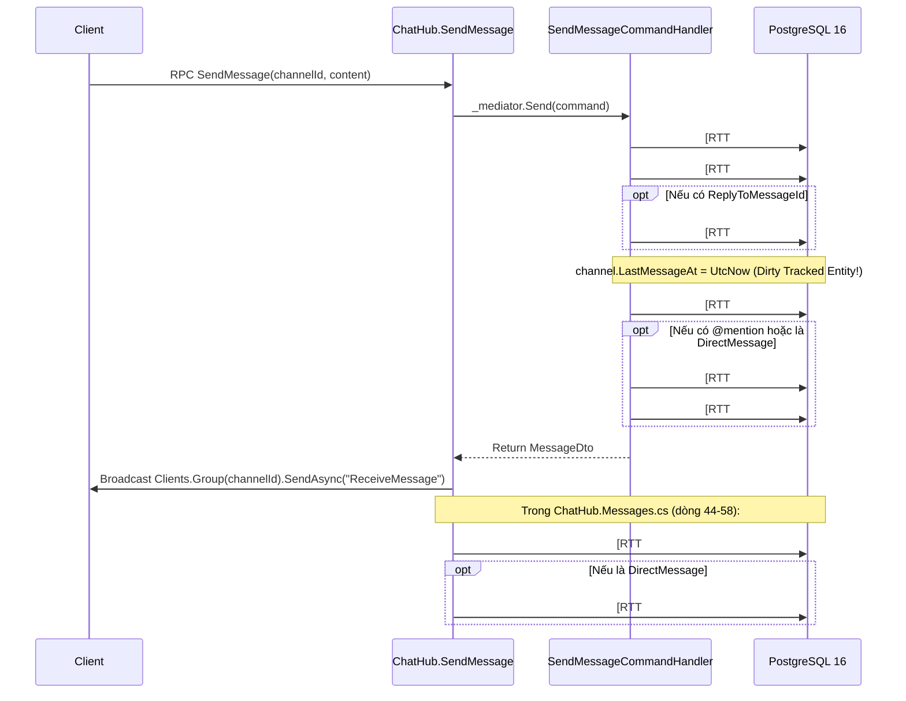
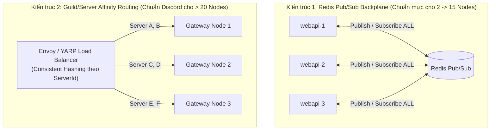
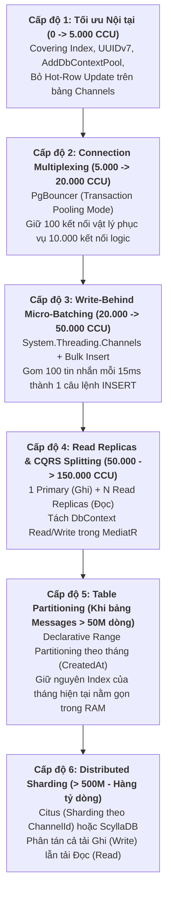
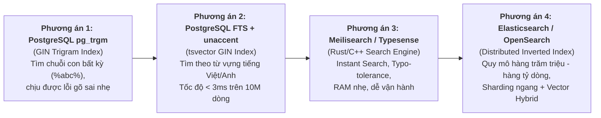
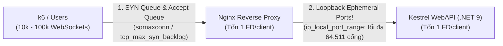

# 🧠 Tập 06: Bách Khoa Toàn Thư Kiến Trúc Hiệu Năng Cao — Từ C# CLR, Kestrel, Linux Kernel Đến Scale DB/Search & Ma Trận Trade-Off

> **Góc nhìn:** Principal / Staff+ Systems Engineer  
> **Đối tượng phân tích:** Hệ thống Chat Thời Gian Thực **NomNa** (.NET 9, ASP.NET Core, SignalR, EF Core, PostgreSQL 16, Redis 7, Linux/Docker)  
> **Triết lý cốt lõi:** *"Mọi kiến trúc đều là sự đánh đổi (Everything in software architecture is a trade-off). Một Senior thực thụ không phải là người nhét Kafka, Elasticsearch và Kubernetes vào mọi dự án, mà là người biết chính xác ở ngưỡng vật lý nào hệ thống hiện tại sẽ gãy và giải pháp nào rẻ nhất để đẩy giới hạn đó lên gấp 10 lần."*

---

## Mục Lục
1. [Tầng 1: Giải Phẫu C# CLR, .NET 9 Memory Model & ThreadPool Internals](#1-tầng-1-giải-phẫu-c-clr-net-9-memory-model--threadpool-internals)
2. [Tầng 2: Audit Thực Chiến Codebase NomNa — 5 "Quả Bom Nổ Chậm" Khi Chịu Tải Cao](#2-tầng-2-audit-thực-chiến-codebase-nomna--5-quả-bom-nổ-chậm-khi-chịu-tải-cao)
3. [Tầng 3: Kestrel, SignalR WebSockets & Bài Toán Scale Multi-Node Realtime](#3-tầng-3-kestrel-signalr-websockets--bài-toán-scale-multi-node-realtime)
4. [Tầng 4: PostgreSQL 16 Internals (MVCC, WAL, B-Tree, UUIDv7) & 6 Cấp Độ Scale Database](#4-tầng-4-postgresql-16-internals-mvcc-wal-b-tree-uuidv7--6-cấp-độ-scale-database)
5. [Tầng 5: Kiến Trúc Scale Search — Từ `LIKE %kw%` Đến Trigram, PG FTS, Meilisearch & Elasticsearch](#5-tầng-5-kiến-trúc-scale-search--từ-like-kw-đến-trigram-pg-fts-meilisearch--elasticsearch)
6. [Tầng 6: Linux Kernel, TCP/IP Network Stack, Docker Conntrack & Vượt Ngưỡng 64.511 Ephemeral Ports](#6-tầng-6-linux-kernel-tcpip-network-stack-docker-conntrack--vượt-ngưỡng-64511-ephemeral-ports)
7. [Tầng 7: Ma Trận Quyết Định & Đánh Đổi Theo Quy Mô (The Principal Trade-Off Matrix)](#7-tầng-7-ma-trận-quyết-định--đánh-đổi-theo-quy-mô-the-principal-trade-off-matrix)

---

## 1. Tầng 1: Giải Phẫu C# CLR, .NET 9 Memory Model & ThreadPool Internals

Muốn vắt kiệt từng chu kỳ xung nhịp (clock cycle) của 1 vCPU và 512MB RAM, bạn không thể nhìn C# như một ngôn ngữ bậc cao trừu tượng. Bạn phải nhìn thấy **bộ nhớ vật lý** và **các luồng hạt nhân (OS threads)**.

### 1.1. Kiến trúc Bộ nhớ .NET 9: SOH, LOH, POH và Cuộc cách mạng DATAS

Trong .NET CLR, Managed Heap được chia thành các phân vùng có quy luật thu gom rác (Garbage Collection) hoàn toàn khác nhau:

| Phân vùng Heap | Kích thước Object | Cơ chế cấp phát & thu gom | Nguy cơ trong ứng dụng Chat (NomNa) |
| :--- | :--- | :--- | :--- |
| **Gen 0 / Gen 1 (SOH)** | `< 85.000 bytes` | Cấp phát bằng con trỏ bump-pointer cực nhanh ($O(1)$). Thu gom Ephemeral GC dưới `1ms`, có nén bộ nhớ (Compaction). | Các DTO ngắn hạn (`MessageDto`, `NotificationDto`, chuỗi JSON nhỏ, Closure trong LINQ) sinh ra và chết đi ở đây. |
| **Gen 2 (SOH)** | `< 85.000 bytes` (sống sót qua Gen 1) | Chỉ thu gom khi Full GC kích hoạt. Tốn CPU và gây **Stop-The-World (STW) Pause** rõ rệt. | Các object bị giữ lâu trong kết nối WebSocket (`ChatHub` state, `IMemoryCache` entries trong `UserProfileCache`, `PermissionService`) hoặc request bị treo lâu trong hàng đợi DB. |
| **LOH (Large Object Heap)** | `>= 85.000 bytes` | **Không compact (nén) mặc định** vì chi phí copy mảng lớn quá đắt. Chỉ được dọn khi có Full Gen 2 GC. | Khi `GetMessagesQueryHandler` trả về 100 tin nhắn kèm danh sách `Attachments` và `Reactions`, chuỗi JSON trả về hoặc mảng byte buffer vượt 85KB sẽ nhảy thẳng vào LOH $\to$ gây **phân mảnh bộ nhớ (Heap Fragmentation)** dẫn tới OOM dù RAM trống vẫn còn! |
| **POH (Pinned Object Heap)** | Mảng được pin cố định địa chỉ | Tách riêng các buffer dùng cho Socket I/O (`Kestrel`, `Npgsql`) để không cản trở GC nén SOH. | Mỗi kết nối WebSocket giữ các slab bộ nhớ cố định trong `System.IO.Pipelines`. |

#### ⚖️ Trade-off: Server GC vs Workstation GC vs DATAS (.NET 9)
* **Server GC truyền thống (`ServerGarbageCollection = true`)**:
  - Tạo 1 Managed Heap và 1 luồng GC chuyên biệt cho mỗi Logical CPU Core.
  - **Ưu điểm:** Throughput cực đại trên máy nhiều core vì các luồng không tranh chấp lock khi cấp phát bộ nhớ.
  - **Nhược điểm chí mạng trên Docker 512MB:** Server GC cực kỳ "tham" RAM. Nó găm giữ các segment lớn và chỉ chịu chạy GC khi bộ nhớ phình to. Trên container giới hạn `512MB`, Server GC rất dễ chạm ngưỡng `cgroup memory.max` và bị Linux Kernel **OOM Killer (`SIGKILL - Exit Code 137`)** giết chết ngay lập tức trước khi kịp thu gom rác!
* **DATAS (Dynamic Adaptation To Application Sizes — Bật mặc định từ .NET 9)**:
  - Tự động co giãn số lượng Heap và kích thước ngân sách bộ nhớ (GC budget) dựa trên tải thực tế (Live Data Size).
  - **Khi nào cần can thiệp?**
    - Nếu chạy trong container nhỏ (`<= 1GB RAM`): Giữ nguyên **DATAS** (mặc định của .NET 9) hoặc đặt biến môi trường `DOTNET_GCHeapHardLimitPercent=75` để ép GC thu gom quyết liệt khi chạm 75% giới hạn RAM của container (khoảng 384MB trên container 512MB).
    - Nếu chạy trên Dedicated Server / VPS lớn (`>= 8 vCPU, >= 16GB RAM`) chuyên chịu tải cao liên tục và bạn ưu tiên P99 latency thấp tuyệt đối hơn là tiết kiệm RAM: Tắt DATAS (`DOTNET_GCDynamicAdaptationMode=0`) để giữ sẵn các heap segments lớn, tránh chi phí co giãn heap lúc spike tải.

---

### 1.2. Giải phẫu `async/await`: Khi nào `ValueTask<T>` cứu nguy, khi nào là cái bẫy?

Mỗi khi bạn viết từ khóa `async Task<T>`, trình biên dịch C# sinh ra một `struct` cài đặt `IAsyncStateMachine`.
- **Trường hợp 1 (Hoàn thành bất đồng bộ - I/O thật):** Luồng gặp lệnh chờ socket (PostgreSQL/Redis) chưa có dữ liệu ngay $\to$ State machine được **boxed (đóng hộp) lên Managed Heap**, và một đối tượng `Task<T>` (~72 bytes) được cấp phát trên Heap.
- **Trường hợp 2 (Hoàn thành đồng bộ - Cache Hit):** Giả sử hàm kiểm tra `IMemoryCache` và thấy có sẵn dữ liệu. Không có I/O nào xảy ra! Tuy nhiên, nếu kiểu trả về là `Task<UserProfileDto?>`, CLR **vẫn phải cấp phát một object `Task<UserProfileDto?>` mới trên Heap** mỗi lần gọi!

Hãy nhìn vào [`UserProfileCache.cs`](../../src/NomNa.Infrastructure/Services/UserProfileCache.cs) hiện tại trong NomNa:
```csharp
// HIỆN TẠI: Dù 99.9% là Cache Hit đồng bộ, mỗi lần gọi vẫn tốn 1 Heap Allocation cho Task<UserProfileDto?>!
public async Task<UserProfileDto?> GetAsync(Guid userId, CancellationToken cancellationToken = default)
{
    var cacheKey = GetCacheKey(userId);
    if (_cache.TryGetValue<UserProfileDto>(cacheKey, out var cached) && cached != null)
    {
        return cached; // <--- Vẫn cấp phát Task object trên Heap!
    }
    // ...
}
```
Và tương tự trong [`PermissionService.cs`](../../src/NomNa.Infrastructure/Services/PermissionService.cs):
```csharp
public async Task<Permissions> GetChannelPermissionsAsync(Guid userId, Guid channelId, CancellationToken cancellationToken = default)
{
    var cacheKey = $"perm_chn_{channelId}_{userId}";
    if (_cache.TryGetValue<Permissions>(cacheKey, out var cached))
    {
        return cached; // <--- 99% thời gian chạy vào nhánh này!
    }
    // ...
}
```

#### Giải pháp tối ưu chuẩn Principal: Tách Fast-Path đồng bộ với `ValueTask<T>`
```csharp
// TỐI ƯU HÓA: 0 byte Heap Allocation khi Cache Hit!
public ValueTask<UserProfileDto?> GetAsync(Guid userId, CancellationToken cancellationToken = default)
{
    if (_cache.TryGetValue<UserProfileDto>(GetCacheKey(userId), out var cached) && cached != null)
    {
        return new ValueTask<UserProfileDto?>(cached); // Struct trên Stack - ZERO heap allocation!
    }

    return new ValueTask<UserProfileDto?>(FetchAndCacheAsync(userId, cancellationToken));
}
```

#### ⚖️ Trade-off của `ValueTask<T>`:
- **Khi nào PHẢI dùng `ValueTask<T>`:** Ở các phương thức nằm trên **Hot Path** (được gọi hàng nghìn lần/giây) và có **xác suất hoàn thành đồng bộ cao (> 70% - 80%)**, điển hình là các tầng Cache-Aside (`UserProfileCache`, `PermissionService`, `PinnedMessageCache`) hoặc đọc từ buffer có sẵn dữ liệu.
- **Khi nào KHÔNG NÊN dùng `ValueTask<T>`:** Ở các hàm chắc chắn 100% phải đi qua mạng/DB (như `SendMessageCommandHandler`, `GetMessagesQueryHandler`). Khi phải chờ I/O thật, `ValueTask<T>` vẫn phải bọc một `Task<T>` bên trong, mà bản thân struct `ValueTask<T>` lại to hơn con trỏ `Task<T>` (16 bytes vs 8 bytes trên 64-bit), làm state machine của hàm gọi to hơn một chút mà không tiết kiệm được byte nào!
- **Quy tắc an toàn:** Với `ValueTask<T>`, chỉ được `await` đúng 1 lần duy nhất tại nơi gọi. Không bao giờ lưu vào biến để `await` nhiều lần.

---

### 1.3. Cơ chế .NET ThreadPool & Tại sao 1 hàm CPU-Bound có thể làm tê liệt toàn bộ WebSocket?

.NET ThreadPool có một thuật toán điều phối tên là **Hill-Climbing**:
1. Ban đầu, số lượng Worker Threads tối thiểu (`MinThreads`) bằng số nhân CPU (trong container `bench_webapi_1` giới hạn `cpus: "1.00"`, `Environment.ProcessorCount = 1`).
2. Khi toàn bộ các Worker Threads đều đang bận (blocked hoặc đang chạy CPU 100%) và hàng đợi `ThreadPool Queue Length` tăng lên, ThreadPool **không tạo ngay hàng chục luồng mới**, mà chỉ bơm thêm **1 đến 2 luồng mỗi 500ms – 1000ms** để tránh nổ bộ nhớ Stack (mỗi Thread tốn ~1MB vùng nhớ ảo cho Stack).
3. Trong khoảng thời gian chờ bơm luồng đó, mọi tác vụ I/O callback (Kestrel đọc gói tin HTTP, SignalR xử lý Ping/Pong WebSocket, Npgsql nhận kết quả từ Postgres, StackExchange.Redis nhận phản hồi từ Redis) đều phải xếp hàng trong `ThreadPool Global/Local Queue`!
4. Hệ quả: StackExchange.Redis báo lỗi kinh điển `Timeout performing EVAL ... inst: 0, qu: 0, qs: 150, in: 65536` — không phải do Redis chậm, mà do **Worker Thread của .NET bị kẹt không kịp thức dậy để đọc dữ liệu từ Socket Buffer!**

---

## 2. Tầng 2: Audit Thực Chiến Codebase NomNa — 5 "Quả Bom Nổ Chậm" Khi Chịu Tải Cao

Là một Senior/Principal Engineer, trước khi chạy benchmark hay gắn thêm phần cứng, việc đầu tiên là đọc xuyên thấu mã nguồn hiện tại. Dưới đây là **5 điểm nghẽn và lỗi kiến trúc thực tế** đang nằm ngay trong codebase NomNa mà bạn sẽ chứng kiến chúng phát nổ khi chạy k6:

---

### 💣 Quả Bom #1: Lỗi Scoped Lifetime + Memory Leak trong [`PermissionService.cs`](../../src/NomNa.Infrastructure/Services/PermissionService.cs)

Hãy nhìn vào [`src/NomNa.Infrastructure/DependencyInjection.cs`](../../src/NomNa.Infrastructure/DependencyInjection.cs) (dòng 46):
```csharp
services.AddScoped<IPermissionService, PermissionService>();
```
Và nhìn vào [`src/NomNa.Infrastructure/Services/PermissionService.cs`](../../src/NomNa.Infrastructure/Services/PermissionService.cs) (dòng 22–24):
```csharp
private readonly ConcurrentDictionary<Guid, CancellationTokenSource> _serverTokens = new();
private readonly ConcurrentDictionary<Guid, CancellationTokenSource> _channelTokens = new();
private readonly ConcurrentDictionary<(Guid ServerId, Guid UserId), CancellationTokenSource> _userTokens = new();
```

**Phân tích hậu quả kép:**
1. Vì `PermissionService` được đăng ký là **`Scoped`** (tạo mới theo từng HTTP Request), mà 3 biến `_serverTokens`, `_channelTokens`, `_userTokens` lại là **instance fields** (không có `static`):
   - **Request A** vào kiểm tra quyền, bị cache miss $\to$ tạo `CancellationTokenSource` lưu vào `_serverTokens` của **Instance A** và gắn `CancellationChangeToken` vào `IMemoryCache` (vốn là Singleton). Sau khi Request A kết thúc, **Instance A** bị hủy!
   - **Request B** (cập nhật Role trên Server) gọi `_permissionService.InvalidateServer(serverId)` $\to$ nó tìm trong `_serverTokens` của **Instance B** (đang rỗng hoàn toàn!) $\to$ **Không hủy được `CancellationTokenSource` của Request A! Cache cũ vẫn sống nhăn răng suốt 2 phút dù quyền đã bị thu hồi!**
2. **Về mặt Performance & GC:** Mỗi request kiểm tra quyền đều cấp phát mới 3 đối tượng `ConcurrentDictionary` (rất nặng vì bên trong chứa mảng `Node[]` và `locks[]`), đồng thời các `CancellationTokenSource` gắn vào `IMemoryCache` không được chia sẻ mà tạo trùng lặp theo từng request!
3. **Cách khắc phục triệt để:** Chuyển 3 dictionary đó thành `private static readonly` (hoặc tách một `Singleton` `PermissionCacheTokenRegistry`), để mọi Scoped `PermissionService` cùng chia sẻ chung một bảng điều khiển `CancellationTokenSource` toàn cục!

---

### 💣 Quả Bom #2: Bão Broadcast $O(N^2)$ (`Clients.All`) trong [`ChatHub.cs`](../../src/NomNa.WebAPI/Hubs/ChatHub.cs)

Hãy nhìn vào [`ChatHub.cs`](../../src/NomNa.WebAPI/Hubs/ChatHub.cs) (dòng 80–90 và 124–133):
```csharp
var becameOnline = await _presenceTracker.UserConnectedAsync(userId, Context.ConnectionId);
if (becameOnline)
{
    // Broadcast toàn hệ thống (Clients.All) báo rằng User này vừa mới Online
    await Clients.All.SendAsync(SignalRConstants.Events.UserStatusChanged, new
    {
        userId = userId.ToString(),
        status = "online"
    });
}
```

**Toán học của sự sụp đổ:**
- Khi bạn chạy kịch bản k6 `02_signalr_realtime.js` đẩy 500 kết nối WebSocket vào cùng lúc:
  - Kết nối thứ 1 vào $\to$ gửi 1 frame.
  - Kết nối thứ 2 vào $\to$ gửi 2 frames.
  - ...
  - Kết nối thứ $N$ vào $\to$ gửi $N$ frames.
  - Tổng số gói tin WebSocket phải serialize và đẩy qua mạng chỉ riêng cho sự kiện Online/Offline là:
    $$\sum_{i=1}^{N} i = \frac{N(N+1)}{2} \approx \frac{N^2}{2}$$
- Ở mức **500 CCU**: $\frac{500^2}{2} = 125.000$ gói tin khi kết nối + $125.000$ gói tin khi ngắt kết nối = **250.000 gói tin**!
- Ở mức **10.000 CCU** (khi server vừa khởi động lại hoặc mạng chập chờn khiến 10.000 người reconnect cùng lúc — **Reconnection Thundering Herd**):
  $$\frac{10.000^2}{2} = 50.000.000 \text{ (50 triệu gói tin WebSocket!)}$$
  Băng thông mạng và Kestrel Write Pipe sẽ nổ tung ngay lập tức!

**Giải pháp kiến trúc chuẩn Discord / Slack (Trade-off giữa Realtime Accuracy vs Scalability):**
1. **Scoped Presence Fanout:** Không bao giờ dùng `Clients.All`. Chỉ gửi tới các Server Group mà user đó là thành viên, hoặc chỉ những người đang mở chung kênh/danh sách bạn bè.
2. **Debounced / Coalesced Presence Broadcast (Gom lô theo chu kỳ 2 giây):** Thay vì bắn ngay lập tức trong `OnConnectedAsync`, đẩy sự kiện `(UserId, Status)` vào một hàng đợi trong bộ nhớ, và mỗi `2000ms` một BackgroundTimer gom tất cả các thay đổi thành 1 mảng duy nhất `UsersStatusChangedBatch([{ userId, status }, ...])` rồi mới gửi đi. Giảm **99% số lượng gói tin** khi có bão kết nối!
3. **Disconnect Grace Window (5–10 giây):** Khi user ấn F5 tải lại trang, `OnDisconnectedAsync` chạy rồi 500ms sau `OnConnectedAsync` chạy lại. Nếu bắn `offline` rồi `online` ngay lập tức, bạn tốn gấp đôi băng thông vô ích.

---

### 💣 Quả Bom #3: 8 DB Round-Trips + Hot Row Lock Contention khi gửi 1 tin nhắn ([`SendMessageCommandHandler.cs`](../../src/NomNa.Application/Features/Messages/Commands/SendMessage/SendMessageCommandHandler.cs) & [`ChatHub.Messages.cs`](../../src/NomNa.WebAPI/Hubs/ChatHub.Messages.cs))

Hãy đếm chính xác những gì xảy ra mỗi khi 1 user bấm Enter gửi tin nhắn qua `ChatHub.SendMessage`:



**3 tử huyệt lớn ở đây:**
1. **Truy vấn lặp lại dư thừa (RTT #7 và #8):** `ChatHub.Messages.cs` (dòng 44–58) mở thêm một DI scope mới chỉ để query lại bảng `channels` xem có phải là `DirectMessage` không, trong khi `SendMessageCommandHandler` vừa mới lấy `channel` đó ở RTT #1! Chỉ cần trả kèm `ChannelType` hoặc `RecipientUserIds` trong kết quả nội bộ của Command là cắt bỏ hoàn toàn RTT #7 và #8!
2. **Hot Row Lock Contention trên bảng `channels` (Dòng 94–108 của `SendMessageCommandHandler.cs`):**
   - Mỗi khi có 1 tin nhắn mới, code cập nhật `channel.LastMessageAt = DateTime.UtcNow; channel.LastMessageContent = ...` và gọi `SaveChangesAsync()`.
   - Trong PostgreSQL, câu lệnh `UPDATE channels SET ... WHERE id = @channelId` sẽ giữ một **Row-Level Exclusive Lock (`FOR NO KEY UPDATE`)** trên đúng dòng `channel` đó cho đến khi Transaction `COMMIT`.
   - Khi 300 VUs trong k6 cùng bắn tin nhắn vào **cùng 1 kênh `#general`**, cả 300 luồng đều tranh nhau khóa đúng 1 dòng duy nhất trong bảng `channels`! Hơn nữa, cột `LastMessageAt` lại đang được đánh Index (`entity.HasIndex(e => e.LastMessageAt)` ở dòng 120 của `ApplicationDbContext.cs`), khiến PostgreSQL không thể dùng tối ưu hóa **HOT (Heap-Only Tuple) Update**, mà phải tạo bản ghi mới trong cả Heap lẫn B-Tree Index mỗi lần có tin nhắn!
3. **Tách rời Side-Effects (Notifications & Mentions) khỏi Critical Path:**
   - Người gửi và những người đang mở khung chat chỉ cần thấy tin nhắn xuất hiện nhanh nhất có thể (`INSERT INTO messages` + `Clients.Group.SendAsync`).
   - Việc phân tích regex `@mention`, tìm danh sách user, lưu bảng `notifications` và cập nhật `channels.LastMessageAt` hoàn toàn có thể đẩy vào một **`System.Threading.Channels.Channel<MessageSentDomainEvent>`** (In-Memory Background Queue) để xử lý bất đồng bộ sau khi đã trả kết quả cho user! Thời gian phản hồi P95 của `SendMessage` sẽ giảm một nửa ngay lập tức.

---

### 💣 Quả Bom #4: Bẫy Băm Mật Khẩu + Full Table Scan trong [`LoginCommandHandler.cs`](../../src/NomNa.Application/Features/Auth/Commands/Login/LoginCommandHandler.cs)

Hãy nhìn vào [`LoginCommandHandler.cs`](../../src/NomNa.Application/Features/Auth/Commands/Login/LoginCommandHandler.cs) (dòng 30–53):
```csharp
var input = request.EmailOrUsername.Trim().ToLowerInvariant();

var user = await _userManager.Users
    .FirstOrDefaultAsync(u => u.Email == input || u.UserName == input, cancellationToken: cancellationToken);
```
Và dòng 45–53:
```csharp
bool passwordValid = await _userManager.CheckPasswordAsync(user, request.Password);
// ...
await _userManager.ResetAccessFailedCountAsync(user);
```

**3 vấn đề nghiêm trọng khi DB có 100.000 users và tải đăng nhập tăng cao:**
1. **Bỏ quên Index của ASP.NET Core Identity:**
   - Trong `IdentityDbContext`, bảng `users` chỉ đánh Index mặc định trên 2 cột: `NormalizedEmail` (`EmailIndex`) và `NormalizedUserName` (`UserNameIndex`). Hai cột `Email` và `UserName` **KHÔNG hề có Index**!
   - Khi bạn viết `u.Email == input || u.UserName == input`, PostgreSQL buộc phải chạy **Sequential Scan (quét toàn bộ bảng `users`)**!
   - **Cách sửa chuẩn:** Dùng `var normalized = _userManager.NormalizeName(request.EmailOrUsername.Trim());` và truy vấn trên `u.NormalizedEmail == normalized || u.NormalizedUserName == normalized` (hoặc dùng `_userManager.FindByEmailAsync` / `_userManager.FindByNameAsync`).
2. **`ResetAccessFailedCountAsync(user)` luôn chạm DB hoặc thừa thãi:**
   - Chỉ nên gọi `if (user.AccessFailedCount > 0) await _userManager.ResetAccessFailedCountAsync(user);` để tránh mọi thao tác kiểm tra/cập nhật không cần thiết khi user đăng nhập bình thường.
3. **PBKDF2 100.000 vòng lặp (CPU Bottleneck):**
   - `CheckPasswordAsync` băm mật khẩu tốn ~20–30ms CPU nguyên chất. Trên 1 vCPU, nếu 100 người cùng gọi `/api/auth/login` tại 1 giây, CPU sẽ kẹt ở 100% trong 2.5 giây liên tiếp.
   - **Giải pháp thực tế:** Đặt một `SemaphoreSlim` hoặc ASP.NET Core `ConcurrencyLimiter` riêng cho endpoint `/api/auth/login` (ví dụ chỉ cho phép tối đa `MaxConcurrentRequests = ProcessorCount * 2` luồng băm mật khẩu cùng lúc; các request vượt ngưỡng xếp hàng hoặc nhận `429 Too Many Requests`), bảo vệ các luồng xử lý chat và WebSocket không bị chết chùm!

---

### 💣 Quả Bom #5: Duplicate Index trong [`ApplicationDbContext.cs`](../../src/NomNa.Infrastructure/Persistence/ApplicationDbContext.cs)

Hãy nhìn vào [`ApplicationDbContext.cs`](../../src/NomNa.Infrastructure/Persistence/ApplicationDbContext.cs) (dòng 162 và 169–171):
```csharp
// Dòng 162: Index thứ nhất trên (ChannelId, CreatedAt)
entity.HasIndex(e => new { e.ChannelId, e.CreatedAt });

// Dòng 169-171: Index thứ hai CŨNG trên (ChannelId, CreatedAt) nhưng có thêm HasDatabaseName!
entity.HasIndex(e => new { e.ChannelId, e.CreatedAt })
    .HasDatabaseName("idx_messages_channel_root_created")
    .HasFilter("\"DeletedAt\" IS NULL");
```
- Trong EF Core, nếu bạn gọi `HasIndex(e => new { e.ChannelId, e.CreatedAt })` hai lần trên cùng một cặp thuộc tính mà không chỉ định tên khác nhau ở lần đầu, EF Core hoặc sẽ ghi đè cấu hình, hoặc nếu tạo thành 2 index trong các bản migration khác nhau thì PostgreSQL phải duy trì **2 cây B-Tree giống hệt nhau** trên bảng lớn nhất hệ thống (`messages`)!
- Mỗi một Index dư thừa trên bảng `messages` làm chậm tốc độ `INSERT` đi ~10–15% và chiếm hàng trăm MB trong `shared_buffers` (RAM của Postgres).

---

## 3. Tầng 3: Kestrel, SignalR WebSockets & Bài Toán Scale Multi-Node Realtime

### 3.1. Giải phẫu Bộ nhớ & Băng thông của 10.000 kết nối SignalR

Khi 1 client mở kết nối WebSocket tới `/hubs/chat`:
1. **Kestrel Transport Layer** cấp phát 2 đường ống `System.IO.Pipelines.Pipe` (Input Pipe & Output Pipe) sử dụng các khối bộ nhớ `MemoryPool<byte>.Shared` (mặc định mỗi slab 4KB).
2. **SignalR `HubConnectionContext`** lưu trạng thái kết nối, danh sách các Group mà connection đó đã join, và hàng đợi gửi đi.
3. **Chi phí RAM thực tế trên .NET 9:**
   - 1 kết nối WebSocket rỗi (idle): tốn khoảng **12KB – 25KB RAM**.
   - Vậy **10.000 kết nối đồng thời (10k CCU)** chỉ tốn khoảng **150MB – 250MB RAM** cho riêng tầng socket!
   - Cái làm tràn 512MB RAM không phải là bản thân kết nối WebSocket, mà là **Payload Serialization Allocations** khi bạn broadcast 1 tin nhắn cho hàng nghìn người cùng lúc!

#### Kỹ thuật tối ưu hóa Serialization & Payload trong SignalR:
| Kỹ thuật | Cơ chế | Độ giảm tài nguyên | Trade-off |
| :--- | :--- | :--- | :--- |
| **`System.Text.Json` Source Generators (`JsonSerializerContext`)** | Sinh code serialize lúc compile-time thay vì dùng Reflection + runtime metadata caching. | Giảm ~20% CPU, giảm kích thước bộ nhớ warmup. | Phải khai báo `[JsonSerializable(typeof(MessageDto))]` cho các DTO. |
| **MessagePack Protocol (`AddMessagePackProtocol()`)** | Thay thế văn bản JSON bằng định dạng nhị phân nén (Binary serialization). | Giảm **40% – 60% băng thông mạng**, giảm **~50% CPU** serialize/deserialize. | Khó debug bằng mắt thường trong tab Network của Chrome DevTools (cần formatter). |
| **WebSocket Compression (`PerMessageDeflate`)** | Nén luồng khung tin WebSocket bằng thuật toán DEFLATE (zlib). | Giảm **60% – 75% băng thông mạng** cho tin nhắn văn bản dài. | **CỰC KỲ NGUY HIỂM CHO RAM & CPU!** Mỗi kết nối WebSocket bật `deflate` sẽ giữ một ngữ cảnh cửa sổ trượt `zlib sliding window` tốn thêm **32KB – 256KB native memory (unmanaged RAM)** mỗi kết nối! Với 10.000 CCU, `PerMessageDeflate` có thể ngốn thêm **1GB – 2GB RAM** ngoài tầm kiểm soát của .NET GC! **Quy tắc vàng: Tắt WebSocket Compression trên máy ít RAM (< 2GB), dùng MessagePack thay thế!** |

---

### 3.2. Khi 1 Node Không Đủ: Các Kiến Trúc Scale Multi-Node Cho SignalR

Khi bạn chạy từ 2 containers WebAPI trở lên (`webapi-1`, `webapi-2`) đứng sau Nginx:
- User A kết nối WebSocket vào `webapi-1`.
- User B kết nối WebSocket vào `webapi-2`.
- Nếu User A gửi tin nhắn vào `channelId`, lệnh `Clients.Group(channelId).SendAsync(...)` trên `webapi-1` **chỉ gửi được cho các kết nối đang nằm trên RAM của `webapi-1`**! User B trên `webapi-2` sẽ không nhận được gì nếu không có **Backplane**.

Dưới đây là 4 kiến trúc Multi-Node từ đơn giản đến siêu quy mô (Hyperscale) cùng **Trade-off** rõ ràng:



| Kiến trúc | Cách hoạt động | Ngưỡng phù hợp | Ưu điểm | Nhược điểm / Điểm gãy (Trade-off) |
| :--- | :--- | :--- | :--- | :--- |
| **1. Redis Backplane tiêu chuẩn (`AddStackExchangeRedis`)** | Mọi gói tin `Clients.Group` hoặc `Clients.User` đều được publish qua Redis Pub/Sub tới các node WebAPI. | **2 – 15 Nodes WebAPI** (`< 100.000 CCU`, `< 20.000 msg/s`). | Cài đặt trong 5 phút (1 gói NuGet + 1 dòng cấu hình). Không cần thay đổi code `ChatHub`. | **Bẫy Fanout Toàn Cụm:** Với `Clients.All` hoặc kênh chung, mọi node WebAPI đều nhận được bản sao của mọi tin nhắn từ Redis để tự kiểm tra xem mình có giữ kết nối nào của group đó không. Khi thêm quá nhiều node, băng thông nội bộ giữa Redis và các node tăng tuyến tính $O(K \times M)$. |
| **2. Sharded Redis Pub/Sub (Redis 7.0+ `SPUBLISH`) / Dynamic Channel Subscription** | Node WebAPI chỉ `SUBSCRIBE` vào đúng kênh Redis của những `channelId` đang có ít nhất 1 user active trên node đó. Khi user cuối cùng trên node rời kênh, node gọi `UNSUBSCRIBE`. | **10 – 50 Nodes WebAPI** (`100.000 – 500.000 CCU`). | Loại bỏ hoàn toàn hiện tượng một node phải nhận tin nhắn của những kênh không có người dùng nào kết nối trên nó. | Phức tạp hơn khi quản lý reference counting của từng group trên mỗi node. |
| **3. Stateful Actor / Consistent Hash Routing (Mô hình Discord / Microsoft Orleans)** | Chia tách tầng **Realtime Gateway** (giữ kết nối WebSocket) và tầng **Guild/Channel Actor** (giữ state của từng Server/Channel trên đúng 1 node cố định bằng Consistent Hashing). | **> 500.000 CCU** (Quy mô Discord, Slack, Game Server). | Mọi thao tác trong cùng 1 Server/Channel diễn ra hoàn toàn trong RAM của 1 Actor node duy nhất, không cần lock phân tán trên Redis hay DB! | Chi phí kỹ thuật (Engineering Complexity) rất cao; phải xử lý Rebalancing khi 1 Actor node chết. |

> 💡 **Lời khuyên thực chiến cho NomNa:** Ở giai đoạn từ **1 đến 50.000 CCU**, **Redis Backplane (`Microsoft.AspNetCore.SignalR.StackExchangeRedis`)** kết hợp với việc **bỏ `Clients.All`** là lựa chọn tối ưu tuyệt đối về tỷ lệ Hiệu năng / Công sức (ROI). Đừng bao giờ đụng vào Kafka hay Actor Cluster khi chưa vượt qua mốc 50.000 CCU!

---

## 4. Tầng 4: PostgreSQL 16 Internals (MVCC, WAL, B-Tree, UUIDv7) & 6 Cấp Độ Scale Database

Để scale Database đúng cách, bạn phải hiểu cách PostgreSQL lưu dữ liệu trên đĩa và trong RAM (`shared_buffers`).

### 4.1. Sự thật bên dưới PostgreSQL: MVCC, Write Amplification & UUIDv4 vs UUIDv7

1. **Trong PostgreSQL, `UPDATE` thực chất là `DELETE` + `INSERT`:**
   - Do kiến trúc **MVCC (Multi-Version Concurrency Control)**, khi bạn chạy `UPDATE channels SET "LastMessageAt" = NOW() WHERE "Id" = ...`, Postgres **không ghi đè** lên vùng nhớ cũ trên trang 8KB (8KB Heap Page).
   - Thay vào đó, nó đánh dấu bản ghi cũ (old tuple) là đã hết hạn (`xmax = current_txid`) và **chèn một bản ghi hoàn toàn mới (new tuple)** vào Heap Page!
   - Nếu cột bị sửa (`LastMessageAt`) nằm trong một B-Tree Index (như dòng 120 của `ApplicationDbContext.cs`), Postgres **bắt buộc phải chèn thêm 1 nút mới vào TẤT CẢ các Index của bảng `channels`** (vì con trỏ vật lý `ctid` của dòng đó đã đổi sang vị trí mới, không dùng được tối ưu hóa **HOT — Heap-Only Tuple**)!
   - Hậu quả: Gửi 100.000 tin nhắn vào 1 kênh sẽ sinh ra **100.000 Dead Tuples** trong bảng `channels`! Bảng `channels` chỉ có 10 kênh nhưng có thể phình to hàng trăm MB trên đĩa nếu `autovacuum` không dọn kịp!

2. **Bẫy `Guid.NewGuid()` (UUIDv4) vs `Guid.CreateVersion7()` (UUIDv7 trong .NET 9):**
   - Hiện tại trong [`BaseEntity.cs`](../../src/NomNa.Domain/Common/BaseEntity.cs), mỗi `Message` mới dùng `Guid.NewGuid()` (UUIDv4 — 122 bits hoàn toàn ngẫu nhiên).
   - Khi bảng `messages` có 10 triệu dòng (B-Tree Primary Key Index `PK_messages` nặng khoảng ~300MB–500MB):
     - Vì UUIDv4 là ngẫu nhiên, mỗi tin nhắn mới chèn vào sẽ rơi vào một trang 8KB **bất kỳ** nằm rải rác khắp cây B-Tree.
     - Trang đó đã đầy $\to$ Postgres phải thực hiện **Page Split** (tách 1 trang 8KB thành 2 trang, copy một nửa dữ liệu sang trang mới, ghi WAL log cho cả 2 trang), gây phân mảnh B-Tree (~30–40% khoảng trống lãng phí) và bắt toàn bộ cây B-Tree phải nằm trong RAM mới không bị đọc/ghi đĩa ngẫu nhiên (Random I/O)!
   - **Vũ khí tối thượng của .NET 9 — `Guid.CreateVersion7()` (UUIDv7):**
     - 48 bits đầu của UUIDv7 là **Unix Timestamp (mili-giây)**, các bits sau là ngẫu nhiên.
     - Nhờ đó, mọi ID sinh ra mới đều **lớn hơn các ID cũ** (Monotonically Increasing).
     - Khi `INSERT` vào PostgreSQL, mọi bản ghi mới luôn được chèn vào **nhánh ngoài cùng bên phải (Right-most Leaf Page)** của cây B-Tree!
     - **Kết quả:** Tốc độ `INSERT` khi bảng có hàng chục triệu dòng **nhanh gấp 3 đến 5 lần**, kích thước Index nhỏ hơn ~25%, và chỉ cần giữ đúng vài trang cuối cùng của B-Tree trong RAM (`shared_buffers`)!

---

### 4.2. Lộ Trình 6 Cấp Độ Scale Database (Khi nào dùng gì & Trade-off?)



#### Chi tiết từng cấp độ & Ma trận đánh đổi (Trade-offs):

| Cấp độ | Giải pháp kỹ thuật | Khi nào BẮT BUỘC phải áp dụng? | Ưu điểm (Pros) | Đánh đổi / Rủi ro (Cons & Trade-offs) |
| :--- | :--- | :--- | :--- | :--- |
| **Level 1: Tối ưu Query & Schema** | - Chuyển `AddDbContext` sang `AddDbContextPool` (`poolSize: 1024`).<br/>- Dùng `Guid.CreateVersion7()`.<br/>- Gộp truy vấn kiểm tra quyền vào cùng 1 câu SQL.<br/>- Bỏ cập nhật trực tiếp `channels.LastMessageAt` trên mỗi tin nhắn (hoặc cập nhật bất đồng bộ). | **Ngay lập tức (0 – 5.000 CCU)**. Chi phí hạ tầng = $0. | Tăng gấp 3–5 lần RPS ngay trên cùng 1 vCPU mà không tốn thêm 1 đồng tiền server nào. | Không có nhược điểm nếu xử lý đúng việc reset state của DbContext. |
| **Level 2: PgBouncer (Transaction Mode)** | Đặt container `PgBouncer` (chỉ tốn 15MB RAM) đứng giữa các node WebAPI và PostgreSQL. Cấu hình `pool_mode = transaction`, `default_pool_size = 50`. | Khi có **nhiều hơn 2 node WebAPI** hoặc tổng `Max Pool Size` của các node cộng lại `> 200` kết nối. | PostgreSQL dùng mô hình **1 tiến trình OS (forked process) cho 1 kết nối** (~10MB RAM/kết nối). 500 kết nối làm CPU Postgres kẹt cứng vì Context Switching. PgBouncer giúp 5.000 luồng WebAPI dùng chung đúng 50 tiến trình Postgres mượt mà! | Trong chế độ `transaction` của PgBouncer, các tính năng phụ thuộc vào Session State (như `SET LOCAL` ngoài transaction, Advisory Locks cấp session, hoặc Prepared Statements cũ nếu không bật hỗ trợ trong PgBouncer 1.21+) cần cấu hình chuẩn (`Max Auto Prepare` trong Npgsql hoặc PgBouncer `max_prepared_statements`). |
| **Level 3: Write-Behind Batching (`Channel<T>`)** | Khi user gửi tin nhắn: Tạo `MessageDto` (với `Guid.CreateVersion7()` và `CreatedAt = DateTime.UtcNow`), bắn **ngay lập tức** qua SignalR cho người nhận (độ trễ < 2ms), đồng thời đẩy vào `Channel<Message>` trong bộ nhớ. Một `BackgroundService` cứ mỗi **15ms** (hoặc đủ 100 tin nhắn) lấy ra toàn bộ và thực hiện **1 lệnh Bulk Insert duy nhất** vào Postgres! | Khi lưu lượng ghi vượt quá khả năng IOPS commit đơn lẻ của ổ cứng (`> 3.000 – 5.000 tin nhắn mới/giây`). | Biến 5.000 lệnh `INSERT` + 5.000 lần `fsync` WAL đĩa thành **50 lệnh Bulk Insert/giây**! Tăng thông lượng ghi lên **30.000+ tin nhắn/giây** trên 1 DB duy nhất! | **Trade-off về Durability (Tính bền vững):** Trong khoảng cửa sổ 15ms trước khi `BackgroundService` kịp flush xuống đĩa, nếu máy chủ bị rút dây điện đột ngột (Power loss / `SIGKILL`), tối đa 15ms tin nhắn trong RAM sẽ bị mất dù UI đã hiện. *Cách hóa giải:* Ghi vào Redis Stream (`XADD`) hoặc Kafka trước khi trả về. |
| **Level 4: Read Replicas (Primary + Standby)** | Trong MediatR: Các `ICommand` tiêm `IWriteDbContext` (trỏ vào Primary DB). Các `IQuery` (`GetMessagesQuery`, `GetServersQuery`) tiêm `IReadOnlyDbContext` (trỏ vào Read Replica qua chuỗi kết nối `Target Session Attributes=prefer-standby` của Npgsql!). | Khi tỷ lệ Đọc/Ghi là 90/10 và CPU của Primary DB chạm 70–80% do các câu lệnh `SELECT` lịch sử chat. | Npgsql hỗ trợ sẵn việc tự động cân bằng tải (Load Balancing) và Failover giữa nhiều Read Replicas ngay trong Connection String mà không cần cài proxy phức tạp! | **Trade-off về Consistency (Replication Lag):** Sau khi User A gửi tin nhắn (ghi vào Primary), mất khoảng `5ms – 50ms` để dữ liệu đồng bộ sang Read Replica. Nếu User A lập tức gọi `GET /messages` vào Read Replica trong 10ms đó, có thể chưa thấy tin nhắn vừa gửi. *Cách hóa giải:* Trên UI, tin nhắn mới được nhận trực tiếp qua SignalR / Optimistic UI nên không cần gọi lại `GET /messages` ngay sau khi gửi! |
| **Level 5: Table Partitioning** | Chia bảng `messages` thành các phân vùng vật lý theo thời gian: `messages_2026_11`, `messages_2026_12` (`PARTITION BY RANGE (created_at)`). | Khi bảng `messages` vượt **50 triệu – 100 triệu dòng** (kích thước bảng > 30GB–50GB, vượt quá RAM của server DB). | 95% người dùng chỉ đọc tin nhắn của **7 ngày gần nhất**. Nhờ Partitioning, toàn bộ bảng và B-Tree Index của tháng hiện tại chỉ nặng vài GB $\to$ nằm gọn 100% trong RAM (`shared_buffers`), giữ tốc độ truy vấn dưới `1ms` bất kể lịch sử 5 năm trước nặng 10TB! Hơn nữa, xóa dữ liệu cũ chỉ cần `DROP TABLE messages_2020_01` (tức thì, không gây bloat như `DELETE`). | Khóa chính (Primary Key) của bảng phân vùng trong Postgres bắt buộc phải bao gồm cột phân vùng: `PRIMARY KEY (id, created_at)`. Các khóa ngoại (Foreign Keys) trỏ tới `messages.id` (như `ReplyToMessageId`) cần xử lý ở tầng ứng dụng hoặc kèm `created_at`. |
| **Level 6: Sharding (Citus / ScyllaDB)** | Phân mảnh dữ liệu theo `channel_id` (mỗi `channel_id` cùng toàn bộ `messages` của nó nằm trên 1 Shard vật lý riêng biệt). | Khi vượt **500 triệu – hàng tỷ tin nhắn** hoặc tốc độ ghi vượt quá giới hạn vật lý của 1 máy chủ Primary duy nhất (`> 50.000 writes/sec`). | Mở rộng tuyến tính (Linear Horizontal Scalability) cả Đọc lẫn Ghi: thêm máy là thêm công suất. | Mất khả năng `JOIN` xuyên các kênh khác nhau (ví dụ: tìm kiếm tin nhắn trên toàn bộ các kênh của 1 Server phải scatter-gather qua nhiều shard — lúc này bắt buộc phải tách Search sang hệ thống riêng ở Tầng 5!). |

---

## 5. Tầng 5: Kiến Trúc Scale Search — Từ `LIKE %kw%` Đến Trigram, PG FTS, Meilisearch & Elasticsearch

Hãy nhìn vào [`SearchMessagesQueryHandler.cs`](../../src/NomNa.Application/Features/Messages/Queries/SearchMessages/SearchMessagesQueryHandler.cs) (dòng 123–127) hiện tại của NomNa:
```csharp
if (!string.IsNullOrWhiteSpace(request.Keyword))
{
    var keyword = request.Keyword.Trim().ToLower();
    query = query.Where(m => EF.Functions.Like(m.Content.ToLower(), $"%{keyword}%"));
}
```

### 5.1. Tại sao `LIKE '%keyword%'` là "Sát thủ CPU" của Database?

Trong cấu trúc dữ liệu **B-Tree**, các chuỗi được sắp xếp theo thứ tự từ điển từ trái sang phải (giống như cuốn từ điển giấy).
- Nếu bạn tìm `LIKE 'abc%'` (Prefix search): Cây B-Tree có thể nhảy ngay tới vần `abc` trong $O(\log N)$.
- Nhưng khi bạn đặt dấu `%` ở đầu (`LIKE '%abc%'`), từ khóa có thể nằm ở giữa hoặc cuối câu. Cây B-Tree hoàn toàn vô dụng!
- Tệ hơn nữa, biểu thức `m.Content.ToLower()` bắt PostgreSQL phải:
  1. Đọc từng dòng tin nhắn từ Heap (`Seq Scan` hoặc `Bitmap Heap Scan` toàn bộ tin nhắn của Server/Channel đó).
  2. Cấp phát chuỗi mới trong bộ nhớ để chuyển toàn bộ nội dung tin nhắn sang chữ thường (`lower(content)`).
  3. Chạy thuật toán so khớp chuỗi byte-by-byte trên hàng trăm nghìn dòng!
- Khi một Server có **500.000 tin nhắn**, chỉ cần 10 người dùng cùng bấm tìm kiếm là CPU của PostgreSQL vọt lên **100%** ngay lập tức!

---

### 5.2. 4 Phương Án Scale Search & Ma Trận Trade-Off Chi Tiết

Để giải quyết bài toán Search trong ứng dụng Chat (đặc biệt có **Tiếng Việt có dấu + Tiếng Anh + Code snippets**), bạn có 4 vũ khí theo từng giai đoạn phát triển:



| Tiêu chí | 1. PostgreSQL `pg_trgm` (Trigram GIN) | 2. PostgreSQL Full-Text Search (`tsvector` + `unaccent`) | 3. Meilisearch / Typesense (Rust / C++) | 4. Elasticsearch / OpenSearch (Java/Lucene) |
| :--- | :--- | :--- | :--- | :--- |
| **Nguyên lý hoạt động** | Cắt chuỗi `"xin chào"` thành các bộ 3 ký tự: `{"  x", " xi", "xin", "in ", "cch", "cha", "hao", "ao "}` và lưu vào **GIN Index** (Inverted Index ngay trong Postgres). | Tách câu thành các từ chuẩn hóa (Lexemes), bỏ dấu tiếng Việt qua `unaccent`, lưu vào cột `tsvector` kèm **GIN Index**. | Động cơ Inverted Index + Prefix Automaton độc lập viết bằng Rust/C++, giao tiếp qua HTTP REST/gRPC. | Cụm phân tán Apache Lucene, hỗ trợ Sharding, Replica, BM25 ranking và Vector Search. |
| **Tốc độ với `LIKE '%keyword%'`** | Biến `ILIKE '%keyword%'` (từ 3 ký tự trở lên) từ **Full Scan $O(N)$** thành **GIN Index Scan $O(1)$**! | Không quét chuỗi con tùy ý giữa từ, mà khớp theo từ nguyên vẹn hoặc tiền tố từ (`to_tsquery('simple', 'keyword:*')`) cực nhanh (**< 2ms**). | **< 5ms – 10ms**, trả kết quả ngay khi gõ từng chữ cái (Search-as-you-type). | **< 10ms – 20ms** trên hàng trăm triệu bản ghi. |
| **Hỗ trợ Tiếng Việt (Có dấu & Không dấu)** | Tìm có dấu ra có dấu; nếu muốn tìm không dấu ra có dấu phải kết hợp `unaccent`. | **Rất tốt** khi tạo cấu hình `CREATE TEXT SEARCH CONFIGURATION vietnamese_unaccent (COPY = simple)` gắn filter `unaccent`. Gõ `"toiuu"` hay `"tối ưu"` đều ra kết quả! | **Xuất sắc** (Tự động hiểu dấu tiếng Việt, tự động sửa lỗi chính tả 1–2 ký tự — Typo Tolerance). | **Xuất sắc** (Có bộ phân tích `icu_folding`, `asciifolding`, custom analyzers). |
| **Quy mô dữ liệu tối ưu** | **< 5 triệu tin nhắn** | **< 20 – 50 triệu tin nhắn** | **5 triệu – 100 triệu tin nhắn** | **> 50 triệu – Hàng tỷ tin nhắn** |
| **Chi phí RAM & Hạ tầng** | **0 server mới.** Tuy nhiên GIN Trigram Index khá tốn dung lượng đĩa (bằng ~50–70% dung lượng cột `Content`). | **0 server mới.** GIN Index trên `tsvector` rất gọn nhẹ (chỉ bằng ~15–25% dung lượng cột `Content`). | Cần thêm 1 container nhẹ (~256MB – 1GB RAM). | **Rất nặng!** Riêng JVM Heap tối thiểu cần **2GB – 8GB RAM** chỉ để khởi động ổn định. |
| **Độ phức tạp vận hành (DevOps & Consistency)** | **Bằng 0.** ACID 100%: Vừa lưu tin nhắn xong là tìm thấy ngay lập tức! | **Bằng 0.** ACID 100%: Dùng `Generated Stored Column` trong Postgres, tự động cập nhật khi `INSERT/UPDATE`. | Cần cơ chế đồng bộ dữ liệu (**Transactional Outbox Pattern** hoặc Background Worker đẩy từ Postgres sang Meilisearch). Có độ trễ Eventual Consistency ~200ms. | Rất cao: Phải quản lý đồng bộ dữ liệu (Outbox / Debezium CDC), quản lý Index Mapping, Reindexing, Split-brain, JVM GC tuning. |

#### 🎯 Khuyến nghị của Principal Engineer cho NomNa:
1. **Ngắn hạn & Trung hạn (Giai đoạn hiện tại $\to$ 20 triệu tin nhắn):**
   - **Dùng PostgreSQL Full-Text Search (`tsvector` + `GIN Index`) hoặc `pg_trgm` ngay trong PostgreSQL!**
   - Tại sao? Bạn không phải nuôi thêm bất kỳ container Search nào, không bao giờ lo lệch dữ liệu giữa DB và Search Engine khi tin nhắn bị sửa/xóa (`EditMessage` / `DeleteMessage`), không tốn thêm 1MB RAM nào cho JVM, mà tốc độ tìm kiếm giảm từ **800ms xuống còn 2ms**!
   - Cách triển khai trong PostgreSQL cực kỳ thanh lịch:
     ```sql
     CREATE EXTENSION IF NOT EXISTS pg_trgm;
     CREATE EXTENSION IF NOT EXISTS unaccent;

     -- Tạo GIN Trigram Index hỗ trợ trực tiếp ILIKE '%keyword%' cho các truy vấn có độ dài >= 3 ký tự:
     CREATE INDEX CONCURRENTLY idx_messages_content_trgm 
     ON messages USING GIN (LOWER("Content") gin_trgm_ops)
     WHERE "DeletedAt" IS NULL;
     ```
     Chỉ với đúng 1 câu lệnh `CREATE INDEX` này, câu code `EF.Functions.Like(m.Content.ToLower(), $"%{keyword}%")` hiện tại trong [`SearchMessagesQueryHandler.cs`](../../src/NomNa.Application/Features/Messages/Queries/SearchMessages/SearchMessagesQueryHandler.cs) của bạn **tự động ăn vào GIN Index mà không cần sửa dù chỉ 1 dòng C#**!
2. **Dài hạn (Khi vượt 30–50 triệu tin nhắn hoặc cần Fuzzy Typo-Tolerance + AI Semantic Search):**
   - Nhảy thẳng lên **Meilisearch** (hoặc **Typesense**) thông qua **Outbox Pattern** (hoặc dùng `pgvector` nếu cần tìm kiếm ngữ nghĩa bằng AI Embedding). Chỉ dùng **Elasticsearch** khi bạn có cụm nhiều máy chủ chuyên biệt và lưu lượng log/message hàng trăm triệu dòng.

---

## 6. Tầng 6: Linux Kernel, TCP/IP Network Stack, Docker Conntrack & Vượt Ngưỡng 64.511 Ephemeral Ports

Nhiều kỹ sư tối ưu C# và SQL rất kỹ, nhưng khi đem lên VPS thật bắn tới mốc **10.000 – 65.000 kết nối WebSocket**, hệ thống đột ngột từ chối kết nối dù CPU mới dùng 20% và RAM còn trống một nửa! Nguyên nhân nằm ở **Linux Kernel & Mạng**.

### 6.1. Giải phẫu đường đi của gói tin và 3 nút cổ chai của Linux Kernel



#### Nút cổ chai 1: Cạn kiệt File Descriptors (`Too many open files`)
Trong Linux, *"Everything is a file"*. Mỗi kết nối TCP Socket là 1 File Descriptor (FD).
- Nếu Nginx và Kestrel chạy trên cùng 1 máy chủ VPS:
  - 1 kết nối từ Client $\to$ Nginx tốn **1 FD** của tiến trình Nginx.
  - Nginx mở 1 kết nối proxy ngược vào Kestrel (`127.0.0.1:8080`) tốn **thêm 1 FD** của tiến trình Nginx!
  - Kestrel nhận kết nối đó tốn **1 FD** của tiến trình `dotnet`!
- **Tổng cộng:** 1 người dùng online qua WebSocket tiêu tốn **3 File Descriptors** trên hệ điều hành (riêng Nginx tốn **2 FDs / người dùng**)!
- Nếu giới hạn mặc định của Linux (`ulimit -n`) là `1024`, Nginx sẽ sập ngay ở kết nối WebSocket thứ **512**!
- **Thông số bắt buộc phải mở khóa trên VPS:**
  - `/etc/sysctl.conf`: `fs.file-max = 2097152`
  - `/etc/security/limits.conf`: `* soft nofile 1048576` và `* hard nofile 1048576`
  - Trong `nginx.conf`: `worker_rlimit_nofile 200000;` và `events { worker_connections 65536; use epoll; multi_accept on; }`

#### Nút cổ chai 2: Bức tường vô hình 64.511 kết nối giữa Nginx và Kestrel (Ephemeral Port Exhaustion)
Giả sử bạn đã nâng `ulimit -n` lên 1 triệu. Nhưng khi bắn tới khoảng **28.000** (hoặc **64.000** sau khi chỉnh `ip_local_port_range`), Nginx bắt đầu quăng lỗi 502 Bad Gateway kèm dòng log:
> `connect() to 127.0.0.1:8080 failed (99: Cannot assign requested address)`

**Tại sao lại như vậy?**
- Một kết nối TCP được định danh duy nhất bởi bộ tứ (**4-tuple**):
  $$(\text{Source IP}, \text{Source Port}, \text{Destination IP}, \text{Destination Port})$$
- Khi Nginx proxy vào Kestrel:
  - `Source IP` cố định là `127.0.0.1` (hoặc IP của container Nginx).
  - `Destination IP` cố định là `127.0.0.1` (hoặc IP của container `webapi-1`).
  - `Destination Port` cố định là `8080`.
- Biến số duy nhất còn lại là **`Source Port` (Ephemeral Port)** mà chỉ có tối đa 16-bit ($2^{16} = 65.536$ cổng, trừ đi 1.024 cổng hệ thống còn **64.511 cổng**)!
- **2 Cách Phá Vỡ Giới Hạn 64.511 Kết Nối Của Một Principal Engineer:**
  1. **Cách 1 (Trên cùng 1 máy chủ / cùng Docker host): Dùng Unix Domain Socket (`unix:/var/run/nomna-kestrel.sock`) thay vì TCP Loopback!**
     - Cấu hình Kestrel lắng nghe trên file socket `options.ListenUnixSocket("/tmp/kestrel.sock")` và Nginx `proxy_pass http://unix:/tmp/kestrel.sock;`.
     - **Lợi ích kép:** Unix Domain Socket **KHÔNG dùng TCP/IP stack và KHÔNG tốn bất kỳ Ephemeral Port nào** (bạn có thể mở 500.000 kết nối WebSocket qua 1 file socket duy nhất!), đồng thời giảm ~25–30% độ trễ và CPU copy gói tin qua tầng loopback!
  2. **Cách 2 (Qua mạng TCP giữa nhiều container/máy chủ):**
     - Mở nhiều cổng lắng nghe trên Kestrel (`8080`, `8081`, `8082`, `8083`) hoặc gắn nhiều địa chỉ IP nội bộ cho Nginx dùng chỉ thị `proxy_bind $split_ip;` để nhân số lượng bộ tứ 4-tuple lên gấp $K$ lần ($K \times 64.511$ kết nối)!

#### Nút cổ chai 3: Bảng `nf_conntrack` của Linux Firewall / Docker Bridge Network
- Khi bạn chạy Docker Compose với mạng `bridge` mặc định, mọi gói tin đi qua cổng publish (`5050:80`) đều đi qua mô-đun NAT (`iptables` / `nftables`) của Linux Kernel, sử dụng bảng theo dõi kết nối **`nf_conntrack`**.
- Nếu bảng `net.netfilter.nf_conntrack_max` (thường mặc định là `65536` trên các VPS nhỏ) bị đầy do hàng chục nghìn kết nối HTTP/WebSocket + các socket ở trạng thái `TIME_WAIT`, Linux Kernel sẽ **âm thầm vứt bỏ gói tin SYN (Drop Packet)** trước cả khi gói tin chạm tới Nginx!
- Kiểm tra bằng lệnh `dmesg | grep conntrack`. Nếu thấy `nf_conntrack: table full, dropping packet`, cần tăng `net.netfilter.nf_conntrack_max = 524288` và giảm `net.netfilter.nf_conntrack_tcp_timeout_time_wait = 30`.

---

## 7. Tầng 7: Ma Trận Quyết Định & Đánh Đổi Theo Quy Mô (The Principal Trade-Off Matrix)

Đây là tấm bản đồ chiến lược quan trọng nhất dành cho bạn. Một kiến trúc sư giỏi **không bao giờ áp dụng giải pháp của Tier 4 cho bài toán ở Tier 1**, nhưng luôn viết code ở Tier 1 sao cho **không tự khóa chân mình** khi bước lên Tier 2, Tier 3.

| Thành phần | Tier 1: MVP / Khởi đầu (`< 1.000 CCU`, `< 1M msgs`) | Tier 2: Tăng trưởng (`1.000 – 10.000 CCU`, `1M – 20M msgs`) | Tier 3: Quy mô lớn (`10.000 – 100.000 CCU`, `20M – 200M msgs`) | Tier 4: Hyperscale (`> 100.000 CCU`, `> 500M – Hàng tỷ msgs`) |
| :--- | :--- | :--- | :--- | :--- |
| **Compute & WebAPI (.NET 9)** | **1 Node** (1–2 vCPU, 1–2GB RAM). Monolith Clean Architecture. | **2 – 4 Nodes** đứng sau Nginx/YARP. Bật `AddDbContextPool`, `ValueTask` cho cache, tách Background `Channel<T>` cho Side-effects. | **5 – 20 Nodes** (Auto-scaling). Tách riêng cụm **Realtime Gateway Nodes** (chuyên giữ WebSocket) và **REST API / Worker Nodes** (chuyên xử lý HTTP & Background jobs). | Hàng chục/trăm Nodes. Native AOT hoặc Actor Model (Orleans) định tuyến theo `ServerId` (Guild Affinity). |
| **Realtime SignalR & Presence** | In-Memory hoặc 1 Redis instance. Lưu ý: **Vẫn phải bỏ `Clients.All`** và thay bằng Scoped Group + Debounce! | **Redis Backplane** (`StackExchangeRedis`) + **MessagePack Binary Protocol**. Presence dùng Lua Script + Pipelining (như `RedisUserPresenceTracker` hiện tại). | **Sharded Redis 7 Pub/Sub** (chỉ subscribe các channel có user đang kết nối trên node đó). Gom lô (Coalescing) các sự kiện Presence & Typing Indicator mỗi 1–2 giây. | Custom WebSocket Gateway / Envoy + Consistent Hashing. Không broadcast xuyên toàn cụm. |
| **Database (PostgreSQL)** | **1 Primary PostgreSQL**. Đánh đúng Composite Index `(ChannelId, CreatedAt)`, dùng `Guid.CreateVersion7()`. | **PgBouncer (Transaction Mode)** đứng trước 1 Primary PostgreSQL (4–8 vCPU, NVMe SSD). Bật `shared_buffers = 25% RAM`. | **1 Primary + 2 Read Replicas** (CQRS Read/Write DbContext splitting) + **Write-Behind Batching (`Channel<T>`)** + **Table Partitioning** theo tháng (`CreatedAt`). | **Distributed Sharding** theo `ChannelId` (Citus Data cho Postgres hoặc chuyển bảng `messages` sang **ScyllaDB**, giữ `users/servers/roles` ở Postgres). |
| **Search (Tìm kiếm tin nhắn)** | PostgreSQL `GIN Index` với `pg_trgm` hoặc `tsvector` + `unaccent`. (**Tuyệt đối bỏ `LIKE '%kw%'` không có GIN index!**) | PostgreSQL Native Full-Text Search (`tsvector` Generated Column + `GIN Index`). Độ trễ `< 5ms`, tốn 0đ tiền server phụ. | **Meilisearch / Typesense** (đồng bộ qua Outbox Pattern / Background Worker). Hỗ trợ Instant Search, Typo-tolerance. | **Elasticsearch / OpenSearch Cluster** (Sharded theo `ServerId` / thời gian) kết hợp Vector Search. |
| **Caching Layer** | `IMemoryCache` cục bộ trên 1 node (`UserProfileCache`, `PermissionService` với `static` token dictionary). | **HybridCache (.NET 9)** (L1 In-Memory + L2 Redis) kết hợp **Redis Pub/Sub Cache Invalidation** để khi 1 node sửa Profile/Role thì các node khác tự xóa L1 cache ngay! | **HybridCache** + Stampede Protection (Single-flight locking — 1000 luồng cùng miss 1 key chỉ cử đúng 1 luồng xuống DB lấy dữ liệu). | Client-side caching mạnh mẽ (IndexedDB / SQLite WASM trên trình duyệt) + Edge CDN + Distributed L1/L2 Cache. |

---

### 🧭 Checklist "Tư Duy Principal" Trước Mọi Quyết Định Tối Ưu Hóa

Mỗi khi bạn định viết thêm một dòng code tối ưu hay thêm một thành phần hạ tầng vào NomNa trong tuần lễ Benchmarking này, hãy tự hỏi 4 câu hỏi sau:

1. **Bottleneck thực sự đang nằm ở tài nguyên vật lý nào?**
   - **CPU** (Băm mật khẩu PBKDF2, JSON Serialization, Regex, LINQ loop)?
   - **Memory / GC** (LOH > 85KB, cấp phát `Task`/Dictionary liên tục, WebSocket `PerMessageDeflate`)?
   - **Disk I/O & Locks** (Sequential Scan thiếu Index, Hot Row Lock khi `UPDATE channels`, UUIDv4 Page Split)?
   - **Network & OS** (6 RTT tuần tự trong 1 request, bão $O(N^2)$ `Clients.All`, giới hạn `ulimit -n` hoặc Ephemeral Ports)?
2. **Chi phí của giải pháp này là gì (Complexity Tax)?**
   - Thêm một `GIN Index` chỉ mất 3 dòng SQL và 0 phút vận hành, nhưng giải quyết được 95% bài toán Search dưới 20 triệu dòng.
   - Thêm `Elasticsearch` mất 2GB RAM, thêm rủi ro lệch dữ liệu (Dual-write / Outbox) và thêm 1 dịch vụ có thể chết lúc 2 giờ sáng.
3. **Định luật Amdahl có ủng hộ việc tối ưu chỗ này không?**
   - Nếu một hàm chỉ chiếm 1% tổng thời gian request, dù bạn làm nó nhanh gấp 100 lần thì toàn hệ thống cũng chỉ nhanh hơn **0.99%**. Hãy dùng `dotnet-trace` (Flame Graph) và `EXPLAIN (ANALYZE, BUFFERS)` để bắn trúng phần chiếm **80% thời gian thực thi**!
4. **Con sốTrước (Before) và Sau (After) là bao nhiêu?**
   - Không có con số P95, P99, RPS và Allocated Bytes trước/sau từ `k6` và `dotnet-counters` $\to$ mọi lời tuyên bố "đã tối ưu" đều chỉ là giả thuyết!

