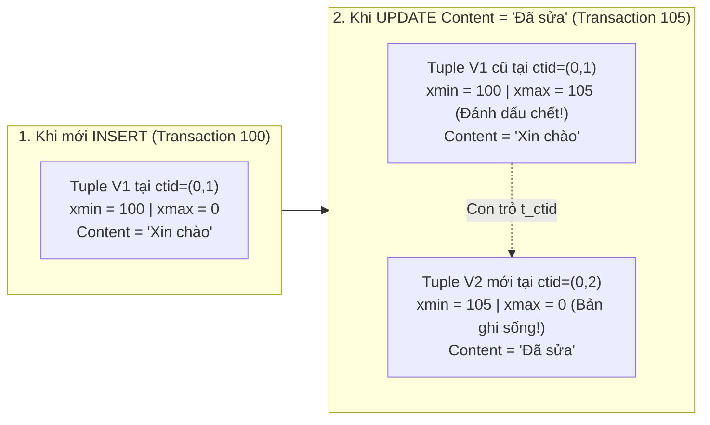
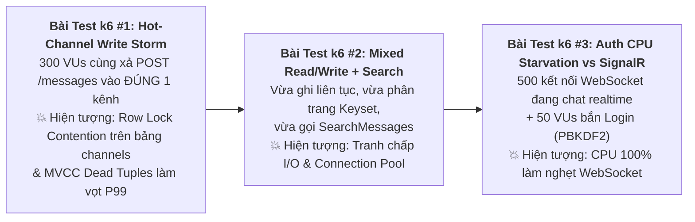

# 🐘 Tập 07: Cẩm Nang Ôn Luyện PostgreSQL Chuyên Sâu — Cơ Chế MVCC, Toàn Tập Các Loại Index, Giải Mã Tham Số Cấu Hình & Cẩm Nang Đọc `EXPLAIN`

> **Mục tiêu tài liệu:** Tài liệu ôn luyện thực chiến được thiết kế cô đọng, trực quan, đi thẳng vào bản chất vật lý bên dưới PostgreSQL 16. Kết hợp trực tiếp với môi trường thực hành tại `labs/postgres-perf/` (bảng `messages` dùng `UUIDv4` và bảng `ms2` dùng `UUIDv7`).

---

## Mục Lục
1. [Phần 1: Giải Phẫu Cơ Chế MVCC (Multi-Version Concurrency Control) & Tối Ưu Hiệu Năng Ghi](#1-phần-1-giải-phẫu-cơ-chế-mvcc-multi-version-concurrency-control--tối-ưu-hiệu-năng-ghi)
2. [Phần 2: Toàn Tập Các Loại Index Trong PostgreSQL — Khi Nào Dùng Gì & Lưu Ý Sống Còn](#2-phần-2-toàn-tập-các-loại-index-trong-postgresql--khi-nào-dùng-gì--lưu-ý-sống-còn)
3. [Phần 3: Cuộc Đối Đầu Thực Nghiệm `UUIDv4` (Bảng `messages`) vs `UUIDv7` (Bảng `ms2`)](#3-phần-3-cuộc-đối-đầu-thực-nghiệm-uuidv4-bảng-messages-vs-uuidv7-bảng-ms2)
4. [Phần 4: Giải Mã Các Tham Số Cấu Hình Database (`postgresql.conf` / `docker-compose`) — Lớn Hơn Hay Bé Hơn Thì Sao?](#4-phần-4-giải-mã-các-tham-số-cấu-hình-database-postgresqlconf--docker-compose--lớn-hơn-hay-bé-hơn-thì-sao)
5. [Phần 5: Từ Điển Cầm Tay Khi Đọc `EXPLAIN (ANALYZE, BUFFERS)`](#5-phần-5-từ-điển-cầm-tay-khi-đọc-explain-analyze-buffers)
6. [Phần 6: Kế Hoạch Thực Chiến k6 Tiếp Theo — Đánh Gục Các Điểm Nghẽn Ghi (Write-Heavy Stress)](#6-phần-6-kế-hoạch-thực-chiến-k6-tiếp-theo--đánh-gục-các-điểm-nghẽn-ghi-write-heavy-stress)

---

## 1. Phần 1: Giải Phẫu Cơ Chế MVCC (Multi-Version Concurrency Control) & Tối Ưu Hiệu Năng Ghi

### 1.1. Tại sao phải có MVCC?
Trong các hệ quản trị cơ sở dữ liệu cũ, khi **User A đang sửa (UPDATE)** một dòng, **User B muốn đọc (SELECT)** dòng đó sẽ bị bắt đứng chờ (Read-Write Lock Blocking).
PostgreSQL giải quyết triệt để vấn đề này bằng **MVCC**:
> **"Đọc không bao giờ chặn Ghi, và Ghi không bao giờ chặn Đọc" (Readers never block Writers, Writers never block Readers).**

Làm thế nào Postgres làm được điều đó? Thay vì ghi đè trực tiếp lên dữ liệu cũ, mỗi khi dữ liệu thay đổi, Postgres **tạo ra một phiên bản mới (New Version / Tuple)** của dòng đó!

---

### 1.2. Bên trong mỗi dòng dữ liệu của Postgres có những "Cột Ẩn" nào?

Mỗi dòng trong bảng `messages` (gọi là một **Heap Tuple**) ngoài các cột bạn tạo (`Id`, `Content`, `CreatedAt`...) còn chứa một **Tuple Header (23 bytes)** gồm 3 cột hệ thống cực kỳ quan trọng mà bạn có thể `SELECT` ra xem trực tiếp:

| Cột ẩn hệ thống | Kiểu dữ liệu | Ý nghĩa vật lý |
| :--- | :--- | :--- |
| **`ctid`** | `tid` `(Block, Offset)` | Địa chỉ vật lý của dòng trên đĩa. Ví dụ `(0, 1)` nghĩa là nằm ở **Trang 8KB số 0, vị trí số 1**. Khi dòng bị `UPDATE`, `ctid` của nó sẽ nhảy sang vị trí mới! |
| **`xmin`** | `xid` (Transaction ID) | Mã số của Transaction đã **tạo ra (`INSERT`)** phiên bản dòng này. |
| **`xmax`** | `xid` (Transaction ID) | Mã số của Transaction đã **xóa (`DELETE`) hoặc cập nhật (`UPDATE`)** phiên bản dòng này. Nếu dòng đang sống hiện hành, `xmax = 0`! |

👉 **Bạn có thể tự gõ câu lệnh này trong DataGrip để nhìn tận mắt các cột ẩn:**
```sql
SELECT ctid, xmin, xmax, "Id", "Content"
FROM messages
LIMIT 5;
```

---

### 1.3. Chuyện gì thực sự xảy ra khi chạy `INSERT`, `DELETE`, và `UPDATE`?



1. **Khi `INSERT` (Giả sử Transaction ID = `100`):**
   - Postgres tạo 1 tuple mới tại `ctid = (0, 1)`, ghi `xmin = 100`, `xmax = 0`.
2. **Khi `DELETE` (Giả sử Transaction ID = `102`):**
   - Postgres **KHÔNG HỀ XÓA dòng đó khỏi đĩa** ngay lúc đó!
   - Nó chỉ sửa cột `xmax = 102` trên dòng cũ. Các câu lệnh `SELECT` bắt đầu sau khi Transaction 102 đã commit thấy `xmax != 0` sẽ tự động bỏ qua dòng này!
3. **Khi `UPDATE` (Giả sử Transaction ID = `105`):**
   - Trong PostgreSQL: **`UPDATE` = `DELETE` + `INSERT`!**
   - Bước 1: Đánh dấu dòng cũ `ctid = (0, 1)` là đã hết hạn bằng cách gán `xmax = 105`.
   - Bước 2: Chèn một dòng **hoàn toàn mới** vào `ctid = (0, 2)` với `xmin = 105, xmax = 0`.
   - Khi không còn bất kỳ Transaction nào cần nhìn thấy dòng cũ `(0, 1)` nữa, dòng cũ `(0, 1)` trở thành một **Xác chết (Dead Tuple)** nằm chiếm chỗ trên đĩa và trong RAM!

---

### 1.4. Hệ lụy của MVCC: Dead Tuples, Bloat, VACUUM và Vũ khí cứu mạng "HOT Update"

#### A. Dead Tuples & Table/Index Bloat (Phình bảng)
- Nếu bạn `UPDATE` 1 dòng `channel` (ví dụ cập nhật `LastMessageAt` trên bảng `channels` mỗi khi có người gửi tin nhắn) **100.000 lần**:
  - Sẽ có **100.000 Dead Tuples** sinh ra cho đúng 1 kênh chat đó!
  - Nếu tiến trình dọn rác chưa kịp chạy, câu lệnh `SELECT * FROM channels` dù chỉ có 10 kênh nhưng phải đọc qua 100.000 xác chết $\to$ cực kỳ chậm! Hiện tượng bảng phình to toàn xác chết gọi là **Table Bloat**.

#### B. Phân biệt `VACUUM` thường vs `VACUUM FULL`
| Cơ chế | Cách hoạt động | Có khóa bảng (Lock) không? | Có trả lại dung lượng cho OS không? |
| :--- | :--- | :--- | :--- |
| **`VACUUM` (hoặc `Autovacuum` tự động)** | Quét các Dead Tuples và đánh dấu vùng nhớ đó vào **Free Space Map (FSM)** là *"đã trống, các lệnh INSERT/UPDATE tiếp theo có thể ghi đè vào đây"*. Đồng thời cập nhật **Visibility Map (VM)**. | **KHÔNG khóa bảng!** Chạy song song hoàn toàn với đọc/ghi bình thường. | **KHÔNG** làm giảm dung lượng file trên ổ cứng (trừ khi các trang cuối cùng của file trống hoàn toàn), nhưng giúp bảng không bị phình to thêm nữa. |
| **`VACUUM FULL`** | Viết lại toàn bộ bảng sang một file mới tinh trên ổ cứng, nén chặt các dòng còn sống lại với nhau và xóa file cũ. | **KHÓA ĐỘC QUYỀN (`ACCESS EXCLUSIVE LOCK`)!** Cấm tiệt mọi lệnh `SELECT`, `INSERT`, `UPDATE` trên bảng đó trong lúc chạy! | **CÓ**, trả lại 100% dung lượng trống về cho hệ điều hành. *(Chỉ dùng khi bảo trì hoặc dùng công cụ `pg_repack` để chạy online không khóa bảng).* |

#### C. Vũ khí tối thượng khi UPDATE: **HOT Update (Heap-Only Tuple)**
Bình thường, khi bạn `UPDATE` 1 dòng trong bảng có **5 cái Index**:
- Vì dòng mới nhảy sang vị trí `ctid` mới, cả **5 cây B-Tree Index đều phải chèn thêm con trỏ mới** trỏ tới `ctid` mới! Điều này gọi là **Write Amplification** (Sửa 1 cột nhưng phải ghi xuống đĩa 6 nơi!).
- **Cơ chế HOT Update của Postgres cứu bạn như thế nào?**
  - Nếu thỏa mãn đồng thời **2 điều kiện vàng**:
    1. **Cột bị `UPDATE` KHÔNG nằm trong bất kỳ Index nào** của bảng.
    2. **Trang 8KB hiện tại vẫn còn chỗ trống** để chứa bản ghi mới trên **cùng một trang 8KB đó**.
  - Khi đó, Postgres thực hiện **HOT Update**: Các Index bên ngoài vẫn chỉ trỏ vào dòng cũ `(0, 1)`, còn dòng cũ `(0, 1)` nối một con trỏ ngắn sang dòng mới `(0, 2)` nằm ngay trong cùng trang 8KB đó!
  - **Lợi ích khổng lồ:** **KHÔNG CẦN CẬP NHẬT BẤT KỲ INDEX NÀO**! Tốc độ `UPDATE` nhanh gấp 5–10 lần và Index không bao giờ bị phình (Zero Index Bloat)!

#### 🛠️ 4 Lưu ý Sống Còn Để Tối Ưu Hiệu Năng Dưới Cơ Chế MVCC:
1. **Tuyệt đối tránh đánh Index lên cột bị `UPDATE` liên tục हर giây:**
   - Trong NomNa, bảng `channels` có cột `LastMessageAt`. Nếu bạn đánh Index trên `LastMessageAt` và mỗi tin nhắn gửi đi đều `UPDATE channels SET "LastMessageAt" = NOW()`, bạn đã **phá hủy hoàn toàn cơ chế HOT Update**!
2. **Đặt `fillfactor` cho bảng hay bị `UPDATE` nhiều (như bảng `channels` hoặc `users`):**
   - Mặc định `fillfactor = 100` (`INSERT` lấp đầy 100% trang 8KB, không chừa chỗ cho `HOT Update`).
   - Với bảng hay cập nhật như `channels`, đặt:
     ```sql
     ALTER TABLE channels SET (fillfactor = 80);
     ```
     Postgres sẽ chỉ chèn `INSERT` tới 80% trang 8KB, chừa sẵn 20% khoảng trống ngay trong mỗi trang để mọi lệnh `UPDATE` sau đó đều đạt chuẩn **HOT Update** 100%!
3. **Không bao giờ giữ Transaction mở quá lâu (`idle in transaction`):**
   - Nếu trong code C# bạn mở `BeginTransactionAsync()` rồi gọi một HTTP API bên ngoài (hoặc chờ lâu), `Autovacuum` **không được phép dọn bất kỳ Dead Tuple nào** được sinh ra sau thời điểm Transaction đó bắt đầu!
4. **Tăng tốc `Autovacuum` cho bảng có tải ghi cao (`messages` / `notifications`):**
   - Mặc định Postgres đợi tới khi có **20% số dòng trong bảng bị sửa/xóa** (`autovacuum_vacuum_scale_factor = 0.2`) mới chạy dọn rác. Với bảng 10 triệu dòng, 20% là **2 triệu dòng rác** mới dọn 1 lần!
   - Với bảng lớn, luôn hạ xuống theo số dòng cố định:
     ```sql
     ALTER TABLE messages SET (autovacuum_vacuum_scale_factor = 0.01, autovacuum_vacuum_threshold = 5000);
     ```

---

## 2. Phần 2: Toàn Tập Các Loại Index Trong PostgreSQL — Khi Nào Dùng Gì & Lưu Ý Sống Còn

PostgreSQL không chỉ có 1 loại Index, mà cung cấp **6 cấu trúc dữ liệu Index** chuyên biệt cho từng bài toán:

| Loại Index | Cấu trúc dữ liệu | Toán tử hỗ trợ | Khi nào dùng hợp lý nhất? | Lưu ý & Cạm bẫy (Trade-offs) |
| :--- | :--- | :--- | :--- | :--- |
| **1. B-Tree** *(Mặc định)* | Cây cân bằng đa nhánh (Balanced Tree, Lehmer & Yao). | `=`, `<`, `<=`, `>`, `>=`, `BETWEEN`, `IN`, `IS NULL`, `ORDER BY`, `LIKE 'abc%'` (tiền tố). | **90% mọi trường hợp:** Khóa chính (`Id`), khóa ngoại (`SenderId`, `ChannelId`), phân trang thời gian (`CreatedAt DESC`), sắp xếp. | - Vô dụng với `LIKE '%abc%'` (ký tự `%` ở đầu).<br/>- Bị phân mảnh nặng (Page Split) nếu đánh trên cột ngẫu nhiên như `UUIDv4`.<br/>- Không nên đánh trên cột text quá dài (> 2704 bytes sẽ báo lỗi). |
| **2. GIN** *(Generalized Inverted Index)* | Chỉ mục đảo ngược (Inverted Index: ánh xạ từ `Phần tử/Từ` $\to$ `Danh sách TIDs`). | `@>`, `<@`, `&&` (`JSONB` / Array), `@@` (`tsvector` Full-Text Search), `ILIKE '%abc%'` (với `pg_trgm`). | Khi **1 dòng chứa nhiều phần tử con** cần tìm kiếm: Tìm từ trong câu (`Content`), tìm trường bên trong cột `JSONB` (`Attachments`), mảng `Tags`. | - Rất nặng khi ghi (`INSERT/UPDATE` chậm vì 1 dòng văn bản tách ra hàng chục mục trong GIN).<br/>- Có cơ chế `fastupdate = on` (gom vào vùng đệm RAM trước rồi mới đẩy xuống cây GIN).<br/>- **Không hỗ trợ sắp xếp (`ORDER BY`)!** |
| **3. BRIN** *(Block Range Index)* | Lưu duy nhất cặp giá trị `(Min, Max)` cho mỗi cụm trang đĩa liên tiếp (mặc định 128 trang = 1MB). | `=`, `<`, `<=`, `>`, `>=` trên các cột **tăng dần vật lý theo thứ tự ghi đĩa**. | **Vũ khí tối thượng cho bảng hàng chục triệu dòng theo thời gian:** Cột `CreatedAt` hoặc cột `Id` dùng **`UUIDv7`** trên bảng chỉ thêm mới (`Append-only` như `messages`, `audit_logs`). | - **Kích thước siêu nhỏ:** Trên 10 triệu dòng, B-Tree nặng **~300MB**, còn BRIN chỉ nặng **~48 KB (nhỏ hơn 6.000 lần!)**.<br/>- **Lưu ý sống còn:** Chỉ hiệu quả khi dữ liệu trên đĩa nằm đúng theo thứ tự tăng dần. Nếu dùng `UUIDv4` ngẫu nhiên, mọi vùng đĩa đều có `Min = 000..., Max = fff...` $\to$ BRIN vô tác dụng 100%! |
| **4. Hash** | Bảng băm (Hash Table 32-bit bucket). | **Chỉ duy nhất phép bằng `=`**. | Khi cần so khớp chính xác `=` trên các chuỗi dài (như `RefreshToken.TokenHash`, `Url`, `InviteCode` dài) mà không bao giờ cần `<`, `>` hay `ORDER BY`. | Nhỏ hơn B-Tree ~20–30% và tra cứu $O(1)$ với chuỗi dài, nhưng không thể dùng cho `ORDER BY` hay Range scan. |
| **5. GiST** *(Generalized Search Tree)* | Cây tìm kiếm tổng quát (cho phép các nhánh chồng lấn nhau - Overlapping). | Khoảng thời gian chồng lấn (`&&` trên `tstzrange`), tọa độ địa lý PostGIS, khoảng cách gần nhất (`<->` KNN). | Đặt lịch phòng họp không trùng giờ (Exclusion constraint), bản đồ vị trí, hoặc Full-Text Search khi bảng bị ghi/sửa quá nhiều mà GIN chịu không nổi. | Tìm kiếm văn bản chậm hơn GIN khoảng 2–3 lần (nhưng cập nhật nhanh hơn GIN). |

---

### 🎯 4 Tuyệt Chiêu Thiết Kế B-Tree Index Cấp Độ Senior

#### 1. Thứ tự cột trong Composite Index: **"Equality trước, Range/Sort sau"**
Giả sử câu query phân trang tin nhắn của bạn là:
```sql
SELECT * FROM messages 
WHERE "ChannelId" = '01a16f00-...' 
  AND "CreatedAt" < '2026-11-01'
ORDER BY "CreatedAt" DESC
LIMIT 50;
```
* **ĐÚNG:** `CREATE INDEX ON messages ("ChannelId", "CreatedAt" DESC);`
  - Bước 1: Dùng `"ChannelId" = ...` (phép bằng `=`) để nhảy thẳng tới nhánh của kênh đó.
  - Bước 2: Trong nhánh của kênh đó, các tin nhắn đã được xếp sẵn theo `"CreatedAt" DESC` $\to$ lấy 50 dòng đầu tiên rồi dừng!
* **SAI NGHIÊM TRỌNG:** `CREATE INDEX ON messages ("CreatedAt" DESC, "ChannelId");`
  - Nếu đặt `CreatedAt` lên trước, Postgres sẽ quét theo thời gian của **tất cả các kênh trộn lẫn nhau**, vừa đi vừa phải lọc xem có đúng `ChannelId` không! Nếu kênh đó ít tin nhắn, nó phải quét hàng triệu dòng của các kênh khác!

#### 2. Partial Index (Chỉ đánh Index cho phần dữ liệu thực sự cần truy vấn)
- Trong bảng `messages`, 99% các câu query đều có điều kiện `WHERE "DeletedAt" IS NULL` (bỏ qua tin nhắn đã xóa mềm).
- Hoặc chỉ có 5% tin nhắn có `ReplyToMessageId IS NOT NULL`.
- Thay vì đánh Index trên toàn bộ 10 triệu dòng, hãy thêm mệnh đề `WHERE`:
  ```sql
  CREATE INDEX idx_messages_active ON messages ("ChannelId", "CreatedAt" DESC)
  WHERE "DeletedAt" IS NULL;
  ```
  👉 Giúp giảm dung lượng Index và tăng tốc cho đúng 99% câu lệnh thực tế!

#### 3. Covering Index (`INCLUDE`) để đạt cảnh giới `Index Only Scan`
- Bình thường, khi chạy `Index Scan`, Postgres tìm thấy con trỏ `TID` trong Index rồi vẫn phải **nhảy vào bảng gốc (Heap Table)** để lấy thêm cột `SenderId`, `Content` (tốn thêm Random I/O).
- Nếu một câu query chạy cực nhiều và chỉ cần vài cột nhỏ, bạn đính kèm cột đó vào lá của Index bằng từ khóa `INCLUDE`:
  ```sql
  CREATE INDEX idx_messages_covering ON messages ("ChannelId", "CreatedAt" DESC)
  INCLUDE ("SenderId", "Id")
  WHERE "DeletedAt" IS NULL;
  ```
  👉 Khi truy vấn các cột này, kế hoạch thực thi sẽ hiện **`Index Only Scan`** với **`Heap Fetches: 0`** (Đọc 100% từ Index, không chạm vào bảng dữ liệu gốc một lần nào!).

---

## 3. Phần 3: Cuộc Đối Đầu Thực Nghiệm `UUIDv4` (Bảng `messages`) vs `UUIDv7` (Bảng `ms2`)

Trong phòng thí nghiệm `labs/postgres-perf/`, tôi đã tạo sẵn cho bạn bảng **`ms2`** sử dụng **`UUIDv7` (Time-ordered UUID)** cùng script `./labs/postgres-perf/seed-ms2.sh`.

### 3.1. Tại sao `UUIDv7` lại đánh bại `UUIDv4` toàn diện trong Database?

```text
UUIDv4 (Ngẫu nhiên 100%):
[ 60 bits Random ] - [4 bits Ver 4] - [ 62 bits Random ]
-> Chèn vào B-Tree: Nhảy loạn xạ vào mọi trang đĩa cũ -> Tách trang (Page Split) -> Phân mảnh 30-40%!

UUIDv7 (Chuẩn RFC 9562 - Có sẵn trong .NET 9 Guid.CreateVersion7()):
[ 48 bits Unix Timestamp (ms) ] - [4 bits Ver 7] - [ 74 bits Random ]
-> Chèn vào B-Tree: Luôn luôn lớn hơn ID trước đó -> Xếp nối đuôi vào trang cuối cùng -> Đầy khít 99%!
```

### 3.2. Câu lệnh thực hành so sánh trực tiếp trong DataGrip của bạn:

Sau khi bảng `ms2` đã có dữ liệu, bạn hãy chạy câu lệnh này trong DataGrip để chứng kiến sự khác biệt vật lý bên trong B-Tree Index giữa `messages_pkey` (`UUIDv4`) và `ms2_pkey` (`UUIDv7`):

```sql
SELECT 
    'messages_pkey (UUIDv4)' AS index_type,
    pg_size_pretty(pg_relation_size('messages_pkey')) AS total_size,
    round(avg_leaf_density::numeric, 2) AS leaf_fill_percent,
    round((100 - avg_leaf_density)::numeric, 2) AS wasted_space_percent,
    leaf_pages
FROM pgstatindex('messages_pkey')

UNION ALL

SELECT 
    'ms2_pkey (UUIDv7)' AS index_type,
    pg_size_pretty(pg_relation_size('ms2_pkey')) AS total_size,
    round(avg_leaf_density::numeric, 2) AS leaf_fill_percent,
    round((100 - avg_leaf_density)::numeric, 2) AS wasted_space_percent,
    leaf_pages
FROM pgstatindex('ms2_pkey');
```
> 🔍 **Điều bạn sẽ thấy:**
> - **`messages_pkey (UUIDv4)`**: Độ lấp đầy trang lá (`leaf_fill_percent`) chỉ đạt khoảng **~68% – 72%** (Lãng phí **~30%** dung lượng RAM và Đĩa vì Page Splits!).
> - **`ms2_pkey (UUIDv7)`**: Độ lấp đầy trang lá (`leaf_fill_percent`) đạt tới **~90% – 97%**! Dung lượng Index nhỏ hơn gần **25% – 30%** trên cùng một số lượng dòng!

---

## 4. Phần 4: Giải Mã Các Tham Số Cấu Hình Database (`postgresql.conf` / `docker-compose`) — Lớn Hơn Hay Bé Hơn Thì Sao?

Trong file [`labs/postgres-perf/docker-compose.lab.yml`](../../labs/postgres-perf/docker-compose.lab.yml), chúng ta đã cấu hình các tham số hiệu năng cho Postgres. Dưới đây là bảng giải phẫu chi tiết: **Chúng là gì, và nếu chỉnh LỚN HƠN hoặc BÉ HƠN thì chuyện gì xảy ra?**

| Tham số cấu hình | Giá trị mặc định của Postgres | Giá trị khuyến nghị chuẩn | Nếu đặt QUÁ BÉ thì sao? (Hệ quả) | Nếu đặt QUÁ LỚN thì sao? (Rủi ro & Trade-off) |
| :--- | :--- | :--- | :--- | :--- |
| **`shared_buffers`** | `128MB` *(Rất nhỏ!)* | **25% – 40% tổng RAM** của container/server (VD: Container 1GB RAM $\to$ đặt `256MB`). | Postgres không đủ RAM để giữ các trang Index và bảng nóng $\to$ Phải liên tục gọi xuống OS/Ổ cứng đọc lại (`shared read` tăng vọt). | **Bẫy Double Buffering & OOM:** Bản thân Linux Kernel cũng dùng phần RAM trống còn lại làm **OS Page Cache**. Nếu bạn cấp 80% RAM cho `shared_buffers`, Linux mất vùng Page Cache và khi các câu query cần thêm RAM cho `work_mem` để Sort, container sẽ bị **OOM Killed (Sập DB)** ngay lập tức! |
| **`work_mem`** | `4MB` | **16MB – 64MB** (tùy số lượng kết nối đồng thời). | Khi chạy `ORDER BY`, `DISTINCT`, `GROUP BY (HashAggregate)` hoặc `Hash Join` trên nhiều dòng, 4MB RAM bị tràn ngay lập tức $\to$ Postgres phải ghi ra ổ cứng tạm (**`external merge Disk` / `Disk Spilling`** như bạn vừa thấy trong ảnh!). | ⚠️ **CỰC KỲ NGUY HIỂM!** `work_mem` **KHÔNG PHẢI** giới hạn cho toàn server, mà cấp phát cho **MỖI thao tác Sort/Hash $\times$ MỖI Parallel Worker $\times$ MỖI Kết nối**! Nếu bạn đặt `work_mem = 256MB`, và có 50 người cùng chạy query (mỗi query có 2 worker): $50 \times 3 \times 256\text{MB} = \mathbf{38\text{ GB RAM}}$ $\to$ Server nổ tung vì OOM trong 1 giây! |
| **`maintenance_work_mem`** | `64MB` | **64MB – 512MB** | Các tác vụ quản trị như `CREATE INDEX`, `VACUUM` (dọn Dead Tuples), `ALTER TABLE` chạy rất chậm vì phải chia làm nhiều đợt đọc/ghi đĩa. | Vì một thời điểm chỉ có 1 hoặc vài tiến trình bảo trì/tạo index chạy, đặt lớn khá an toàn, nhưng không nên vượt quá 15–20% tổng RAM. |
| **`effective_cache_size`** | `4GB` | **50% – 75% tổng RAM** của máy chủ. | **Lưu ý:** Tham số này **KHÔNG cấp phát bất kỳ byte RAM nào!** Nó chỉ là "con số gợi ý" cho bộ não Query Planner biết rằng tổng `shared_buffers + OS Page Cache` có khoảng bao nhiêu RAM. Nếu đặt quá bé, Planner tưởng máy ít RAM (sợ dữ liệu không nằm trong cache) nên **ngại dùng `Index Scan`** mà chuyển sang `Seq Scan`! | Nếu đặt lớn hơn tổng RAM thật của máy, Planner sẽ quá lạc quan (tưởng mọi trang dữ liệu đều nằm sẵn trong RAM) nên chọn `Index Scan` ngay cả khi phải đọc đĩa ngẫu nhiên (Random I/O) cực chậm! |
| **`random_page_cost`** | `4.0` *(Thiết kế cho ổ đĩa cơ HDD quay tay thời xưa!)* | **`1.1` trên ổ cứng SSD / NVMe**. | Nếu để thấp hơn `1.0`, Planner sẽ dùng Index một cách mù quáng ngay cả khi phải lấy 80% bảng. | Nếu giữ nguyên mặc định `4.0` trên ổ SSD, Postgres tưởng rằng đọc ngẫu nhiên đắt gấp 4 lần đọc tuần tự $\to$ rất dễ từ bỏ Index để chạy `Seq Scan` oan uổng! |
| **`max_connections`** | `100` | **100 – 200** (Kết hợp với **PgBouncer** ở ngoài). | Nếu ứng dụng không dùng Connection Pool chuẩn, sẽ báo lỗi `sorry, too many clients already`. | Mỗi kết nối vật lý trong Postgres là 1 tiến trình OS riêng tốn ~5–10MB RAM và làm tăng chi phí quản lý Snapshot MVCC. Đặt `max_connections = 1000` làm giảm ~30–50% throughput của DB so với việc dùng PgBouncer gom về 100 kết nối! |
| **`track_io_timing`** | `off` | **`on`** | Trong `EXPLAIN (ANALYZE, BUFFERS)`, bạn sẽ **không nhìn thấy dòng `I/O Timings: read=... write=...`**, không biết được câu query chậm do CPU hay chậm do chờ ổ cứng! | Tốn một chi phí cực nhỏ (< 1%) để gọi đồng hồ hệ điều hành đo thời gian đọc đĩa. Luôn luôn nên bật `on`! |

---

## 5. Phần 5: Từ Điển Cầm Tay Khi Đọc `EXPLAIN (ANALYZE, BUFFERS)`

Khi nhìn vào một bảng `EXPLAIN (ANALYZE, BUFFERS)`, đây là **6 dấu hiệu sống còn** bạn cần quét qua trong 5 giây:

### 5.1. Ý nghĩa của các loại Scan (Từ chậm nhất đến nhanh nhất)
1. 🔴 **`Seq Scan` / `Parallel Seq Scan`**: Quét tuần tự toàn bộ bảng từ đầu đến cuối. Chỉ tốt khi bảng cực nhỏ (< vài nghìn dòng) hoặc bạn thực sự muốn lấy > 25% tổng số dòng của bảng.
2. 🟡 **`Bitmap Index Scan` $\to$ `Bitmap Heap Scan`**:
   - Bước 1 (`Bitmap Index Scan`): Duyệt qua Index (hoặc ghép nhiều Index lại với nhau bằng phép `BitmapAnd` / `BitmapOr`) để đánh dấu một bản đồ bit (0 và 1) xem những trang 8KB nào có chứa dữ liệu cần tìm.
   - Bước 2 (`Bitmap Heap Scan`): Sắp xếp các địa chỉ trang đĩa theo thứ tự tăng dần rồi mới đọc từ ổ cứng một mạch (biến Random I/O thành Sequential I/O!).
   - ⚠️ **Cảnh báo đỏ trong `Bitmap Heap Scan`:** Nếu bạn thấy `Heap Blocks: exact=1000 lossy=50000` (có chữ **`lossy`**), nghĩa là vùng nhớ `work_mem` không đủ chứa địa chỉ từng dòng mà bị suy biến thành chỉ nhớ mang máng từng trang 8KB $\to$ Postgres phải đọc lại toàn bộ các dòng trong trang đó để lọc lại (`Recheck Cond`)!
3. 🟢 **`Index Scan`**: Đi theo cây B-Tree tìm đúng mục cần lấy, sau đó nhảy sang bảng dữ liệu gốc (Heap) để lấy các cột còn lại. Rất nhanh khi đi kèm `LIMIT` hoặc lấy ít dòng.
4. 💎 **`Index Only Scan`**: **Đỉnh cao nhất!** Toàn bộ các cột trong `SELECT` đều nằm sẵn ngay trên lá của Index.
   - ⚠️ **Lưu ý:** Luôn nhìn dòng **`Heap Fetches`** ngay dưới `Index Only Scan`. Nếu `Heap Fetches: 0` là hoàn hảo tuyệt đối. Nếu `Heap Fetches` cao (ví dụ hàng chục nghìn), nghĩa là bảng vừa có nhiều lệnh `INSERT/UPDATE` mà **`VACUUM` chưa chạy** để cập nhật **Visibility Map (VM)**, nên Postgres vẫn phải nhảy vào bảng gốc để kiểm tra `xmin/xmax`! Chỉ cần chạy `VACUUM tablename;` là `Heap Fetches` về `0` ngay!

---

### 5.2. Các thông số đọc nhanh trong ngoặc đơn
```text
Node Name (cost=0.56..8.58 rows=50 width=107) (actual time=0.025..0.092 rows=50 loops=1)
```
* **`cost=0.56..8.58`**: `0.56` là chi phí ước tính để ra dòng đầu tiên (Startup Cost), `8.58` là tổng chi phí ước tính để chạy xong node đó.
* **`rows=50` (bên trái) vs `rows=50` (bên phải trong `actual`)**:
  - Bên trái là **dự đoán của Planner**, bên phải là **số dòng thực tế khi chạy**.
  - ⚠️ **Cảnh báo đỏ:** Nếu bên trái ghi `rows=1` (dự đoán chỉ có 1 dòng) mà bên phải ghi `actual ... rows=500000` (thực tế 500 nghìn dòng) $\to$ Thống kê của bảng đã quá cũ! Planner sẽ chọn sai thuật toán (ví dụ chọn `Nested Loop` thay vì `Hash Join` làm treo máy). **Cách chữa:** Chạy lệnh `ANALYZE tablename;`.
* **`loops=3`**: Node đó được lặp lại 3 lần (hoặc chạy bởi 3 luồng Parallel Workers). **Mẹo tính tổng:** Con số `actual time` và `rows` hiển thị là **trung bình của 1 loop**. Muốn biết tổng số dòng đã quét qua tất cả các luồng, hãy lấy `rows * loops`!
* **`Buffers`**:
  - `shared hit`: Số khối 8KB lấy thẳng từ RAM (`shared_buffers`) $\to$ **Càng nhiều hit, càng ít read càng tốt.**
  - `shared read`: Số khối 8KB phải gọi xuống OS / Ổ đĩa đọc lên.
  - `shared dirtied`: Số khối 8KB trong RAM bị câu lệnh này làm thay đổi (ví dụ do `INSERT/UPDATE` hoặc cập nhật cờ Hint Bits của MVCC).
  - `temp read / temp written`: **Báo động đỏ!** Bộ nhớ `work_mem` đã bị tràn, phải ghi dữ liệu tạm ra ổ cứng để Sort hoặc Hash!

---

## 6. Phần 6: Kế Hoạch Thực Chiến k6 Tiếp Theo — Đánh Gục Các Điểm Nghẽn Ghi (Write-Heavy Stress)

Sau khi đã làm chủ hoàn toàn tầng Database trong Lab, bước tiếp theo chúng ta sẽ dùng **Grafana k6** bắn trực diện vào cụm **WebAPI .NET 9 + PostgreSQL** để tái hiện và xử lý các bài toán hiệu năng "đau đầu" nhất trong thực tế:



### Chi tiết 3 kịch bản k6 chúng ta sẽ thực hiện:
1. **Kịch bản 1 — Bão Ghi Vào 1 Kênh Nóng (Hot-Channel Write Contention):**
   - Trong `SendMessageCommandHandler.cs`, mỗi tin nhắn mới đều chạy `UPDATE channels SET "LastMessageAt" = NOW() WHERE "Id" = @channelId`.
   - Khi 300 người cùng gửi tin nhắn vào 1 kênh `#general`:
     - Dưới góc độ **MVCC & Locking**: Cả 300 luồng đều phải xếp hàng chờ khóa độc quyền (`Row Exclusive Lock`) trên đúng 1 dòng của bảng `channels`!
     - Đồng thời, hàng nghìn **Dead Tuples** sinh ra mỗi phút trên bảng `channels`.
   - **Chúng ta sẽ đo:** P95/P99 của lệnh gửi tin nhắn trước và sau khi tách việc cập nhật `LastMessageAt` / `Notifications` ra khỏi Transaction chính!
2. **Kịch bản 2 — Hỗn hợp Đọc + Ghi + Tìm kiếm trên nền DB Lớn:**
   - Đo xem khi DB đã có hàng trăm nghìn / hàng triệu dòng, việc vừa `INSERT` (làm bẩn các trang B-Tree Index) vừa `SELECT` phân trang có làm rớt RPS không.
3. **Kịch bản 3 — Bão WebSocket SignalR + Tối ưu hóa Memory/ThreadPool:**
   - Đo 500 kết nối WebSocket đồng thời trên container `1 vCPU, 512MB RAM`.

