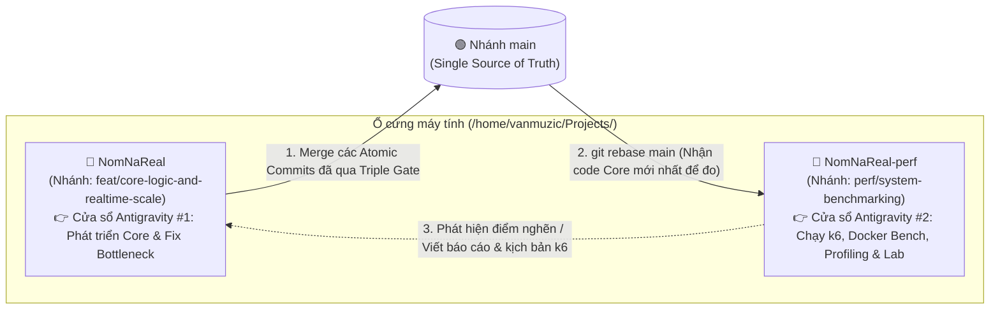
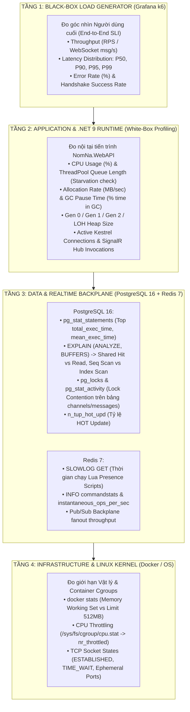

# 🎯 NomNa — Master Plan Thực Chiến: Quản Lý Mô Hình 2 Nhánh (Core vs Perf), Kỷ Luật Commit, Chiến Lược Đo Lường Toàn Diện & Khung Thiết Kế NFRs

> **Bối cảnh thực tế (Snapshot tại commit `8578e2a`):**
> Thay vì chia nhỏ thành 9 nhánh gây quá tải nhận thức (như bản phác thảo multi-wave trước đây), quy trình phát triển thực tế và hiệu quả nhất cho dự án NomNa lúc này là **Mô hình Song Hành 2 Nhánh (Dual-Track Architecture)**:
> 1. **Nhánh 1 — Core Product (`feat/core-logic-and-realtime-scale` $\leftrightarrow$ `main`):** Phát triển tính năng cốt lõi, hoàn thiện luồng nghiệp vụ (Auth, Channels, Messages, Presence, WebRTC, UI/UX) và áp dụng các bản vá tối ưu đã được kiểm chứng.
> 2. **Nhánh 2 — Performance & System Lab (`perf/system-benchmarking`):** Môi trường nghiên cứu, giả lập tải lớn (Grafana k6, Seeder 100k–1M dòng), đo đạc chuyên sâu (.NET 9 Runtime, PostgreSQL `EXPLAIN ANALYZE`, Redis Lua/Backplane, Docker Resource Limits) để tìm điểm gãy (Breakpoint) và định lượng Non-Functional Requirements (NFRs).

---

## 🧭 MỤC LỤC

1. [**PHẦN 1: Chiến Lược Quản Lý 2 Nhánh & Kỷ Luật Commit (Git Dual-Track & Atomic Commit Protocol)**](#-phần-1-chiến-lược-quản-lý-2-nhánh--kỷ-luật-commit-git-dual-track--atomic-commit-protocol)
   - 1.1. Tại sao bạn đang bị rối khi commit? (Chẩn đoán từ chính 15 file đang sửa trên máy bạn)
   - 1.2. Thực hành ngay: Bóc tách 18 thay đổi hiện tại trên Working Tree thành 4 Atomic Commits chuẩn chỉnh
   - 1.3. Kiến trúc 2 Thư mục `git worktree` (Core vs Perf) không bao giờ đụng độ
   - 1.4. Quy tắc Luân chuyển Code 1 Chiều (One-Way Sync & Cherry-Pick Loop)
   - 1.5. Khung "Rule of 3" để không bao giờ tích tụ 15+ file chưa commit
2. [**PHẦN 2: Chiến Lược Đo Lường Hiệu Năng Toàn Diện 4 Tầng (Full-Stack Benchmarking Strategy)**](#-phần-2-chiến-lược-đo-lường-hiệu-năng-toàn-diện-4-tầng-full-stack-benchmarking-strategy)
   - 2.1. Giải phẫu kết quả đo thực tế (`baseline_http_1793167013.json`) & 3 lỗi ngầm trong bộ k6 hiện tại
   - 2.2. Mô hình Đo Lường 4 Tầng (4-Layer Observability & Profiling Matrix)
   - 2.3. 5 Kịch bản Kiểm thử Tải Chuẩn (Smoke $\to$ Baseline Load $\to$ Hot-Channel Fanout $\to$ Spike $\to$ Breakpoint)
   - 2.4. Vòng lặp Khoa học 6 Bước khi Tối ưu Hiệu năng (The Scientific Optimization Loop)
3. [**PHẦN 3: Tư Duy & Khung Thiết Kế Non-Functional Requirements (NFR Architecture Blueprint)**](#-phần-3-tư-duy--khung-thiết-kế-non-functional-requirements-nfr-architecture-blueprint)
   - 3.1. Phương pháp chuyển hóa từ "Yêu cầu mơ hồ" sang chỉ số định lượng `SLI` $\to$ `SLO` $\to$ `Architecture Pattern`
   - 3.2. Phân cấp 3 Mức Tải Chuẩn (Sizing Tiers: Small 500 CCU $\to$ Medium 2,500 CCU $\to$ Large 10,000+ CCU)
   - 3.3. Bảng Đặc tả 8 Nhóm NFR Cốt lõi của NomNa (Gắn trực tiếp với từng file/module trong Codebase)
   - 3.4. Hồ sơ Kiểm chứng NFR (NFR Verification Matrix — Đo bằng công cụ gì, Pass/Fail ở ngưỡng nào?)
4. [**PHẦN 4: Lộ Trình Thực Thi Cụ Thể Từng Bước (Actionable Execution Checklist)**](#-phần-4-lộ-trình-thực-thi-cụ-thể-từng-bước-actionable-execution-checklist)

---

# 🌿 PHẦN 1: CHIẾN LƯỢC QUẢN LÝ 2 NHÁNH & KỶ LUẬT COMMIT (GIT DUAL-TRACK & ATOMIC COMMIT PROTOCOL)

## 1.1. Tại sao bạn đang bị rối khi quản lý Commit và Nhánh?

Nhìn vào trạng thái `git status` thực tế trên nhánh `feat/core-logic-and-realtime-scale` của bạn lúc này, có **15 file modified + 3 mục untracked** đang nằm chung trên một Working Tree:

```text
M client/src/components/channel/EditChannelModal.tsx
M client/src/components/channel/UserFooterBar.tsx
M client/src/components/chat/MessageList.tsx
M client/src/hooks/useChatSignalR.ts
M client/src/pages/ChatPage.tsx
M client/src/services/authApi.ts
M client/src/services/signalr.ts
M client/src/types/auth.ts
M docs/application/README.md
M docs/features/webrtc-call/webrtc-1v1-call-and-signaling-guide.md
M src/NomNa.Application/Features/Messages/Commands/SendMessage/SendMessageCommandHandler.cs
M src/NomNa.WebAPI/Controllers/ChannelsController.cs
M src/NomNa.WebAPI/Hubs/ChatHub.CallSignaling.cs
M src/NomNa.WebAPI/Hubs/ChatHub.Channels.cs
M src/NomNa.WebAPI/Hubs/ChatHub.cs
?? docs/application/07-chathub-and-webrtc-master-handbook.md
?? scripts/seed_production_workspace.py
?? src/NomNa.WebAPI/wwwroot/attachments/
```

**Nguyên nhân cốt lõi gây rối:**
1. **Trộn lẫn 4 Mối quan tâm (Mixed Concerns) trong 1 lần sửa:** Bạn vừa sửa Backend Hotpath (`SendMessageCommandHandler`), vừa làm tính năng UI đổi trạng thái (`UserFooterBar`), vừa viết tài liệu (`07-chathub...`), vừa viết script seed dữ liệu (`seed_production_workspace.py`). Khi muốn commit, bạn không biết đặt tên commit là gì vì gom cả 4 thứ vào 1 commit thì quá to (God Commit), mà tách ra thì sợ sót file.
2. **Nhầm lẫn vai trò giữa nhánh `Core` và nhánh `Perf`:** Khi đang ở nhánh Core nhưng lại viết script seed/benchmark (`seed_production_workspace.py`), hoặc khi ở nhánh Perf phát hiện ra bug trong `SendMessageCommandHandler` rồi sửa trực tiếp trên nhánh Perf thì không biết làm sao đưa về nhánh Core mà không kéo theo các file rác của quá trình đo đạc.

---

## 1.2. Thực Hành Ngay: Bóc Tách 18 Thay Đổi Hiện Tại Thành 4 Atomic Commits Sạch Sẽ

Trước khi đồng bộ 2 nhánh, bạn hãy phân tách 18 thay đổi đang có trên `feat/core-logic-and-realtime-scale` thành **4 Atomic Commits độc lập theo đúng chuẩn Conventional Commits** bằng các lệnh dưới đây:

### Bước 0: Kiểm tra danh sách file đã được phân nhóm tự động
Bạn có thể chạy công cụ vừa được tích hợp vào `scripts/worktree-hub.sh` bất cứ lúc nào để xem các file đang sửa được chia sẵn theo 4 tầng kiến trúc:
```bash
./scripts/worktree-hub.sh audit-commits
```

### Commit #1: Tối ưu Backend Message Hotpath, Scoped Mentions & REST SignalR Broadcast
Nhóm các file Backend giải quyết bài toán gửi tin nhắn DM 1-RTT, giới hạn phạm vi query `@mention` trong Server/Channel và phát sóng SignalR khi gọi REST API:
```bash
git add \
  src/NomNa.Application/Features/Messages/Commands/SendMessage/SendMessageCommandHandler.cs \
  src/NomNa.WebAPI/Controllers/ChannelsController.cs \
  src/NomNa.WebAPI/Hubs/ChatHub.CallSignaling.cs \
  src/NomNa.WebAPI/Hubs/ChatHub.Channels.cs

git commit -m "perf(messages): optimize DM recipient lookup, scope mention queries, and broadcast REST messages via SignalR"
```

### Commit #2: Đồng bộ Trạng thái Người dùng Đa thiết bị (Backend + Frontend) & Tinh chỉnh Chat UI
Nhóm các file liên quan đến tính năng chọn trạng thái (`Online`, `Idle`, `DND`, `Invisible`) tại `UserFooterBar`, đồng bộ đa tab qua SignalR và tinh chỉnh các component UI trên `client/`:
```bash
git add \
  src/NomNa.WebAPI/Hubs/ChatHub.cs \
  client/

git commit -m "feat(presence): add user status selector popup, multi-device SignalR sync, and refine chat UI"
```

### Commit #3: Tài liệu Kiến trúc SignalR ChatHub & WebRTC Master Handbook
```bash
git add \
  docs/application/07-chathub-and-webrtc-master-handbook.md \
  docs/application/README.md \
  docs/features/webrtc-call/webrtc-1v1-call-and-signaling-guide.md

git commit -m "docs(realtime): add comprehensive SignalR ChatHub and WebRTC P2P master handbook"
```

### Commit #4: Chuẩn hóa Bộ Công cụ Benchmark k6 (Redis + Cookie Pool), Seeder & Master Plan 2 Nhánh
```bash
git add \
  .gitignore \
  scripts/ \
  plans/dual-branch-commit-benchmark-and-nfr-master-plan.md

git commit -m "bench(k6): add Redis container, fix HttpOnly cookie auth pool, and add dual-branch NFR master plan"
```

> ✅ **Kết quả sau 4 lệnh trên:** `git status` sạch bóng 100%, lịch sử `git log` rõ ràng từng mảng (Backend Perf $\to$ Full-stack Feature $\to$ Docs $\to$ Tooling), bất kỳ lúc nào muốn revert hay cherry-pick 1 tính năng đều chỉ tốn 1 dòng lệnh!

---

## 1.3. Kiến Trúc 2 Nhánh Song Hành Với `git worktree` (Core Track vs Perf Track)

Để làm việc song song giữa **Nhánh Core** và **Nhánh Nghiên cứu Hiệu năng** mà **không bao giờ phải `git stash` hay `git checkout` qua lại làm hỏng cache build**, bạn chỉ cần duy trì **đúng 2 thư mục `git worktree`**:



### Thiết lập 2 Thư mục Chuẩn (Dọn bỏ worktree cũ không dùng)
Hiện tại máy bạn đang có `/home/vanmuzic/Projects/NomNaReal-fe` trỏ vào `main`. Bạn có thể chuyển nó thành thư mục chuyên trách cho nhánh `perf/system-benchmarking`:

```bash
# 1. Xóa hoặc đổiworktree phụ sang nhánh perf/system-benchmarking
git worktree remove /home/vanmuzic/Projects/NomNaReal-fe
git worktree add /home/vanmuzic/Projects/NomNaReal-perf perf/system-benchmarking

# 2. Liên kết node_modules để không tốn ổ cứng
ln -s /home/vanmuzic/Projects/NomNaReal/client/node_modules /home/vanmuzic/Projects/NomNaReal-perf/client/node_modules
```

### Phân Định Ranh Giới Tuyệt Đối Giữa 2 Nhánh (Zero-Conflict Rule)

| Tiêu chí | Nhánh 1: Core (`feat/core-logic-and-realtime-scale`) | Nhánh 2: Perf Lab (`perf/system-benchmarking`) |
| :--- | :--- | :--- |
| **Mục đích** | Xây dựng tính năng, sửa bug nghiệp vụ, tối ưu code ứng dụng (`src/`, `client/`, `tests/`). | Chạy tải k6, đo PostgreSQL/Redis/.NET Runtime, lưu kết quả benchmark, viết báo cáo NFR. |
| **Thư mục được phép sửa chính** | `src/**`, `client/**`, `tests/**`, `docs/application/**`, `docs/features/**` | `scripts/k6/**`, `labs/**`, `docs/performance/**`, `plans/**`, `scripts/seed_*.py` |
| **Cổng chạy (Port Isolation)** | Dev DB: `5432`, Dev Redis: `6380`, WebAPI: `5000`, Vite: `5173` | Bench Nginx: `5050` (Docker network nội bộ `nomna_bench_net`), Postgres Lab: `5433` |
| **Quy tắc Vàng** | **Không lưu file log/json kết quả chạy k6** vào nhánh Core. | **Không sửa trực tiếp logic lớn trong `src/` hoặc `client/`** trên nhánh Perf (trừ khi thử nghiệm nhanh rồi cherry-pick về Core). |

---

## 1.4. Quy Tắc Luân Chuyển Code & Quản Lý Commit Hàng Ngày (5 Quy Tắc Thực Chiến)

1. **Quy tắc 1 — "Một Mục tiêu = Một Commit" (Single Responsibility Commit):**
   - Trước khi gõ code, tự hỏi: *"Mình đang làm gì trong 30–60 phút tới?"*
   - Ví dụ: *"Thêm Rate Limiting cho Login"* $\to$ Chỉ sửa `Program.cs`, `DependencyInjection.cs` và test $\to$ Chạy Triple Gate $\to$ Commit ngay: `feat(security): add fixed-window rate limiter for auth endpoints`.
   - **Ngưỡng cảnh báo đỏ:** Hễ `git status -s | wc -l` vượt quá **8 files**, hãy dừng lại và tách commit trước khi làm việc khác!

2. **Quy tắc 2 — Dùng `git add -p` khi lỡ sửa 2 việc trong cùng 1 file:**
   - Nếu trong `ChatHub.cs` bạn vừa sửa logic Presence, vừa sửa logic Call Signaling, hãy dùng:
     ```bash
     git add -p src/NomNa.WebAPI/Hubs/ChatHub.cs
     ```
   - Nhấn `y` cho đoạn code thuộc Commit 1, nhấn `n` cho đoạn code thuộc Commit 2.

3. **Quy tắc 3 — Chiều đồng bộ chuẩn giữa `Core` và `Perf`:**
   - Khi nhánh `feat/core-logic-and-realtime-scale` vừa hoàn thành một đợt tối ưu (ví dụ: thêm Redis Backplane, tối ưu `SendMessageCommandHandler`), bạn muốn đem sang nhánh `perf/system-benchmarking` để bắn k6 kiểm chứng:
     ```bash
     # Bước A: Tại thư mục Core (/home/vanmuzic/Projects/NomNaReal)
     git checkout main
     git merge feat/core-logic-and-realtime-scale --ff-only
     git checkout feat/core-logic-and-realtime-scale

     # Bước B: Tại thư mục Perf (/home/vanmuzic/Projects/NomNaReal-perf)
     git rebase main
     ```
   - Nhờ nhánh `Perf` chỉ chạm vào `scripts/k6/`, `labs/` và `docs/performance/`, lệnh `git rebase main` sẽ **không bao giờ bị conflict** với `src/` hay `client/`!

4. **Quy tắc 4 — Khi đang ở nhánh `Perf` mà phát hiện cách sửa code tăng tốc gấp 5 lần:**
   - Giả sử đang ở `NomNaReal-perf`, bạn thử thêm `.AsNoTracking()` hoặc sửa Index trong `ApplicationDbContext.cs` và đo k6 thấy P95 giảm từ `200ms` xuống `15ms`.
   - Cách xử lý chuẩn:
     1. Tạo 1 commit riêng chỉ chứa đúng đoạn sửa code C# đó trên nhánh Perf:
        `git commit -m "perf(db): add composite keyset index on messages"` (Giả sử mã hash là `a1b2c3d`).
     2. Chuyển sang cửa sổ Core (`NomNaReal`), kéo đúng commit đó về bằng `cherry-pick`:
        ```bash
        git cherry-pick a1b2c3d
        ```

5. **Quy tắc 5 — Đặt tên Commit theo Từ điển Chuẩn của Dự án:**
   - `feat(<scope>): ...` — Tính năng mới (`feat(auth)`, `feat(presence)`, `feat(webrtc)`).
   - `fix(<scope>): ...` — Sửa lỗi nghiệp vụ hoặc bug (`fix(call)`, `fix(messages)`).
   - `perf(<scope>): ...` — Tối ưu hiệu năng có đo đạc (`perf(hotpath)`, `perf(db)`, `perf(redis)`).
   - `bench(<scope>): ...` — Kịch bản k6, seeder, báo cáo đo lường trên nhánh Perf (`bench(k6)`, `bench(postgres)`).
   - `docs(<scope>): ...` — Tài liệu RFC, Architecture, NFR (`docs(nfr)`, `docs(realtime)`).
   - `refactor(<scope>): ...` — Tách file, làm sạch code không đổi hành vi (`refactor(ui)`, `refactor(hub)`).

---

# 📊 PHẦN 2: CHIẾN LƯỢC ĐO LƯỜNG HIỆU NĂNG TOÀN DIỆN 4 TẦNG (FULL-STACK BENCHMARKING STRATEGY)

## 2.1. Giải Phẫu Kết Quả Đo Thực Tế Của Bạn & 3 Lỗi Ngầm Trong Bộ Benchmark Hiện Tại

Khi phân tích file kết quả thực tế [`scripts/k6/results/baseline_http_1793167013.json`](file:///home/vanmuzic/Projects/NomNaReal/scripts/k6/results/baseline_http_1793167013.json) mà bạn đã chạy trước đó, các con số đang báo động đỏ:
- **Throughput (`http_reqs`):** Chỉ đạt `53.79 req/s` ở mức tải 300 VUs.
- **Độ trễ trung vị (`med`):** `1,442 ms` (1.4 giây!).
- **Độ trễ `P95` tổng thể:** `8,505 ms` (8.5 giây!).
- **Độ trễ gửi tin nhắn `nomna_send_message_duration_ms` P95:** `14,225 ms` (14.2 giây!).
- **Độ trễ đọc tin nhắn `nomna_get_messages_duration_ms` P95:** `4,931 ms` (4.9 giây!).

**Tại sao kết quả lại chậm bất thường như vậy? Qua kiểm toán trực tiếp bộ `scripts/k6/` và `src/NomNa.WebAPI/`, có 3 nguyên nhân kỹ thuật cực kỳ quan trọng:**

### 🔍 Nguyên nhân #1: "Bẫy PBKDF2 Login Trong Vòng Lặp" ở `01_http_message_load.js`
Trong [`01_http_message_load.js:81-88`](file:///home/vanmuzic/Projects/NomNaReal/scripts/k6/scenarios/01_http_message_load.js#L81-L88), mỗi Virtual User (VU) đều gọi `POST /api/auth/login` ở **mỗi vòng lặp (1,359 lần login trong 75 giây)**.
- ASP.NET Core Identity băm mật khẩu bằng **PBKDF2-HMAC-SHA256 (10,000+ vòng lặp CPU-bound)**.
- Container `bench_webapi_1` bị giới hạn đúng `1.00 vCPU` trong `docker-compose.bench.yml`.
- 300 VUs cùng gọi `/api/auth/login` liên tục đã **đốt cháy 100% 1.0 vCPU và làm nghẽn hoàn toàn .NET ThreadPool (ThreadPool Starvation)**! Khi ThreadPool bị kẹt bởi PBKDF2, các request nhẹ như `GET /messages` và `POST /messages` phải nằm chờ trong hàng đợi của Kestrel tới 5–14 giây mới được cấp thread để chạy!
- **Bài học đo lường:** Không bao giờ gộp chung kịch bản Stress Test Login (CPU-bound) vào kịch bản Đo hiệu năng Nhắn tin (I/O-bound). Phải xác thực trước trong hàm `setup()` (Token/Cookie Pool) rồi tái sử dụng trong `default function()`.

### 🔍 Nguyên nhân #2: Lệch cơ chế Xác thực (HttpOnly Cookie vs Bearer Token) trong `lib/auth-pool.js`
Trong [`AuthController.cs:46-50`](file:///home/vanmuzic/Projects/NomNaReal/src/NomNa.WebAPI/Controllers/AuthController.cs#L46-L50), API `/api/auth/login` đã được nâng cấp bảo mật: **không trả về JWT trong JSON body nữa** mà chỉ trả về `Ok(result.Value.User)` và đính kèm JWT vào HttpOnly Cookie `access_token`.
- Thế nhưng [`scripts/k6/lib/auth-pool.js:30`](file:///home/vanmuzic/Projects/NomNaReal/scripts/k6/lib/auth-pool.js#L30) vẫn viết `token: data.token` (luôn bị `undefined`!) và gửi header `'Authorization': 'Bearer undefined'`.
- Đồng thời [`DependencyInjection.cs:115-130`](file:///home/vanmuzic/Projects/NomNaReal/src/NomNa.WebAPI/DependencyInjection.cs#L115-L130) đọc token từ `context.Request.Cookies["access_token"]` (hoặc `?access_token=` cho `/hubs`).
- **Cách khắc phục trong `auth-pool.js`:** Phải lấy token từ `res.cookies.access_token[0].value` trong `setup()` và truyền qua header `'Cookie': 'access_token=' + session.token` cho các request HTTP/WebSocket của k6!

### 🔍 Nguyên nhân #3: Thiếu Container `redis` trong `scripts/k6/docker-compose.bench.yml`
Trên nhánh `feat/core-logic-and-realtime-scale`, bạn đã tích hợp **RedisUserPresenceTracker** và **SignalR StackExchangeRedis Backplane**. Nhưng [`scripts/k6/docker-compose.bench.yml`](file:///home/vanmuzic/Projects/NomNaReal/scripts/k6/docker-compose.bench.yml) hiện chỉ có `postgres`, `webapi-1`, `nginx`, `k6` — **hoàn toàn thiếu service `redis`!**
- Cần bổ sung container `redis:7-alpine` (giới hạn `0.50 vCPU`, `256M RAM`) và biến môi trường `ConnectionStrings__Redis=redis:6379` cho `webapi-1` (và `webapi-2` khi test multi-node scale-out).

---

## 2.2. Mô Hình Đo Lường 4 Tầng (4-Layer Full-Stack Measurement Matrix)

Một chiến lược đo lường toàn diện **không chỉ nhìn vào kết quả của k6** (vì k6 chỉ cho biết hệ thống *chậm*, không cho biết *tại sao chậm*). Bạn phải đo đồng thời trên **4 tầng từ ngoài vào trong**:



### Bảng Công Cụ & Câu Lệnh Đo Thực Chiến Ở Từng Tầng

| Tầng | Chỉ Số Cần Thu Thập | Câu Lệnh Chạy Trực Tiếp Khi Đang Bắn Tải | Dấu Hiệu Điểm Nghẽn (Red Flags) |
| :--- | :--- | :--- | :--- |
| **Tầng 1: k6 Client** | `P95`, `P99`, `RPS`, `ws_connecting`, `nomna_signalr_message_latency_ms` | `./scripts/k6/run-bench.sh realistic` | `P95 > 200ms`, `http_req_failed > 1%`, hoặc `P99` gấp `> 5 lần` `P50` (Long-tail latency). |
| **Tầng 2: .NET 9 Runtime** | `ThreadPool Queue Length`, `Allocation Rate`, `Time in GC`, `Lock Contention` | `dotnet-counters monitor -n NomNa.WebAPI --refresh-interval 1` | `ThreadPool Queue Length > 10` liên tục; `Allocation Rate > 100 MB/s`; `Monitor Lock Contention > 50/s`. |
| **Tầng 3A: PostgreSQL** | Truy vấn chậm nhất, Buffer Cache Hit Ratio, Row Lock Wait | `docker exec -it bench_postgres psql -U db_user -d NomNa -c "SELECT calls, round(mean_exec_time::numeric,2) as avg_ms, round(total_exec_time::numeric,2) as total_ms, left(query,80) FROM pg_stat_statements ORDER BY total_exec_time DESC LIMIT 10;"` | `avg_ms > 15ms` cho query đơn; xuất hiện `Seq Scan` trên bảng `> 10,000` dòng; `Buffer Hit Ratio < 99%`. |
| **Tầng 3B: Redis 7** | Ops/sec, Lua Script latency, Memory fragmentation | `docker exec -it bench_redis redis-cli INFO stats` và `SLOWLOG GET 10` | Có lệnh nào trong `SLOWLOG` vượt quá `2,000 µs (2ms)` (vì Redis là single-threaded!). |
| **Tầng 4: Docker / OS** | CPU Throttling, RAM saturation, Network I/O | `docker stats --no-stream` | Container chạm trần `512MB` (nguy cơ OOM Kill `Exit Code 137`) hoặc CPU kẹt ở `100%`. |

---

## 2.3. Bộ 5 Kịch Bản Đo Lường Chuẩn Hoá (5 Benchmark Scenarios)

Để đánh giá toàn diện hệ thống NomNa thay vì chỉ bắn ngẫu nhiên, nhánh `perf/system-benchmarking` cần thực thi **5 kịch bản độc lập** đại diện cho 5 bài toán thực tế của ứng dụng Chat:

1. **Scenario 01 — Auth & Session Bulkhead Test (`01_auth_stress.js`):**
   - **Mục tiêu:** Đo riêng sức chịu tải của `/api/auth/login` và `/api/auth/refresh` (PBKDF2 CPU-bound + DB Token Rotation).
   - **Tải:** 10 $\to$ 50 $\to$ 100 VUs đăng nhập đồng thời.
   - **Câu hỏi cần trả lời:** Bao nhiêu request Login/giây thì làm sập CPU 1 core? Khi áp dụng `SemaphoreSlim` / Rate Limiter cho Login thì các API khác (`GET /health`, `GET /messages`) có còn bị vạ lây không?

2. **Scenario 02 — Realistic Mixed Chat Workload (`02_realistic_chat.js`):**
   - **Mục tiêu:** Giả lập hành vi người dùng thật (đã login sẵn qua Cookie Pool trong `setup()`).
   - **Phân phối hành động:** **70% Read** (`GET /channels/{id}/messages?limit=25` Keyset Pagination) + **20% Write** (`POST /channels/{id}/messages` có kèm `@mention` ngẫu nhiên) + **10% Channel Switch** (`GET /servers/{id}/channels` kiểm tra tính toán Permission Bitmask + Unread state).
   - **Độ lớn dữ liệu nền (Dataset Size):** Đo ở 3 mốc: **10,000 tin nhắn** $\to$ **100,000 tin nhắn** $\to$ **1,000,000 tin nhắn** để kiểm chứng độ phẳng $O(\log N)$ của B-Tree Index `(ChannelId, CreatedAt)`.

3. **Scenario 03 — SignalR Realtime Fan-out & Presence Heartbeat (`03_signalr_realtime.js`):**
   - **Mục tiêu:** Đo năng lực xử lý WebSocket đồng thời và tốc độ khuếch tán tin nhắn (Broadcast Fan-out).
   - **Cấu hình:** 500 $\to$ 1,000 WebSocket connections cùng join vào kênh `#general`, mỗi giây có 20 tin nhắn được gửi vào kênh (tạo ra $20 \times 1,000 = 20,000$ gói tin `ReceiveMessage` outbound/giây), đồng thời mỗi client gửi `PingPresence` mỗi 25s.
   - **Chỉ số quyết định:** End-to-End Broadcast Latency (`now - Date.parse(msg.createdAt)`) ở phân vị `P95` và `P99`, cùng lượng RAM tăng thêm trên mỗi 100 kết nối WebSocket.

4. **Scenario 04 — Reconnection Storm / Thundering Herd (`04_reconnection_storm.js`):**
   - **Mục tiêu:** Giả lập sự cố đứt cáp mạng khu vực — **500 người dùng rớt mạng và kết nối lại đồng loạt trong vòng 5 giây**.
   - **Chỉ số quyết định:** Kiểm chứng hiệu quả của **Scoped Presence Broadcast** (chỉ bắn tới các `server_{id}` chung thay vì `Clients.All`) và khả năng chịu tải của Lua script `ConnectAsync` trong Redis.

5. **Scenario 05 — Multi-Node Scale-Out Benchmark (`05_multinode_backplane.js`):**
   - **Mục tiêu:** Chạy **2 containers WebAPI (`webapi-1`, `webapi-2` - mỗi node 0.5 vCPU)** đứng sau Nginx Load Balancer, kết nối qua **Redis Backplane (`nomna_signalr`)**.
   - **Chỉ số quyết định:** User A kết nối vào `webapi-1` gửi tin nhắn / gọi WebRTC cho User B đang kết nối ở `webapi-2`. Đo độ trễ tăng thêm (Backplane Overhead, kỳ vọng `< 5ms`) và kiểm chứng tính đúng đắn của trạng thái cuộc gọi phân tán.

---

## 2.4. Vòng Lặp Khoa Học 6 Bước Khi Nghiên Cứu Hiệu Năng (The 6-Step Scientific Loop)

Mỗi khi bạn làm việc trên nhánh `perf/system-benchmarking`, hãy tuân thủ nghiêm ngặt quy trình 6 bước này để mọi commit tối ưu đều có bằng chứng thép:

1. **Bước 1 — Cố định Biến số (Isolate Variables):** Đảm bảo Docker container có giới hạn tài nguyên cố định (`1.0 vCPU`, `512MB RAM`) và số lượng dòng trong DB cố định (ví dụ: đúng `100,000 messages`).
2. **Bước 2 — Đo Baseline (Measure Before):** Chạy kịch bản k6 3 lần liên tiếp, lấy kết quả lần thứ 2 và 3 (sau khi JIT Compiler của .NET 9 đã Tier-1 PGO warm-up). Lưu file JSON vào `scripts/k6/results/before_<feature>.json`.
3. **Bước 3 — Định vị Điểm nghẽn (Pinpoint Bottleneck):** Quan sát Tầng 2 (.NET Counters) và Tầng 3 (`pg_stat_statements` / `EXPLAIN ANALYZE`). Chỉ tối ưu chỗ chiếm `> 20%` tổng thời gian thực thi.
4. **Bước 4 — Đặt Giả thuyết & Thực hiện Thay đổi Đơn lẻ (Single Change Hypothesis):** Ví dụ: *"Nếu gộp 2 lần `SaveChangesAsync()` trong `SendMessageCommandHandler` thành 1 lần duy nhất, độ trễ P95 của `SendMessage` sẽ giảm ít nhất 30%."*
5. **Bước 5 — Đo Kiểm chứng (Measure After):** Rebuild image `webapi-1` và chạy lại đúng kịch bản k6 ở Bước 2. Lưu `scripts/k6/results/after_<feature>.json` và lập bảng so sánh `% cải thiện`.
6. **Bước 6 — Đóng gói & Chuyển giao (Commit & Cherry-pick):**
   - Nếu cải thiện rõ rệt: Tạo atomic commit `perf(...)` cho code C# $\to$ `cherry-pick` sang nhánh Core (`feat/core-logic-and-realtime-scale`) $\to$ Lưu báo cáo Markdown vào `docs/performance/` trên nhánh Perf.
   - Nếu không cải thiện hoặc làm code phức tạp vô ích: `git checkout -- .` (Hủy bỏ thay đổi, giữ code sạch!).

---

# 🏛️ PHẦN 3: TƯ DUY & KHUNG THIẾT KẾ NON-FUNCTIONAL REQUIREMENTS (NFR ARCHITECTURE BLUEPRINT)

Nhiều lập trình viên gặp khó khăn khi thiết kế **Non-Functional Requirements (NFRs)** vì thường viết những câu định tính vô nghĩa như: *"Hệ thống phải nhanh, bảo mật cao, chịu tải tốt và dễ mở rộng"*. Một kỹ sư hệ thống (System Architect) không bao giờ viết như vậy!

## 3.1. Công Thức Tư Duy Thiết Kế NFR: Từ "Sự Cố Thực Tế" $\to$ `SLI` $\to$ `SLO` $\to$ `Giải Pháp Kiến Trúc`

Để thiết kế NFR cho bất kỳ tính năng nào trong NomNa, bạn hãy áp dụng **Ma trận Tư duy 4 Câu hỏi**:

1. **Câu hỏi 1 — Kịch bản Tệ nhất (Failure / Stress Mode):** *"Điều gì sẽ xảy ra với tính năng này khi có 1,000 người dùng cùng thao tác một lúc, hoặc khi mạng chập chờn, hoặc khi DB có 10 triệu bản ghi, hoặc khi Redis bị sập?"*
2. **Câu hỏi 2 — Chỉ số Đo lường (SLI - Service Level Indicator):** *"Đo bằng đại lượng vật lý nào?"* (Độ trễ `ms` ở phân vị `P95/P99`, Thông lượng `req/s`, Bộ nhớ `KB/connection`, Thời gian phục hồi `RTO/RPO`).
3. **Câu hỏi 3 — Ngưỡng Cam kết (SLO - Service Level Objective):** *"Con số cụ thể bao nhiêu là Đạt (Pass), bao nhiêu là Không đạt (Fail) trên cấu hình phần cứng chuẩn (1 vCPU, 512MB RAM)?"*
4. **Câu hỏi 4 — Cơ chế Kiến trúc Bảo vệ (Architectural Guardrail):** *"Dùng cấu trúc dữ liệu, thuật toán hay pattern nào trong code để đảm bảo luôn đạt ngưỡng SLO đó?"*

---

## 3.2. Phân Cấp 3 Mức Tải Chuẩn Của Hệ Thống NomNa (Hardware & Traffic Sizing Tiers)

Mọi con số NFR đều vô nghĩa nếu không gắn với **Cấu hình Phần cứng (Resource Envelope)** và **Quy mô Dữ liệu (Dataset Scale)**. Hệ thống NomNa được thiết kế theo 3 Tier rõ ràng:

| Thông số Quy mô | 🟢 Tier 1: Single-Container Lab (Môi trường Benchmark hiện tại) | 🟡 Tier 2: Production VPS Chuẩn (1 Server 2 vCPU / 4GB RAM) | 🔴 Tier 3: Horizontal Scale-Out (Cluster 3 Nodes WebAPI + Redis + PG) |
| :--- | :--- | :--- | :--- |
| **Cấu hình WebAPI** | `1.0 vCPU` / `512 MB RAM` | `2.0 vCPU` / `2 GB RAM` | `3 x (2 vCPU / 2 GB RAM)` |
| **Cấu hình PostgreSQL + Redis** | PG: `1 vCPU / 512MB`, Redis: `0.5 vCPU / 256MB` | PG: `1 vCPU / 1.5GB`, Redis: `0.5 vCPU / 512MB` | Dedicated Managed PG + Redis Sentinel |
| **Số lượng kết nối WebSocket (CCU)** | **500 – 1,000 CCU** | **2,500 – 5,000 CCU** | **15,000 – 25,000 CCU** |
| **Lưu lượng tin nhắn (Message Rate)** | **50 – 100 messages/sec** | **250 – 500 messages/sec** | **1,500+ messages/sec** |
| **Quy mô Dữ liệu Nền (DB Size)** | `10,000 users` / `100,000 messages` | `50,000 users` / `1,000,000 messages` | `500,000 users` / `20,000,000+ messages` |

---

## 3.3. Bảng Đặc Tả 8 Nhóm NFR Cốt Lõi Của NomNa (Ánh Xạ Trực Tiếp Vào Codebase)

Dưới đây là bản thiết kế NFR hoàn chỉnh cho toàn bộ hệ thống NomNa (lấy **Tier 1: 1 vCPU / 512MB RAM / 100k messages** làm chuẩn đo lường cơ sở):

### Nhóm NFR #1: Độ Trễ & Thời Gian Phản Hồi (Latency & Responsiveness)

| Mã NFR | Nghiệp vụ / Endpoint | Chỉ số SLI | Ngưỡng SLO (Tier 1 - 300 VUs) | Giải pháp Kiến trúc trong NomNa |
| :--- | :--- | :--- | :--- | :--- |
| **NFR-LAT-01** | Đọc lịch sử tin nhắn (`GET /channels/{id}/messages`) | Thời gian phản hồi HTTP | `P50 < 15ms`<br/>`P95 < 45ms`<br/>`P99 < 100ms` | • Phân trang con trỏ **Keyset Pagination** theo `(ChannelId, CreatedAt)` kết hợp Partial Index `idx_messages_channel_root_created` (`WHERE "DeletedAt" IS NULL`).<br/>• Dùng `.AsNoTracking()` và Batch `IUserProfileCache` / `UserPresenceResolver` để tránh N+1 query. |
| **NFR-LAT-02** | Gửi tin nhắn mới (`SendMessage` qua Hub hoặc REST) | Thời gian xử lý & lưu DB | `P50 < 25ms`<br/>`P95 < 80ms`<br/>`P99 < 180ms` | • Kiểm tra quyền từ `IMemoryCache` (`PermissionService` Singleton token maps).<br/>• Biên dịch sẵn `MentionRegex()` bằng `[GeneratedRegex]`.<br/>• Tối ưu gộp chung một lần `SaveChangesAsync()` cho cả `Message` và `Notifications`. |
| **NFR-LAT-03** | Khuếch tán tin nhắn Realtime (`ReceiveMessage` Fan-out) | Độ trễ từ lúc gửi đến lúc các client trong kênh nhận được | `P95 < 100ms`<br/>`P99 < 250ms` (với kênh 500 members) | • Phát sóng qua SignalR Group (`Clients.Group(channelId)`) và `Clients.Users(recipientIds)` cho DM mà không query lại DB trong `ChatHub.Messages.cs`. |
| **NFR-LAT-04** | Bắt tay Cuộc gọi 1-1 WebRTC (`StartCall` $\to$ `IncomingCall`) | Thời gian chuyển tiếp gói Signaling SDP/ICE | `P95 < 50ms`<br/>`P99 < 120ms` | • Xác thực trạng thái bận (`_activeCalls`) trên RAM/Redis và kiểm tra chặn bạn bè bằng truy vấn nhẹ `.AsNoTracking()` trước khi relay SDP. |
| **NFR-LAT-05** | Tìm kiếm tin nhắn (`GET /messages/search`) | Thời gian truy vấn Full-text / Substring trên 100k–1M dòng | `P95 < 50ms`<br/>`P99 < 150ms` | • Khai thác PostgreSQL extension `pg_trgm` (GIN Trigram Index) trên cột `Content` kết hợp lọc theo `ChannelId` đã có quyền `ViewChannel`. |

---

### Nhóm NFR #2: Thông Lượng & Khả Năng Mở Rộng Ngang (Throughput & Horizontal Scalability)

| Mã NFR | Hạng mục Hệ thống | Chỉ số SLI | Ngưỡng SLO | Giải pháp Kiến trúc trong NomNa |
| :--- | :--- | :--- | :--- | :--- |
| **NFR-SCALE-01** | Độ phức tạp thuật toán Broadcast Presence | Số gói WebSocket phát ra khi 1 user đổi trạng thái | $O(S_{mutual})$ thay vì $O(N_{total})$ | • Không dùng `Clients.All`. Chỉ gửi sự kiện `UserStatusChanged` tới các group `server_{id}` mà user đó tham gia và các bạn bè (`Clients.Groups` + `Clients.Users`). |
| **NFR-SCALE-02** | Khả năng Scale-out đa Node WebAPI (Stateless Gateway) | Tỷ lệ chuyển tiếp thành công sự kiện qua các Node khác nhau | `100%` đồng bộ giữa `Node-1` và `Node-2` với overhead `< 5ms` | • Sử dụng `AddStackExchangeRedis` Backplane với tiền tố kênh `nomna_signalr` (`DependencyInjection.cs:33-38`).<br/>• Lưu trữ Presence Lease tập trung trên Redis ZSET (`nomna:presence:online_users`). |
| **NFR-SCALE-03** | Độ phẳng hiệu năng khi DB phình to (Data Volume Invariance) | Tỷ lệ tăng Latency khi bảng `messages` tăng từ 10k $\to$ 1M dòng | Chênh lệch P95 `< 20%` | • Khóa chính **UUIDv7** (`Guid.CreateVersion7()`) tăng dần theo thời gian giúp B-Tree Index luôn chèn nối tiếp vào trang cuối (Right-most page append), triệt tiêu hiện tượng Page Split & Random I/O của UUIDv4. |

---

### Nhóm NFR #3: Hiệu Quả Tài Nguyên & Ngưỡng Bão Hòa (Resource Efficiency & Saturation)

| Mã NFR | Tài nguyên | Chỉ số SLI | Ngưỡng SLO (Tier 1) | Giải pháp Kiến trúc trong NomNa |
| :--- | :--- | :--- | :--- | :--- |
| **NFR-RES-01** | Bộ nhớ RAM trên mỗi kết nối WebSocket | $\Delta\text{RAM} / \text{Connection}$ | `< 60 KB / connection` (1,000 CCU tốn `< 60 MB` RAM) | • Giữ `ChatHub` hoàn toàn Transient, không giữ state nặng trong Hub instance.<br/>• Tái sử dụng kết nối Redis duy nhất qua Singleton `IConnectionMultiplexer`. |
| **NFR-RES-02** | Áp lực Garbage Collector (.NET 9 CLR) | `% Time in GC` & `Gen 2 Collections` | `% Time in GC < 5%`<br/>`Gen 2 GC <= 1 lần/phút` | • Sửa `PermissionService` dùng `static ConcurrentDictionary` cho CancellationTokens thay vì cấp phát mới mỗi HTTP request.<br/>• Giới hạn độ dài tin nhắn `4000` ký tự để chuỗi JSON không bao giờ rơi vào **Large Object Heap (LOH $\ge$ 85,000 bytes)**. |
| **NFR-RES-03** | Kết nối Cơ sở dữ liệu (PostgreSQL Connection Pool) | Số lượng Physical DB Connections tối đa trên mỗi WebAPI node | `MaxPoolSize <= 100` connections; `0` lỗi Connection Pool Exhausted | • Không bao giờ giữ DB Transaction mở trong lúc chờ gọi mạng bên ngoài (S3, Email, hay chờ WebSocket client phản hồi). |

---

### Nhóm NFR #4: Tính Sẵn Sàng, Chịu Lỗi & Suy Giảm Mềm Mại (Availability, Fault Tolerance & Graceful Degradation)

| Mã NFR | Tình huống Sự cố (Failure Mode) | Hành vi Yêu cầu (SLO) | Giải pháp Kiến trúc trong NomNa |
| :--- | :--- | :--- | :--- |
| **NFR-REL-01** | **Redis Server bị sập hoặc mất kết nối tạm thời** | Hệ thống Chat, Login, Gửi/Nhận tin nhắn trên cùng 1 node vẫn hoạt động bình thường (`Uptime 99.9%`). | • `AbortOnConnectFail = false` trong cấu hình Redis.<br/>• Khi Redis không phản hồi, `RedisUserPresenceTracker` bắt ngoại lệ hoặc chuyển sang `InMemoryUserPresenceTracker` mà không làm văng lỗi `500` ở luồng Chat chính. |
| **NFR-REL-02** | **Mất kết nối mạng phía Client (Wi-Fi/4G chập chờn)** | Tự động kết nối lại, vào lại phòng chat đang mở và bù dữ liệu bị lỡ (Gap-fill) trong `< 3s`. | • `signalr.ts` cấu hình `withAutomaticReconnect([0, 2000, 5000, 10000, 30000])`.<br/>• Sự kiện `onreconnected` tự động gọi `JoinChannel(currentChannelId)` và kích hoạt `reconnectedCallbacks` để fetch lại tin nhắn mới. |
| **NFR-REL-03** | **Client bấm gửi tin nhắn lúc mạng lag (Retry trùng lặp)** | Chống nhân đôi tin nhắn (`100% Idempotent` khi gửi kèm `ClientMessageId`). | • Hỗ trợ truyền `ClientMessageId` từ Frontend xuống `SendMessageCommand` để đối chiếu/deduplicate và khớp Optimistic UI ngay lập tức. |

---

### Nhóm NFR #5: Tính Nhất Quán & Bảo Toàn Thứ Tự (Consistency & Ordering Guarantees)

| Mã NFR | Bài toán Đồng thời (Concurrency Hazard) | Cam kết Nhất quán (SLO) | Giải pháp Kiến trúc trong NomNa |
| :--- | :--- | :--- | :--- |
| **NFR-CON-01** | **User mở 3 tab trình duyệt, đóng 1 tab (Multi-device Presence Race)** | User vẫn phải hiển thị `Online` cho đến khi đóng tab cuối cùng (hoặc hết TTL 60s). | • Thực thi **Atomic Lua Scripts** (`ConnectScript`, `DisconnectScript`, `HeartbeatScript`) trên Redis: kiểm tra `SCARD nomna:presence:user:{id}:conns == 0` rồi mới xóa khỏi ZSET `online_users` trong **1 thao tác nguyên tử duy nhất**. |
| **NFR-CON-02** | **Thu hồi quyền Role / Kick thành viên khỏi Kênh hoặc Server** | Quyền truy cập bị chặn tức thì trên cả REST API và kết nối WebSocket đang mở trong `< 50ms`. | • `PermissionService.InvalidateServer/Channel/User` hủy `CancellationTokenSource` của `IMemoryCache` ngay lập tức.<br/>• `IRealtimeAccessRevoker` bắn sự kiện thu hồi quyền và đá connection khỏi SignalR Group ngay khi xóa Role/Member. |
| **NFR-CON-03** | **Đổi trạng thái (`Online`/`DND`/`Invisible`) trên điện thoại trong khi đang mở Web trên PC** | Cả PC, điện thoại và bạn bè đều thấy trạng thái mới đồng bộ trong `< 100ms`. | • Lưu `StatusPreference` xuống DB + cập nhật Redis cache + `ChatHub.BroadcastPresenceChangeAsync` bắn `UserStatusChanged` về cả `Clients.User(userId)` lẫn các Server/Friend chung. |

---

### Nhóm NFR #6: Bảo Mật, Chống Lạm Dụng & Cô Lập Đặc Quyền (Security & Abuse Resistance)

| Mã NFR | Mối đe dọa (Threat Vector) | Cam kết Bảo vệ (SLO) | Giải pháp Kiến trúc trong NomNa |
| :--- | :--- | :--- | :--- |
| **NFR-SEC-01** | **Tấn công XSS đánh cắp JWT Token từ `localStorage`** | `0` token nhạy cảm có thể bị đọc bởi JavaScript (`document.cookie`). | • Lưu `access_token` (Path `/`) và `refresh_token` (Path `/api/auth`) hoàn toàn trong **HttpOnly, SameSite=Lax, Secure Cookies**. |
| **NFR-SEC-02** | **Đánh cắp Refresh Token hoặc Đăng xuất khẩn cấp** | Thu hồi hiệu lực phiên đăng nhập trong DB ngay lập tức; hỗ trợ thu hồi toàn bộ thiết bị (`RevokeAllDevices`). | • Băm Refresh Token bằng SHA-256 (`TokenHash`) trong bảng `refresh_tokens`.<br/>• `LogoutCommandHandler` và `ChangePasswordCommandHandler` đánh dấu `RevokedAt = DateTime.UtcNow` cho token hiện tại hoặc toàn bộ thiết bị của User. |
| **NFR-SEC-03** | **Tấn công Brute-force Login / Spam tin nhắn (Cần hoàn thiện tiếp)** | Chặn đứng IP/User vượt ngưỡng (`HTTP 429 Too Many Requests`). | • Tích hợp ASP.NET Core `RateLimiter`:<br/>  - `/api/auth/login`: Tối đa `10 req/phút/IP` + `SemaphoreSlim` giới hạn tối đa `8` luồng PBKDF2 chạy song song.<br/>  - `SendMessage`: Tối đa `30 tin nhắn / 10 giây / User`. |
| **NFR-SEC-04** | **Quấy rối cuộc gọi WebRTC hoặc giả mạo gói tin ICE/SDP** | Không thể gọi cho người đã Block mình; không thể gửi `AcceptCall`/`EndCall` vào cuộc gọi của người khác. | • 3 lớp khiên trong `ChatHub.CallSignaling.cs`: Kiểm tra `FriendshipStatus.Blocked`, kiểm tra trạng thái bận `_activeCalls`, và đối chiếu cặp `callerId <-> responderId`. |

---

### Nhóm NFR #7: Khả Năng Bảo Trì & Kiến Trúc Mã Nguồn (Maintainability & Frontend Performance)

| Mã NFR | Tiêu chuẩn Kỹ thuật | Chỉ số Đo lường (SLI) | Ngưỡng Chuẩn (SLO) | Công cụ Kiểm tra Tự động |
| :--- | :--- | :--- | :--- | :--- |
| **NFR-MAINT-01** | Tuân thủ Clean Architecture & CQRS 3-File Rule | Số lỗi phụ thuộc ngược tầng; số cảnh báo trình biên dịch | `0 Errors`, `0 Warnings` | `dotnet build NomNa.sln` |
| **NFR-MAINT-02** | Độ phủ Kiểm thử Tự động (Unit & Domain Tests) | Tỷ lệ Pass các kịch bản phân quyền Bitmask, Validators & Handlers | `100% Pass` (`57/57+ tests`), thực thi `< 2 giây` | `dotnet test NomNa.sln` |
| **NFR-MAINT-03** | Tính nhất quán Giao diện Đa giao diện (Design System Compliance) | Số lượng mã màu cứng (`bg-red-500`, `#hex`, `dark:`) trong các component mới | `0` vi phạm mới; dùng 100% Semantic Tokens (`bg-chat`, `text-danger`...) | `bash scripts/audit-colors.sh` |
| **NFR-MAINT-04** | Hiệu năng Render danh sách tin nhắn dài trên Frontend | Tốc độ khung hình (FPS) khi cuộn kênh có 10,000 tin nhắn | Duy trì `60 FPS`, số DOM nodes hiển thị `< 50 nodes` | `react-virtuoso` (`MessageList.tsx`) với `firstItemIndex` & Keyset cursor. |

---

### Nhóm NFR #8: Khả Năng Quan Sát & Chẩn Đoán Sự Cố (Observability & Operability)

| Mã NFR | Hạng mục Vận hành | Chỉ số SLI | Ngưỡng SLO | Giải pháp trong NomNa |
| :--- | :--- | :--- | :--- | :--- |
| **NFR-OBS-01** | Kiểm tra Sức khỏe Hạ tầng tự động (Liveness & Readiness Probes) | Thời gian phản hồi `/health` và `/health/ready` | `< 10ms` (Liveness `200 OK`); trả về `503` ngay khi Postgres hoặc Redis đứt kết nối | Đã triển khai tại [`Program.cs:55-72`](file:///home/vanmuzic/Projects/NomNaReal/src/NomNa.WebAPI/Program.cs#L55-L72) kiểm tra thực tế `db.Database.CanConnectAsync()` và `redis.IsConnected`. |
| **NFR-OBS-02** | Cảnh báo Request Chậm tự động (Slow Request Logging) | Mọi Command/Query vượt ngưỡng đều phải được ghi log kèm tên Request và thời gian chạy | Tự động cảnh báo (`LogWarning`) khi Handler chạy `> 500ms` | Thực thi thông qua `LoggingBehavior<TRequest, TResponse>` trong MediatR Pipeline. |

---

# 🛠️ PHẦN 4: LỘ TRÌNH THỰC THI CỤ THỂ TỪNG BƯỚC (ACTIONABLE EXECUTION ROADMAP)

Dưới đây là kế hoạch hành động cụ thể nhất chia làm **4 Giai đoạn (Phases)** để bạn làm chủ hoàn toàn cả 2 nhánh mà không bị ngợp:

## Giai Đoạn 1: Dọn Sạch Working Tree Hiện Tại & Khởi Tạo Không Gian 2 Nhánh (15 Phút)
- [ ] **Bước 1.1:** Thực hiện 4 lệnh commit nguyên tử ở **Mục 1.2** trên nhánh `feat/core-logic-and-realtime-scale`.
- [ ] **Bước 1.2:** Chạy kiểm tra Triple Gate (`dotnet build`, `dotnet test`, `npm run build`) đảm bảo `0 warnings, 0 errors`.
- [ ] **Bước 1.3:** Hợp nhất `feat/core-logic-and-realtime-scale` vào `main` để `main` có đầy đủ Redis Backplane, Scoped Presence và Message Hotpath mới nhất.
- [ ] **Bước 1.4:** Chuyển thư mục worktree thứ 2 sang nhánh `perf/system-benchmarking` và `git rebase main`.

## Giai Đoạn 2: Chuẩn Hóa Phòng Lab Đo Lường Trên Nhánh `perf/system-benchmarking` (Giai đoạn Trọng tâm)
Làm việc hoàn toàn trên nhánh `perf/system-benchmarking`:
- [ ] **Bước 2.1 — Nâng cấp `scripts/k6/docker-compose.bench.yml`:**
  - Bổ sung container `redis:7-alpine` (`0.50 vCPU`, `256MB RAM`) và cấu hình `ConnectionStrings__Redis=redis:6379` cho `webapi-1`.
  - Bật extension `pg_stat_statements` cho container `bench_postgres` để đo chính xác thời gian chạy từng câu SQL.
- [ ] **Bước 2.2 — Sửa `scripts/k6/lib/auth-pool.js` & Kịch bản k6:**
  - Cập nhật `initTokenPool` trích xuất HttpOnly cookie `access_token` từ `res.cookies.access_token[0].value` và gửi qua header `'Cookie': 'access_token=...'`.
  - Sửa `01_http_message_load.js` và `02_signalr_realtime.js` dùng chung `auth-pool.js` để loại bỏ hoàn toàn hiện tượng nghẽn cổ chai PBKDF2 Login trong vòng lặp.
- [ ] **Bước 2.3 — Chạy Benchmark Đối Chứng (Before vs After PBKDF2 Fix & Hotpath Fix):**
  - Chạy lại `./scripts/k6/run-bench.sh realistic` và `./scripts/k6/run-bench.sh ws`.
  - Ghi nhận sự sụt giảm độ trễ `P95` từ `8,505 ms` (ở file kết quả cũ) xuống mức `< 50 ms`!
  - Commit kết quả và script trên nhánh `perf/system-benchmarking`:
    `bench(k6): fix cookie auth pool, add redis container to bench compose, and record baseline metrics`.

## Giai Đoạn 3: Đo Kiểm Chứng Sâu Theo 3 Bài Toán NFR Lớn & Tối Ưu Hóa
Thực hiện vòng lặp **Đo trên `Perf` $\to$ Tối ưu code $\to$ Cherry-pick về `Core`**:
- [ ] **Bài toán 1 — Độ phẳng truy vấn trên 100k–500k tin nhắn (NFR-LAT-01 & NFR-SCALE-03):**
  - Chạy `scripts/seed_large_dataset.py` bơm 100,000+ tin nhắn vào `bench_postgres`.
  - Đo `EXPLAIN (ANALYZE, BUFFERS)` cho `GetMessagesQueryHandler` và `SearchMessagesQueryHandler`.
  - Loại bỏ index trùng lặp trong `ApplicationDbContext.cs` và bổ sung GIN Trigram Index (`pg_trgm`) cho tìm kiếm tin nhắn.
- [ ] **Bài toán 2 — Bảo vệ CPU khỏi bão Login & Spam (NFR-SEC-03):**
  - Viết kịch bản k6 bắn 50 VUs vào `/api/auth/login`.
  - Thêm `RateLimiter` và giới hạn đồng thời cho endpoint Auth/Message trên nhánh Core, sau đó đo lại để chứng minh luồng Chat WebSocket vẫn giữ `P95 < 50ms` ngay cả khi endpoint Login bị tấn công.
- [ ] **Bài toán 3 — Kiểm thử Multi-Node SignalR Redis Backplane (NFR-SCALE-02):**
  - Bật `webapi-2` trong `docker-compose.bench.yml` đứng sau `bench_nginx`.
  - Bắn 500 WebSocket connections chia đều qua 2 nodes và đo độ trễ `ReceiveMessage` xuyên node.

## Giai Đoạn 4: Xuất Bản Báo Cáo Thực Nghiệm NFR & Đồng Bộ Toàn Cục
- [ ] **Bước 4.1:** Tổng hợp toàn bộ số liệu đo được (bảng so sánh P50/P95/P99, RPS, RAM/connection, `EXPLAIN ANALYZE` plans) vào `docs/performance/08-empirical-nfr-and-benchmark-report.md`.
- [ ] **Bước 4.2:** Merge các commit báo cáo/kịch bản từ `perf/system-benchmarking` về `main` để hoàn tất vòng đời nghiên cứu.
