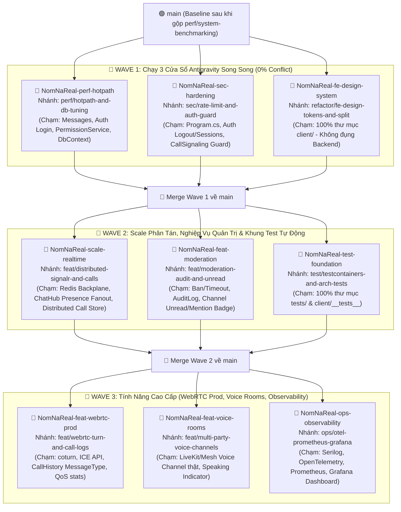

# 🚀 NomNa — Master Plan Phát Triển Song Song Đa Nhánh (`git worktree`) & Kiến Trúc Scale Hệ Thống Toàn Diện

> **Cập nhật theo trạng thái thực tế tại commit:** `0c56978` (Nhánh `perf/system-benchmarking` + `main` sau khi đã merge `feat/webrtc-1v1-call` và `feat/fe-modernize`).  
> **Mục tiêu:** Tổ chức quy trình phát triển **Multi-Folder / Multi-Branch bằng `git worktree`** để mở nhiều cửa sổ **Antigravity IDE** chạy song song mà **không đụng độ port, không xung đột database migration và không bị Git Merge Conflict**, đồng thời giải quyết triệt để các lỗ hổng nghiệp vụ (Functional), yêu cầu phi chức năng (NFRs) và điểm nghẽn mở rộng (Scaling Bottlenecks).

---

## 📌 PHẦN 1: VIỆC CẦN LÀM NGAY LẬP TỨC (IMMEDIATE ACTION PLAN)

Trước khi tách hàng loạt nhánh `git worktree` mới, workspace hiện tại (`/home/vanmuzic/Projects/NomNaReal` đang ở nhánh `perf/system-benchmarking`) đang có các file staged, modified và untracked (`labs/`). Nếu không đóng gói sạch sẽ ngay bây giờ, các worktree mới tách từ `main` sẽ thiếu bộ tài liệu `docs/` và phòng lab `labs/postgres-perf/`.

### Bước 1: Đóng gói & Commit sạch sẽ nhánh `perf/system-benchmarking` hiện tại
Chạy các lệnh sau tại terminal của `/home/vanmuzic/Projects/NomNaReal`:

```bash
# 1. Kiểm tra Triple Gate trước khi commit
dotnet build NomNa.sln
dotnet test NomNa.sln
(cd client && npm run build)

# 2. Stage toàn bộ tài liệu kiến trúc, k6 config và phòng lab PostgreSQL
git add docs/ labs/ scripts/k6/docker-compose.bench.yml plans/ scripts/

# 3. Tạo commit nguyên tử (English commit message theo đúng chuẩn dự án)
git commit -m "docs(perf): add architecture deep-dives, principal scaling bible, and postgres uuidv7 lab"
```

### Bước 2: Đồng bộ `perf/system-benchmarking` vào `main` làm Baseline chuẩn cho mọi Worktree
Hiện tại bạn đang có một worktree thứ hai tại `/home/vanmuzic/Projects/NomNaReal-fe` đang trỏ vào nhánh `main`. Vì Git không cho phép 2 folder cùng checkout 1 nhánh `main`, ta hợp nhất `perf/system-benchmarking` vào `main` ngay trên `NomNaReal-fe` (hoặc tháo tạm worktree cũ):

```bash
# Cách nhanh và sạch nhất:
cd /home/vanmuzic/Projects/NomNaReal-fe
git merge perf/system-benchmarking --ff-only

# Quay lại thư mục chính
cd /home/vanmuzic/Projects/NomNaReal
```

### Bước 3: Khởi tạo cấu trúc thư mục Worktree song song
Thay vì `git clone` nhiều lần gây tốn ổ cứng và lệch lịch sử Git, ta dùng **`git worktree`** (chia sẻ chung `.git/objects` cực nhẹ, tạo nhánh mới trong 0.5 giây, mỗi folder mở 1 cửa sổ Antigravity độc lập):

```text
/home/vanmuzic/Projects/
├── NomNaReal/                      # [Core / Coordinator] -> perf/system-benchmarking
├── NomNaReal-perf-hotpath/         # [Wave 1 - Nhánh 1]   -> perf/hotpath-and-db-tuning
├── NomNaReal-sec-hardening/        # [Wave 1 - Nhánh 2]   -> sec/rate-limit-and-auth-guard
├── NomNaReal-fe-design-system/     # [Wave 1 - Nhánh 3]   -> refactor/fe-design-tokens-and-split
├── NomNaReal-scale-realtime/       # [Wave 2 - Nhánh 4]   -> feat/distributed-signalr-and-calls
├── NomNaReal-feat-moderation/      # [Wave 2 - Nhánh 5]   -> feat/moderation-audit-and-unread
├── NomNaReal-test-foundation/      # [Wave 2 - Nhánh 6]   -> test/testcontainers-and-arch-tests
├── NomNaReal-feat-webrtc-prod/     # [Wave 3 - Nhánh 7]   -> feat/webrtc-turn-and-call-logs
├── NomNaReal-feat-voice-rooms/     # [Wave 3 - Nhánh 8]   -> feat/multi-party-voice-channels
└── NomNaReal-ops-observability/    # [Wave 3 - Nhánh 9]   -> ops/otel-prometheus-grafana
```

> 💡 **Công cụ tự động:** Sử dụng script [`scripts/worktree-hub.sh`](file:///home/vanmuzic/Projects/NomNaReal/scripts/worktree-hub.sh) vừa được tạo sẵn để khởi tạo từng Wave chỉ bằng 1 câu lệnh:
> ```bash
> ./scripts/worktree-hub.sh status      # Xem trạng thái tất cả worktrees
> ./scripts/worktree-hub.sh init-wave1  # Tự động tạo 3 folder Wave 1 để mở 3 cửa sổ Antigravity ngay!
> ```

---

## 🔍 PHẦN 2: KIỂM TOÁN CHUYÊN SÂU CODEBASE HIỆN TẠI (REALITY CHECK)

Qua việc đọc trực tiếp toàn bộ mã nguồn tại `src/` và `client/`, dưới đây là bức tranh chính xác 100% về những gì **đã làm xong**, những **lỗ hổng nghiệp vụ (Functional Gaps)** và **điểm nghẽn phi chức năng (NFR & Scaling Bottlenecks)** đang tồn tại trong code:

### 2.1. Những gì ĐÃ HOÀN THÀNH gần đây (Không làm lại)
* **Presence Tracker v2 (`RedisUserPresenceTracker.cs`)**: Đã chuyển sang ZSET lease (`nomna:presence:online_users`) + 3 precompiled Lua scripts (`ConnectScript`, `DisconnectScript`, `HeartbeatScript`) chạy 1-RTT + `UserStatusPreference` (`Online`, `Idle`, `DoNotDisturb`, `Invisible`).
* **UUIDv7 (`BaseEntity.cs`)**: Đã dùng `Guid.CreateVersion7()` chuẩn RFC 9562 trên .NET 9.
* **Core Chat, RBAC Bitmask 64-bit, Link Preview, Pin Message, S3 Upload, 1-1 WebRTC UI**: Đã hoạt động.

---

### 2.2. Các Điểm Nghẽn Hiệu Năng & Scale (5 "Quả Bom Nổ Chậm" Trong Code Thực Tế)

| Mã | Vị Trí File Thực Tế | Bản Chất Kỹ Thuật Của Điểm Nghẽn | Hậu Quả Khi Scale Lên >500–5,000 CCU |
| :--- | :--- | :--- | :--- |
| **💣 BOM #1** | [`PermissionService.cs:22-24`](file:///home/vanmuzic/Projects/NomNaReal/src/NomNa.Infrastructure/Services/PermissionService.cs#L22-L24) & [`DependencyInjection.cs:46`](file:///home/vanmuzic/Projects/NomNaReal/src/NomNa.Infrastructure/DependencyInjection.cs#L46) | `PermissionService` đăng ký là `Scoped`, nhưng `_serverTokens`, `_channelTokens`, `_userTokens` (`ConcurrentDictionary<..., CancellationTokenSource>`) lại là **instance fields** (không phải `static` / Singleton). | **Hỏng Cache Invalidation:** Request B thu hồi quyền Role gọi `InvalidateServer()` trên dictionary rỗng của chính nó, không hủy được token của Request A trong `IMemoryCache`! Đồng thời cấp phát 3 `ConcurrentDictionary` nặng mỗi HTTP request gây áp lực GC Gen 0/1. |
| **💣 BOM #2** | [`ChatHub.cs:85,128`](file:///home/vanmuzic/Projects/NomNaReal/src/NomNa.WebAPI/Hubs/ChatHub.cs#L85) | Dùng `Clients.All.SendAsync(UserStatusChanged)` mỗi khi có người kết nối hoặc ngắt kết nối. | **Bão Broadcast $O(N^2)$:** Khi 1,000 người kết nối lại sau khi rớt mạng, Kestrel phải bắn $\frac{1000^2}{2} = 500,000$ gói WebSocket. Lộ quyền riêng tư (người lạ không chung server vẫn nhận được trạng thái online). |
| **💣 BOM #3** | [`SendMessageCommandHandler.cs:94-108`](file:///home/vanmuzic/Projects/NomNaReal/src/NomNa.Application/Features/Messages/Commands/SendMessage/SendMessageCommandHandler.cs#L94-L108) & [`ChatHub.Messages.cs:44-58`](file:///home/vanmuzic/Projects/NomNaReal/src/NomNa.WebAPI/Hubs/ChatHub.Messages.cs#L44-L58) | 1 lần gửi tin nhắn tốn **8 DB Round-Trips** và gọi `SaveChangesAsync()` 2 lần. Cập nhật `channel.LastMessageAt` trực tiếp trong transaction gửi tin nhắn. `ChatHub.Messages.cs` lại mở scope mới query lại `Channels` và `ChannelMembers` vừa query ở Handler. | **Hot Row Lock Contention:** 300 người cùng chat vào `#general` sẽ tranh nhau Row Exclusive Lock trên đúng 1 dòng của bảng `channels` (lại có index trên `LastMessageAt` làm mất cơ chế PostgreSQL HOT Update!). |
| **💣 BOM #4** | [`LoginCommandHandler.cs:32-53`](file:///home/vanmuzic/Projects/NomNaReal/src/NomNa.Application/Features/Auth/Commands/Login/LoginCommandHandler.cs#L32-L53) | Truy vấn `u.Email == input \|\| u.UserName == input` (không có index vì ASP.NET Identity chỉ đánh index trên `NormalizedEmail` và `NormalizedUserName`) + không giới hạn concurrency cho `CheckPasswordAsync` (PBKDF2 CPU-bound). | **Full Table Scan + ThreadPool Starvation:** Bảng 100k users bị quét tuần tự (`Seq Scan`), cộng thêm 50 request login đồng thời sẽ đốt 100% CPU làm nghẽn toàn bộ luồng WebSocket. |
| **💣 BOM #5** | [`ApplicationDbContext.cs:162,169`](file:///home/vanmuzic/Projects/NomNaReal/src/NomNa.Infrastructure/Persistence/ApplicationDbContext.cs#L162) & [`SearchMessagesQueryHandler.cs:126`](file:///home/vanmuzic/Projects/NomNaReal/src/NomNa.Application/Features/Messages/Queries/SearchMessages/SearchMessagesQueryHandler.cs#L126) | Khai báo trùng lặp `.HasIndex(e => new { e.ChannelId, e.CreatedAt })` 2 lần; `SearchMessages` dùng `EF.Functions.Like(m.Content.ToLower(), "%kw%")` nhưng chưa có `pg_trgm` GIN index. | Tìm kiếm tin nhắn trên bảng 1 triệu dòng mất **300ms–800ms** (`Seq Scan`) thay vì `< 5ms` (`Bitmap Index Scan` với GIN Trigram). |

---

### 2.3. Các Thiếu Sót Nghiệp Vụ (Functional Gaps) Phát Hiện Trong Code

1. **`GetChannelsQueryHandler.cs` (Dòng 81) hardcode `HasUnread = false`**:
   - Dù hệ thống đã có bảng `channel_members` lưu `LastReadAt` và API `MarkChannelAsRead`, nhưng khi lấy danh sách kênh của Server, `GetChannelsQueryHandler` đang truyền cứng `false` cho trường `HasUnread`! Người dùng vào server không biết kênh nào có tin nhắn mới hay có `@mention` chưa đọc.
2. **`AuthController.cs` (Dòng 94–99) `Logout` không thu hồi Refresh Token trong DB**:
   - Hàm `Logout()` chỉ xóa cookie trên trình duyệt (`ClearAuthCookies()`), hoàn toàn không đánh dấu `RevokedAt` cho `RefreshToken` trong bảng `refresh_tokens`. Thiếu tính năng **"Đăng xuất khỏi mọi thiết bị" (`RevokeAllSessionsCommand`)** và **"Đổi mật khẩu" (`ChangePasswordCommand`)**.
3. **Lỗ hổng Nghiệp vụ & Bảo mật trong WebRTC Call (`ChatHub.CallSignaling.cs`)**:
   - `StartCall` ghi đè `_activeCalls[targetUserId] = callerId` mà **không kiểm tra xem `targetUserId` có đang trong cuộc gọi khác hay không** (hằng số `SignalRConstants.Events.UserBusy` đã tạo nhưng chưa hề được gọi!).
   - `StartCall` không kiểm tra xem `callerId` có đang bị `targetUserId` chặn (`FriendshipStatus.Blocked`) hay không.
   - `AcceptCall`, `EndCall`, `SendIceCandidate` không xác thực cặp caller-callee hợp lệ.
   - Cuộc gọi nhỡ hoặc cuộc gọi kết thúc không lưu lịch sử (`CallLog` / tin nhắn hệ thống trong khung chat DM).
4. **Thiếu tính năng Quản trị & Kiểm duyệt Server (Moderation & Audit Log)**:
   - Mới chỉ có `KickServerMemberCommand`. Nhưng vì `Server.InviteCode` là cố định, người vừa bị Kick bấm lại link invite cũ là vào lại được ngay!
   - Cần bổ sung: **Ban / Unban thành viên (`ServerBan`)**, **Timeout / Mute tạm thời (`CommunicationDisabledUntil`)**, **Slowmode cho kênh**, **Tạo lại mã mời (`RegenerateInviteCodeCommand`)**, và **Nhật ký kiểm duyệt (`ServerAuditLog`)**.
5. **Chống gửi trùng tin nhắn (Message Idempotency) & Tie-breaker Cursor Pagination**:
   - `SendMessageCommand` chưa nhận `ClientMessageId` (Idempotency Key) để chống nhân đôi tin nhắn khi mạng chập chờn retry.
   - `GetMessagesQueryHandler` phân trang chỉ dùng `CreatedAt < Before` mà chưa dùng cặp khóa `(CreatedAt, Id)` — nếu 2 tin nhắn cùng mili-giây sẽ bị sót tin.
6. **Chưa chuẩn hóa tiếng Anh trong Comment (`ChatHub*.cs`, `PermissionService.cs`)**:
   - Một số file mới vẫn còn XML docstring tiếng Việt, vi phạm quy tắc `english-code-comments`.
7. **Frontend Technical Debt**:
   - `bash scripts/audit-colors.sh` báo **703 lỗi vi phạm Design System** (raw Tailwind colors `bg-emerald-500`, `text-rose-500`, `text-white`, `rounded-[4px]`).
   - `ChatPage.tsx` dài **1,690 dòng** (God Component), bundle JS chính nặng **1.34 MB** chưa tách `React.lazy()` / `manualChunks`, chưa có `ErrorBoundary`.

---

### 2.4. Bản Đồ Yêu Cầu Phi Chức Năng (Non-Functional Requirements — NFRs) Cần Đạt

| Nhóm NFR | Hiện Trạng | Mục Tiêu Chuẩn Production (Target SLA/SLO) | Nhánh Đảm Nhiệm |
| :--- | :--- | :--- | :--- |
| **1. Throughput & Latency** | `SendMessage` tốn 8 RTT; Search quét bảng tuần tự. | `SendMessage` P95 `< 35ms` (2 RTT); `GetMessages` P95 `< 15ms`; `SearchMessages` trên 1M dòng `< 20ms` nhờ GIN `pg_trgm`. | `perf/hotpath-and-db-tuning` |
| **2. Security & Abuse Protection** | Không có Rate Limiter; JWT fallback secret cứng; Logout không hủy DB token. | Rate Limiting 4 tầng (Auth, API, SignalR SendMessage, Call); JWT fail-fast; Security Headers (CSP, HSTS, X-Frame-Options). | `sec/rate-limit-and-auth-guard` |
| **3. Horizontal Scalability** | SignalR chạy In-Memory đơn lẻ; `_activeCalls` nằm trên RAM cục bộ. | Scale-out $N$ instances WebAPI sau Nginx với **Redis Backplane** + Distributed Call State + Scoped/Batched Presence. | `feat/distributed-signalr-and-calls` |
| **4. Maintainability & UI Perf** | 703 lỗi màu cứng; `ChatPage.tsx` 1,690 dòng; 1.34MB single JS chunk. | `0` lỗi `audit-colors.sh`; chunk chính `< 300KB` gzip; mọi component `< 300` dòng; có `ErrorBoundary` từng vùng. | `refactor/fe-design-tokens-and-split` |
| **5. Automated Test & Reliability** | 47 unit tests; 0 integration tests; 0 frontend tests; 0 arch tests. | `NetArchTest` bảo vệ Clean Architecture; `Testcontainers` (Postgres + Redis thật) + `Respawn`; SignalR Hub tests; `Vitest` FE. | `test/testcontainers-and-arch-tests` |
| **6. Observability & Telemetry** | Chỉ có log console cơ bản; `/health/ready` chưa check Redis. | Structured Logging (`Serilog`), `OpenTelemetry` + `Prometheus` metrics + `Grafana` Dashboard (CCU, GC, Latency, Redis/PG). | `ops/otel-prometheus-grafana` |

---

## 🗺️ PHẦN 3: CHIẾN LƯỢC CHIA NHÁNH `git worktree` KHÔNG ĐỤNG ĐỘ (CONFLICT-FREE DAG)

Để bạn mở **3 cửa sổ Antigravity cùng lúc** mà khi merge về `main` không bị cảnh tượng "đẫm máu" vì conflict, các nhánh được thiết kế theo **3 Đợt (Waves)** dựa trên nguyên tắc **Cô lập Vùng Chạm File (File-Touch Isolation)**:



### Quy Tắc Vàng Khi Dùng Nhiều Worktrees Trên Cùng 1 Máy Local:
1. **Dùng chung Hạ tầng Docker (`nomna_postgres:5432` và `nomna_redis:6380`):** Không cần bật tắt Docker Compose ở từng worktree. Các worktree cùng kết nối vào Postgres `5432` (hoặc đổi `Database=NomNa_<branch>` trong `appsettings.Development.json` nếu nhánh đó có tạo Migration mới!).
2. **Quy tắc EF Core Migration:** Trong mỗi Wave, **chỉ 1 nhánh được phép chạy `dotnet ef migrations add`** (Ở Wave 1 là nhánh `perf/hotpath-and-db-tuning`; ở Wave 2 là nhánh `feat/moderation-audit-and-unread`; ở Wave 3 là nhánh `feat/webrtc-turn-and-call-logs`). Nhờ đó `ApplicationDbContextModelSnapshot.cs` **không bao giờ bị conflict**!
3. **Cách ly Port khi chạy thử Server/Client cùng lúc:**
   * Worktree 1: `dotnet run --urls="http://localhost:5001"` | `npm run dev -- --port 5173`
   * Worktree 2: `dotnet run --urls="http://localhost:5002"` | `npm run dev -- --port 5174`
   * Worktree 3: `dotnet run --urls="http://localhost:5003"` | `npm run dev -- --port 5175`

---

## 🛠️ PHẦN 4: CHI TIẾT TỪNG NHÁNH & PROMPT MẪU CHO TỪNG Ô CHAT ANTIGRAVITY

Dưới đây là đặc tả kỹ thuật chi tiết và **Prompt Mẫu (Copy-Paste 100%)** cho cả **9 Nhánh phát triển**. Khi bạn mở một cửa sổ Antigravity vào thư mục tương ứng, chỉ cần copy đúng khối Prompt của nhánh đó dán vào ô chat!

---

# 🌊 WAVE 1 — CỦNG CỐ LÕI HIỆU NĂNG, BẢO MẬT & KIẾN TRÚC FRONTEND

---

### 🔹 NHÁNH 1: `perf/hotpath-and-db-tuning`
* **Thư mục Worktree:** `/home/vanmuzic/Projects/NomNaReal-perf-hotpath`
* **Lệnh tạo:**
  ```bash
  git worktree add ../NomNaReal-perf-hotpath -b perf/hotpath-and-db-tuning main
  ```
* **Mục tiêu Chuyên sâu:** Tháo gỡ 4/5 "Quả Bom Nổ Chậm" trong tầng Data & Hot-Path (`PermissionService` memory leak & broken invalidation, `SendMessage` 8 RTTs & hot row lock contention, `Login` full table scan, `SearchMessages` GIN Trigram index & composite keyset pagination + `ClientMessageId` idempotency).
* **Phạm vi File chạm tới:**
  * `src/NomNa.Infrastructure/Services/PermissionService.cs`
  * `src/NomNa.Application/Features/Messages/Commands/SendMessage/*`
  * `src/NomNa.WebAPI/Hubs/ChatHub.Messages.cs`
  * `src/NomNa.Application/Features/Messages/Queries/GetMessages/*`
  * `src/NomNa.Application/Features/Messages/Queries/SearchMessages/*`
  * `src/NomNa.Application/Features/Auth/Commands/Login/LoginCommandHandler.cs`
  * `src/NomNa.Infrastructure/Persistence/ApplicationDbContext.cs` + 1 EF Core Migration mới.

#### 📋 PROMPT MẪU COPY-PASTE VÀO ANTIGRAVITY (NHÁNH 1):
```markdown
/goal
Hãy đọc kỹ các tài liệu và skill sau trước khi bắt đầu:
1. `.agents/AGENTS.md`
2. `.agents/skills/be-architecture/SKILL.md`
3. `.agents/skills/engineering-workflow/SKILL.md`
4. `.agents/skills/english-code-comments/SKILL.md`
5. `docs/performance/06-principal-system-scaling-and-tradeoffs-bible.md` (Đặc biệt đọc kỹ Phần 2: 5 Quả Bom Nổ Chậm)

Bạn đang làm việc trên nhánh `perf/hotpath-and-db-tuning` (Worktree độc lập). Nhiệm vụ của bạn là giải quyết triệt để các điểm nghẽn hiệu năng Backend & Database theo từng Micro-slice (mỗi slice <= 10 files, pass Triple Gate, comment 100% bằng tiếng Anh):

### Slice 1: Sửa lỗi Broken Cache Invalidation & Memory Allocation trong `PermissionService` (Quả Bom #1)
- Trong `src/NomNa.Infrastructure/Services/PermissionService.cs`, 3 biến `_serverTokens`, `_channelTokens`, `_userTokens` hiện là instance fields trong một `Scoped` service, khiến `InvalidateServer`/`InvalidateChannel`/`InvalidateUserPermissions` tạo dictionary mới trên mỗi request và không bao giờ hủy được `CancellationTokenSource` của các request trước.
- Hãy chuyển quản lý token sang cơ chế Singleton an toàn luồng (hoặc `private static readonly ConcurrentDictionary` với việc `Dispose()` và thay mới `CancellationTokenSource` sạch sẽ khi invalidate), đồng thời chuyển toàn bộ comment tiếng Việt trong `PermissionService.cs` sang tiếng Anh.
- Viết thêm Unit Test kiểm chứng việc gọi `InvalidateServer` thực sự làm vô hiệu hóa cache entry trong `IMemoryCache`.

### Slice 2: Tối ưu `LoginCommandHandler` — Xóa bỏ Sequential Scan trên bảng `users` (Quả Bom #4)
- Trong `LoginCommandHandler.cs`, thay truy vấn `u.Email == input || u.UserName == input` (gây Seq Scan vì không dùng cột có index) bằng truy vấn trên `u.NormalizedEmail == normalized || u.NormalizedUserName == normalized` (sử dụng `_userManager.NormalizeName` / `NormalizeEmail` để tận dụng `EmailIndex` và `UserNameIndex`).
- Chỉ gọi `await _userManager.ResetAccessFailedCountAsync(user)` khi `user.AccessFailedCount > 0` để tránh ghi DB dư thừa ở mỗi lần login thành công.

### Slice 3: Tối ưu Hot-Path `SendMessage` & Message Idempotency (Quả Bom #3)
- Bổ sung trường tùy chọn `ClientMessageId (Guid?)` vào `SendMessageCommand` và `MessageDto` để hỗ trợ Idempotency & Optimistic UI matching.
- Loại bỏ truy vấn DB lặp lại trong `ChatHub.Messages.cs` (dòng 44-58 đang mở scope mới query lại `Channels` và `ChannelMembers` dù `SendMessageCommandHandler` vừa mới query xong). Hãy trả kèm thông tin cần thiết từ Handler hoặc DTO nội bộ để `ChatHub.Messages.cs` tốn **0 DB queries**.
- Gom việc lưu `Message` và `Notification` vào **1 lần `SaveChangesAsync()` duy nhất** thay vì gọi `SaveChangesAsync()` 2 lần liên tiếp trong `SendMessageCommandHandler`.
- Chuẩn hóa toàn bộ comment trong `ChatHub.Messages.cs` và `SendMessageCommandHandler.cs` sang tiếng Anh.

### Slice 4: Database Indexing, GIN Trigram Search & Composite Keyset Pagination (Quả Bom #5)
- Trong `ApplicationDbContext.cs`:
  - Xóa khai báo index trùng lặp trên `(ChannelId, CreatedAt)` ở dòng 162, chỉ giữ lại index tối ưu cho phân trang Keyset `(ChannelId, CreatedAt, Id)` với filter `"DeletedAt" IS NULL`.
  - Bật extension PostgreSQL `pg_trgm` (`builder.HasPostgresExtension("pg_trgm")`) và đánh GIN Index (`gin_trgm_ops`) trên cột `Message.Content` để tăng tốc `SearchMessagesQueryHandler`.
- Trong `SearchMessagesQueryHandler.cs`: Dùng `EF.Functions.ILike(m.Content, $"%{keyword}%")` để PostgreSQL kích hoạt Bitmap Index Scan trên GIN `pg_trgm` index thay vì `ToLower() LIKE`.
- Tạo EF Core Migration mới (`AddMessageTrgmAndCompositeKeysetIndex`).

Sau khi hoàn thành cả 4 slices, chạy đủ Triple Gate (`dotnet build`, `dotnet test`, `npm run build`), kiểm tra `git status` và xuất báo cáo Senior Handover Report. Tuyệt đối không tự ý `git push`.
```

---

### 🔹 NHÁNH 2: `sec/rate-limit-and-auth-guard`
* **Thư mục Worktree:** `/home/vanmuzic/Projects/NomNaReal-sec-hardening`
* **Lệnh tạo:**
  ```bash
  git worktree add ../NomNaReal-sec-hardening -b sec/rate-limit-and-auth-guard main
  ```
* **Mục tiêu Chuyên sâu:** Đóng toàn bộ lỗ hổng bảo mật P1 và lỗ hổng quản lý phiên đăng nhập: Rate Limiting đa tầng (HTTP + Auth + SignalR), bảo vệ trạng thái cuộc gọi `ChatHub.CallSignaling.cs` (check `UserBusy`, check `Blocked`, xác thực cặp gọi), thu hồi RefreshToken thật trong DB khi `Logout` + thêm API `RevokeAllSessions` & `ChangePassword`, JWT fail-fast trên Production và HTTP Security Headers.
* **Phạm vi File chạm tới:**
  * `src/NomNa.WebAPI/Program.cs`, `src/NomNa.WebAPI/DependencyInjection.cs`
  * `src/NomNa.WebAPI/Controllers/AuthController.cs`
  * `src/NomNa.Application/Features/Auth/Commands/Logout/*` (Mới - 3 files)
  * `src/NomNa.Application/Features/Auth/Commands/ChangePassword/*` (Mới - 3 files)
  * `src/NomNa.WebAPI/Hubs/ChatHub.CallSignaling.cs`

#### 📋 PROMPT MẪU COPY-PASTE VÀO ANTIGRAVITY (NHÁNH 2):
```markdown
/goal
Hãy đọc kỹ các tài liệu và skill sau trước khi bắt đầu:
1. `.agents/AGENTS.md`
2. `.agents/skills/security-guidelines/SKILL.md`
3. `.agents/skills/be-architecture/SKILL.md`
4. `.agents/skills/signalr-patterns/SKILL.md`
5. `.agents/skills/engineering-workflow/SKILL.md`
6. `.agents/skills/english-code-comments/SKILL.md`

Bạn đang làm việc trên nhánh `sec/rate-limit-and-auth-guard`. Nhiệm vụ của bạn là thắt chặt bảo mật, chống lạm dụng tài nguyên (Rate Limiting) và hoàn thiện nghiệp vụ bảo mật Auth & Call Signaling theo từng Micro-slice (comment 100% tiếng Anh, tuân thủ tuyệt đối luật tách 3 file `Command`, `CommandHandler`, `CommandValidator`):

### Slice 1: Thu hồi RefreshToken khi Logout & Quản lý Mật khẩu / Phiên đăng nhập
- Hiện tại `AuthController.Logout()` chỉ xóa cookie mà không thu hồi `RefreshToken` trong bảng `refresh_tokens`.
- Hãy tạo `LogoutCommand`, `LogoutCommandHandler`, `LogoutCommandValidator` trong `Features/Auth/Commands/Logout/`: nhận `RefreshToken` từ cookie, tìm bản ghi trong DB và đánh dấu `IsRevoked = true` (hoặc xóa/cập nhật trạng thái thu hồi), đồng thời hỗ trợ cờ `RevokeAllDevices = true` để thu hồi toàn bộ refresh token đang sống của user đó.
- Tạo `ChangePasswordCommand`, `ChangePasswordCommandHandler`, `ChangePasswordCommandValidator` trong `Features/Auth/Commands/ChangePassword/` và endpoint `[Authorize] [HttpPost("change-password")]` trong `AuthController`: xác minh mật khẩu hiện tại, đổi mật khẩu mới qua `UserManager`, và thu hồi các refresh token cũ.

### Slice 2: Bảo mật JWT Fail-Fast & HTTP Security Headers
- Trong `src/NomNa.WebAPI/DependencyInjection.cs`: Nếu `environment.IsProduction()` mà `Jwt:Secret` bị thiếu, ngắn hơn 32 ký tự, hoặc trùng với chuỗi fallback mặc định `"NomNaSuperSecretKeyForDevelopmentAndDemoPurposes2026!MustBeLongEnough"`, lập tức ném `InvalidOperationException` khi khởi động (Fail-fast).
- Trong `src/NomNa.WebAPI/Program.cs`: Thêm middleware gắn các Security Headers chuẩn OWASP (`X-Content-Type-Options: nosniff`, `X-Frame-Options: DENY`, `Referrer-Policy: strict-origin-when-cross-origin`, `Permissions-Policy: camera=(self), microphone=(self)`).
- Nâng cấp endpoint `/health/ready` trong `Program.cs` để kiểm tra cả kết nối PostgreSQL (`db.Database.CanConnectAsync()`) lẫn Redis (`IConnectionMultiplexer.IsConnected`).

### Slice 3: ASP.NET Core Rate Limiting Đa Tầng & Bảo vệ CPU Login
- Cấu hình `builder.Services.AddRateLimiter(...)` và `app.UseRateLimiter()` trong `WebAPI`:
  1. Policy `"auth"`: Fixed Window / Sliding Window giới hạn tối đa 10 requests / phút theo địa chỉ IP cho `/api/auth/login`, `/api/auth/register`, `/api/auth/forgot-password` (kèm giới hạn Concurrency để chống làm nghẽn ThreadPool bởi PBKDF2 hashing).
  2. Policy `"api-general"`: Token Bucket hợp lý cho các API thông thường, trả về HTTP 429 chuẩn JSON.
- Gắn `[EnableRateLimiting("auth")]` lên các endpoint nhạy cảm trong `AuthController`.

### Slice 4: Khóa chặt An ninh & State Machine trong `ChatHub.CallSignaling.cs`
- Hiện tại `ChatHub.CallSignaling.cs` có 4 lỗ hổng lớn:
  1. `StartCall` ghi đè `_activeCalls[targetUserId]` mà không kiểm tra đối phương có đang bận cuộc gọi khác không. Hãy kiểm tra: nếu `_activeCalls.ContainsKey(targetUserId)`, bắn sự kiện `SignalRConstants.Events.UserBusy` (hoặc `CallRejected` với lý do bận) về cho Caller và dừng ngay, tuyệt đối không làm gián đoạn cuộc gọi đang diễn ra của người khác!
  2. Trong `StartCall`, kiểm tra trong DB bảng `Friendships`: nếu giữa `callerId` và `targetUserId` có trạng thái `FriendshipStatus.Blocked`, từ chối cuộc gọi ngay lập tức.
  3. Trong `AcceptCall`, `EndCall`, `SendIceCandidate`: kiểm tra xác thực `_activeCalls` xem 2 user có thực sự đang trong phiên gọi với nhau hay không trước khi chuyển tiếp gói tin.
  4. Chuyển toàn bộ comment tiếng Việt trong `ChatHub.CallSignaling.cs` và `ChatHub.cs` sang tiếng Anh chuẩn.

Sau khi hoàn thành, viết Unit Tests cho các Validator/Handler mới, chạy đủ Triple Gate (`dotnet build`, `dotnet test`, `npm run build`) và báo cáo kết quả.
```

---

### 🔹 NHÁNH 3: `refactor/fe-design-tokens-and-split`
* **Thư mục Worktree:** `/home/vanmuzic/Projects/NomNaReal-fe-design-system`
* **Lệnh tạo:**
  ```bash
  git worktree add ../NomNaReal-fe-design-system -b refactor/fe-design-tokens-and-split main
  ```
* **Mục tiêu Chuyên sâu:** Xử lý 100% nợ kỹ thuật Frontend hoàn toàn độc lập với Backend (0% xung đột code C#): Xóa sổ **703 lỗi vi phạm Design System** (`scripts/audit-colors.sh` = 0 lỗi), tách nhỏ God Component `ChatPage.tsx` (1,690 dòng), cấu hình Code-Splitting (`React.lazy` + Vite `manualChunks`) giảm kích thước bundle từ 1.34MB xuống `< 300KB`, và bọc `ErrorBoundary` chống sập trắng trang.
* **Phạm vi File chạm tới:** Chỉ chạm vào thư mục `client/` (`client/src/**`, `client/vite.config.ts`).

#### 📋 PROMPT MẪU COPY-PASTE VÀO ANTIGRAVITY (NHÁNH 3):
```markdown
/goal
Hãy đọc kỹ các tài liệu và skill sau trước khi bắt đầu:
1. `.agents/AGENTS.md`
2. `.agents/skills/design-system/SKILL.md`
3. `.agents/skills/fe-architecture/SKILL.md`
4. `.agents/skills/engineering-workflow/SKILL.md`
5. `.agents/skills/english-code-comments/SKILL.md`

Bạn đang làm việc trên nhánh `refactor/fe-design-tokens-and-split`. Nhiệm vụ của bạn chỉ nằm trong thư mục `client/` (tuyệt đối không sửa file nào trong `src/` của Backend để đảm bảo 0% conflict với các nhánh Backend đang chạy song song). Thực hiện lần lượt 4 Micro-slices sau:

### Slice 1: Xóa bỏ 100% lỗi vi phạm Design System (`bash scripts/audit-colors.sh` -> 0 violations)
- Chạy `bash scripts/audit-colors.sh` để xem danh sách 703 lỗi vi phạm (raw Tailwind colors như `bg-emerald-500`, `bg-rose-500`, `bg-amber-500`, `text-white`, `text-black`, `rounded-[4px]`, `rounded-[8px]`...).
- Kiểm tra `client/src/styles/globals.css` và `client/src/index.css` để nắm rõ bộ biến CSS ngữ nghĩa (`--bg-chat`, `--bg-surface`, `--text-primary`, `--accent-primary`, `--status-online`, `--status-idle`, `--status-dnd`, `--text-danger`...). Nếu thiếu utility class ngữ nghĩa cho badge/status/button text, hãy định nghĩa bổ sung hợp lệ trong CSS theme tokens.
- Refactor lần lượt từng nhóm thư mục trong `client/src/components/` (`notifications`, `call`, `chat`, `server`, `channel`, `dm`, `friends`, `layout`, `profile`, `settings`, `ui`) và `client/src/pages/` cho đến khi chạy `bash scripts/audit-colors.sh` trả về **0 design-token violations**!
- Giữ nguyên 100% thẩm mỹ giao diện trên cả 4 theme (Dark, Light, Midnight, Discord).

### Slice 2: Thiết lập Regional `ErrorBoundary` chống White Screen of Death
- Tạo component `ErrorBoundary.tsx` chuẩn trong `client/src/components/ui/` dùng semantic design tokens, hỗ trợ fallback UI gọn đẹp kèm nút "Reload Section" (Thử lại).
- Bọc `ErrorBoundary` ở cấp ứng dụng (`App.tsx`) và bọc riêng từng khu vực nhạy cảm: Khung danh sách tin nhắn (`MessageList`), Giao diện cuộc gọi (`CallOverlay`), và hệ thống Modal.

### Slice 3: Tách nhỏ God Component `ChatPage.tsx` (1,690 dòng)
- Phân tích `client/src/pages/ChatPage.tsx` (hiện dài 1,690 dòng) và tách các khối logic/UI độc lập sang các custom hooks (`useChatPageModals.ts`, `useServerChannelEffects.ts`...) và các sub-components trong `client/src/pages/components/` sao cho `ChatPage.tsx` gọn gàng, dễ đọc, đúng nguyên tắc tách biệt Container vs Presentational trong `fe-architecture/SKILL.md` và không làm thay đổi bất kỳ hành vi chức năng nào.

### Slice 4: Code Splitting & Tối ưu Vite Bundle Size (< 300KB Main Chunk)
- Trong `client/src/App.tsx`: Chuyển các trang nặng (`ChatPage`, `AuthPage`, `JoinPage`, `LandingPage`) sang `React.lazy()` kết hợp `Suspense` skeleton loader mượt mà.
- Trong `client/vite.config.ts`: Cấu hình `build.rollupOptions.output.manualChunks` (hoặc `rolldownOptions` tương thích Vite 8 đang dùng) để tách riêng các thư viện lớn (`react-vendor`, `signalr-vendor`, `icons-vendor`, `query-vendor`).
- Chạy `cd client && npm run build` để xác nhận không còn cảnh báo chunk > 500KB hoặc giảm tối đa kích thước chunk chính.

Cuối cùng, chạy kiểm tra `bash scripts/audit-colors.sh` (phải đạt 0 lỗi) và Triple Gate (`dotnet build`, `dotnet test`, `npm run build`).
```

---

# 🌊 WAVE 2 — SCALE PHÂN TÁN REALTIME, NGHIỆP VỤ QUẢN TRỊ & KHUNG KIỂM THỬ

*(Khởi tạo sau khi đã merge Wave 1 về `main`)*

---

### 🔹 NHÁNH 4: `feat/distributed-signalr-and-calls`
* **Thư mục Worktree:** `/home/vanmuzic/Projects/NomNaReal-scale-realtime`
* **Lệnh tạo:**
  ```bash
  git worktree add ../NomNaReal-scale-realtime -b feat/distributed-signalr-and-calls main
  ```
* **Mục tiêu Chuyên sâu:** Đưa tầng Realtime SignalR từ Single-Node lên **Multi-Node Scale-Out**:
  1. Tích hợp `Microsoft.AspNetCore.SignalR.StackExchangeRedis` (Redis Backplane) để chạy $N$ instances WebAPI phía sau Nginx (`docker-compose.bench.yml` đang chạy 2 instances `bench_webapi_1` và `bench_webapi_2`!).
  2. Thay thế `_activeCalls` (`ConcurrentDictionary` cục bộ trên RAM) bằng `ICallSessionTracker` lưu trên Redis Hash/Keys có TTL để 2 người dùng kết nối vào 2 node WebAPI khác nhau vẫn gọi điện 1-1 cho nhau được.
  3. Xóa bỏ **Quả Bom #2 (`Clients.All.SendAsync(UserStatusChanged)`)**: Thay bằng **Scoped Presence Broadcast** (chỉ phát tới các Server Groups `server_{serverId}` mà user đó tham gia và các DM peers) kết hợp **Presence Change Coalescing/Debouncing**.

#### 📋 PROMPT MẪU COPY-PASTE VÀO ANTIGRAVITY (NHÁNH 4):
```markdown
/goal
Hãy đọc kỹ các tài liệu và skill sau trước khi bắt đầu:
1. `.agents/AGENTS.md`
2. `.agents/skills/signalr-patterns/SKILL.md`
3. `.agents/skills/presence-tracker/SKILL.md`
4. `.agents/skills/be-architecture/SKILL.md`
5. `docs/performance/06-principal-system-scaling-and-tradeoffs-bible.md` (Đọc kỹ Quả Bom #2 và Tầng 3: Multi-node SignalR Scaling)

Bạn đang làm việc trên nhánh `feat/distributed-signalr-and-calls`. Nhiệm vụ của bạn là nâng cấp hệ thống Realtime SignalR của NomNa để chạy hoàn hảo trên môi trường Multi-Node (2+ instances WebAPI phía sau Nginx):

### Slice 1: Tích hợp SignalR Redis Backplane
- Thêm package `Microsoft.AspNetCore.SignalR.StackExchangeRedis` vào `NomNa.WebAPI.csproj`.
- Trong `src/NomNa.WebAPI/DependencyInjection.cs`, cấu hình `.AddSignalR().AddStackExchangeRedis(...)` dùng cấu hình Redis (`ChannelPrefix = RedisChannel.Literal("NomNaSignalR")`), đồng thời tối ưu `MaximumReceiveMessageSize`, `KeepAliveInterval`, `ClientTimeoutInterval`.

### Slice 2: Chuyển `_activeCalls` từ RAM cục bộ sang Redis Distributed Call Store (`ICallSessionTracker`)
- Hiện tại `_activeCalls` trong `ChatHub.cs` là `static ConcurrentDictionary<Guid, Guid>`, nên khi User A ở `webapi_1` gọi User B ở `webapi_2`, `webapi_2` không hề biết cuộc gọi tồn tại!
- Tạo interface `ICallSessionTracker` trong `NomNa.Application/Common/Interfaces/` và implementation `RedisCallSessionTracker` (kèm in-memory fallback) trong `NomNa.Infrastructure/Services/`:
  - Sử dụng Redis Lua script nguyên tử để đăng ký cặp gọi (`TryStartCallAsync`), chấp nhận cuộc gọi (`TryAcceptCallAsync`), kết thúc/từ chối (`EndCallAsync`), kiểm tra đối phương đang bận (`GetActivePartnerAsync`) với TTL tự động hết hạn (ví dụ 60s khi đang đổ chuông `Ringing`, và gia hạn/keep-alive khi `Connected`).
- Cập nhật `ChatHub.cs` và `ChatHub.CallSignaling.cs` dùng `ICallSessionTracker` thay cho `_activeCalls`.

### Slice 3: Xóa bỏ `Clients.All` — Scoped Server Group Presence Broadcast (Quả Bom #2)
- Trong `ChatHub.cs` (`OnConnectedAsync` và `OnDisconnectedAsync`), khi kết nối thành công:
  - Tự động join connection hiện tại vào các SignalR Group cấp Server (`server_{serverId}`) của những server mà user là thành viên.
  - Khi `becameOnline` hoặc `becameOffline`, **TUYỆT ĐỐI KHÔNG dùng `Clients.All.SendAsync`**. Thay vào đó, chỉ phát sự kiện `UserStatusChanged` tới danh sách các group `server_{serverId}` của user đó và các bạn bè/DM peers liên quan.
- Cập nhật `docker-compose.prod.yml` đổi chính sách Redis từ `allkeys-lru` sang `volatile-lru` để tránh làm bay hơi key Presence.

### Slice 4: Viết Unit Tests cho `RedisCallSessionTracker` & Kiểm tra Multi-Node
- Viết Unit Tests kiểm tra state machine của `CallSessionTracker` (tránh gọi trùng khi đang bận, tự giải phóng khi ngắt kết nối).
- Chạy đủ Triple Gate (`dotnet build`, `dotnet test`, `npm run build`).
```

---

### 🔹 NHÁNH 5: `feat/moderation-audit-and-unread`
* **Thư mục Worktree:** `/home/vanmuzic/Projects/NomNaReal-feat-moderation`
* **Lệnh tạo:**
  ```bash
  git worktree add ../NomNaReal-feat-moderation -b feat/moderation-audit-and-unread main
  ```
* **Mục tiêu Chuyên sâu:** Bổ sung trọn vẹn các tính năng nghiệp vụ cốt lõi còn thiếu của một nền tảng chat chuẩn Discord:
  1. **Sửa lỗi `HasUnread` luôn bằng `false` trong `GetChannelsQueryHandler.cs`**: Tính toán chuẩn xác trạng thái chưa đọc (`HasUnread`) và số lượt `@mention` chưa đọc (`UnreadCount` / `MentionCount`) cho từng kênh dựa trên `ChannelMember.LastReadAt` và `Channel.LastMessageAt`.
  2. **Hệ thống Kiểm duyệt Server (Ban / Unban / Timeout / Regenerate Invite)**:
     - Thực thể `ServerBan` (`ServerId`, `UserId`, `BannedById`, `Reason`, `CreatedAt`) chặn vĩnh viễn user bị ban không cho join lại qua `JoinServerCommand`.
     - Trường `CommunicationDisabledUntil (DateTime?)` trên `ServerMember` (Timeout/Mute tạm thời): chặn gửi tin nhắn và gọi thoại khi đang trong thời gian bị phạt.
     - Lệnh `RegenerateInviteCodeCommand` cho phép chủ server / người có quyền `ManageServer` đổi mã mời mới.
  3. **Nhật ký Quản trị Server (`ServerAuditLog`)**:
     - Thực thể `ServerAuditLog` (`ServerId`, `ActorId`, `ActionType` enum: `MemberKicked`, `MemberBanned`, `MemberUnbanned`, `MemberTimedOut`, `RoleCreated`, `RoleUpdated`, `RoleDeleted`, `ChannelCreated`, `ChannelDeleted`, `MessageDeletedByMod`, `InviteRegenerated`, `TargetName`, `DetailsJson`).
     - Tab **Audit Log** trong giao diện cài đặt Server (`ServerSettingsModal` / `RoleManagementModal`) trên Frontend.

#### 📋 PROMPT MẪU COPY-PASTE VÀO ANTIGRAVITY (NHÁNH 5):
```markdown
/goal
Hãy đọc kỹ các tài liệu và skill sau trước khi bắt đầu:
1. `.agents/AGENTS.md`
2. `.agents/skills/be-architecture/SKILL.md`
3. `.agents/skills/fe-architecture/SKILL.md`
4. `.agents/skills/design-system/SKILL.md`
5. `.agents/skills/english-code-comments/SKILL.md`

Bạn đang làm việc trên nhánh `feat/moderation-audit-and-unread`. Nhiệm vụ của bạn là hoàn thiện các tính năng nghiệp vụ quan trọng còn thiếu trong hệ thống Server, Channel Unread Tracking và Moderation:

### Slice 1: Khắc phục lỗi `HasUnread = false` cứng trong `GetChannelsQueryHandler.cs`
- Hiện tại `src/NomNa.Application/Features/Channels/Queries/GetChannels/GetChannelsQueryHandler.cs` (dòng 81) truyền cứng `HasUnread = false` vào `ChannelDto`!
- Hãy truy vấn bảng `ChannelMembers` của `userId` hiện tại cho các kênh trong Server để lấy `LastReadAt`.
- Một kênh có `HasUnread = true` khi `c.LastMessageAt != null && c.LastMessageSenderId != userId && (lastReadAt == null || c.LastMessageAt > lastReadAt)`.
- Đảm bảo khi `MarkChannelAsReadCommandHandler` chạy (cập nhật hoặc tạo mới `ChannelMember.LastReadAt = DateTime.UtcNow`), lần gọi `GetChannels` tiếp theo trả về `HasUnread = false` chính xác.

### Slice 2: Thực thể `ServerBan`, `ServerAuditLog` & Timeout (`CommunicationDisabledUntil`)
- Trong `NomNa.Domain`:
  - Tạo enum `AuditLogActionType` và entity `ServerAuditLog` (`ServerId`, `ActorId`, `ActionType`, `TargetId`, `TargetName`, `Reason`, `MetadataJson`).
  - Tạo entity `ServerBan` (`ServerId`, `UserId`, `BannedById`, `Reason`).
  - Thêm thuộc tính `public DateTime? CommunicationDisabledUntil { get; set; }` vào `ServerMember.cs`.
- Cấu hình EF Core trong `ApplicationDbContext.cs` (với index trên `(ServerId, CreatedAt)` cho `server_audit_logs` và unique index `(ServerId, UserId)` cho `server_bans`) và tạo Migration.

### Slice 3: Các CQRS Commands/Queries cho Moderation & Invite (Tuân thủ luật tách 3 file)
- Tạo `BanServerMemberCommand` (+ Handler + Validator): Kiểm tra quyền `Permissions.BanMembers`, xóa khỏi `ServerMembers`, thêm vào `ServerBans`, ghi `ServerAuditLog`, và gọi `IRealtimeAccessRevoker.RevokeServerAccessAsync`.
- Tạo `UnbanServerMemberCommand` (+ Handler + Validator) và `GetServerBansQuery` (+ Handler).
- Tạo `TimeoutServerMemberCommand` (+ Handler + Validator): Kiểm tra quyền `Permissions.ModerateMembers` (hoặc `KickMembers`), set `CommunicationDisabledUntil`, ghi `ServerAuditLog`. Kiểm tra trong `SendMessageCommandHandler` nếu thành viên đang bị timeout (`CommunicationDisabledUntil > DateTime.UtcNow`) thì trả về lỗi `Error.Forbidden("Server.TimedOut", ...)`.
- Cập nhật `JoinServerCommandHandler`: Kiểm tra nếu user nằm trong `ServerBans` của server đó thì chặn không cho tham gia!
- Tạo `RegenerateInviteCodeCommand` (+ Handler + Validator) để tạo mã mời mới cho Server và ghi `ServerAuditLog`.
- Tạo `GetServerAuditLogsQuery` (+ Handler) và thêm các endpoints tương ứng vào `ServersController.cs`.

### Slice 4: Giao diện Quản trị Moderation & Audit Log trên Frontend
- Bổ sung các API client vào `client/src/services/serverApi.ts`.
- Trong giao diện quản lý Server trên Frontend:
  - Thêm nút **Ban**, **Timeout (10m, 1h, 24h)** trong danh sách thành viên (`ServerMembersTab.tsx`).
  - Thêm tab **Bans** (danh sách bị cấm + nút Unban) và tab **Audit Log** (hiển thị lịch sử hành động quản trị trực quan).
  - Thêm nút **Regenerate Invite Code** trong `InviteMemberModal.tsx`.
- Tuân thủ tuyệt đối Design System (`bash scripts/audit-colors.sh` = 0 lỗi). Chạy đủ Triple Gate (`dotnet build`, `dotnet test`, `npm run build`).
```

---

### 🔹 NHÁNH 6: `test/testcontainers-and-arch-tests`
* **Thư mục Worktree:** `/home/vanmuzic/Projects/NomNaReal-test-foundation`
* **Lệnh tạo:**
  ```bash
  git worktree add ../NomNaReal-test-foundation -b test/testcontainers-and-arch-tests main
  ```
* **Mục tiêu Chuyên sâu:** Hiện thực hóa toàn bộ lộ trình trong `plans/testing-roadmap-and-execution-plan.md`:
  1. **Architecture Tests (`NetArchTest.Rules`)**: Tự động bắt lỗi nếu Domain phụ thuộc bên ngoài, nếu Controller gọi thẳng `ApplicationDbContext`, hoặc nếu Command thiếu Validator.
  2. **Unit Tests cho FluentValidation & Handlers**: Phủ kín các Validator trọng yếu.
  3. **Integration Tests với `Testcontainers.PostgreSql` + `Testcontainers.Redis` + `Respawn`**: Test thật trên Postgres 16 và Redis 7 container, cộng với **SignalR Hub Integration Tests** (2 `HubConnection` chat và gọi điện cho nhau thật).
  4. **Frontend Unit Tests với `Vitest`**: Test `usePermissions` (64-bit bitmask), `useChatStore`, `useDmStore`.
* **Phạm vi File chạm tới:** 99% chỉ nằm trong `tests/` và `client/src/**/__tests__/` (Không gây conflict với code sản phẩm!).

#### 📋 PROMPT MẪU COPY-PASTE VÀO ANTIGRAVITY (NHÁNH 6):
```markdown
/goal
Hãy đọc kỹ các tài liệu và skill sau trước khi bắt đầu:
1. `.agents/AGENTS.md`
2. `plans/testing-roadmap-and-execution-plan.md`
3. `.agents/skills/be-architecture/SKILL.md`
4. `.agents/skills/engineering-workflow/SKILL.md`
5. `.agents/skills/english-code-comments/SKILL.md`

Bạn đang làm việc trên nhánh `test/testcontainers-and-arch-tests`. Nhiệm vụ của bạn là xây dựng hệ thống kiểm thử tự động công nghiệp cho cả Backend (.NET 9) và Frontend (React/TS) mà không làm ảnh hưởng tới logic sản phẩm:

### Slice 1: Architecture Tests (`NetArchTest.Rules`) & FluentValidation Unit Tests
- Trong `tests/NomNa.Domain.UnitTests` hoặc `tests/NomNa.Application.UnitTests`, cài đặt `NetArchTest.Rules` và viết bộ test `CleanArchitectureTests.cs` kiểm chứng:
  1. `NomNa.Domain` không có dependency vào `Application`, `Infrastructure`, `WebAPI` hay `Microsoft.EntityFrameworkCore`.
  2. Mọi `Controller` trong `NomNa.WebAPI` không được inject trực tiếp `ApplicationDbContext` hay `IApplicationDbContext`.
  3. Mọi Command trong `NomNa.Application` đều là `record` hoặc `class` bất biến và nằm riêng file với `CommandHandler` và `CommandValidator`.
- Viết thêm ít nhất 25 Unit Tests trong `NomNa.Application.UnitTests` cho các `CommandValidator` (`SendMessage`, `CreateServer`, `CreateChannel`, `Register`, `Login`, `SetChannelOverwrite`) và `UserPresenceResolver`.

### Slice 2: Dự án `tests/NomNa.IntegrationTests` với `Testcontainers` (PostgreSQL 16 + Redis 7)
- Tạo project xUnit mới `tests/NomNa.IntegrationTests/NomNa.IntegrationTests.csproj` và thêm vào `NomNa.sln`.
- Cài đặt `Microsoft.AspNetCore.Mvc.Testing`, `Testcontainers.PostgreSql`, `Testcontainers.Redis`, `Respawn`, `FluentAssertions`, `Microsoft.AspNetCore.SignalR.Client`.
- Thêm `public partial class Program { }` ở cuối `src/NomNa.WebAPI/Program.cs` để `WebApplicationFactory<Program>` truy cập được.
- Xây dựng `IntegrationTestWebAppFactory` tự động khởi chạy container PostgreSQL 16 và Redis 7 (hoặc tái sử dụng container test an toàn), chạy EF Core Migrations và reset dữ liệu bằng `Respawn`.

### Slice 3: API & SignalR Realtime Hub Integration Tests
- Viết Integration Tests thực tế:
  1. **Auth & Server Flow**: Đăng ký 2 tài khoản User A và User B -> User A tạo Server & Channel -> User B join qua InviteCode -> Kiểm tra quyền RBAC.
  2. **SignalR Realtime Messaging & Presence**: Khởi tạo 2 `HubConnection` thật kết nối tới `/hubs/chat` -> User A join channel và gửi tin nhắn -> User B nhận được event `ReceiveMessage` ngay lập tức -> Kiểm tra `GetOnlineUsers` trả về cả A và B.

### Slice 4: Thiết lập `Vitest` cho Frontend (`client/`)
- Cài đặt `vitest` vào `client/package.json` và thêm script `"test": "vitest run"`.
- Viết bộ unit test cho:
  1. Logic tính toán quyền bitmask 64-bit (`usePermissions` / permission utils).
  2. Zustand stores (`useDmStore`, `useChatStore`, `useCallStore`).
  3. Generator `uuidv7.ts`.

Chạy `dotnet build`, `dotnet test`, `cd client && npm test && npm run build` đảm bảo 100% test xanh lá!
```

---

# 🌊 WAVE 3 — WEBRTC PRODUCTION, PHÒNG THOẠI ĐA NGƯỜI (VOICE CHANNELS) & OBSERVABILITY

*(Khởi tạo sau khi đã merge Wave 2 về `main`)*

---

### 🔹 NHÁNH 7: `feat/webrtc-turn-and-call-logs`
* **Thư mục Worktree:** `/home/vanmuzic/Projects/NomNaReal-feat-webrtc-prod`
* **Lệnh tạo:**
  ```bash
  git worktree add ../NomNaReal-feat-webrtc-prod -b feat/webrtc-turn-and-call-logs main
  ```
* **Mục tiêu Chuyên sâu:** Nâng cấp WebRTC 1-1 lên chuẩn thương mại:
  1. **Coturn TURN Server & Ephemeral HMAC Credentials API (`GET /api/webrtc/ice-servers`)**: Sinh username/credential ngắn hạn theo thuật toán chuẩn `TURN REST API` (HMAC-SHA1 với `Coturn:SharedSecret`) để vượt tường lửa Symmetric NAT / 4G.
  2. **Lưu lịch sử cuộc gọi vào khung chat (`MessageType`)**: Thêm enum `MessageType` (`Default = 0`, `CallCompleted = 1`, `CallMissed = 2`, `CallRejected = 3`, `SystemNotification = 4`) vào bảng `Messages`. Khi cuộc gọi 1-1 kết thúc hoặc bị nhỡ (timeout 45s không bắt máy), tự động ghi 1 bản ghi tin nhắn cuộc gọi vào kênh DM giữa 2 người và phát qua SignalR `ReceiveMessage`!
  3. **ICE Restart & QoS Call Quality Indicator**: Tự động gọi `restartIce()` khi mạng chập chờn và hiển thị chỉ số Ping RTT (ms) / chất lượng sóng trực tiếp trên `CallOverlay.tsx`.

#### 📋 PROMPT MẪU COPY-PASTE VÀO ANTIGRAVITY (NHÁNH 7):
```markdown
/goal
Hãy đọc kỹ các tài liệu và skill sau trước khi bắt đầu:
1. `.agents/AGENTS.md`
2. `docs/architecture/webrtc-architecture-and-engineering-deep-dive.md`
3. `docs/features/webrtc-call/webrtc-1v1-call-and-signaling-guide.md`
4. `.agents/skills/be-architecture/SKILL.md`
5. `.agents/skills/fe-architecture/SKILL.md`
6. `.agents/skills/design-system/SKILL.md`

Bạn đang làm việc trên nhánh `feat/webrtc-turn-and-call-logs`. Nhiệm vụ của bạn là đưa tính năng gọi thoại/video WebRTC 1-1 đạt chuẩn Production:

### Slice 1: TURN REST API Ephemeral Credentials & Coturn Docker Setup
- Tạo `GetIceServersQuery` và `GetIceServersQueryHandler` trong `NomNa.Application/Features/WebRtc/Queries/GetIceServers/` cùng `WebRtcController.cs` (`[Authorize] [HttpGet("/api/webrtc/ice-servers")]`).
- Sinh thông tin STUN + TURN động theo chuẩn Coturn REST API (`use-auth-secret`): `username = "{expiryUnixTimestamp}:{userId}"`, `credential = Base64(HMACSHA1(secret, username))`, `ttl = 3600`.
- Bổ sung cấu hình container `coturn/coturn` vào `docker-compose.prod.yml`.
- Cập nhật `client/src/services/webrtc.ts` gọi `/api/webrtc/ice-servers` trước khi tạo `RTCPeerConnection` (có fallback về Google STUN nếu offline/dev).

### Slice 2: Lịch sử Cuộc gọi & Cuộc gọi nhỡ trong Khung Chat DM (`MessageType`)
- Thêm enum `MessageType` (`Default = 0`, `CallEnded = 1`, `CallMissed = 2`, `CallDeclined = 3`) và `CallDurationSeconds (int?)`, `IsVideoCall (bool?)` (hoặc lưu trong metadata) vào entity `Message` (`src/NomNa.Domain/Entities/Messages/Message.cs`) và `MessageDto`. Tạo EF Core Migration.
- Khi cuộc gọi 1-1 bị từ chối (`RejectCall`), không bắt máy, hoặc kết thúc (`EndCall`), tự động ghi nhận một tin nhắn hệ thống cuộc gọi vào kênh Direct Message của 2 người và bắn event `ReceiveMessage` để cả 2 bên đều thấy thẻ *"Cuộc gọi thoại — 05:12"* hoặc *"Cuộc gọi nhỡ"* kèm nút **"Gọi lại" (Call Back)** ngay trong luồng chat!

### Slice 3: ICE Restart tự động & Hiển thị Chất lượng mạng (QoS Stats) trên `CallOverlay.tsx`
- Trong `client/src/services/webrtc.ts`:
  - Khi `iceConnectionState === 'failed'` hoặc `'disconnected'`, tự động kích hoạt ICE Restart (`createOffer({ iceRestart: true })`) trước khi kết luận rớt cuộc gọi.
  - Định kỳ mỗi 2 giây đọc `peerConnection.getStats()` lấy `currentRoundTripTime` (RTT ms) và `packetsLost`.
- Trong `client/src/components/call/CallOverlay.tsx`:
  - Hiển thị biểu tượng cột sóng chất lượng mạng (Tốt < 100ms, Trung bình 100-250ms, Yếu > 250ms) và thời gian ping trực quan bằng semantic tokens.
- Kiểm tra `bash scripts/audit-colors.sh` (0 lỗi) và chạy đủ Triple Gate.
```

---

### 🔹 NHÁNH 8: `feat/multi-party-voice-channels`
* **Thư mục Worktree:** `/home/vanmuzic/Projects/NomNaReal-feat-voice-rooms`
* **Lệnh tạo:**
  ```bash
  git worktree add ../NomNaReal-feat-voice-rooms -b feat/multi-party-voice-channels main
  ```
* **Mục tiêu Chuyên sâu:** Thay thế hoàn toàn con bot giả lập `simulated-nomna-bot` trong `useVoiceStore.ts` bằng **Phòng Thoại Nhóm Thời Gian Thực (Multi-Party Server Voice Channels)** chuẩn Discord!
  * Bao gồm: Quản lý danh sách thành viên đang ở trong từng kênh thoại trên Redis (`IVoiceChannelTracker`), phát sóng trạng thái ai đang ở trong phòng thoại cho toàn Server thấy ngay dưới tên kênh thoại ở Sidebar (giống hệt Discord!), đồng bộ trạng thái Mute/Deafen/Camera/ScreenShare, và truyền nhận âm thanh/video WebRTC đa người dùng kèm vòng sáng xanh khi đang nói (Voice Activity Detection — VAD).

#### 📋 PROMPT MẪU COPY-PASTE VÀO ANTIGRAVITY (NHÁNH 8):
```markdown
/goal
Hãy đọc kỹ các tài liệu và skill sau trước khi bắt đầu:
1. `.agents/AGENTS.md`
2. `.agents/skills/signalr-patterns/SKILL.md`
3. `.agents/skills/fe-architecture/SKILL.md`
4. `.agents/skills/design-system/SKILL.md`

Bạn đang làm việc trên nhánh `feat/multi-party-voice-channels`. Hiện tại trong `client/src/stores/useVoiceStore.ts` (dòng 68-77), khi người dùng bấm vào kênh thoại của Server (`ChannelType.Voice`), ứng dụng chỉ tạo ra một bot giả `simulated-nomna-bot` chứ chưa có kết nối phòng thoại thực sự giữa các thành viên. Nhiệm vụ của bạn là biến Server Voice Channels thành phòng thoại đa người dùng thật sự:

### Slice 1: Backend Voice Room State & SignalR Multi-Party Voice Signaling
- Tạo `IVoiceRoomTracker` (Redis + In-Memory fallback) lưu danh sách người dùng đang tham gia trong từng kênh thoại (`ChannelId -> List<VoiceParticipantDto>` với `UserId`, `DisplayName`, `AvatarUrl`, `IsMuted`, `IsDeafened`, `IsVideoOn`, `IsScreenSharing`).
- Bổ sung partial class `src/NomNa.WebAPI/Hubs/ChatHub.VoiceChannels.cs` và đăng ký hằng số trong `SignalRConstants.cs`:
  - `JoinVoiceChannel(Guid channelId)`: Kiểm tra quyền `Permissions.Connect`, thêm user vào phòng thoại, trả về danh sách thành viên hiện tại trong phòng, và broadcast `VoiceParticipantJoined` cho cả Server Group (`server_{serverId}`) để Sidebar của mọi người trong server thấy ngay avatar người đang ở trong phòng thoại!
  - `LeaveVoiceChannel(Guid channelId)` & tự động rời phòng trong `OnDisconnectedAsync`: Broadcast `VoiceParticipantLeft`.
  - `UpdateVoiceState(Guid channelId, bool isMuted, bool isDeafened, bool isVideoOn, bool isScreenSharing)`: Broadcast `VoiceStateUpdated`.
  - `SendVoiceRoomOffer`, `SendVoiceRoomAnswer`, `SendVoiceRoomIceCandidate`: Chuyển tiếp signaling WebRTC Mesh giữa các peer trong cùng phòng thoại (hỗ trợ tối đa 6-8 người/phòng mượt mà không cần cài thêm media server ngoài).

### Slice 2: Frontend Multi-Peer WebRTC Audio/Video Engine & Voice Activity Detection (VAD)
- Xây dựng `client/src/services/voiceRoomRtc.ts` quản lý `Map<string, RTCPeerConnection>` cho các thành viên trong phòng thoại, kết hợp Web Audio API `AnalyserNode` để phát hiện ai đang nói (`isSpeaking`) theo thời gian thực.
- Xóa bỏ hoàn toàn `simulated-nomna-bot` trong `client/src/stores/useVoiceStore.ts` và kết nối trực tiếp với SignalR events + `voiceRoomRtc.ts`.

### Slice 3: Hiển thị Thành viên Dưới Kênh Thoại ở Sidebar & Giao diện Phòng Họp
- Trên thanh danh sách kênh của Server: Hiển thị danh sách avatar nhỏ + tên + icon mic bị tắt của những thành viên đang ngồi trong từng Voice Channel theo thời gian thực (giống hệt Discord).
- Trên giao diện phòng thoại: Hiển thị hiệu ứng viền sáng (`--status-online`) quanh avatar người đang phát âm thanh, nút bật/tắt Mic, Deafen, Camera và Chia sẻ màn hình.
- Kiểm tra `bash scripts/audit-colors.sh` (0 lỗi) và chạy đủ Triple Gate (`dotnet build`, `dotnet test`, `npm run build`).
```

---

### 🔹 NHÁNH 9: `ops/otel-prometheus-grafana`
* **Thư mục Worktree:** `/home/vanmuzic/Projects/NomNaReal-ops-observability`
* **Lệnh tạo:**
  ```bash
  git worktree add ../NomNaReal-ops-observability -b ops/otel-prometheus-grafana main
  ```
* **Mục tiêu Chuyên sâu:** Xây dựng hệ thống **Observability, Telemetry & Performance Benchmarking Dashboard**:
  1. **Structured Logging với `Serilog`**: Ghi log JSON có kèm `CorrelationId`, `UserId`, thời gian thực thi MediatR request (`LoggingBehavior`).
  2. **OpenTelemetry & Prometheus Metrics (`/metrics`)**: Đo lường tự động HTTP request latency (P50/P95/P99), Kestrel active connections, .NET 9 GC Heap (Gen 0/1/2/LOH/POH), ThreadPool queue length, và **Custom Metrics của NomNa** (`nomna_signalr_active_connections`, `nomna_messages_sent_total`, `nomna_active_calls_count`).
  3. **Grafana + Prometheus trong Docker Compose**: Dựng sẵn Dashboard JSON tự động nạp vào Grafana để khi chạy k6 (`./scripts/k6/run-bench.sh`), mở trình duyệt ở `http://localhost:3001` là nhìn thấy biểu đồ thời gian thực tuyệt đẹp!

#### 📋 PROMPT MẪU COPY-PASTE VÀO ANTIGRAVITY (NHÁNH 9):
```markdown
/goal
Hãy đọc kỹ các tài liệu và skill sau trước khi bắt đầu:
1. `.agents/AGENTS.md`
2. `.agents/skills/cicd-pipeline/SKILL.md`
3. `.agents/skills/be-architecture/SKILL.md`
4. `docs/performance/04-scaling-and-bottleneck-engineering-playbook.md`
5. `docs/performance/06-principal-system-scaling-and-tradeoffs-bible.md`

Bạn đang làm việc trên nhánh `ops/otel-prometheus-grafana`. Nhiệm vụ của bạn là trang bị hệ thống Observability (Giám sát thời gian thực, Structured Logging và Metrics Dashboard) cho NomNa:

### Slice 1: Tích hợp Serilog Structured Logging & MediatR `PerformanceLoggingBehavior`
- Thay thế toàn bộ `Console.WriteLine` còn sót lại trong `ApplicationDbContextInitializer.cs` và `SignalRNotificationDispatcher.cs` bằng `ILogger` chuẩn.
- Tạo `LoggingBehavior<TRequest, TResponse>` trong `NomNa.Application/Common/Behaviors/`: đo thời gian chạy của từng Command/Query bằng `Stopwatch`. Nếu vượt quá `300ms`, tự động ghi `LogWarning("Slow MediatR Request: {RequestName} took {ElapsedMs}ms", ...)`.

### Slice 2: OpenTelemetry + Prometheus Metrics & Custom `NomNaMetrics`
- Tích hợp `OpenTelemetry.Extensions.Hosting`, `OpenTelemetry.Instrumentation.AspNetCore`, `OpenTelemetry.Instrumentation.Runtime`, và `OpenTelemetry.Exporter.Prometheus.AspNetCore`.
- Tạo class `NomNaTelemetry` (sử dụng `System.Diagnostics.Metrics.Meter`) đo lường:
  - `nomna.signalr.connections.active` (`UpDownCounter<long>`)
  - `nomna.messages.sent.total` (`Counter<long>`)
  - `nomna.calls.active` (`UpDownCounter<long>`)
  - `nomna.mediatr.duration` (`Histogram<double>`)
- Expose endpoint `/metrics` cho Prometheus scrape.

### Slice 3: Cấu hình Prometheus + Pre-provisioned Grafana Dashboard cho Phòng Lab k6
- Bổ sung services `prometheus` và `grafana` (với datasource và dashboard JSON được provision sẵn trong `scripts/monitoring/`) vào `scripts/k6/docker-compose.bench.yml`.
- Thiết kế Grafana Dashboard JSON hiển thị trực quan:
  1. Số kết nối WebSocket đang active (`nomna_signalr_connections_active`).
  2. Tốc độ gửi tin nhắn (Messages/sec) & HTTP RPS.
  3. Độ trễ P95 / P99 của API và MediatR.
  4. Bộ nhớ .NET 9 GC (Gen 0/1/2/LOH) & ThreadPool Queue Length.
- Cập nhật `docs/performance/README.md` hướng dẫn bật Grafana Dashboard khi bắn tải k6. Chạy đủ Triple Gate (`dotnet build`, `dotnet test`, `npm run build`).
```

---

# 🌊 WAVE 4 — NGHIÊN CỨU CHUYÊN SÂU (R&D), EXTREME SCALE & TÍNH NĂNG NÂNG CAO

*(Dành cho giai đoạn đào sâu kiến trúc bậc cao — Staff/Principal Engineering Exploration)*

---

### 🔹 NHÁNH 10: `perf/async-channel-pipeline-and-outbox`
* **Thư mục Worktree:** `/home/vanmuzic/Projects/NomNaReal-perf-outbox`
* **Lệnh tạo:**
  ```bash
  git worktree add ../NomNaReal-perf-outbox -b perf/async-channel-pipeline-and-outbox main
  ```
* **Mục tiêu Nghiên cứu & Scale:** Tách hoàn toàn các tác vụ phụ (Side-Effects) ra khỏi Critical Path của `SendMessageCommandHandler` bằng **`System.Threading.Channels.Channel<T>` (Bounded In-Memory Producer-Consumer Queue)** kết hợp **Coalesced Batch DB Writer**:
  1. Khi User gửi tin nhắn: Chỉ `INSERT INTO messages` và bắn SignalR `ReceiveMessage` ngay lập tức (Latency giảm xuống `< 5ms`).
  2. Đẩy sự kiện `MessageSentInternalEvent` vào `Channel<T>` bất đồng bộ:
     - **Background Worker 1 (Channel Metadata Coalescer):** Gom tất cả cập nhật `LastMessageAt` / `LastMessageContent` của cùng 1 kênh trong cửa sổ `1000ms` thành **1 câu lệnh `UPDATE channels` duy nhất**! Xóa sổ hoàn toàn hiện tượng **Row-Level Lock Contention** khi 500 người cùng chat vào `#general`!
     - **Background Worker 2 (Mention & Notification Processor):** Phân tích regex `@mention`, lưu bảng `notifications` theo lô (`AddRangeAsync`) và bắn `INotificationDispatcher` ở hậu trường.

#### 📋 PROMPT MẪU COPY-PASTE VÀO ANTIGRAVITY (NHÁNH 10):
```markdown
/goal
Hãy đọc kỹ các tài liệu và skill sau trước khi bắt đầu:
1. `.agents/AGENTS.md`
2. `.agents/skills/be-architecture/SKILL.md`
3. `.agents/skills/engineering-workflow/SKILL.md`
4. `.agents/skills/english-code-comments/SKILL.md`
5. `docs/performance/06-principal-system-scaling-and-tradeoffs-bible.md` (Đọc kỹ Quả Bom #3: Hot Row Lock Contention trên bảng `channels`)

Bạn đang làm việc trên nhánh nghiên cứu chuyên sâu `perf/async-channel-pipeline-and-outbox`. Mục tiêu là giải quyết triệt để bài toán "Hot Channel Lock Contention" khi hàng trăm người cùng nhắn tin vào 1 kênh `#general` cùng lúc:

### Slice 1: Thiết kế `IMessageSideEffectQueue` với `System.Threading.Channels`
- Tạo `MessageSentSideEffectEvent` và `IMessageSideEffectQueue` trong `NomNa.Application/Common/Interfaces/`.
- Triển khai `BoundedChannel<MessageSentSideEffectEvent>` (Capacity = 50,000, `FullMode = BoundedChannelFullMode.Wait`) trong `NomNa.Infrastructure/Services/MessageSideEffectQueue.cs` (Singleton).

### Slice 2: `MessageSideEffectBackgroundService` — Gom lô `LastMessageAt` (Write Coalescing) & Async Notifications
- Xây dựng `IHostedService` (`BackgroundService`) đọc từ `IMessageSideEffectQueue`:
  1. **Write Coalescing cho bảng `channels`:** Thu thập các sự kiện theo chu kỳ `500ms` (hoặc tối đa 200 events/batch). Nếu kênh `#general` có 50 tin nhắn trong 500ms, chỉ lấy tin nhắn mới nhất để cập nhật `LastMessageAt`, `LastMessageContent`, `LastMessageSenderId` đúng **1 lần duy nhất** thay vì khóa dòng 50 lần!
  2. **Async Mention & Notification Dispatching:** Xử lý regex `@mention`, tạo `Notification` entities theo batch và bắn SignalR notification ở background.
- Rút gọn `SendMessageCommandHandler` để Critical Path chỉ còn: Kiểm tra quyền -> `INSERT INTO messages` -> Enqueue vào `IMessageSideEffectQueue` -> Trả về `MessageDto` ngay lập tức.

### Slice 3: Kiểm thử Unit Test & Viết tài liệu ADR/RFC
- Viết Unit Tests kiểm chứng `SendMessageCommandHandler` đẩy sự kiện vào queue và worker gom lô cập nhật chính xác.
- Viết tài liệu kỹ thuật `docs/features/messaging/async-write-coalescing-and-outbox-deep-dive.md` phân tích biểu đồ Sequence Diagram trước và sau khi tối ưu.
- Chạy đủ Triple Gate (`dotnet build`, `dotnet test`, `npm run build`).
```

---

### 🔹 NHÁNH 11: `feat/threads-slowmode-and-read-receipts`
* **Thư mục Worktree:** `/home/vanmuzic/Projects/NomNaReal-feat-rich-chat`
* **Lệnh tạo:**
  ```bash
  git worktree add ../NomNaReal-feat-rich-chat -b feat/threads-slowmode-and-read-receipts main
  ```
* **Mục tiêu Nghiên cứu & Nghiệp vụ:** Bổ sung 3 tính năng trải nghiệm người dùng cao cấp của Discord/Messenger:
  1. **Channel Slowmode (`SlowmodeSeconds` trên `Channel`)**: Cho phép Admin đặt giới hạn (ví dụ: 5s, 10s, 30s, 60s mới được gửi 1 tin nhắn trong kênh đông người) được kiểm tra siêu tốc bằng Redis TTL key `nomna:slowmode:{channelId}:{userId}` (User có quyền `ManageMessages` / `ManageChannels` được miễn trừ).
  2. **Real-Time Read Receipts (Hiển thị "Đã xem" kèm Avatar nhỏ)**: Khi đối phương trong DM hoặc kênh nhỏ gọi `MarkChannelAsRead`, phát sự kiện SignalR `ChannelReadReceiptUpdated(channelId, userId, lastReadAt)` để phía bên kia thấy ngay avatar nhỏ của người vừa đọc dưới chân tin nhắn mới nhất!
  3. **Message Threads (Chuỗi thảo luận theo chủ đề)**: Cho phép mở khung Thread bên phải từ bất kỳ tin nhắn nào (`ThreadParentId`), đếm số lượng phản hồi (`ReplyCount`) mà không làm loãng luồng chat chính.

#### 📋 PROMPT MẪU COPY-PASTE VÀO ANTIGRAVITY (NHÁNH 11):
```markdown
/goal
Hãy đọc kỹ các tài liệu và skill sau trước khi bắt đầu:
1. `.agents/AGENTS.md`
2. `.agents/skills/be-architecture/SKILL.md`
3. `.agents/skills/fe-architecture/SKILL.md`
4. `.agents/skills/signalr-patterns/SKILL.md`
5. `.agents/skills/design-system/SKILL.md`

Bạn đang làm việc trên nhánh `feat/threads-slowmode-and-read-receipts`. Nhiệm vụ của bạn là phát triển các tính năng tương tác chat nâng cao:

### Slice 1: Channel Slowmode với Redis Rate-Gate
- Thêm thuộc tính `public int SlowmodeSeconds { get; set; } = 0;` vào entity `Channel` và `ChannelDto` (cập nhật `CreateChannelCommand` / `UpdateChannelCommand`).
- Khi `SlowmodeSeconds > 0`, trong `SendMessageCommandHandler` (bỏ qua nếu user có quyền `Permissions.ManageMessages` hoặc `ManageChannels`), kiểm tra key Redis `nomna:slowmode:{channelId}:{userId}` để chặn nếu user gửi tin quá nhanh và trả về số giây còn phải chờ.
- Hiển thị đồng hồ đếm ngược Slowmode trên thanh nhập tin nhắn (`MessageInput`) ở Frontend.

### Slice 2: Real-Time Read Receipts ("Đã xem" trong Direct Message & Channel)
- Bổ sung hằng số `SignalRConstants.Events.ChannelReadUpdated = "ChannelReadUpdated"`.
- Khi user gọi API/Hub `MarkChannelAsRead`, bắn sự kiện `ChannelReadUpdated` kèm `{ channelId, userId, lastReadAt }` tới Channel Group.
- Trên Frontend (`MessageList`), hiển thị avatar nhỏ tinh tế của đối phương ở dưới tin nhắn cuối cùng mà họ đã đọc trong cuộc trò chuyện.

### Slice 3: Kiểm tra Design Tokens & Triple Gate
- Đảm bảo `bash scripts/audit-colors.sh` đạt **0 lỗi**.
- Chạy đủ Triple Gate (`dotnet build`, `dotnet test`, `npm run build`).
```

---

### 🔹 NHÁNH 12: `perf/system-benchmarking` (Nhánh Hiện Tại Tại `/home/vanmuzic/Projects/NomNaReal`)
* **Thư mục Worktree:** `/home/vanmuzic/Projects/NomNaReal` (Thư mục gốc hiện tại)
* **Mục tiêu Chuyên sâu:** Sau khi tách các nhánh tính năng ra các folder vệ tinh, thư mục gốc `NomNaReal` đóng vai trò là **Phòng Thí Nghiệm Đo Đạc Hiệu Năng & Điều Phối (Benchmarking Lab & Coordinator)**:
  1. Thực thi trọn vẹn các bài thực hành trong `labs/postgres-perf/README.md` (Nạp 1M–5M dòng cho bảng `messages` UUIDv4 và `ms2` UUIDv7, đo `pgstattuple` leaf density, `EXPLAIN (ANALYZE, BUFFERS)`).
  2. Chạy bộ kịch bản `scripts/k6/run-bench.sh` trước và sau khi merge từng Wave để ghi nhận bảng số liệu cải thiện thực tế (Before vs After RPS, P95, P99, Memory, DB Lock Wait) vào báo cáo `docs/performance/08-benchmark-experimental-results.md`.

#### 📋 PROMPT MẪU COPY-PASTE VÀO ANTIGRAVITY (NHÁNH 12 — PHÒNG LAB ĐO ĐẠC):
```markdown
/goal
Hãy đọc kỹ các tài liệu sau trước khi bắt đầu:
1. `docs/performance/README.md`
2. `docs/performance/07-postgresql-internals-mvcc-indexing-and-tuning-guide.md`
3. `labs/postgres-perf/README.md`
4. `plans/system-benchmarking-plan.md`

Bạn đang ở nhánh `perf/system-benchmarking` tại thư mục gốc `/home/vanmuzic/Projects/NomNaReal`. Container `nomna_postgres_lab` (port 5436) đang chạy. Hãy thực hiện chuỗi thực nghiệm đo đạc thực tế và ghi lại số liệu thật 100% vào file báo cáo mới `docs/performance/08-benchmark-experimental-results.md`:

1. **Thực nghiệm 1 (UUIDv4 vs UUIDv7 trên PostgreSQL 16):**
   - Kiểm tra hoặc nạp 1.000.000 dòng vào bảng `messages` (`UUIDv4` qua `./labs/postgres-perf/seed.sh 1000000`) và 1.000.000 dòng vào bảng `ms2` (`UUIDv7` qua `./labs/postgres-perf/seed-ms2.sh 1000000`).
   - Chạy truy vấn `pgstatindex('messages_pkey')` vs `pgstatindex('ms2_pkey')` và `pg_size_pretty` để lấy số liệu thực tế về: Thời gian nạp, Dung lượng Index (MB), `avg_leaf_density` (%), và `leaf_fragmentation` (%).
2. **Thực nghiệm 2 (Before vs After Indexing với `EXPLAIN (ANALYZE, BUFFERS)`):**
   - Chạy và thu thập kết quả `EXPLAIN (ANALYZE, BUFFERS)` thực tế trên 1.000.000 dòng cho 3 bài toán:
     a. Keyset Pagination 50 tin nhắn mới nhất (Seq Scan vs Composite B-Tree Index).
     b. Tìm kiếm từ khóa `%debug_perf_target%` (Seq Scan vs GIN `pg_trgm` Index).
     c. Thống kê Top Senders (HashAggregate vs Index-Only Scan).
3. **Tổng hợp Báo cáo Khoa học:**
   - Xuất toàn bộ bảng so sánh số liệu thực nghiệm, query plans và kết luận kỹ thuật vào `docs/performance/08-benchmark-experimental-results.md` và cập nhật mục lục trong `docs/performance/README.md`.
```

---

## 📊 PHẦN 5: TỔNG HỢP LỊCH TRÌNH THỰC THI, CÁCH LY PORT & THỨ TỰ MERGE

### 5.1. Bảng Phân Bổ 12 Nhánh & Cách Ly Port Khi Chạy Đồng Thời

| # | Wave | Nhánh Git | Thư Mục Mở Antigravity | Port WebAPI | Port Vite FE | Tạo DB Migration? |
| :-: | :-: | :--- | :--- | :---: | :---: | :---: |
| **0** | **Lab** | `perf/system-benchmarking` | `/home/vanmuzic/Projects/NomNaReal` | `5000` | `5173` | ❌ (Dùng DB Lab `5436`) |
| **1** | **Wave 1** | `perf/hotpath-and-db-tuning` | `../NomNaReal-perf-hotpath` | `5001` | `5174` | ✅ Có (Migration #1) |
| **2** | **Wave 1** | `sec/rate-limit-and-auth-guard` | `../NomNaReal-sec-hardening` | `5002` | `5175` | ❌ Không |
| **3** | **Wave 1** | `refactor/fe-design-tokens-and-split` | `../NomNaReal-fe-design-system` | *(Không cần)* | `5176` | ❌ Không (Chỉ sửa `client/`) |
| **4** | **Wave 2** | `feat/distributed-signalr-and-calls` | `../NomNaReal-scale-realtime` | `5004` | `5177` | ❌ Không |
| **5** | **Wave 2** | `feat/moderation-audit-and-unread` | `../NomNaReal-feat-moderation` | `5005` | `5178` | ✅ Có (Migration #2) |
| **6** | **Wave 2** | `test/testcontainers-and-arch-tests` | `../NomNaReal-test-foundation` | *(In-Memory)* | *(Vitest)* | ❌ Không (Chỉ sửa `tests/`) |
| **7** | **Wave 3** | `feat/webrtc-turn-and-call-logs` | `../NomNaReal-feat-webrtc-prod` | `5007` | `5179` | ✅ Có (Migration #3) |
| **8** | **Wave 3** | `feat/multi-party-voice-channels` | `../NomNaReal-feat-voice-rooms` | `5008` | `5180` | ❌ Không |
| **9** | **Wave 3** | `ops/otel-prometheus-grafana` | `../NomNaReal-ops-observability` | `5009` | `5181` | ❌ Không |
| **10** | **Wave 4** | `perf/async-channel-pipeline-and-outbox` | `../NomNaReal-perf-outbox` | `5010` | `5182` | ❌ Không |
| **11** | **Wave 4** | `feat/threads-slowmode-and-read-receipts`| `../NomNaReal-feat-rich-chat` | `5011` | `5183` | ✅ Có (Migration #4) |

---

### 5.2. Quy Trình Merge Cuối Mỗi Wave (Zero-Conflict Merge Protocol)

Khi cả 3 cửa sổ Antigravity của **Wave 1** đã báo `GOAL_COMPLETE` và pass 100% Triple Gate:

```bash
# 1. Đứng tại nhánh điều phối main (hoặc checkout main sau khi tháo worktree phụ):
cd /home/vanmuzic/Projects/NomNaReal-fe   # (Nơi đang giữ nhánh main)

# 2. Merge lần lượt theo thứ tự: FE -> Security -> Perf Hotpath
git merge refactor/fe-design-tokens-and-split --no-ff -m "merge: refactor/fe-design-tokens-and-split into main"
git merge sec/rate-limit-and-auth-guard --no-ff -m "merge: sec/rate-limit-and-auth-guard into main"
git merge perf/hotpath-and-db-tuning --no-ff -m "merge: perf/hotpath-and-db-tuning into main"

# 3. Kiểm tra lại Triple Gate trên main
dotnet build NomNa.sln && dotnet test NomNa.sln && (cd client && npm run build)

# 4. Dọn dẹp 3 worktrees của Wave 1 và khởi tạo ngay Wave 2!
cd /home/vanmuzic/Projects/NomNaReal
./scripts/worktree-hub.sh remove NomNaReal-perf-hotpath
./scripts/worktree-hub.sh remove NomNaReal-sec-hardening
./scripts/worktree-hub.sh remove NomNaReal-fe-design-system
./scripts/worktree-hub.sh init-wave2 main
```

