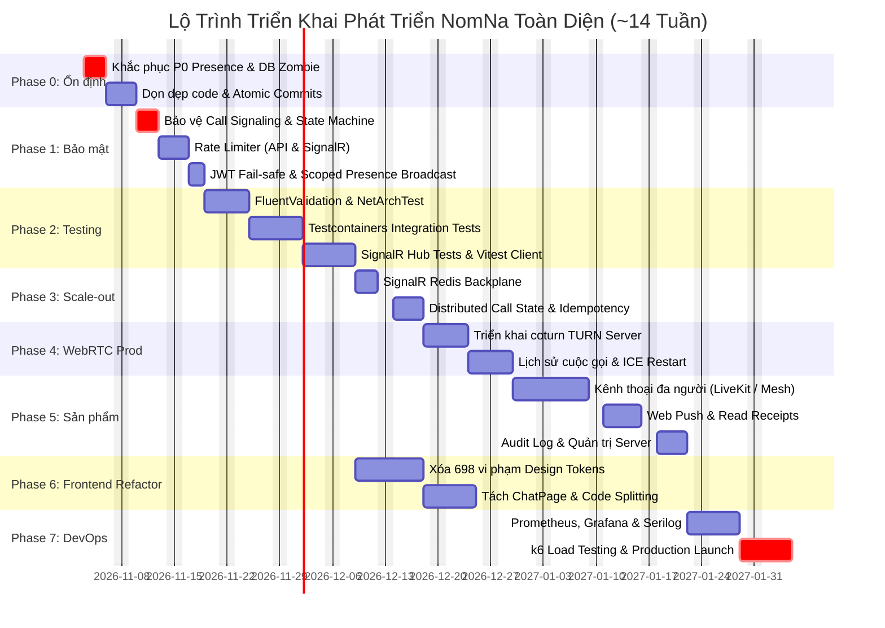

# NomNa — Kế Hoạch Cải Tiến & Lộ Trình Phát Triển A → Z (Đã Kiểm Chứng Thực Tế)

> **Trạng thái kiểm chứng:** 100% đối chiếu trực tiếp trên mã nguồn thực tế tại nhánh `feat/webrtc-1v1-call` (kết hợp `feat/fe-modernize`, `main`).  
> **Cam kết:** Bỏ qua toàn bộ những tính năng đã có sẵn trong codebase; chỉ tập trung vào các lỗi thực tế, lỗ hổng bảo mật, điểm nghẽn kiến trúc và tính năng còn thiếu thực sự.

---

## MỤC LỤC
1. [Báo Cáo Kiểm Chứng Mã Nguồn (Reality Check)](#1-báo-cáo-kiểm-chứng-mã-nguồn-reality-check)
2. [Phân Tích Chi Tiết Các Điểm Cần Cải Tiến (P0 → P4)](#2-phân-tích-chi-tiết-các-điểm-cần-cải-tiến-p0--p4)
3. [Lộ Trình Phát Triển Từ A → Z (Phases 0 → 7)](#3-lộ-trình-phát-triển-từ-a--z-phases-0--7)
4. [Sơ Đồ Timeline & Phụ Thuộc (Mermaid Gantt)](#4-sơ-đồ-timeline--phụ-thuộc-mermaid-gantt)
5. [Quy Trình Kỹ Sư & Kỷ Luật Git (Senior Discipline)](#5-quy-trình-kỹ-sư--kỷ-luật-git-senior-discipline)
6. [Các Quyết Định Kiến Trúc Cần Chốt](#6-các-quyết-định-kiến-trúc-cần-chốt)

---

## 1. BÁO CÁO KIỂM CHỨNG MÃ NGUỒN (REALITY CHECK)

### 1.1. Các Tính Năng ĐÃ CÓ (Bỏ qua, KHÔNG đưa vào roadmap phát triển mới)
Qua kiểm tra trực tiếp toàn bộ code C# (.NET 9) và React 19/TS, các tính năng sau **đã hoàn thiện ở cả hai phía Backend & Frontend**:

| Tính Năng | Hiện Trạng Codebase (Đã có sẵn) | File Bằng Chứng |
|---|---|---|
| **Tìm kiếm tin nhắn (Search)** | Backend có `SearchMessagesQueryHandler` kiểm tra quyền kênh, lọc keyword/sender/date. Frontend có `SearchSidebar.tsx` với highlight từ khóa và jump to message. | [SearchMessagesQueryHandler.cs](file:///home/vanmuzic/Projects/NomNaReal/src/NomNa.Application/Features/Messages/Queries/SearchMessages/SearchMessagesQueryHandler.cs), [SearchSidebar.tsx](file:///home/vanmuzic/Projects/NomNaReal/client/src/components/chat/SearchSidebar.tsx) |
| **Ghim tin nhắn (Pin Messages)** | Có `PinMessageCommand`, `UnpinMessageCommand`, SignalR event `onMessagePinned`. Frontend có `StickyPinBar.tsx`, `PinnedMessagesSidebar.tsx`. | [PinMessageCommandHandler.cs](file:///home/vanmuzic/Projects/NomNaReal/src/NomNa.Application/Features/Messages/Commands/PinMessage/PinMessageCommandHandler.cs), [StickyPinBar.tsx](file:///home/vanmuzic/Projects/NomNaReal/client/src/components/chat/StickyPinBar.tsx) |
| **Link Server Invite** | Tạo mã mời, tham gia qua link `/join/:inviteCode`, `GetServerByInviteCodeQuery`, modal `InviteMemberModal.tsx` & `JoinPage.tsx`. | [GetServerByInviteCodeQuery.cs](file:///home/vanmuzic/Projects/NomNaReal/src/NomNa.Application/Features/Servers/Queries/GetServerByInviteCode/GetServerByInviteCodeQuery.cs), [JoinPage.tsx](file:///home/vanmuzic/Projects/NomNaReal/client/src/pages/JoinPage.tsx) |
| **Phân quyền & Vai trò (RBAC)** | Bitmask Permissions, `IPermissionService`, `AuthorizationBehavior`, modal quản lý vai trò `RoleManagementModal.tsx`, `ServerRolesTab.tsx`, `ServerMembersTab.tsx`. | [IPermissionService.cs](file:///home/vanmuzic/Projects/NomNaReal/src/NomNa.Application/Common/Interfaces/IPermissionService.cs), [RoleManagementModal.tsx](file:///home/vanmuzic/Projects/NomNaReal/client/src/components/server/RoleManagementModal.tsx) |
| **Link Preview (Rich Embed)** | Tự động cào OpenGraph preview, chống SSRF (`LinkPreview.ForbiddenHost`), cache TanStack Query, `LinkPreviewCard.tsx`, `InputLinkPreviewStrip.tsx`. | [GetLinkPreviewQuery.cs](file:///home/vanmuzic/Projects/NomNaReal/src/NomNa.Application/Features/Messages/Queries/GetLinkPreview/GetLinkPreviewQuery.cs), [LinkPreviewCard.tsx](file:///home/vanmuzic/Projects/NomNaReal/client/src/components/chat/LinkPreviewCard.tsx) |
| **Lưu trữ file S3 / Local** | `S3FileStorageService.cs` hỗ trợ AWS S3/MinIO/Cloudflare R2 với cơ chế tự động fallback về ổ cứng cục bộ (`FileStorageService.cs`). | [S3FileStorageService.cs](file:///home/vanmuzic/Projects/NomNaReal/src/NomNa.Infrastructure/Services/S3FileStorageService.cs), [FilesController.cs](file:///home/vanmuzic/Projects/NomNaReal/src/NomNa.WebAPI/Controllers/FilesController.cs) |
| **In-App Notifications** | Bắn thông báo realtime qua SignalR (`SignalRNotificationDispatcher`), lưu DB, giao diện popover `NotificationPopover.tsx`, sidebar `NotificationsSidebar.tsx`. | [SignalRNotificationDispatcher.cs](file:///home/vanmuzic/Projects/NomNaReal/src/NomNa.WebAPI/Services/SignalRNotificationDispatcher.cs), [NotificationPopover.tsx](file:///home/vanmuzic/Projects/NomNaReal/client/src/components/notifications/NotificationPopover.tsx) |
| **WebRTC 1v1 Calling** | Gọi thoại / video 1-1, chia sẻ màn hình, lọc khử ồn/chống hú, chuông gọi `callSound.ts`, modal cuộc gọi đến, overlay toàn màn hình. | [webrtc.ts](file:///home/vanmuzic/Projects/NomNaReal/client/src/services/webrtc.ts), [ChatHub.CallSignaling.cs](file:///home/vanmuzic/Projects/NomNaReal/src/NomNa.WebAPI/Hubs/ChatHub.CallSignaling.cs), [CallOverlay.tsx](file:///home/vanmuzic/Projects/NomNaReal/client/src/components/call/CallOverlay.tsx) |

---

## 2. PHÂN TÍCH CHI TIẾT CÁC ĐIỂM CẦN CẢI TIẾN (P0 → P4)

Dưới đây là các điểm thiếu sót, lỗi sai kỹ thuật hoặc rủi ro vận hành được phát hiện trực tiếp trong code:

```
┌────────────────────────────────────────────────────────────────────────┐
│ MỨC ĐỘ ƯU TIÊN VÀ PHÂN LOẠI                                            │
│ 🔴 P0: Lỗi dữ liệu & Stale Presence (Cần sửa ngay)                    │
│ 🟠 P1: Lỗ hổng Bảo mật & Lạm dụng Tài nguyên (Security / Abuse)         │
│ 🟡 P2: Độ tin cậy Realtime, Mở rộng Phân tán & Testing                │
│ 🟢 P3: WebRTC Production (TURN, Lịch sử gọi) & Voice Channel Thật      │
│ 🔵 P4: Kiến trúc Frontend, Chuẩn hóa Design System & Bundle           │
└────────────────────────────────────────────────────────────────────────┘
```

### 🔴 Mức P0 — Lỗi Dữ Liệu & Stale State (Bắt buộc sửa đầu tiên)

#### P0.1. Lỗi "Zombie Online" trong Cơ Sở Dữ Liệu
- **Nguyên nhân:** Trong [LoginCommandHandler.cs:54](file:///home/vanmuzic/Projects/NomNaReal/src/NomNa.Application/Features/Auth/Commands/Login/LoginCommandHandler.cs#L54) và [GoogleLoginCommandHandler.cs:90](file:///home/vanmuzic/Projects/NomNaReal/src/NomNa.Application/Features/Auth/Commands/GoogleLogin/GoogleLoginCommandHandler.cs#L90), hệ thống gọi lệnh `user.UpdateStatus(UserStatus.Online);` để cập nhật cột `Status` trong DB. Tuy nhiên, trong toàn bộ codebase, **không có bất kỳ dòng code nào gọi `UpdateStatus(UserStatus.Offline)`** (do `ChatHub` đã ngắt việc ghi DB khi ngắt kết nối để tránh thắt nút cổ chai DB).
- **Hậu quả:** Trong [GetServerMembersQueryHandler.cs:55](file:///home/vanmuzic/Projects/NomNaReal/src/NomNa.Application/Features/Servers/Queries/GetServerMembers/GetServerMembersQueryHandler.cs#L55) và [GetDirectMessagesQueryHandler.cs:70](file:///home/vanmuzic/Projects/NomNaReal/src/NomNa.Application/Features/Channels/Queries/GetDirectMessages/GetDirectMessagesQueryHandler.cs#L70):
  ```csharp
  onlineUsers.Contains(m.UserId) ? "online" : m.User.Status.ToString().ToLower()
  ```
  Nếu user không có trong Redis, query sẽ fallback về `m.User.Status`. Vì cột này luôn lưu `Online` từ lần đăng nhập trước, **người dùng đã tắt máy cả tuần vẫn hiển thị Online trong danh sách thành viên!**
- **Giải pháp:** 
  1. Loại bỏ hoàn toàn việc set `User.Status = Online` khi Login / Register.
  2. Tách bạch: Cột `User.Status` trong DB chuyển thành `UserStatusPreference` (sở thích hiển thị của người dùng: Invisible, DoNotDisturb) + `LastSeenAt (DateTime?)`.
  3. Trạng thái kết nối vật lý (Online/Offline) **chỉ được phép lấy từ `IUserPresenceTracker`**.

#### P0.2. Redis Presence Không Tự Lành (Stale Key Leak)
- **Nguyên nhân:** Trong [RedisUserPresenceTracker.cs:18](file:///home/vanmuzic/Projects/NomNaReal/src/NomNa.Infrastructure/Services/RedisUserPresenceTracker.cs#L18), Set toàn cục `nomna:presence:online_users` không có TTL (`TTL = -1`). Khi server bị restart đột ngột, crash hoặc mất mạng giữa chừng, `ChatHub.OnDisconnectedAsync()` không bao giờ được gọi.
- **Bằng chứng:** Kiểm tra thực tế trong container `nomna_redis` khi server WebAPI đang tắt, user `e94fae4e-...` vẫn tồn tại vĩnh viễn trong Redis.
- **Giải pháp:** 
  - Áp dụng mô hình **Connection Lease với Heartbeat**: Mỗi connection đăng ký key tạm `nomna:presence:conn:{connectionId}` có TTL ngắn (60–90 giây).
  - Client SignalR hoặc background heartbeat ping định kỳ 30 giây để gia hạn lease (`EXPIRE`).
  - Khi khởi động server, chạy background worker quét và dọn sạch các connection mồ côi.

#### P0.3. Nguy cơ Eviction Mất Dữ Liệu Presence Trên Production
- **Nguyên nhân:** Trong [docker-compose.prod.yml:123](file:///home/vanmuzic/Projects/NomNaReal/docker-compose.prod.yml#L123), cấu hình Redis là:
  ```yaml
  command: redis-server --maxmemory 128mb --maxmemory-policy allkeys-lru
  ```
  Chính sách `allkeys-lru` cho phép Redis tự tiện xoá bất kỳ key nào khi RAM đạt 128MB.
- **Hậu quả:** Khi cache link preview hoặc session phình to, Redis sẽ xóa mất Set `nomna:presence:online_users`, khiến toàn bộ người dùng đang online bị văng thành offline.
- **Giải pháp:** Đổi sang `--maxmemory-policy volatile-lru` hoặc `noeviction`, và phân vùng database Redis (DB 0 cho Cache có TTL, DB 1 cho Presence state).

---

### 🟠 Mức P1 — Lỗ Hổng Bảo Mật & Lạm Dụng Tài Nguyên

#### P1.1. Lỗ Hổng Chiếm Đoạt & Spam Cuộc Gọi (Call Signaling Authorization)
- **Nguyên nhân:** Tại [ChatHub.CallSignaling.cs](file:///home/vanmuzic/Projects/NomNaReal/src/NomNa.WebAPI/Hubs/ChatHub.CallSignaling.cs):
  - `StartCall`: Ghi đè `_activeCalls[targetUserId] = callerId;` mà **không kiểm tra đối phương có đang bận cuộc gọi khác hay không**. Hằng số `SignalRConstants.Events.UserBusy` đã định nghĩa sẵn nhưng chưa được sử dụng! Bất kỳ ai cũng có thể làm gián đoạn cuộc gọi của người khác.
  - `StartCall`: Không kiểm tra xem `callerId` có bị `targetUserId` chặn (Blocked) không, hoặc có phải bạn bè / chung server không.
  - `AcceptCall`: Không xác minh xem `callerId` có thực sự đang gọi `responderId` không.
  - `EndCall`: Gửi `CallEnded` tới bất kỳ `peerUserId` nào mà không cần xác minh 2 người có đang trong phiên gọi với nhau.
  - `SendIceCandidate`: Có thể gửi payload giả mạo tới bất kỳ user nào trong hệ thống.
- **Giải pháp:** Xây dựng state machine cuộc gọi chặt chẽ (`Initiated` → `Ringing` → `Connected` → `Ended`), kiểm tra quan hệ bạn bè/block trước khi rung chuông, kích hoạt sự kiện `UserBusy` nếu callee đang trong cuộc gọi.

#### P1.2. Hoàn Toàn Thiếu Rate Limiting (Chống Brute-force & Spam)
- **Hiện trạng:** Trong [Program.cs](file:///home/vanmuzic/Projects/NomNaReal/src/NomNa.WebAPI/Program.cs) và Nginx [default.conf](file:///home/vanmuzic/Projects/NomNaReal/nginx/conf.d/default.conf), không có bất kỳ cấu hình Rate Limiter nào (vi phạm trực tiếp quy tắc `.agents/AGENTS.md`).
- **Nguy cơ:**
  - Kẻ tấn công có thể brute-force endpoint `/api/auth/login`, spam gửi OTP `/api/auth/forgot-password`.
  - Spam gọi liên tục hàm `SendMessage` hoặc `StartCall` làm cạn kiệt tài nguyên server và treo client người nhận.
- **Giải pháp:**
  - Cấu hình ASP.NET Core `AddRateLimiter`:
    - Auth endpoints: IP/Account-based Fixed Window (tối đa 5 requests/phút).
    - Message sending: Token Bucket (tối đa 5 tin/giây, burst 10).
    - Call signaling: Tối đa 2 cuộc gọi khởi tạo/phút.
  - Cấu hình Nginx `limit_req_zone` ở tầng biên cho port 80/443.

#### P1.3. Khóa Bí Mật JWT Dự Phòng Cố Định (Hardcoded JWT Fallback)
- **Hiện trạng:** Tại [NomNa.WebAPI/DependencyInjection.cs:62](file:///home/vanmuzic/Projects/NomNaReal/src/NomNa.WebAPI/DependencyInjection.cs#L62):
  ```csharp
  var jwtSecret = configuration["Jwt:Secret"] ?? "NomNaSuperSecretKeyForDevelopmentAndDemoPurposes2026!MustBeLongEnough";
  ```
- **Nguy cơ:** Nếu triển khai môi trường Production mà quên khai báo biến môi trường `Jwt__Secret`, hệ thống âm thầm dùng khóa mặc định. Bất kỳ ai đọc repo GitHub đều có thể tự ký token Admin để chiếm quyền toàn bộ database.
- **Giải pháp:** Fail-fast ngay khi khởi động: nếu `environment.IsProduction()` và `Jwt:Secret` rỗng hoặc bằng khóa mặc định, ném ngay `InvalidOperationException` dừng chạy ứng dụng.

#### P1.4. Phát Tán Trạng Thái Người Dùng O(N) Toàn Hệ Thống (Privacy & Broadcast Leak)
- **Hiện trạng:** Tại [ChatHub.cs:73,116](file:///home/vanmuzic/Projects/NomNaReal/src/NomNa.WebAPI/Hubs/ChatHub.cs#L73):
  ```csharp
  await Clients.All.SendAsync(SignalRConstants.Events.UserStatusChanged, ...);
  ```
  Mỗi khi 1 người kết nối hoặc ngắt mạng, server phát sóng tới **tất cả người dùng trên toàn hệ thống** (vi phạm `.agents/skills/signalr-patterns/SKILL.md`: *"ALWAYS use Clients.Group() — NEVER use Clients.All()"*).
- **Hậu quả:** Khi hệ thống đạt 5,000 kết nối, mỗi lần có người online sẽ tạo ra 5,000 gói tin WebSocket. Ngoài ra, việc này làm lộ quyền riêng tư (user lạ biết user khác online dù không kết bạn hay chung server).
- **Giải pháp:** Chỉ gửi `UserStatusChanged` tới các group mà user đó trực thuộc: các server mà user tham gia (`server_{serverId}`) và các bạn bè / DM peer đang active.

---

### 🟡 Mức P2 — Kiến Trúc Realtime, Mở Rộng Phân Tán & Testing

#### P2.1. SignalR Chưa Hỗ Trợ Scale-Out Đa Server (Thiếu Redis Backplane)
- **Hiện trạng:** Trong [DependencyInjection.cs:25](file:///home/vanmuzic/Projects/NomNaReal/src/NomNa.WebAPI/DependencyInjection.cs#L25), chỉ gọi `services.AddSignalR();` thuần in-memory.
- **Hậu quả:** Khi chạy 2 hoặc nhiều instance NomNa phía sau Nginx:
  - User A ở Server 1 nhắn tin vào kênh thì User B ở Server 2 không nhận được.
  - Cuộc gọi WebRTC không thể bắt tay (signaling) nếu 2 người kết nối vào 2 container khác nhau.
- **Giải pháp:** Tích hợp `Microsoft.AspNetCore.SignalR.StackExchangeRedis`, cấu hình `builder.Services.AddSignalR().AddStackExchangeRedis(...)`.

#### P2.2. State Cuộc Gọi Nằm Trong Bộ Nhớ Cục Bộ (In-Memory `_activeCalls`)
- **Hiện trạng:** `_activeCalls` trong [ChatHub.cs:32](file:///home/vanmuzic/Projects/NomNaReal/src/NomNa.WebAPI/Hubs/ChatHub.cs#L32) là một `ConcurrentDictionary<Guid, Guid>` tĩnh trên RAM của một tiến trình duy nhất.
- **Giải pháp:** Đưa call session vào Redis hash `nomna:call:sessions` với TTL tự động giải phóng khi cuộc gọi kết thúc.

#### P2.3. Lỗ Hổng Kiểm Thử Tự Động (Test Coverage Mỏng)
- **Hiện trạng:** Toàn bộ project chỉ có 3 file test (47 unit tests cho Domain bitmask permission và DTO validation).
  - Chưa có Integration Test cho API và DbContext (chưa áp dụng Testcontainers theo `plans/testing-roadmap-and-execution-plan.md`).
  - Chưa có SignalR Hub Integration Test để giả lập 2 client gửi nhận tin nhắn / cuộc gọi song song.
  - Frontend client hoàn toàn chưa có test runner (chưa có Vitest, không có `npm test`).
- **Giải pháp:** Hiện thực hóa các hạng mục đã vạch ra trong [testing-roadmap-and-execution-plan.md](file:///home/vanmuzic/Projects/NomNaReal/plans/testing-roadmap-and-execution-plan.md).

#### P2.4. Health Check Chưa Giám Sát Redis
- **Hiện trạng:** Endpoint `/health/ready` trong [Program.cs:46](file:///home/vanmuzic/Projects/NomNaReal/src/NomNa.WebAPI/Program.cs#L46) chỉ kiểm tra `db.Database.CanConnectAsync()`.
- **Giải pháp:** Bổ sung `_redis.IsConnected` và `Ping()` vào `/health/ready` để bộ cân bằng tải (Load Balancer) phát hiện khi Redis gặp sự cố.

---

### 🟢 Mức P3 — WebRTC Production-Ready & Tính Năng Sản Phẩm

#### P3.1. Kênh Thoại Nhóm (Voice Channels) Hiện Chỉ Là UI Ảo (Mockup)
- **Hiện trạng:** Trong [useVoiceStore.ts:68-77](file:///home/vanmuzic/Projects/NomNaReal/client/src/stores/useVoiceStore.ts#L68), khi người dùng bấm vào kênh thoại, hệ thống tự nạp một bot ảo `simulated-nomna-bot`. Hoàn toàn chưa có truyền nhận âm thanh thật qua mạng cho Server Voice Channels!
- **Phân tích kỹ thuật:**
  - Mesh WebRTC (P2P trực tiếp) chỉ chịu được 3–4 người (băng thông tải lên $N \times (N-1)$ bùng nổ theo cấp số nhân).
  - Để có phòng thoại nhiều người như Discord (10–50 người/kênh), bắt buộc phải có một **SFU (Selective Forwarding Unit)** như **LiveKit** hoặc **mediasoup**.
- **Giải pháp:**
  - *Giai đoạn 1 (Ngắn hạn):* Hỗ trợ Mesh Group Voice giới hạn tối đa 4 người/phòng.
  - *Giai đoạn 2 (Chuẩn Discord):* Tích hợp LiveKit Server (Open-source WebRTC SFU) làm media server độc lập, backend NomNa cấp Access Token phòng thoại.

#### P3.2. Thiếu TURN Relay Server Cho WebRTC Trong Môi Trường Doanh Nghiệp / 4G
- **Hiện trạng:** Client hiện chỉ cấu hình STUN công cộng của Google ([webrtc.ts:77](file:///home/vanmuzic/Projects/NomNaReal/client/src/services/webrtc.ts#L77)).
- **Hậu quả:** Khi 2 thiết bị đều ở sau mạng Symmetric NAT (phổ biến trên mạng 4G/5G di động hoặc wifi công ty), kết nối P2P trực tiếp sẽ thất bại 100% nếu không có TURN Server làm trạm chuyển tiếp (relay).
- **Giải pháp:** Thêm service `coturn` vào `docker-compose.prod.yml`, tạo endpoint cấp TURN credentials động (Time-limited ephemeral credentials).

#### P3.3. Lịch Sử Cuộc Gọi & Nhật Ký Cuộc Gọi Nhỡ (Call Persistence)
- **Hiện trạng:** Hiện tại khi cuộc gọi kết thúc hoặc bị nhỡ, không có bản ghi nào được lưu vào DB. Trong kênh chat không hiển thị tin nhắn hệ thống dạng: *"Cuộc gọi nhỡ lúc 14:20"* hoặc *"Cuộc gọi thoại kết thúc — 15 phút 22 giây"*.
- **Giải pháp:** Bổ sung Entity `CallHistory` (hoặc loại tin nhắn `MessageType.CallLog`), tự động ghi nhận vào cuộc trò chuyện khi cuộc gọi kết thúc.

#### P3.4. Web Push Notification (Thông Báo Khi Tắt Ứng Dụng)
- **Hiện trạng:** Đã có hệ thống notification trong app, nhưng khi người dùng tắt tab trình duyệt thì không nhận được thông báo gì.
- **Giải pháp:** Đăng ký Web Push API (Service Worker + VAPID keys) để đẩy thông báo về hệ điều hành máy tính/điện thoại khi có tin nhắn DM hoặc cuộc gọi đến.

#### P3.5. Trạng Thái Tin Nhắn Đã Xem (Per-Message Read Receipts)
- **Hiện trạng:** Mới chỉ có `LastReadAt` ở cấp độ kênh (`ChannelMember`). Chưa có hiển thị chi tiết "Đã xem" (avatar nhỏ hoặc dấu tích xanh) cho từng tin nhắn cụ thể trong DM.

#### P3.6. Server Audit Log & Công Cụ Kiểm Duyệt (Moderation)
- **Hiện trạng:** Đã có quyền Kick thành viên và phân vai trò, nhưng chưa có bảng `AuditLogs` ghi lại lịch sử quản trị (ai đổi quyền gì, ai xóa tin nhắn của ai, ai kick ai) và chưa có tính năng Timeout/Mute/Ban tài khoản vĩnh viễn khỏi server.

---

### 🔵 Mức P4 — Kiến Trúc Frontend, Chuẩn Hóa Design System & Hiệu Năng

#### P4.1. 698 Lỗi Vi Phạm Design Token (Mã Màu Cứng & Utilities)
- **Hiện trạng:** Khi chạy script [scripts/audit-colors.sh](file:///home/vanmuzic/Projects/NomNaReal/scripts/audit-colors.sh), kết quả trả về **698 lỗi vi phạm** (dùng trực tiếp mã màu cứng Tailwind như `bg-emerald-500`, `bg-rose-500`, `bg-amber-500`, `text-white`, `rounded-[8px]`, `rounded-[4px]`).
- **Quy tắc dự án:** `.agents/skills/design-system/SKILL.md` quy định đây là **LUẬT BẮT BUỘC** (Design System is law): toàn bộ UI phải dùng semantic CSS variables (`bg-chat`, `bg-surface`, `text-primary`, `text-danger`, `bg-accent-primary`...).
- **Giải pháp:** Refactor triệt để các component UI sang semantic tokens để giao diện tương thích hoàn hảo 100% với hệ thống multi-theme (Dark, Light, Midnight, Discord Theme).

#### P4.2. Tách Nhỏ God Component `ChatPage.tsx` (1690 Dòng)
- **Hiện trạng:** [ChatPage.tsx](file:///home/vanmuzic/Projects/NomNaReal/client/src/pages/ChatPage.tsx) dài tới 1,690 dòng, kiêm nhiệm quản lý 5 Zustand store, khởi tạo SignalR, điều hướng router, quản lý panel resizers, modal context...
- **Giải pháp:** Tách nhỏ thành:
  - Custom Hook: `useChatLayoutController.ts`, `useServerNavigation.ts`.
  - Component con: `ChatMainContent.tsx`, `ChatNavigationSidebar.tsx`.

#### P4.3. Tối Ưu Hóa Kích Thước Bundle (1.33 MB Single Chunk)
- **Hiện trạng:** Trong [App.tsx](file:///home/vanmuzic/Projects/NomNaReal/client/src/App.tsx), các trang `AuthPage`, `ChatPage`, `JoinPage` được import đồng bộ tại trang gốc; `vite.config.ts` chưa cấu hình `manualChunks`.
- **Giải pháp:** Áp dụng `React.lazy()` và `Suspense` cho các route; cấu hình split vendor chunks (`react-vendor`, `icons-vendor`, `webrtc-vendor`).

#### P4.4. Bổ Sung ErrorBoundary Toàn Diện
- **Hiện trạng:** Ứng dụng chưa có React `ErrorBoundary`. Nếu một tin nhắn markdown lỗi hoặc WebRTC throw exception chưa bắt, toàn bộ màn hình sẽ bị trắng xóa (White Screen of Death).

---

## 3. LỘ TRÌNH PHÁT TRIỂN TỪ A → Z (PHASES 0 → 7)

```
┌────────────────────────────────────────────────────────────────────────┐
│ TỔNG QUAN CÁC GIAI ĐOẠN                                                │
│ Phase 0: Ổn định nền móng & Khắc phục P0 (Ưu tiên số 1 - 2-3 ngày)     │
│ Phase 1: Thắt chặt An ninh & Chống lạm dụng (Security First - 1 tuần)  │
│ Phase 2: Khung Kiểm thử Toàn diện & CI Gate (Testing Net - 1-2 tuần)   │
│ Phase 3: Scale-out Realtime & Độ tin cậy Phân tán (Reliability - 1 tuần│
│ Phase 4: WebRTC Production (TURN, Call Logs, Busy State - 1-2 tuần)    │
│ Phase 5: Voice Channel Đa Người Dùng & Tính Năng Sản Phẩm (2-3 tuần)   │
│ Phase 6: Hiện đại hóa Frontend, Chuẩn hóa Design System (Song song)    │
│ Phase 7: DevOps, Giám sát Prometheus/Grafana & Production Readiness   │
└────────────────────────────────────────────────────────────────────────┘
```

### Phase 0: Ổn Định Nền Móng & Khắc Phục Lỗi P0 (2–3 Ngày)
> **Mục tiêu:** Xử lý dứt điểm lỗi hiển thị trạng thái sai lệch, đóng gói các thay đổi đang dở và hợp nhất code an toàn.

- [ ] **Task 0.1:** Sửa lỗi P0.1 Zombie Online:
  - Loại bỏ các dòng `user.UpdateStatus(UserStatus.Online)` trong `LoginCommandHandler` và `GoogleLoginCommandHandler`.
  - Điều chỉnh `GetServerMembersQueryHandler` và `GetDirectMessagesQueryHandler` chỉ xác định online dựa trên `IUserPresenceTracker`.
- [ ] **Task 0.2:** Sửa lỗi P0.2 Redis Presence Leak:
  - Triển khai cơ chế Connection Key có TTL ngắn (60s) + Heartbeat ping định kỳ 30s từ client.
  - Thêm logic dọn dẹp key mồ côi khi WebAPI khởi động.
- [ ] **Task 0.3:** Sửa lỗi P0.3 Redis Eviction:
  - Đổi `--maxmemory-policy` sang `volatile-lru` trong `docker-compose.prod.yml`.
- [ ] **Task 0.4:** Thay thế các lệnh `Console.WriteLine` bằng `ILogger` chuẩn trong `ApplicationDbContextInitializer.cs` và `SignalRNotificationDispatcher.cs`.
- [ ] **Task 0.5:** Commit nguyên tử (atomic commits) toàn bộ phần việc đang dở tại `feat/webrtc-1v1-call` (Presence Tracker, comment tiếng Việt WebRTC, âm thanh chuông) sau khi vượt qua Triple Gate.
- [ ] **Task 0.6:** Đối soát và hòa giải khác biệt với nhánh `feat/fe-modernize`, chuẩn bị merge vào `main`.
- **Definition of Done (DoD):** Bật/tắt server, mở/đóng nhiều tab trình duyệt, danh sách thành viên cập nhật tức thời 100% chuẩn xác, không còn bất kỳ user nào bị "online ma" trong Redis lẫn UI.

---

### Phase 1: Thắt Chặt An Ninh & Chống Lạm Dụng (1 Tuần)
> **Mục tiêu:** Bảo vệ hệ thống trước tấn công brute-force, chiếm quyền cuộc gọi, lộ thông tin cá nhân và spam tài nguyên.

- [ ] **Task 1.1:** Bảo vệ WebRTC Call Signaling:
  - Thêm kiểm tra trạng thái bận: Nếu `targetUserId` đang trong cuộc gọi khác, trả về ngay sự kiện `UserBusy`.
  - Thêm kiểm tra quan hệ: Chặn gọi nếu caller nằm trong danh sách bị block.
  - Validate phiên gọi trong `AcceptCall`, `EndCall`, `SendIceCandidate`.
- [ ] **Task 1.2:** Triển khai Rate Limiting Đa Tầng:
  - Cấu hình ASP.NET Core `Microsoft.AspNetCore.RateLimiting` trên WebAPI:
    - Auth limiter: 5 req/phút cho login/register.
    - SignalR message limiter: 5 msg/giây.
    - Call signaling limiter: 2 cuộc gọi/phút.
  - Cấu hình Nginx `limit_req_zone` bảo vệ cổng HTTP.
- [ ] **Task 1.3:** Bảo mật cấu hình JWT:
  - Cấu hình fail-fast khi khởi động nếu thiếu `Jwt:Secret` trên môi trường Production.
  - Bỏ toàn bộ secret và connection string mặc định khỏi file `appsettings.json` (chỉ dùng User Secrets / Environment Variables).
- [ ] **Task 1.4:** Định tuyến Presence Scoped thay vì `Clients.All`:
  - Thay thế `Clients.All.SendAsync(UserStatusChanged)` bằng việc gửi đến các group: `server_{serverId}` của các server mà user tham gia và các DM peers đang hoạt động.
- [ ] **Task 1.5:** Kích hoạt HTTPS và cấu hình Security Headers:
  - Cấu hình Nginx reverse proxy hoàn thiện SSL Let's Encrypt qua Certbot.
  - Thêm các header bảo mật: `X-Content-Type-Options: nosniff`, `X-Frame-Options: DENY`, `Content-Security-Policy`.
- **Definition of Done (DoD):** Chạy kịch bản spam 10 request login liên tục nhận về HTTP 429; cố tình gọi phá rối khi đối phương đang bận nhận được thông báo User Busy; không còn bất kỳ event SignalR nào broadcast toàn cầu qua `Clients.All`.

---

### Phase 2: Khung Kiểm Thử Toàn Diện & CI Gate (1–2 Tuần)
> **Mục tiêu:** Xây dựng lưới an toàn tự động, ngăn chặn 100% lỗi hồi quy (regression) theo kế hoạch `testing-roadmap-and-execution-plan.md`.

- [ ] **Task 2.1:** Unit & Validation Test Suite:
  - Viết 100% Unit test cho FluentValidation của các Command/Query quan trọng (`SendMessage`, `CreateServer`, `StartCall`...).
  - Thiết lập `NetArchTest` kiểm tra kiến trúc Clean Architecture (Domain không phụ thuộc bên ngoài, Controllers không inject DbContext trực tiếp).
- [ ] **Task 2.2:** Backend Integration Testing với Testcontainers:
  - Xây dựng `CustomWebApplicationFactory` với `Testcontainers.PostgreSql` và `Testcontainers.Redis`.
  - Kiểm thử tích hợp tự động chạy migration trên Postgres thật, dọn dẹp dữ liệu bằng `Respawn` giữa các test case.
- [ ] **Task 2.3:** SignalR Realtime Hub Integration Tests:
  - Dùng `HubConnection` giả lập 2 client kết nối đồng thời: Client A gửi tin nhắn -> Client B nhận `ReceiveMessage`; Client A gọi điện -> Client B nhận `CallIncoming`.
- [ ] **Task 2.4:** Frontend Testing Foundation:
  - Cài đặt Vitest + React Testing Library trong thư mục `client/`.
  - Thêm script `npm test` vào `package.json`.
  - Viết test cho các hook trọng yếu: `usePermissions`, `useCallStore`, `useChatStore`.
- [ ] **Task 2.5:** Tích hợp kiểm thử vào GitHub Actions CI:
  - Bổ sung bước chạy test vào `.github/workflows/ci.yml`. Chặn merge nếu bất kỳ test nào thất bại.
- **Definition of Done (DoD):** `dotnet test` và `npm test` vượt qua 100% trong vòng < 60 giây; CI tự động từ chối mọi Pull Request gây lỗi logic nghiệp vụ.

---

### Phase 3: Scale-Out Realtime & Độ Tin Cậy Phân Tán (1 Tuần)
> **Mục tiêu:** Đảm bảo hệ thống có thể mở rộng chạy nhiều container song song không làm mất tin nhắn hay cuộc gọi.

- [ ] **Task 3.1:** Tích hợp SignalR Redis Backplane:
  - Thêm package `Microsoft.AspNetCore.SignalR.StackExchangeRedis`.
  - Cấu hình Redis Backplane đồng bộ message giữa các container.
- [ ] **Task 3.2:** Phân tán State Cuộc Gọi và Presence:
  - Chuyển `_activeCalls` từ `ConcurrentDictionary` sang Redis hash với cơ chế lease tự động hết hạn.
- [ ] **Task 3.3:** Đảm bảo Tính Bất Biến Tin Nhắn (Message Idempotency):
  - Frontend sinh `clientMessageId` (UUID) trước khi gửi.
  - Backend kiểm tra trùng lặp để tránh gửi 2 lần khi mạng client bị chập chờn reconnect.
- [ ] **Task 3.4:** Hoàn thiện Health Check:
  - Cập nhật `/health/ready` kiểm tra trạng thái sống của cả PostgreSQL lẫn Redis connection.
- **Definition of Done (DoD):** Khởi chạy 2 instance NomNa phía sau Nginx qua Docker Compose, Client A kết nối Instance 1 và Client B kết nối Instance 2 vẫn có thể chat và gọi video cho nhau thông suốt.

---

### Phase 4: WebRTC Production-Ready (1–2 Tuần)
> **Mục tiêu:** Nâng cấp tính năng gọi thoại/video 1-1 đạt chất lượng thương mại, kết nối xuyên mọi loại tường lửa và lưu trữ lịch sử cuộc gọi.

- [ ] **Task 4.1:** Triển khai TURN Server (coturn):
  - Thêm container `coturn` vào `docker-compose.prod.yml`.
  - Viết endpoint `/api/webrtc/ice-servers` sinh credential tạm thời (HMAC ephemeral credentials) cho client.
- [ ] **Task 4.2:** ICE Restart & Xử Lý Chuyển Đổi Mạng:
  - Bổ sung cơ chế tự động ICE Restart trong `webrtc.ts` khi người dùng chuyển từ Wifi sang 4G/5G hoặc ngược lại mà không bị đứt cuộc gọi.
- [ ] **Task 4.3:** Thực Thể & Lịch Sử Cuộc Gọi (Call History):
  - Tạo bảng `CallRecords` trong Domain/Infrastructure.
  - Tự động sinh message hệ thống trong DM channel hiển thị thời lượng cuộc gọi hoặc cảnh báo cuộc gọi nhỡ.
- [ ] **Task 4.4:** Đo Lường Chất Lượng Cuộc Gọi (QoS Metrics):
  - Thu thập định kỳ qua `peerConnection.getStats()` để hiển thị chỉ số Ping (RTT), Packet Loss (%) và cảnh báo mạng yếu trên giao diện.
- **Definition of Done (DoD):** Hai thiết bị dùng 4G của 2 nhà mạng khác nhau (sau Symmetric NAT) kết nối gọi video thành công 100% nhờ TURN relay; lịch sử cuộc gọi lưu lại chính xác trong đoạn chat.

---

### Phase 5: Voice Channel Đa Người Dùng & Tính Năng Sản Phẩm (2–3 Tuần)
> **Mục tiêu:** Biến kênh thoại ảo thành phòng thoại thật chuẩn Discord và hoàn thiện các tính năng giao tiếp cốt lõi.

- [ ] **Task 5.1:** Hiện thực hóa Kênh Thoại Đa Người Dùng (Server Voice Channels):
  - *Phương án A (SFU - Khuyến nghị cho quy mô lớn):* Tích hợp LiveKit Server. NomNa WebAPI đóng vai trò cấp Token phòng. Frontend dùng `@livekit/components-react` nhúng trực tiếp vào `VoiceStage.tsx`.
  - *Phương án B (Mesh - Tạm thời nếu không muốn thêm hạ tầng SFU):* Giới hạn tối đa 4 người/phòng thoại, client tạo kết nối P2P chéo giữa các thành viên.
- [ ] **Task 5.2:** Web Push Notifications (Thông Báo Ngoại Tuyến):
  - Tạo Service Worker xử lý Push API.
  - Backend tích hợp thư viện `WebPush` gửi push notification qua VAPID key khi có tin nhắn DM hoặc cuộc gọi đến mà user đang offline/đóng tab.
- [ ] **Task 5.3:** Trạng Thái Đọc Chi Tiết Từng Tin Nhắn (Read Receipts):
  - Hiển thị avatar nhỏ hoặc dấu tích cho biết đối phương đã xem đến tin nhắn nào trong cuộc trò chuyện 1-1.
- [ ] **Task 5.4:** Nhật Ký Hoạt Động Server (Audit Log) & Công Cụ Quản Trị:
  - Lưu vết các thao tác quản trị: đổi quyền vai trò, kick thành viên, xóa tin nhắn, đổi tên kênh.
  - Bổ sung tính năng Timeout (cấm chat tạm thời) và Ban (cấm vĩnh viễn) thành viên khỏi server.
- **Definition of Done (DoD):** 5 thành viên cùng tham gia vào 1 kênh thoại của server nghe nói rõ ràng, hiển thị vòng sáng xanh khi ai đó đang nói; người dùng nhận được thông báo ngoài desktop khi có người gọi tới.

---

### Phase 6: Hiện Đại Hóa Frontend & Chuẩn Hóa Design System (Thực Hiện Song Song)
> **Mục tiêu:** Xóa bỏ 100% nợ kỹ thuật UI, đảm bảo tuân thủ Design System và tối ưu hóa tải trang.

- [ ] **Task 6.1:** Xử lý triệt để 698 lỗi Design Token:
  - Thay thế toàn bộ mã màu cứng (`bg-emerald-500`, `bg-rose-500`, `text-white`...) bằng semantic tokens (`bg-chat`, `bg-surface`, `text-danger`, `text-success`, `bg-accent-primary`...).
  - Đảm bảo script `bash scripts/audit-colors.sh` chạy đạt kết quả **0 violations**.
- [ ] **Task 6.2:** Tách nhỏ God Component `ChatPage.tsx`:
  - Tách logic state sang custom hooks: `useChatLayout.ts`, `useServerNavigation.ts`.
  - Tách nhỏ layout thành các component độc lập < 300 dòng.
- [ ] **Task 6.3:** Code-Splitting & Tối Ưu Bundle:
  - Cấu hình `React.lazy()` cho `ChatPage`, `AuthPage`, `JoinPage`.
  - Cấu hình `manualChunks` trong `vite.config.ts`, đưa dung lượng chunk chính về < 300 KB.
- [ ] **Task 6.4:** Bổ sung React `ErrorBoundary`:
  - Bao bọc các khu vực quan trọng (MessageList, CallOverlay, ModalRoot) bằng ErrorBoundary chuyên biệt có nút "Thử lại" thay vì để sập cả trang.
- **Definition of Done (DoD):** `bash scripts/audit-colors.sh` trả về 0 lỗi; Lighthouse Performance đạt > 90 điểm; không có lỗi crash trắng trang khi gặp exception.

---

### Phase 7: DevOps, Giám Sát Prometheus/Grafana & Production Readiness (1–2 Tuần)
> **Mục tiêu:** Hoàn thiện hạ tầng giám sát, sao lưu tự động và đưa dự án vào trạng thái vận hành bền bỉ 24/7.

- [ ] **Task 7.1:** Hệ Thống Ghi Log Tập Trung & Quan Sát (Observability):
  - Cấu hình Serilog ghi log có cấu trúc (Structured Logging) dưới định dạng JSON.
  - Tích hợp OpenTelemetry / Prometheus metrics xuất các chỉ số: SignalR Active Connections, HTTP Request Duration, EF Core Query Latency.
- [ ] **Task 7.2:** Dashboard Giám Sát Grafana:
  - Dựng dashboard hiển thị: Số người online theo thời gian thực, lưu lượng mạng WebSockets, số lượng cuộc gọi đang hoạt động, RAM/CPU container.
- [ ] **Task 7.3:** Kiểm Thử Sao Lưu & Phục Hồi Dữ Liệu Tự Động:
  - Kiểm thử định kỳ kịch bản restore database PostgreSQL từ file backup của `scripts/backup-db.sh`.
- [ ] **Task 7.4:** Tải Trọng Đỉnh & Thử Thách Chịu Tải k6 (C10K Load Test):
  - Chạy k6 giả lập 1,000 kết nối WebSocket gửi tin nhắn liên tục để đo P99 Latency (< 150ms).
- **Definition of Done (DoD):** Có dashboard Grafana trực quan theo dõi toàn bộ hệ thống; k6 chạy kịch bản tải cao mà không phát sinh lỗi 5xx hay rò rỉ socket.

---

## 4. SƠ ĐỒ TIMELINE & PHỤ THUỘC (MERMAID GANTT)



---

## 5. QUY TRÌNH KỸ SƯ & KỶ LUẬT GIT (SENIOR DISCIPLINE)

Để đảm bảo dự án phát triển mượt mà, không gặp lỗi xung đột (conflict) hay gãy mã nguồn:

1. **Quy Tắc Nhánh (Branch Isolation):**
   - Không commit trực tiếp vào `main`.
   - Mỗi phase tạo nhánh tính năng chuẩn: `fix/presence-zombie-leak`, `feat/rate-limiting`, `feat/turn-server`.
   - Đối với frontend song song, tận dụng worktree `NomNaReal-fe` tại nhánh `feat/fe-modernize`. Trước khi sửa code chung, đóng băng hợp đồng giao tiếp (Contract Freeze: DTOs & Hub Event Constants).

2. **Cổng Kiểm Duyệt 3 Lớp (Triple Gate) — BẮT BUỘC trước mọi commit:**
   - Cổng 1: `dotnet build NomNa.sln` — 0 lỗi, 0 cảnh báo nghiêm trọng.
   - Cổng 2: `dotnet test NomNa.sln` — 100% test case xanh lá.
   - Cổng 3: `npm run build` (trong thư mục `client/`) — TypeScript không lỗi, Vite bundle thành công.

3. **Kích Thước Micro-slice:**
   - Mỗi lần chỉnh sửa không vượt quá **10 files**. Nếu việc lớn hơn, chia nhỏ thành nhiều bước hoàn chỉnh và commit nguyên tử.
   - Tuyệt đối **KHÔNG tự ý `git push`** lên remote repository khi chưa có yêu cầu từ bạn.

---

## 6. CÁC QUYẾT ĐỊNH KIẾN TRÚC CẦN CHỐT

Để tiến hành thực hiện Phase 0 và Phase 1 một cách chính xác nhất theo ý bạn, hãy cùng chốt 3 quyết định kỹ thuật sau:

1. **Kênh thoại đa người dùng (Phòng họp Voice Channel):**
   - **Lựa chọn A (Khuyến nghị):** Tích hợp container **LiveKit SFU** độc lập. Chịu tải tốt từ 10–50 người/phòng, hỗ trợ chia sẻ màn hình mượt mà như Discord thật.
   - **Lựa chọn B (Tiết kiệm hạ tầng):** Dùng Mesh WebRTC thuần, giới hạn cứng tối đa 4 người/phòng để tránh sập băng thông client.
2. **Hạ tầng triển khai mục tiêu:**
   - Bạn dự định vận hành ứng dụng trên **1 máy chủ VPS duy nhất** (Single Node Docker Compose) hay muốn sẵn sàng cho **cụm nhiều máy chủ** (Multi-node / Kubernetes)? Nếu là 1 VPS, ta có thể ưu tiên tối ưu tài nguyên trước thay vì phân tán phức tạp.
3. **Cột `User.Status` trong Database:**
   - Đề xuất chuyển cột này thành `UserStatusPreference` (sở thích: `Invisible`, `DoNotDisturb`) và chỉ dùng để ghi đè cách hiển thị, còn trạng thái thực tế luôn lấy từ Redis. Bạn có đồng ý với hướng này không?

---
*Kế hoạch này là tài liệu sống (living document), được cập nhật liên tục theo tiến độ thực tế của dự án.*
