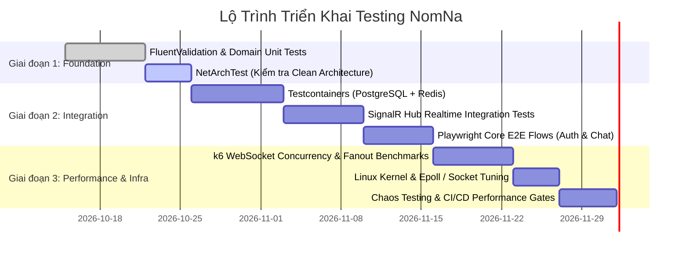
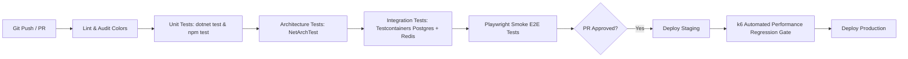

# 🗺️ Lộ Trình Triển Khai Kiểm Thử Toàn Diện (Testing Roadmap & Execution Plan) — Dự Án NomNa

> **Mục tiêu:** Xây dựng khung kiểm thử (Testing Framework) công nghiệp từ tầng Unit Test, Integration Test (với Testcontainers thật) đến Performance & Distributed Load Test (với k6 & SignalR WebSockets), phục vụ cho hệ thống NomNa (.NET 9 + Redis + PostgreSQL + React 18).

---

## 1. Tổng Quan Lộ Trình (3-Phase Execution Roadmap)

Lộ trình được thiết kế theo nguyên tắc: **Xây móng vững (Unit & Validation) ➔ Kiểm tra ghép nối thật (Integration & SignalR) ➔ Thử lửa chịu tải & Hạ tầng phân tán (Load, Stress & Chaos).**

---

## 2. Chi Tiết Từng Giai Đoạn (Actionable Milestones)

### Giai Đoạn 1: Móng Vững Chắc (Foundation & Architecture Integrity)
*Mục tiêu: Đảm bảo 100% logic nghiệp vụ cốt lõi và kiến trúc Clean Architecture không bị vi phạm khi có thêm tính năng.*

1. **Unit Test Suite cho Tầng Application & Domain:**
   - [x] **Domain Entities & Bitmask Permissions:** Đã hoàn thành 34 tests kiểm tra bitwise logic (`hasPermission`, `bitwise &`, `bitwise |`, `Administrator bypass`).
   - [ ] **FluentValidation Test Suite:** Bao phủ 100% Command và Query.
     - `CreateServerCommandValidatorTests` (Tên server 2-100 ký tự, icon URL hợp lệ).
     - `SendMessageCommandValidatorTests` (Nội dung không rỗng hoặc phải có file đính kèm, kích thước attachment < 50MB).
     - `SetChannelOverwriteCommandValidatorTests` (Allow & Deny không được trùng bitmask).
   - [ ] **NetArchTest (Architecture Testing):**
     - Đảm bảo `NomNa.Domain` không bao giờ tham chiếu bất kỳ thư viện ngoài nào.
     - Đảm bảo `NomNa.Application` chỉ phụ thuộc vào `NomNa.Domain`.
     - Đảm bảo Controllers trong `NomNa.WebAPI` không inject trực tiếp `DbContext` mà chỉ qua MediatR `ISender`.

2. **Frontend Unit & Hook Tests:**
   - [ ] `usePermissions` hook testing: Xác thực bitmask calculation với BigInt.
   - [ ] `useDmStore` testing: Kiểm tra `upsertDmMessage` (tạo mới hội thoại khi chưa có, tăng unreadCount, đẩy lên đầu mảng).
   - [ ] `Zod Schemas` validation: Login, Register, Server Name, Channel Name.

---

### Giai Đoạn 2: Ghép Nối Hệ Thống Thật (Integration & Realtime Testcontainers)
*Mục tiêu: Không mock Database và Redis bằng InMemory lừa dối. Sử dụng Docker Container thật để phát hiện lỗi migration, locking và event broadcast.*

1. **Hạ tầng Integration Test với `Testcontainers.PostgreSql` & `Testcontainers.Redis`:**
   - Sử dụng `WebApplicationFactory<Program>` khởi chạy Web API in-process.
   - Mỗi test run tự động spin up 1 instance Postgres và 1 instance Redis sạch trong Docker.
   - Tự động chạy EF Core Migrations trên container thật.
   - Sử dụng thư viện `Respawn` để reset database state giữa các test case (< 15ms) thay vì restart container.

2. **SignalR ChatHub Integration Tests:**
   - Dùng `Microsoft.AspNetCore.SignalR.Client` tạo 2 connection song song: `ClientA` và `ClientB`.
   - Test Case: `ClientA` gửi tin nhắn DM cho `ClientB` -> `ClientB` nhận được event `ReceiveMessage` ngay lập tức dù chưa tham gia Group channel.
   - Test Case: `ClientA` vào phòng thoại -> các client khác trong server nhận `UserStatusChanged`.
   - Test Case: Thành viên bị Kick khỏi server -> tự động bị ngắt kết nối khỏi Hub.

3. **E2E Core Flows (Playwright):**
   - Viết 3 kịch bản vàng (Golden Paths):
     1. User A đăng ký ➔ Đăng nhập ➔ Mặc định mở tab Bạn bè (`/channels/@me`).
     2. User A tạo Server "Tech Lead Hub" ➔ Tạo role "Admin" có quyền `ManageChannels` ➔ Tạo kênh `#announcement`.
     3. User A gửi DM cho User B ➔ User B thấy Toast notification ➔ Click "Xem tin nhắn" ➔ URL chuyển sang `/channels/@me/{chatId}`.

---

### Giai Đoạn 3: Thử Lửa Hiệu Năng & Hạ Tầng Phân Tán (Performance, Load & Infra Tuning)
*Mục tiêu: Đưa NomNa lên chuẩn Production, chứng minh khả năng xử lý đồng thời (Concurrency) và chịu tải phân tán.*

1. **Kịch bản Kiểm thử Tải với `k6` (Distributed Load Testing):**
   - **Scenario 1: Concurrency Saturation (C10K WebSocket connections):**
     - Mô phỏng 10,000 người dùng kết nối WebSocket cùng lúc và duy trì ping/pong (heartbeat).
     - Đo lường: Memory RAM tiêu thụ trên mỗi connection (Mục tiêu: < 30KB/connection).
   - **Scenario 2: Message Fanout Burst (Spike Test):**
     - 1,000 users đang cùng trong một Channel văn phòng. 5 users gửi tin nhắn liên tục (10 msgs/sec).
     - Tổng message fanout nhận về: $1,000 \times 10 = 10,000$ messages/sec.
     - Đo lường: Độ trễ P95, P99 (Mục tiêu: P99 < 150ms).
   - **Scenario 3: Soak Test (Endurance Test):**
     - Chạy 2,000 active users liên tục trong 12 giờ.
     - Giám sát: Rò rỉ bộ nhớ (Memory Leak), số lượng Socket mở (`netstat`/`ss`), ThreadPool Starvation.

2. **Tinh chỉnh Hạ tầng Hệ điều hành (Linux OS Kernel Tuning):**
   - Cấu hình file descriptor limits (`ulimit -n 65535`).
   - Tinh chỉnh TCP buffer và port range (`sysctl -p` với `net.ipv4.ip_local_port_range`, `net.ipv4.tcp_tw_reuse`).
   - Giám sát qua Prometheus + Grafana dashboard đo lường: ASP.NET Core ThreadPool Queue, Redis Memory, PostgreSQL Active Connections.

3. **Chaos Testing (Kiểm tra Phục hồi sự cố):**
   - Đột ngột `docker restart redis` trong lúc 1,000 users đang chat ➔ Hệ thống phải tự reconnect và switch fallback mà không sập WebAPI.
   - Giả lập Network Latency 300ms bằng `Toxiproxy` ➔ Đảm bảo UI Frontend có Optimistic Updates hiển thị ngay tin nhắn mà không giật lag.

---

## 3. Ma Trận Test Cases Cốt Lõi (Core Test Matrix)

| Khu Vực Nghiệp Vụ | Loại Test | Kịch Bản Kiểm Thử Cụ Thể | Tiêu Chí Pass (Pass Criteria) |
| :--- | :--- | :--- | :--- |
| **Bitmask Permissions** | Unit Test | User có role `Administrator` thực hiện hành động bị Deny ở channel overwrite | Vẫn thành công do `Administrator` có cờ tối cao bypass mọi overwrite |
| **Bitmask Permissions** | Unit Test | User thường bị Deny `SendMessages` ở Channel Overwrite | Quăng exception `ForbiddenException: Bạn không có quyền gửi tin nhắn` |
| **Direct Message** | Integration | User A gửi DM cho User B khi User B đang ở tab `/channels/@me` | User B nhận tin qua SignalR, snippet hội thoại cập nhật, Toast hiện thị |
| **Presence (On/Off)** | Integration | User B tắt kết nối WebSocket (Disconnect) | Hub broadcast `UserStatusChanged(Offline)`, friendStore & dmStore cập nhật |
| **File Upload S3** | Integration | User upload file 60MB vượt quá giới hạn 50MB | API trả về HTTP 400 Bad Request, không ghi file tạm vào đĩa |
| **Server Concurrency** | Load Test | 5,000 WebSocket connections kết nối đồng thời trong 60 giây | Tỷ lệ lỗi HTTP/WS < 0.1%, CPU WebAPI < 60% |
| **Message Fanout** | Load Test | 100 msgs/s gửi vào 1 kênh có 500 thành viên | P95 End-to-end latency < 100ms, Redis CPU < 30% |
| **Memory Leak** | Soak Test | Duy trì 1,000 CCU chat liên tục trong 6 giờ | RAM WebAPI ổn định phẳng (flatline), không có dốc đi lên liên tục |

---

## 4. Tích Hợp Vào CI/CD Pipeline (GitHub Actions Automation)

- **Pull Request Stage:** Chạy tự động `npm run build`, `dotnet test` (Unit + Architecture tests). Thời gian chạy: `< 2 phút`.
- **Nightly / Pre-release Stage:** Tự động spin up Testcontainers, chạy Integration tests và k6 load test baseline. Nếu P99 vượt quá 200ms ➔ Tự động gắn nhãn `performance-regression` và chặn merge.

---

## 5. Danh Mục Công Cụ & Thư Viện Chuẩn Hóa

| Tầng Kiểm Thử | Thư Viện / Công Cụ | Lý Do Lựa Chọn |
| :--- | :--- | :--- |
| **Unit Test Backend** | `xUnit`, `FluentAssertions`, `Moq` | Chuẩn mực vàng trong hệ sinh thái .NET 9, cú pháp assertion tự nhiên như văn nói. |
| **Architecture Test** | `NetArchTest.Rules` | Ép buộc mã nguồn tuân thủ Clean Architecture, chặn dev khác vô tình phá vỡ quy tắc layer. |
| **Integration Test** | `Testcontainers`, `Respawn` | Chạy database thật trong Docker disposable container, không bị sai lệch hành vi như SQLite/InMemory. |
| **Unit Test Frontend** | `Vitest`, `@testing-library/react` | Nhanh hơn Jest gấp 10 lần, tương thích native với Vite và TypeScript. |
| **E2E Browser Test** | `Playwright` | Hỗ trợ Chromium/WebKit/Firefox, tự động wait element, chụp video khi test fail, chạy song song cực nhanh. |
| **Performance / Load** | `k6` (Grafana k6) | Viết kịch bản bằng JavaScript/TypeScript, engine Go siêu nhẹ, hỗ trợ native WebSocket và đo lường P99 xuất sắc. |
| **Hạ Tầng Giám Sát** | `Prometheus` + `Grafana` + `dotnet-counters` | Đo đạc GC Gen0/1/2 pauses, ThreadPool queue length, Active TCP Sockets real-time. |
